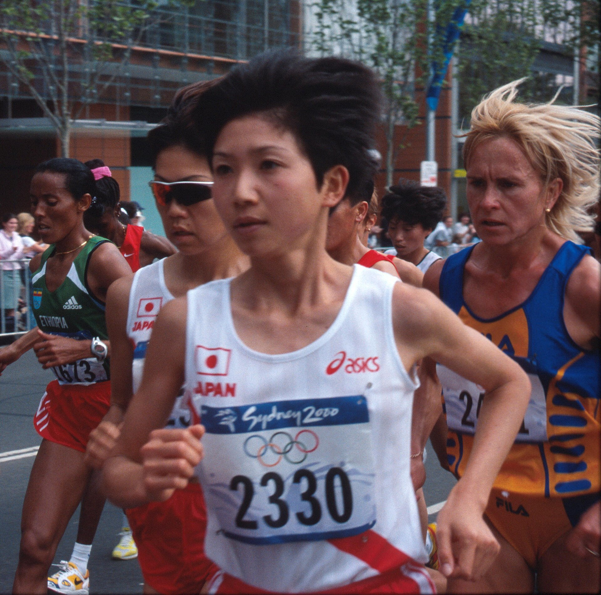
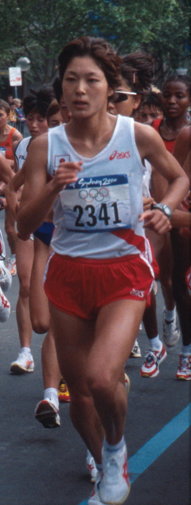
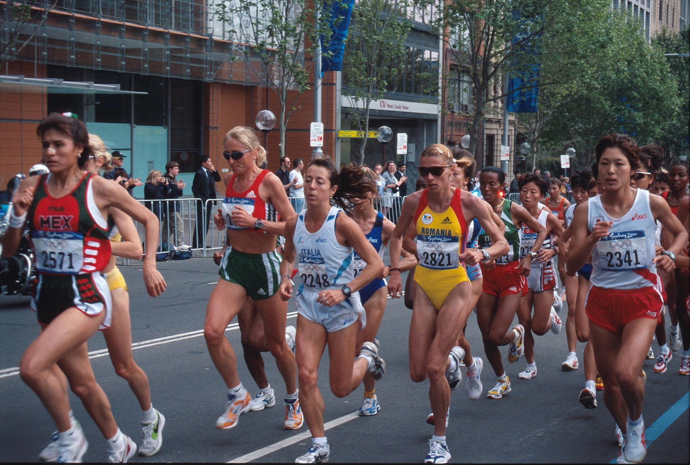

26年前の今日、2000年10月30日。シドニーオリンピックの女子マラソンで金メダルを獲得した高橋尚子選手に、国民栄誉賞が授与されました。女子スポーツ選手への授与は史上初めてのことでした。日本中を明るい笑顔で包み込んだ快挙から、四半世紀以上の月日が流れています。

## 岐阜から始まった挑戦と恩師・小出監督との出会い

岐阜県岐阜市出身の高橋尚子選手は、中学から陸上競技を始めました。県立岐阜商業高校時代は800mの選手で全国インターハイに出場したものの予選敗退に終わるなど、当初から全国区のスターだったわけではありませんでした。大阪学院大学に進学後、日本学生種目別選手権の1500mで優勝するなど中距離走で頭角を現します。

大学卒業を控えた時期、実業団への進路に悩んでいた高橋選手は、高校時代の恩師の助言を受け、名将・小出義雄監督が率いるリクルートの門を叩きました。一度は採用方針の違いから断られかけましたが、熱意が通じて合宿に参加。その走りを見た小出監督が一目で素質を見抜き、契約社員としてチームへ加わることになりました。ここから二人三脚の快進撃が幕を開けます。

## 世界を驚かせたバンコクの激走と五輪切符

実業団入り後、積水化学への移籍を経て本格的にマラソンへ転向した高橋選手は、1998年3月の名古屋国際女子マラソンで初優勝を飾ります。当時の日本最高記録となる2時間25分48秒をマークし、一躍注目を浴びました。

さらに同年12月のバンコクアジア大会では、気温30度を超える過酷な気象条件の中、スタート直後から独走態勢を築きます。2位に13分以上の大差をつけ、2時間21分47秒のアジア最高記録（当時）で優勝。世界記録に迫る圧倒的な走りで、2000年シドニーオリンピックの優勝候補筆頭として世界に名を知られる存在となりました。

その後、怪我や体調不良などの試練に見舞われながらも、2000年3月の名古屋国際女子マラソンで2時間22分19秒の大会新記録で優勝し、堂々とシドニー五輪代表の切符を手にしました。

*Ari Ichihashi Women's Marathon Sydney Olympics 2000 042812 — 写真: Eva Rodriguez Riestra – a staff member of the City of Sydney / CC BY 4.0*

## シドニーの34キロ地点、投げ飛ばされたサングラス

2000年9月24日、シドニーオリンピック女子マラソン本番。高橋選手は18キロ付近から先頭集団を抜け出し、レースの主導権を握りました。26キロ付近からはルーマニアのリディア・シモン選手との熾烈なデッドヒートとなります。

緊迫した一騎打ちが動いたのは34キロ過ぎでした。高橋選手はかけていたサングラスを沿道にいた父親めがけて投げ飛ばすと同時に、猛烈なスパートを仕掛けました。シモン選手を突き放し、スタジアムに入ってもリードを保ち続けた高橋選手は、両手を広げて笑顔でフィニッシュラインを駆け抜けました。

記録は2時間23分14秒。ジョーン・ベノイト選手が持っていた記録を16年ぶりに塗り替えるオリンピック最高記録（当時）でした。ゴール直後の弾けるような笑顔は、世界中のファンの胸に深く刻まれました。

*Eri Yamaguchi in the Women's Marathon, Sydney Olympics 2000 042811 (cropped) — 写真: Eva Rodriguez Riestra, City of Sydney Council / CC BY 4.0*

## 日本陸上界64年ぶりの金メダル、そして国民栄誉賞へ

高橋選手の金メダル獲得は、日本陸上界にとって1936年ベルリン五輪の孫基禎選手以来、実に64年ぶりとなる戦後初の快挙でした。そして、日本の女子陸上競技選手としては歴史上初めて手にしたオリンピックの金メダルでした。

この偉業を称え、大会からおよそ1か月後の2000年10月30日、内閣総理大臣官邸で国民栄誉賞の授与式が行われました。女性スポーツ選手として初めての受賞であり、その明るい人柄と爽やかな走りは、多くの国民に深い感動と勇気を与えました。

*Female Athletes in the Women's Marathon, Sydney Olympics 2000 042811 — 写真: Eva Rodriguez Riestra, City of Sydney Council / CC BY 4.0*

## 女子初の2時間20分突破と「Qちゃん」の足跡

国民栄誉賞を受賞した翌年、高橋選手はさらなる高みへ到達します。2001年9月30日のベルリンマラソンに出場した高橋選手は、女子として史上初めて2時間20分の壁を突破する2時間19分46秒の世界最高記録を樹立して優勝しました。オリンピックの金メダリストが女子マラソンの世界記録を更新したのは、歴史上高橋選手ただ一人です。

現役引退後も、解説者や指導者として活動する傍ら、ランニング教室や途上国へのシューズ寄贈プロジェクトなど、スポーツを通じた社会貢献を続けています。「Qちゃん」の愛称で親しまれた彼女の激走と栄誉は、日本のスポーツ史において今もまばゆい光を放ち続けています。

### 参考資料

- <https://ja.wikipedia.org/wiki/%E9%AB%98%E6%A9%8B%E5%B0%9A%E5%AD%90>
- <https://commons.wikimedia.org/wiki/File:Alina_Gherasim_in_the_Women%27s_Marathon,_Sydney_Olympics_2000_042811_(cropped).jpg>
- <https://commons.wikimedia.org/wiki/File:Ari_Ichihashi_Women%27s_Marathon_Sydney_Olympics_2000_042812.jpg>
- <https://commons.wikimedia.org/wiki/File:Eri_Yamaguchi_in_the_Women%27s_Marathon,_Sydney_Olympics_2000_042811_(cropped).jpg>
- <https://commons.wikimedia.org/wiki/File:Female_Athletes_in_the_Women%27s_Marathon,_Sydney_Olympics_2000_042811.jpg>
