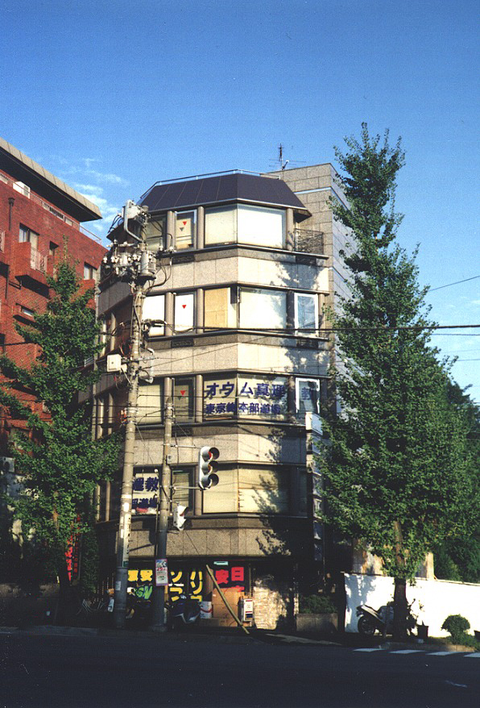
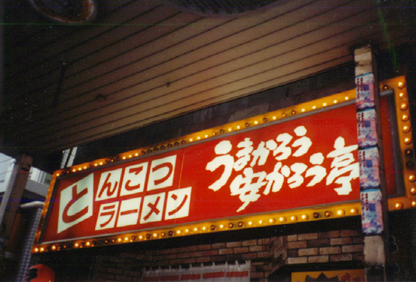
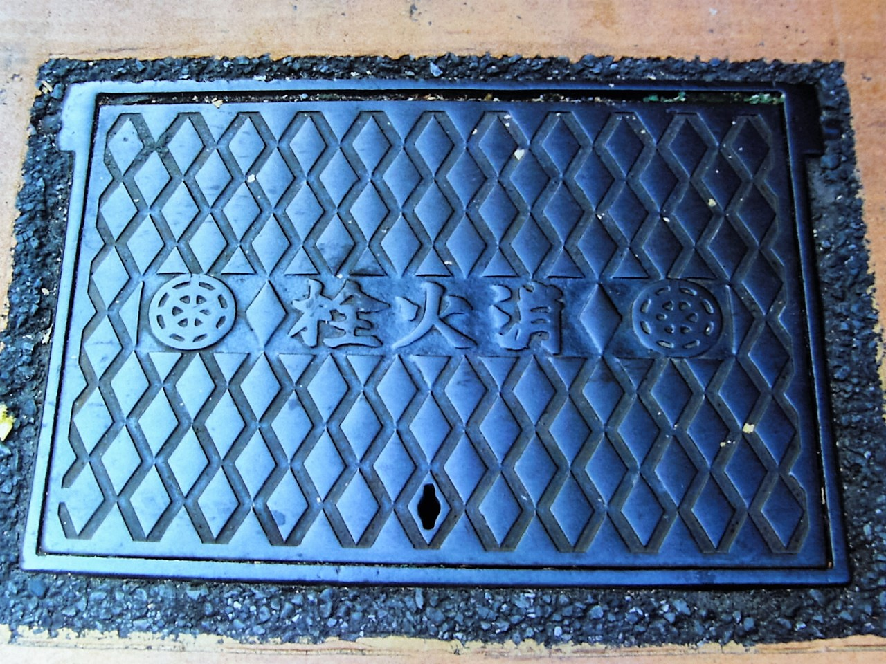

31年前の今日、1995年10月30日。東京地方裁判所は、無差別テロや数々の凶悪犯罪を引き起こしたオウム真理教に対し、解散命令を下しました。同年3月に発生した地下鉄サリン事件から約7か月。宗教を隠れ蓑にして社会を震撼させ続けた教団に対し、司法が明確な断を下した瞬間でした。

## ヨーガ教室から始まった教団の原点

オウム真理教の原点は、麻原彰晃こと松本智津夫が1984年2月に東京都渋谷区で立ち上げたヨーガ教室「オウムの会」にありました。それ以前の松本は、千葉県船橋市で鍼灸院や漢方薬局を営みながら、無許可医薬品の販売など薬事法違反で逮捕される曲折を経ていました。

やがて「オウム神仙の会」を経て、1987年に宗教団体「オウム真理教」を設立します。雑誌に空中浮揚の瞬間と称する写真を掲載するなどして若者の関心を集め、1989年には宗教法人の認証を受けるに至りました。

## 密室の恐怖支配と加速する凶行

教団は若者や高学歴層を取り込む一方で、出家信者に全財産の布施を要求し、過激な修行や絶対服従を強いました。脱会を希望する信者を拘束して殺害するなど内部で激しい恐怖政治を敷き、判明しているだけでも複数名がリンチなどで命を奪われました。

さらに教団を追及していた坂本弁護士一家を殺害するなど、敵対する外部の人間を「ポア」と称して排除する動きを強めます。1990年の第39回衆議院議員総選挙に真理党として挑むも惨敗すると、社会への敵対心はいっそう先鋭化し、国家転覆計画すら企てるようになりました。

*1994年の資料 — 写真: Hasec / Public domain*

## 毒ガスサリンと地下鉄での無差別テロ

教団は自動小銃や爆弾のほか、化学兵器や生物兵器の密造にまで手を染めました。ナチスですら使用を躊躇したとされる猛毒のサリンを用い、長野県での松本サリン事件、そして1995年3月20日には地下鉄サリン事件を引き起こします。

平時の大都市の通勤時間帯を狙い、複数箇所に強力な化学兵器を散布した同時多発テロは、戦後日本の治安神話を打ち砕き、世界中に計り知れない衝撃を与えました。警察の強制捜査が進む中、麻原をはじめとする教団幹部が次々と逮捕されていきました。

*Umakarouyasukarou-Tei Kameido — 写真: Yanagi774 / Public domain*

## 司法のメスと法人格の剥奪

1995年10月30日、東京地方裁判所は教団に対し、解散を命じる決定を下しました。信教の自由を盾にして凶悪犯罪を重ねてきた組織に対し、司法が法人格を取り消す重い判断を下したのです。

教団側は不服として抗告を申し立てたものの退けられ、翌1996年1月に正式に宗教法人としての資格を失いました。さらに2000年2月には破産宣告を受け、組織としての「オウム真理教」の名称は消滅することになりました。

*Fire.hydrant.cover.in.yoyohata.tokyo — 写真: 栗原 岳 / CC BY-SA 4.0*

## 世界が注視したテロ組織認定と死刑執行

事件の衝撃は日本国内にとどまりませんでした。アメリカ政府、欧州連合（EU）、オーストラリア、ロシアなど各国・地域がオウム真理教をテロ組織として認定し、活動を禁止しました。

教団が引き起こした一連の事件をめぐる裁判は長期にわたり、2018年7月、麻原彰晃を含む元教団幹部ら13人の死刑が執行されました。未曾有の無差別テロを引き起こした首謀者たちへの刑事手続きは、事件から23年を経て一つの節目を迎えました。

## 消えぬ傷痕と今も続く監視

法人が解散し破産した後も、教団の信者らは「アレフ（Aleph）」を設立して活動を継続しました。その後も「ひかりの輪」や「山田らの集団」といった分派へと分裂を繰り返しています。

公安調査庁は団体規制法に基づき、現在も後継団体の動向に厳しい監視を続けています。1995年10月30日に下された解散命令は、宗教の名を借りた未曾有の犯罪組織に対し、社会が毅然とした拒絶を突きつけた決定的な転換点でした。

### 参考資料

- <https://ja.wikipedia.org/wiki/10%E6%9C%8830%E6%97%A5>
- <https://commons.wikimedia.org/wiki/File:Emergency_personnel_respond_to_the_Tokyo_subway_sarin_attack.png>
- <https://commons.wikimedia.org/wiki/File:Aum-MinamiAoyama.jpg>
- <https://commons.wikimedia.org/wiki/File:Umakarouyasukarou-Tei_Kameido.jpg>
- <https://commons.wikimedia.org/wiki/File:Fire.hydrant.cover.in.yoyohata.tokyo.jpg>
