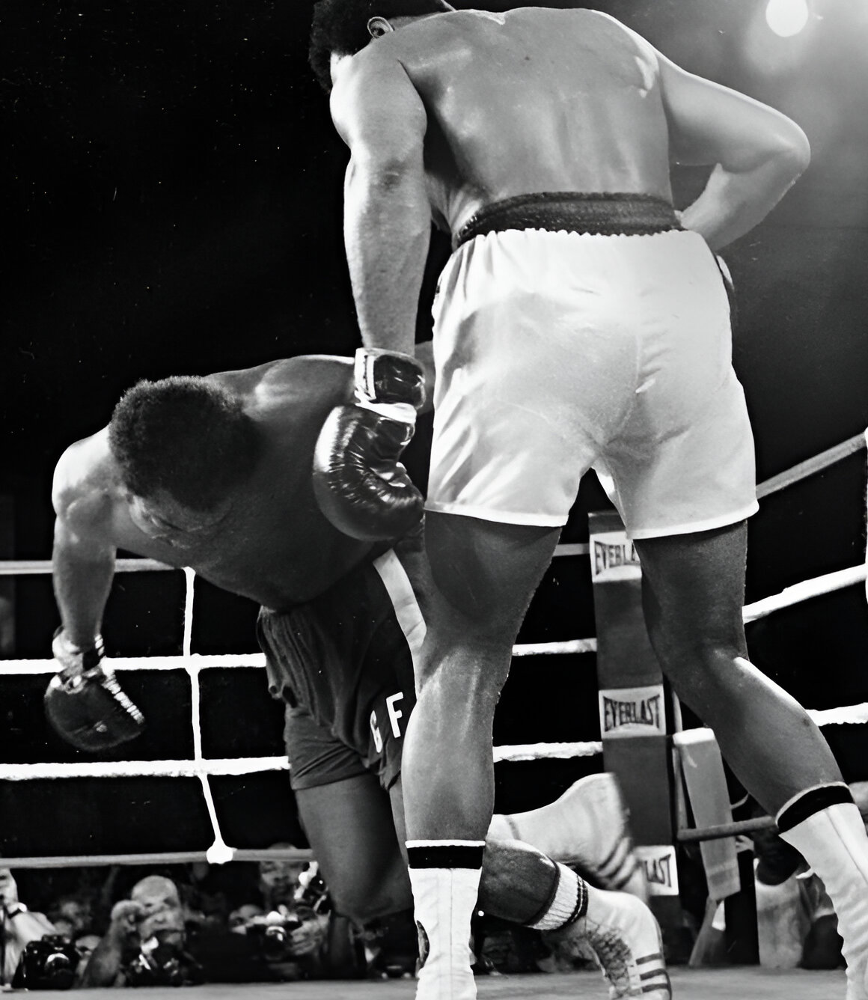
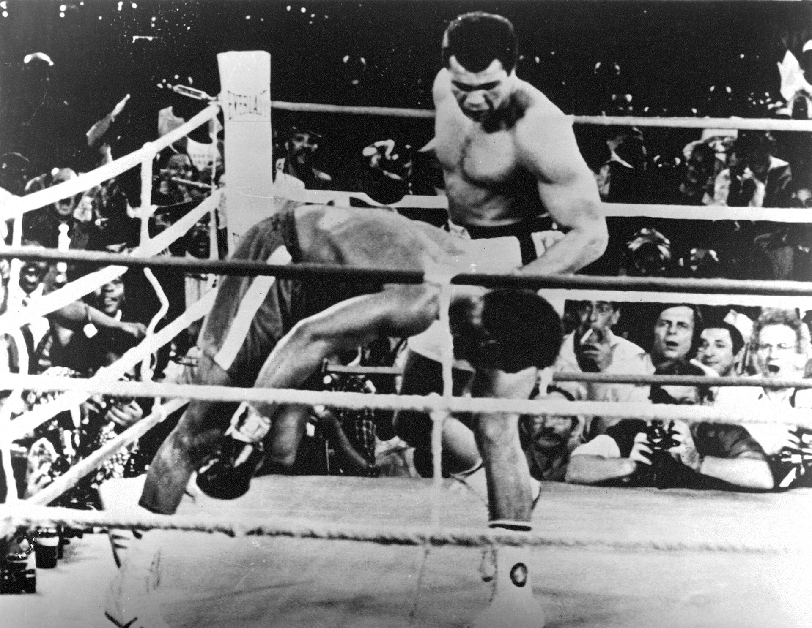
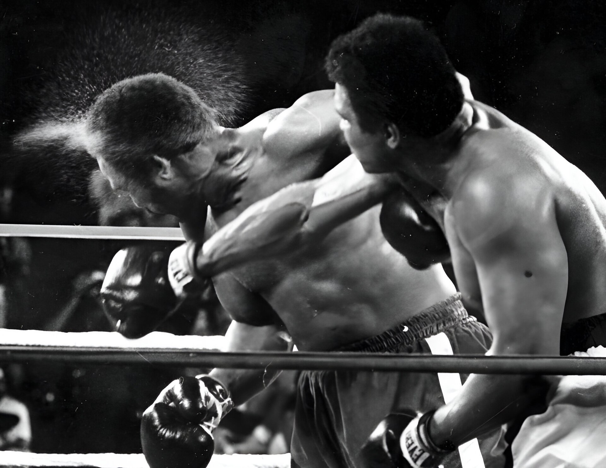

52年前の今日、1974年10月30日。アフリカのザイール共和国の首都キンシャサで、プロボクシングの元世界王者モハメド・アリ選手が、無敗の王者ジョージ・フォアマン選手を8回KOで破り、世界ヘビー級王座を奪回しました。兵役拒否による王座剥奪から7年、世界中を驚嘆させた伝説の一戦は、のちに「キンシャサの奇跡」として語り継がれることになります。

## 王座剥奪の苦難と若き怪物の台頭

1960年のローマ五輪で金メダルを獲得し、プロ転向後も無敗のまま世界ヘビー級王座に君臨していたアリ選手。しかし1967年、ベトナム戦争への徴兵を拒否したことで王座を剥奪され、3年7カ月もの長期にわたりリングから遠ざけられました。復帰後もジョー・フレージャー選手やケン・ノートン選手に苦杯を喫するなど、かつての圧倒的なフットワークには陰りが見え始めていました。

一方、王者のフォアマン選手は当時25歳。1968年のメキシコ五輪で金メダルを獲得したのちプロへ進み、40戦40勝37KOという驚異的な戦績を誇っていました。アリ選手を破ったフレージャー選手をわずか2ラウンドで6度倒して王座を奪取し、24戦連続KO勝ちを継続中。「象をも倒す」と恐れられたパンチ力に対し、32歳のアリ選手が勝てる見込みは極めて薄いとされ、事前の予想は4対1でフォアマン選手有利に傾いていました。

## アフリカの地で実現した異例のメガマッチ

この大一番を仕掛けたのは、のちに大物プロモーターとなるドン・キング氏でした。両者に当時のスポーツ界最高額となる500万ドルずつの報酬を提示したものの、米国内で資金を用立てられず、開催地を海外へ求めました。白羽の矢が立ったのが、モブツ・セセ・セコ大統領が支配するザイールでした。大統領は国威発揚を狙い、リビアの指導者ムアンマル・アル＝カッザーフィー氏が主要スポンサーとして費用を負担することで舞台が整いました。

当初は9月25日に予定されていたものの、試合直前のスパーリングでフォアマン選手が右まぶたを11針縫う負傷を負い、期日は5週間延期されました。試合に先立ちジェームス・ブラウン氏やB.B.キング氏らが出演する大規模な音楽祭が開催され、現地は熱狂的な祝祭ムードに包まれました。

*1974年の資料 — 写真: Associated Press / Public domain*

## 捨て身の奇策「ロープ・ア・ドープ」

世界60カ国へ衛星生中継するため、試合開始時刻は米国の夜に合わせてザイール時間10月30日の午前4時に設定されました。会場となったキンシャサの「5月20日スタジアム」には6万人もの観客が詰めかけました。

ゴングが鳴ると、アリ選手は足を使って距離をとる大方の予想を裏切る動きに出ます。第2ラウンドから自らロープ際に下がり、体を預けて貝のように両腕でガードを固めました。サンドバッグのようにフォアマン選手の強打を浴び続け、クリンチの合間には「それで精一杯なのかい、ジョージ？」と耳元でささやき挑発を重ねました。自陣のトレーナーであるアンジェロ・ダンディ氏さえ「気が狂ったのか」と叫ぶほどの危険な戦法は、相手のスタミナを枯渇させる計算された奇策「ロープ・ア・ドープ」でした。

*1974年の資料 — 写真: Richard Drew / Public domain*

## 第8ラウンド残り16秒の劇的KO

猛暑のなか大振りのパンチを放ち続けたフォアマン選手は、第6ラウンドを過ぎると目に見えて疲労の色を濃くし、足元が重くなっていきました。アリ選手の巧みなクリンチと守備の前に攻め手を欠き、強打の威力は急速に失われていきます。

そして迎えた第8ラウンド。残り16秒の場面でフォアマン選手がバランスを崩した瞬間、アリ選手は素早く体を入れ替えてロープ際を脱出しました。振り返った王者の顔面へ、右、左、右、左、右と正確無比な5連打を浴びせます。最後の右ストレートが顎を打ち抜くと、無敗の怪物は大きくふらつき、リングに崩れ落ちました。レフェリーが10カウントを数え上げ、アリ選手が7年ぶりの王座奪還を成し遂げた瞬間、スタジアムは割れんばかりの歓声に包まれました。

*1974年の資料 — 写真: Ed Kolenovsky / Public domain*

## 日本に轟いた「アリ・ボマ・イェ」の響き

この歴史的一戦は、日本のスポーツ界にも大きな影響を及ぼしました。日本では当日午後1時よりNETテレビ（現・テレビ朝日）の特別番組で衛星生中継され、夜には再放送も行われて列島を沸かせました。

さらに、キンシャサの観客がアリ選手を応援するために叫び続けた現地の言葉「アーリッ・ボマ・イェ（アリ、奴を倒せ）」は、のちにアリ選手の自伝映画のテーマ曲として楽曲化されました。1976年に東京でアリ選手と「格闘技世界一決定戦」を戦ったプロレスラーのアントニオ猪木さんは、アリ選手本人からこの曲を贈られ、「炎のファイター」として自身の入場曲に使用。日本中で誰もが口ずさむ伝説のフレーズとなりました。

## 半世紀を超えて今も語り継がれる奇跡

この試合の記録映像をもとに製作されたドキュメンタリー映画『モハメド・アリ かけがえのない日々』は、第69回アカデミー賞の長編ドキュメンタリー映画賞を受賞し、授賞式の壇上にはアリ選手とフォアマン選手が仲良く並び立ちました。

兵役拒否による苦難の空白期を乗り越え、戦前の圧倒的不利を自らの頭脳と鋼の意志で覆したモハメド・アリ選手。ジャングルの決闘と銘打たれた一戦から52年が経過した今も、キンシャサのリングで見せた不屈の逆転劇は、ボクシング史に燦然と輝く最高のドラマとして世界中の人々の記憶に生き続けています。

### 参考資料

- <https://ja.wikipedia.org/wiki/10%E6%9C%8830%E6%97%A5>
- <https://commons.wikimedia.org/wiki/File:Foreman_tira_golpe_a_clay.jpg>
- <https://commons.wikimedia.org/wiki/File:Foreman_cae.jpg>
- <https://commons.wikimedia.org/wiki/File:Ali_knockout_foreman.jpg>
- <https://commons.wikimedia.org/wiki/File:Muhammad_Ali%27s_right_knocks_perspiration_from_head_of_George_Foreman_in_the_7th_round.jpg>
