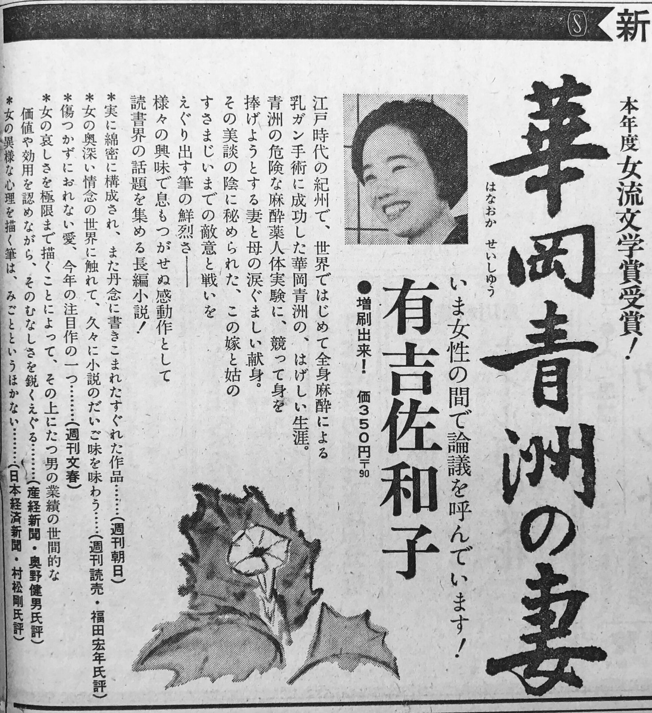
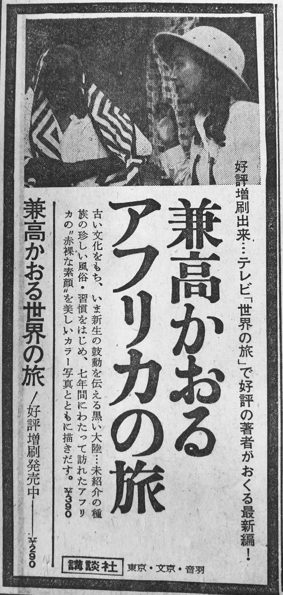
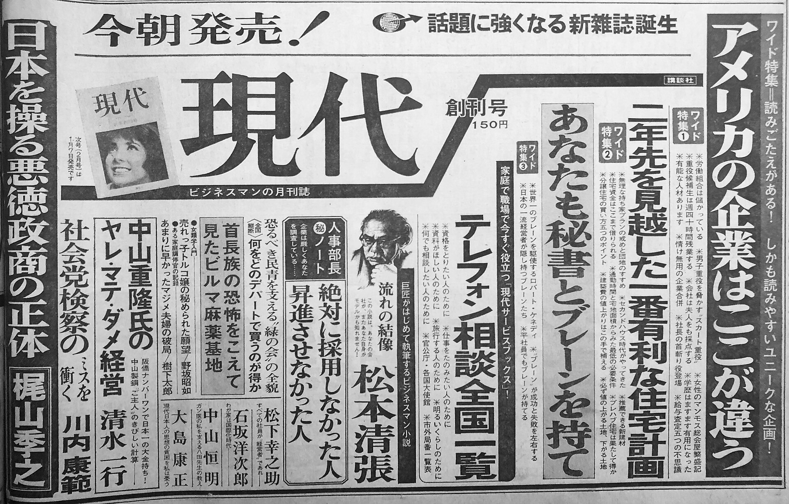

45年前の今日、1981年10月30日。新潮社から写真週刊誌『FOCUS（フォーカス）』が創刊されました。従来の活字中心の週刊誌の常識を覆し、迫力ある写真そのものを主役にした紙面構成は、当時の読者に鮮烈な衝撃を与えました。この創刊を皮切りに、日本の出版界は写真週刊誌の黄金期と熾烈な過当競争の時代へと突き進むことになります。

## 活字から写真へ――1981年10月30日の衝撃

1981年10月30日に産声を上げた『FOCUS』は、日本における「写真週刊誌」の第1号でした。それまでの雑誌は記事の文章が主役であり、写真は文章を補佐する役割にとどまるものがほとんどでした。しかし『FOCUS』は、誌面の大部分を写真で埋め尽くし、短いキャプションだけで出来事を伝えるという徹底したビジュアル路線を打ち出しました。

事件や事故の決定的瞬間から、街で見かける世相の風俗、さらには動物の微笑ましい話題まで、多種多様な場面が一枚の写真として切り取られました。テレビの普及や活字離れが進みつつあった当時の大衆、特に若い世代にとって、ひと目で状況が把握できるこの手軽さと刺激は熱狂的な支持を集めることになりました。

## 従来のグラフ誌との違いと読者の熱狂

『FOCUS』以前にも、新聞社が発行する『アサヒグラフ』や『毎日グラフ』といった写真を主体にした定期刊行物は存在していました。しかし、それらは新聞報道に準じた極めて硬派な内容であり、ベトナム戦争の惨状などを深く掘り下げる社会派の特集が中心でした。

対する『FOCUS』は、大衆の好奇心に直接訴えかける内容を大胆に盛り込みました。普段は見ることのできない芸能人の素顔や舞台裏、社会を揺るがす大事件の渦中を捉えた生々しい写真は、従来の報道媒体にはない生々しいリアリティを放っていました。一枚の写真が持つ圧倒的な情報量と説得力は、雑誌ジャーナリズムのあり方を根本から変えていったのです。

*Chunichi1967-04-06-1 — 写真: 中日新聞社 / Public domain*

## 大手出版社が続々参入した過熱の時代

『FOCUS』の大成功を受け、ライバル出版社も黙ってはいませんでした。1984年には講談社が『FRIDAY（フライデー）』を創刊します。翌1985年には『FOCUS』と『FRIDAY』の2誌だけで合計300万部を売り上げるという驚異的な記録を打ち立て、出版界は「FF時代」と呼ばれる活況を迎えました。

さらに1985年には文藝春秋が『Emma（エマ）』を、1986年には小学館がオールカラーの『TOUCH（タッチ）』、光文社が『FLASH（フラッシュ）』を相次いで創刊しました。大手出版社5誌が店頭で激突する「3FET時代」が到来し、駅の売店や街の書店には過激な見出しと衝撃的な写真がずらりと並ぶことになりました。

*Asahi-Shimbun-1967-04-17-1 — 写真: 朝日新聞社 / Public domain*

## 行き過ぎたスクープ合戦と社会的波紋

しかし、発行部数を競い合う過当競争は、次第に取材活動の暴走を招くことになります。他誌に先駆けて決定的な写真をものにしようとするあまり、プライバシーの侵害や違法すれすれの強引な取材が横行し始めました。パパラッチと呼ばれるフリーカメラマンの持ち込み写真への依存も強まり、芸能界や取材対象者との間で深刻な対立が生じます。

1985年の日本航空123便墜落事故報道では、凄惨な現場を伝える役割を果たした一方で遺族への配慮を欠いた取材が批判を受けました。そして1986年12月には、過熱する取材に抗議したビートたけしと軍団員による『FRIDAY』編集部への襲撃事件が発生します。世論は写真週刊誌の行き過ぎた取材手法に厳しい目を向けるようになり、ブームは大きな転換点を迎えました。

*Chunichi1966-12-05-1 — 写真: 中日新聞社 / Public domain*

## ブームの終焉と現在に残るもの

世間の厳しい批判と過当競争の結果、写真週刊誌の部数は急速に落ち込みました。1987年には『Emma』が廃刊となり、1989年には『TOUCH』も休刊へ追い込まれます。そして時代が21世紀を迎えた2001年、ブームの先駆者であった『FOCUS』もついに休刊の時を迎えました。

現在も発行が続けられている写真週刊誌は『FRIDAY』と『FLASH』の2誌のみとなっています。しかし、写真を主役に据えて一瞬の真実を切り取るという表現手法は、その後のスポーツ新聞の紙面構成やワイドショー、さらには現代の視覚的メディア文化に大きな影響を残しました。1981年10月30日に誕生した一冊の雑誌は、昭和の熱狂とメディアの激動を象徴する歴史的な転換点となったのです。

### 参考資料

- <https://ja.wikipedia.org/wiki/10%E6%9C%8830%E6%97%A5>
- <https://commons.wikimedia.org/wiki/File:Chunichi1967-01-05-1.jpg>
- <https://commons.wikimedia.org/wiki/File:Chunichi1967-04-06-1.jpg>
- <https://commons.wikimedia.org/wiki/File:Asahi-Shimbun-1967-04-17-1.jpg>
- <https://commons.wikimedia.org/wiki/File:Chunichi1966-12-05-1.jpg>
