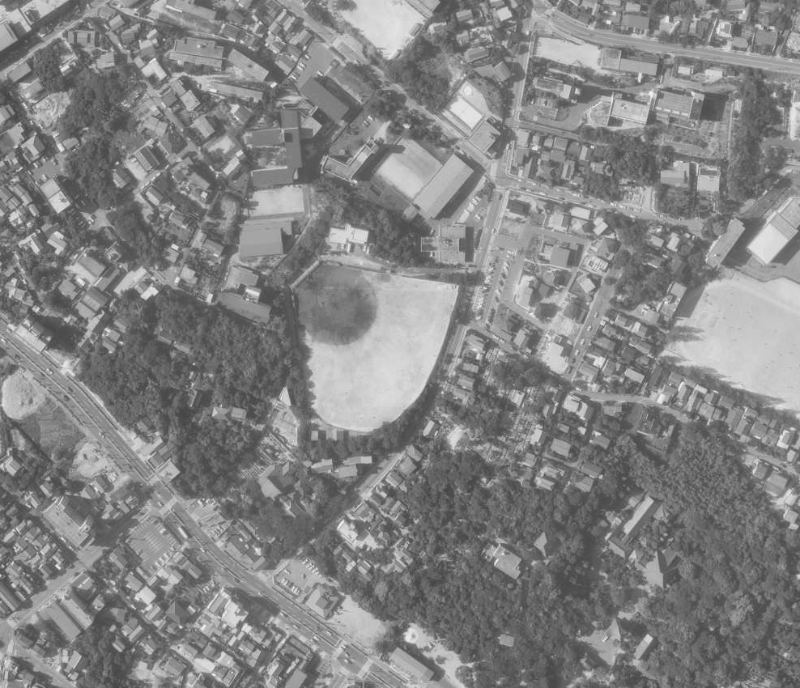
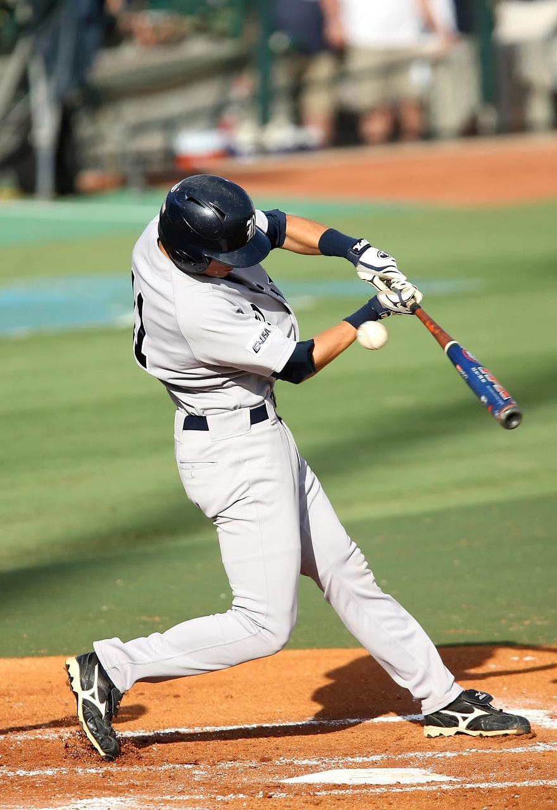
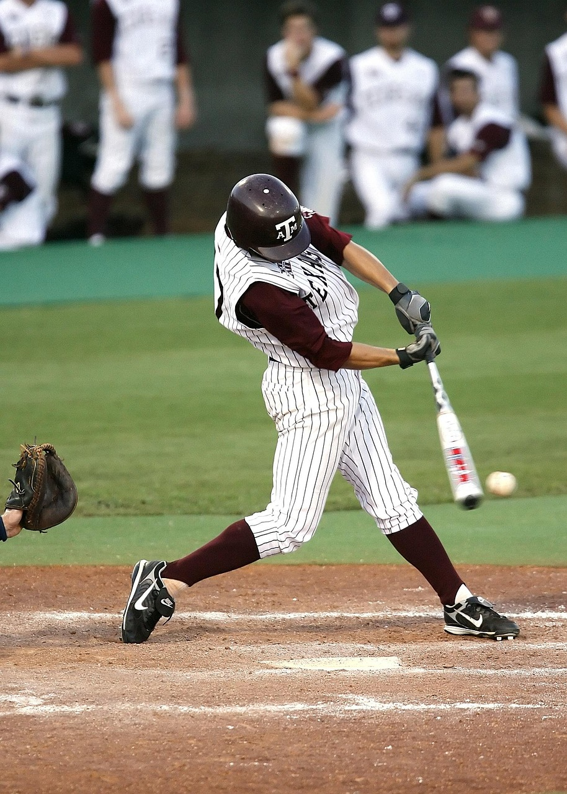

44年前の今日、1982年10月30日。プロ野球の日本シリーズ第6戦で、西武ライオンズが中日ドラゴンズを9対4で破り、球団初となる日本一に輝きました。前身の西鉄ライオンズ時代以来、24年ぶりとなる頂点への到達であり、のちに球界を席巻する西武黄金時代の記念すべき幕開けでした。

## 「野武士軍団」の栄光と、その後の苦難の歳月

ライオンズの歴史は、1950年に福岡で誕生した西鉄クリッパースに始まります。翌年に西鉄ライオンズと改称したチームは、三原脩監督のもとで中西太、豊田泰光、大下弘、稲尾和久といった名選手を擁し、「野武士軍団」として一世を風靡しました。1956年から1958年にかけては日本シリーズ3連覇を成し遂げ、パシフィック・リーグ屈指の強豪として名を馳せました。

しかし、栄光の時代はやがて陰りを見せます。1969年秋に発覚した八百長問題、いわゆる「黒い霧事件」によって主力を失ったチームは深刻な戦力低下に見舞われ、1970年からは3年連続で最下位に沈みました。経営難に陥った球団は西鉄の手を離れ、太平洋クラブライオンズ、クラウンライターライオンズと親会社を変えながら存続を模索する苦難の時代が続きました。

## 所沢への移転と新生「西武ライオンズ」の船出

転機が訪れたのは1978年の秋でした。国土計画を率いる西武グループによって球団が買収され、翌1979年から本拠地を福岡から埼玉県所沢市へと移転、「西武ライオンズ」として再出発を切りました。手塚治虫のアニメ作品をモチーフにした白いレオのマークと鮮やかなライオンズブルーのユニフォームは、新時代の到来を強く印象づけました。

しかし、戦力面の立て直しは容易ではありませんでした。所沢元年の1979年は前期・後期ともに苦戦を強いられ、年間最下位に終わります。続く1980年と1981年も4位にとどまり、強豪への道は険しいものと思われていました。

*事件当時の写真ではありません · 1978年 — 写真: 国土地理院 / Attribution*

## 広岡達朗新監督の就任と徹底した意識改革

チームが劇的な変貌を遂げたのは、1982年に広岡達朗監督が就任してからでした。ヤクルトスワローズを球団史上初の日本一に導いた実績を持つ広岡監督は、妥協を許さない管理野球と徹底的な基本プレーの重視を掲げてチーム改革に着手しました。

広岡監督は技術指導にとどまらず、選手の体調管理や食事改善にも厳格な姿勢で臨みました。ベテランの東尾修投手や田淵幸一選手らチームの看板選手たちもこの方針のもとで結束し、チームは着実に勝ち星を積み重ねていきました。同年のパ・リーグ前期優勝を果たすと、プレーオフでも日本ハムファイターズを退け、西武として初のリーグ優勝を手に入れたのです。

*当日の写真ではありません · 事件当時の写真ではありません · イメージ写真 — 写真: KeithJJ / Pixabay Content License*

## 第6戦、ナゴヤ球場での鮮やかな勝利

迎えた日本シリーズの相手は、セ・リーグを制した近藤貞雄監督率いる中日ドラゴンズでした。所沢の西武ライオンズ球場と愛知県のナゴヤ球場を行き来しながら繰り広げられた熱戦は、第5戦を終えて西武が3勝2敗と王手をかけます。

そして1982年10月30日、ナゴヤ球場で行われた運命の第6戦。西武打線は中日投手陣をとらえて得点を重ね、試合の主導権を完全に掌握しました。投げては投手陣が中日の反撃を退け、最終的に9対4でゲームセットの瞬間を迎えました。所沢へ移転してわずか4年目、西武ライオンズとして球団創設以来初となる日本一の称号を手にした瞬間でした。

*当日の写真ではありません · 事件当時の写真ではありません · イメージ写真 — 写真: KeithJJ / Pixabay Content License*

## 敵地に舞った胴上げと、24年ぶりの歓喜

秋晴れの夜空の下、敵地ナゴヤ球場のグラウンドで広岡監督の体が歓喜の輪の中で高く宙を舞いました。前身の西鉄ライオンズが1958年に巨人を破って日本一となって以来、実に24年の歳月を経て再びパ・リーグの頂点、そして日本プロ野球の頂点へと返り咲いたのです。

この勝利は、福岡時代からの激動と苦境を耐え抜いた球団関係者にとっても、新天地所沢でチームを温かく迎え入れた新たなファンにとっても、忘れられない歓喜の瞬間となりました。手堅い守備と機動力を軸にした野球は、パ・リーグの新たな盟主の誕生を全国に告げるものでした。

## 「常勝西武」黄金時代への確かな第一歩

1982年の初制覇は、単なる一度きりの栄冠ではありませんでした。翌1983年にも巨人を破って日本シリーズ連覇を果たすと、その後も監督や選手が世代交代を重ねながら、1980年代後半から1990年代前半にかけて圧倒的な強さを誇る「常勝黄金時代」を築き上げることになります。

秋のナゴヤ球場で刻まれた9対4というスコアは、新時代の幕開けを告げる号砲でした。所沢の丘に響き渡った歓声と、レオ軍団が打ち立てた不滅の足跡は、今も多くのプロ野球ファンの記憶に鮮やかに刻まれています。

### 参考資料

- <https://ja.wikipedia.org/wiki/1982%E5%B9%B4%E3%81%AE%E6%97%A5%E6%9C%AC%E3%82%B7%E3%83%AA%E3%83%BC%E3%82%BA>
- <https://commons.wikimedia.org/wiki/File:Nagoya_Baseball_Stadium-1977.jpg>
- <https://commons.wikimedia.org/wiki/File:Yagoto_baseball_stadium_1978.jpg>
- <https://pixabay.com/photos/baseball-baseball-player-batter-1462413/>
- <https://pixabay.com/photos/baseball-batter-hitting-sport-1606943/>
