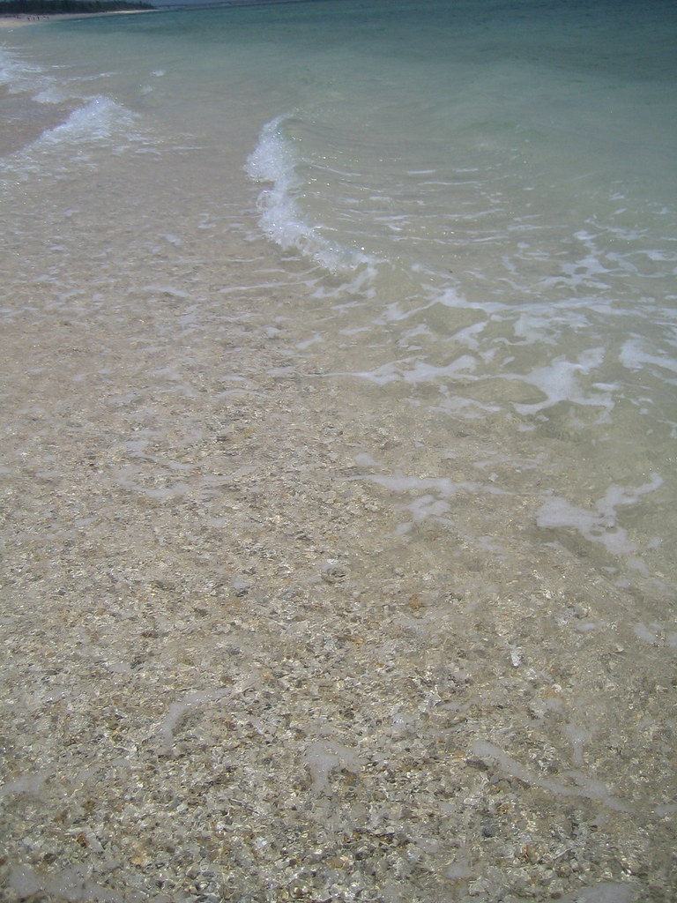
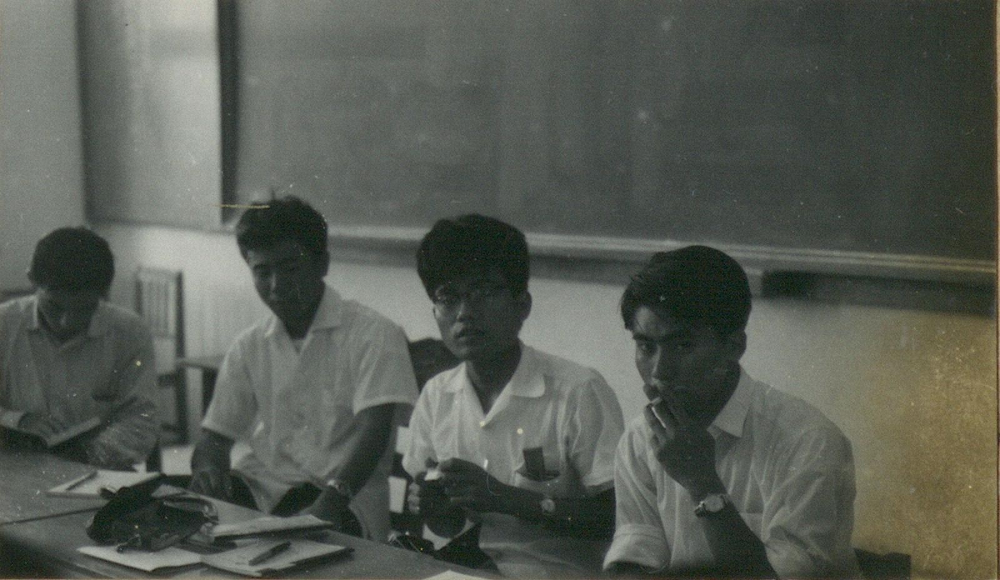
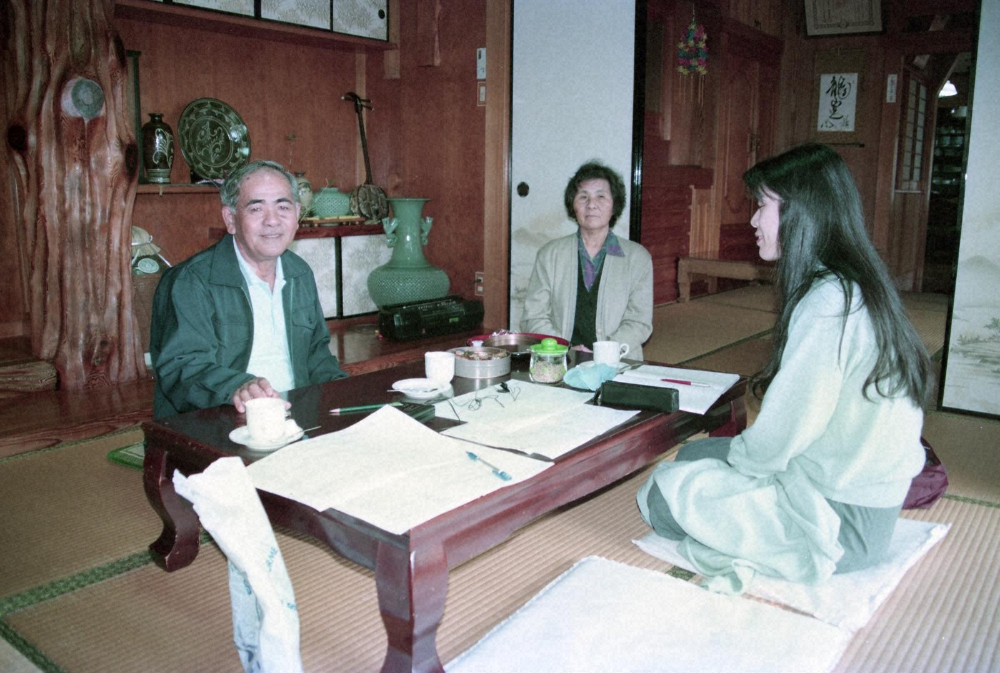

1993年10月30日、沖縄県は農業害虫「ウリミバエ」の県内全域での根絶を宣言しました。体長わずか7〜8ミリの小さな虫がもたらした農業への打撃は計り知れず、沖縄産のウリ類は本土への持ち出しが法律で厳しく禁止されていました。その害虫を駆除するために投じられたのは、人工的に繁殖させた625億匹ものハエを野外に放つという驚くべき国家作戦でした。

## わずか8ミリの脅威、広がる侵入被害

ウリミバエは東南アジア原産のミバエ科の昆虫で、成虫の体長は7〜8ミリほどです。メスは腹部先端の鋭い産卵管を使い、果実の皮を突き破って中に卵を産み付けます。孵化した幼虫が内部を食い荒らすため、スイカ、キュウリ、トマト、ピーマン、そしてゴーヤー（ツルレイシ）といった野菜や果物が腐敗して出荷できなくなります。

日本国内では1919年に八重山列島で初めて確認されました。その後、1929年に宮古列島、1970年に久米島、1972年には沖縄本島、1973年に与論島や沖永良部島、1974年に奄美群島、1977年に大東諸島へと分布が拡大しました。日本生態学会が「日本の侵略的外来種ワースト100」に選定するほどの猛威を振るい、植物防疫法によって発生地域からの寄生植物の移動が厳しく制限される事態となりました。

## 「不妊虫放飼法」という前例なき挑戦

農産物を本土に出荷できず苦しむ農家を救うため、農林水産省や沖縄県が採用したのが「不妊虫放飼法（ふにんちゅうほうしほう）」でした。これは、羽化の2日前にガンマ線を照射して繁殖能力をなくした個体を人工的に大量生産し、野外へ大量に放つ防除法です。野生のメスがこの不妊のオスと交尾すると卵が孵化せず、世代を重ねるごとに野生の個体数が激減していきます。

この技術は1963年にマリアナ諸島で確立されたものの、その後世界50以上の地域で試みられながら一度も成功していませんでした。成否を分けたのは、野生のハエが島に何匹いるかを正確に把握することでした。研究陣は印をつけたハエを放してトラップへの捕獲割合を調べる「マーキング法」を導入し、実験地に選ばれた久米島で約500万匹、沖縄県全体では最終的に3億匹が生息しているという実態を突き止めたのです。

*EEF Beach at Kume-island OKINAWA — 写真: veroyama / CC BY-SA 2.0*

## 週に1億匹を生産、空からハエを撒く日々

作戦を実行に移すため、石垣島の施設から始まった不妊虫の生産は、後に週1億〜2億匹を生産できる巨大工場へと発展しました。羽化直前の蛹（さなぎ）や成虫をいかに効率よく全島へ行き渡らせるかが最大の課題でした。

久米島ではバケツに入れた蛹を地上で羽化させる方法がとられましたが、広大な沖縄本島や周辺離島では、米軍基地の敷地内も含めてヘリコプターなどを使い、週に250万〜400万匹が空から放たれました。同様に被害を受けていた鹿児島県の奄美群島でも、地上散布に加え山間部へのヘリコプター放飼が実施され、徹底した駆除が進められました。

*琉大民俗研究クラブ　1960年5月、6月 — 写真: 南城市教育委員会 / CC BY (Japan Search)*

## 離島から順に勝ち取った完全勝利

地道で膨大な作業は確実に実を結びました。まず1978年に久米島で根絶が確認され、1987年には宮古群島、そして沖縄群島でも根絶が達成されて1990年に記念式典が開かれました。

先行して防除を進めていた奄美群島でも、喜界島が1985年、奄美大島が1987年、南部3島が1989年に発生地域指定を解除されていました。そして1993年10月30日、沖縄県全域での根絶が正式に確認され、高らかに「沖縄県ウリミバエ根絶宣言」が発表されたのです。累計で放たれた虫の数は625億匹、総事業費は204億円に達しました。

*佐敷町史関係 — 写真: 南城市教育委員会 / CC BY (Japan Search)*

## 全国の食卓へ届くようになったゴーヤーの味

根絶宣言が出されたことで、長年本土への持ち出しが禁止されていた沖縄産ゴーヤーの出荷が可能になりました。これが今日、日本全国のスーパーに沖縄産ゴーヤーが並び、ゴーヤーチャンプルーが家庭料理として親しまれるようになった原点です。侵略的外来種ワースト100に選ばれた生物の中で、人間の手によって完全根絶に成功したのは日本国内でウリミバエ唯一の快挙です。

現在でもウリミバエの再侵入を防ぐための監視と防除は続けられており、食の安全と地域の農業を守る努力は静かに継承されています。日々の食卓で鮮やかな緑色の野菜を手に取るとき、南の島で繰り広げられた長い戦いの記憶が思い出されます。

### 参考資料

- <https://ja.wikipedia.org/wiki/10%E6%9C%8830%E6%97%A5>
- <https://nanjo-archive.jp/document/?detail=10998&genre=6>
- <https://www.flickr.com/photos/13132576@N00/11967381>
- <https://nanjo-archive.jp/document/?detail=37474&genre=6>
- <https://nanjo-archive.jp/document/?detail=10689&genre=6>
