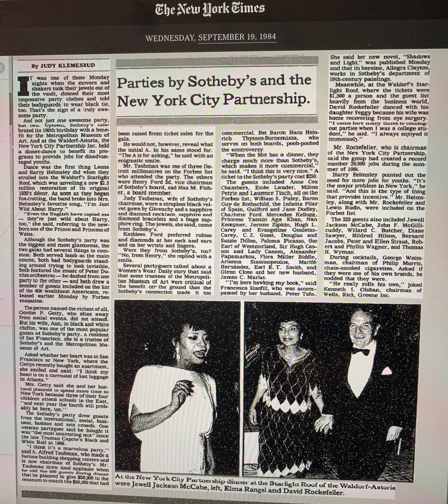
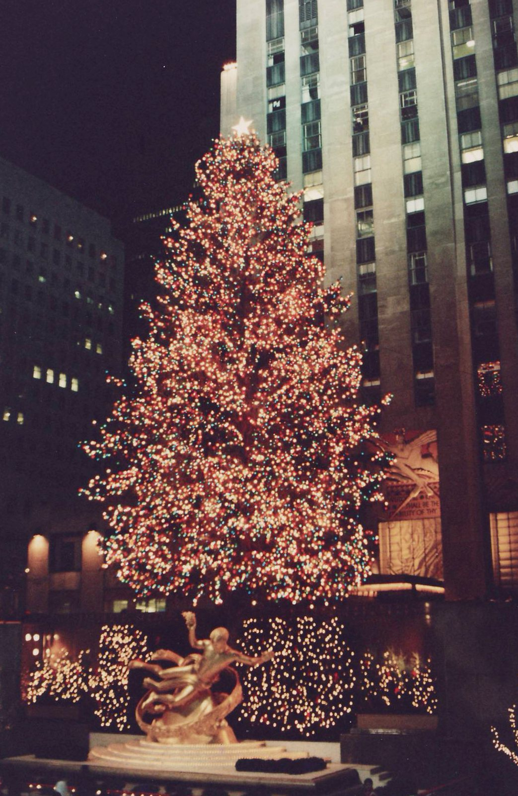
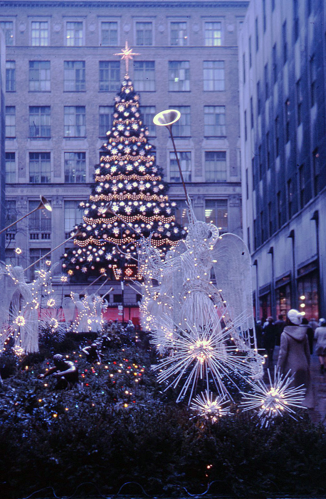

37年前の今日、1989年10月31日。日本の大手不動産会社である三菱地所が、アメリカ・ニューヨークの心臓部にそびえる複合施設「ロックフェラー・センター」を買収したことが明らかになりました。好景気に沸く日本から押し寄せた「ジャパンマネー」の威力を世界に見せつけると同時に、アメリカ社会に激しい衝撃と反発を巻き起こした出来事でした。

## バブル経済の絶頂と「ジャパンマネー」の海外進出

1980年代後半の日本は、空前の好景気、いわゆるバブル経済のまっただ中にありました。急激な円高と過剰な流動性を背景に、日本の企業や投資家は国内にとどまらず、アメリカをはじめとする世界各地の不動産や名門企業を次々と買いあさっていきました。

その象徴的な頂点となったのが、ニューヨーク・マンハッタンの中心に位置する名門、ロックフェラー・センターの買収劇でした。三菱地所は、センターを所有するロックフェラー・グループ（RGI）の株式51パーセントを取得しました。買収にかかった金額はおよそ8億4600万ドル、当時の為替レートで日本円にして約1200億円という巨額の取引でした。

## アメリカの繁栄を象徴するロックフェラー・センター

ロックフェラー・センターは、マンハッタンの5番街と6番街の間、48番街から51番街にまたがる22エーカーの広大な土地に広がる複合施設です。大富豪ジョン・D・ロックフェラー・ジュニアによって1930年代から建設が進められ、1929年に始まった世界恐慌の荒波を乗り越えて1939年に完成しました。

敷地内には高さ259メートル、70階建ての巨大なビル（現在のコムキャスト・ビルディング、元RCAビル）をはじめ、多数の商業ビルが立ち並びます。中心部のプラザには黄金のプロメテウス像が輝き、冬には世界的に有名なアイススケートリンクと巨大なクリスマスツリーが飾られるなど、単なるオフィス街を超えてアメリカ国民の誇りであり、ニューヨークの文化そのものでした。

*事件当時の写真ではありません · 1984年 — 写真: Bijounoir13 / CC BY-SA 4.0*

## 「米国の魂が買われた」全米に広がった反発

アメリカの大企業であるNBCやAP通信、タイム社など名だたるメディアが拠点を置き、ラジオシティ・ミュージックホールを擁するアメリカのシンボルが日本の企業に買収されたという事実は、現地に計り知れない衝撃を与えました。

ニューヨーク市民や米国民の間では、「アメリカの魂まで日本人に買い叩かれた」という強い危機感と反発が巻き起こりました。当時すでに過熱していた日米貿易摩擦の緊張関係と重なり、この買収劇は激しい「ジャパン・バッシング」の火に油を注ぐ結果となったのです。

*Rockefeller Center Tree — 写真: Original uploader was JGHowes at en.wikipedia (Original text / Attribution*

## 開戦前夜の記憶、かつて存在した「日本図書館」

実は、ロックフェラー・センターと日本との間には、戦前から続く歴史的な因縁が存在していました。1938年、日本文化会館（Japan institute）がロックフェラー・センターの38階に「日本図書館」を開設し、日本文化の紹介を行っていた記録があります。

しかし、日米関係が悪化した1941年7月、アメリカ政府によって在米日本資産の凍結命令が出されました。日本からの送金が断たれた図書館は家賃を滞納せざるを得なくなり、同年11月には在米邦人の引き揚げに伴って閉鎖されました。蔵書はコロンビア大学に保管を依頼されることになります。それから約半世紀を経て、今度は日本の企業がビル全体を買い取る側として戻ってきたことは、時代の激変を物語るものでした。

*Rockefeller Center Christmas tree, New York, 1970 - Flickr - PhillipC — 写真: Phillip Capper from Wellington, New Zealand / CC BY 2.0*

## 不動産不況の到来と1995年の破産申請

巨額の資金を投じた世紀の買収劇でしたが、その熱狂は長くは続きませんでした。1990年代に入ると日本のバブル経済が崩壊し、さらにニューヨーク現地の不動産市場も深刻な不況に突入しました。莫大な赤字を抱えたロックフェラー・センターの運営会社は、資金繰りに行き詰まることになります。

買収から約5年半が経過した1995年5月、運営会社はアメリカの連邦倒産法第11章（日本の民事再生法に相当）の適用を申請し、経営破産に追い込まれました。華々しく報じられたバブル期の象徴は、わずか数年で多額の損失を抱えた挫折へと転落したのです。

## 手放された名門ビルと現在に残る2棟の足跡

破産手続きの過程で、三菱地所が買収したセンター内の14棟のビルのうち、12棟は売却され手放されることになりました。現在、三菱地所が所有を継続しているのは、6番街に面する「タイムライフ・ビル」と「マグロウ＝ヒル・ビル」の2棟のみとなっています。

その後、センター全体は別の不動産会社などの手に渡り、今もニューヨークを代表するランドマークとして世界中から観光客を集め続けています。1989年の今日に下された買収の決断は、日本経済が世界に放った圧倒的な勢いと、その直後に訪れたバブル崩壊の現実を象徴する出来事として、今も経済史に深く刻まれています。

### 参考資料

- <https://ja.wikipedia.org/wiki/%E3%83%8B%E3%83%A5%E3%83%BC%E3%83%A8%E3%83%BC%E3%82%AF>
- <https://commons.wikimedia.org/wiki/File:Japanese_Royal_couple_Akihito_with_Rockefeller,_1984.jpg>
- <https://commons.wikimedia.org/wiki/File:Parties_by_Sotheby%27s_and_the_NYC_Partnership_.jpg>
- <https://commons.wikimedia.org/wiki/File:Rockefeller_Center_Tree.jpg>
- <https://commons.wikimedia.org/wiki/File:Rockefeller_Center_Christmas_tree,_New_York,_1970_-_Flickr_-_PhillipC.jpg>
