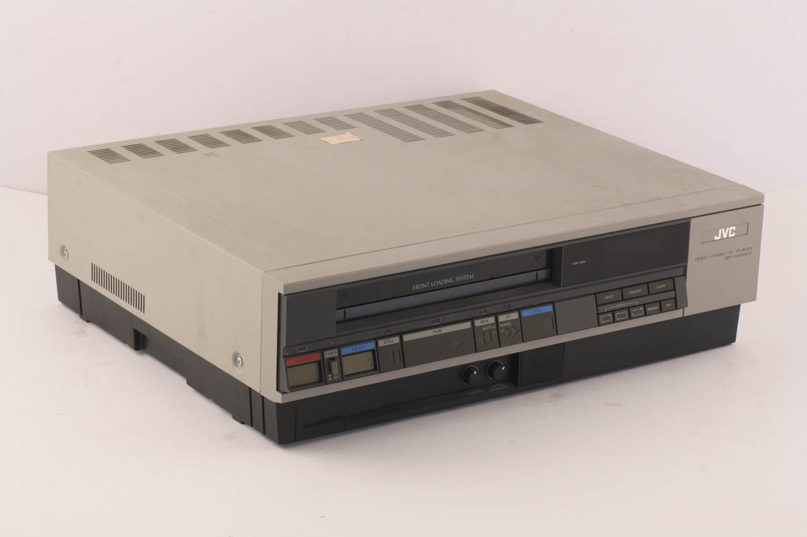
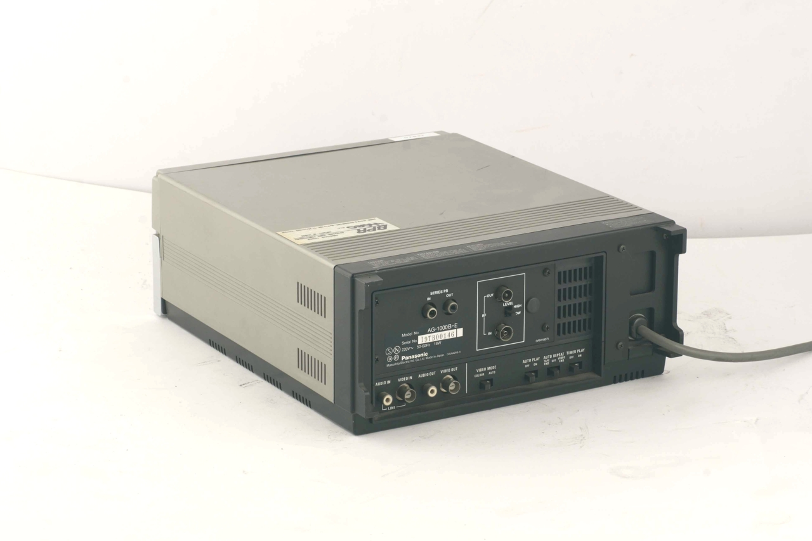
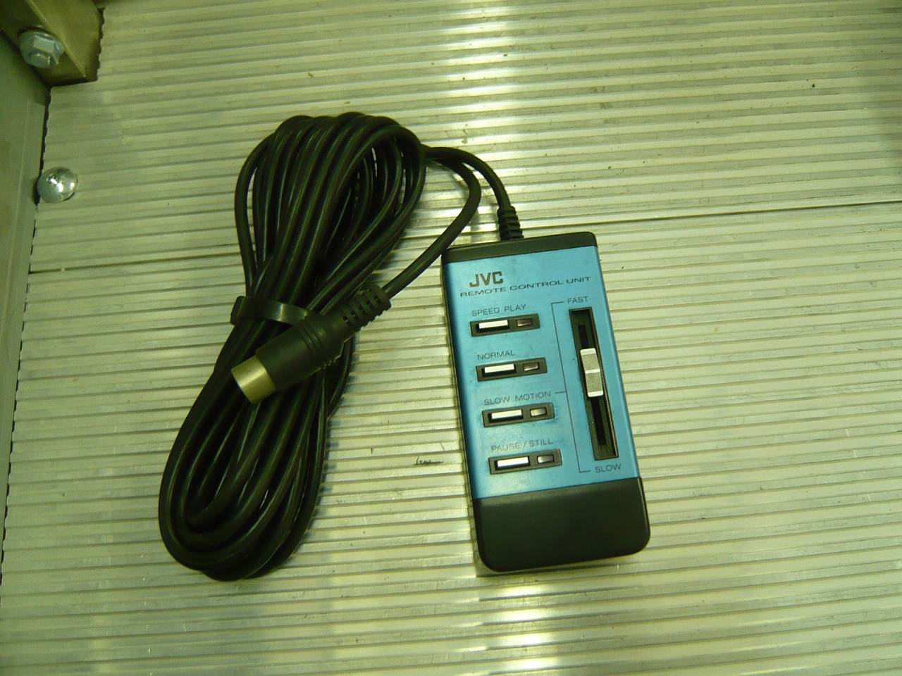

50年前の今日、1976年10月31日。日本ビクターが世界初の家庭用VHSビデオデッキ「HR-3300」を発売しました。テレビ放送をそのまま家庭で録画し、好きな時間に見返すというライフスタイルは、この1台のマシンから本格的な広がりを見せることになります。

## 「2時間録画」への執念が生んだ開発思想

1970年代初頭、テレビ番組を家庭で録画する技術はまだ夢の領域にありました。1975年、ソニーが画期的な家庭用ビデオ規格「ベータマックス」の1号機を発売し、世間の耳目を集めます。しかし、ベータの録画時間は最長で60分でした。

これに対し、日本ビクターでビデオ開発を指揮していた高野鎭雄さんや白石勇真さんたちの開発チームは、異なる未来図を描いていました。劇場映画やプロ野球中継を途中で途切れることなく楽しむためには、どうしても最低2時間の録画時間が必要であると考えたのです。たとえカセットのサイズが少し大きくなっても、一般家庭で本当に使われるための実用性を貫くという明確な指針が、VHS方式の礎となりました。

## 松下幸之助が下した「150点」の評価

開発陣の熱意は、やがて日本の電機産業界の巨頭をも動かします。1975年9月3日、ビクター横浜工場を訪れた松下電器産業（現パナソニックホールディングス）の松下幸之助相談役は、完成したVHSの試作機をじっくりと見つめました。

松下幸之助は「ベータマックスは100点満点の製品だ、しかしこのVHSは150点だ」「ええもん造ってくれたな」と語り、VHSのコンセプトを高く評価しました。その評価の決め手のひとつには、機械の重さもありました。販売店の配送を待たずとも、購入した客が自分の手で抱えて自宅に持ち帰り、その日のうちにテレビにつないで見られるという重量設計は、まさに大衆の目線に立った製品づくりそのものでした。

*1976年の資料 — 写真: J.V.C. (progettista/ costruttore) / CC BY-SA 4.0*

## 1976年10月31日、歴史的1号機「HR-3300」の登場

そして1976年10月31日、満を持して発売されたのがVHSの第1号機「HR-3300」でした。定価は当時の物品税込みで25万6000円。初任給を大きく上回る高級家電でしたが、家庭でテレビ番組を自由に録画できるという魅力は大きな衝撃を与えました。

留守中に自動で番組を録画できる時計内蔵の専用取付式タイマーは別売1万円、標準120分の録画用テープは1巻6000円で販売されました。なお、日本ビクターは翌1977年1月からロゴ表記を改定したため、1976年末までに生産された最初期のHR-3300だけが、戦前から受け継がれた大文字の旧ロゴを刻印された貴重なモデルとなっています。

*1976年の資料 — 写真: Matsushita Electric Industrial Co. (progettista/ costruttore / CC BY-SA 4.0*

## 世界基準へ押し上げた規格の開放と提携

発売後、家庭用ビデオの主導権をめぐってベータ方式との激しい規格争奪戦が繰り広げられました。ビクターは自社技術を独占せず、日立製作所、三菱電機、シャープなど国内外のメーカーに広く規格を開放して仲間を増やしていきました。

特に大きな転機となったのが、親会社であった松下電器による普及型デッキ「ナショナルマックロード」の発売や、1977年のアメリカ大手RCAとの提携でした。アメリカ市場ではアメリカンフットボールの長時間中継を録画したいという需要に応え、録画時間をさらに延ばす技術改良も進められました。こうしてVHS陣営は世界市場で圧倒的なシェアを獲得していったのです。

*1976年の資料 — 写真: J.V.C. (progettista/ costruttore) / CC BY-SA 4.0*

## 進化を重ねたVHSと「未来技術遺産」への登録

その後もVHSは、高音質なHi-Fiステレオ化や高画質規格のS-VHSなど、基本の互換性を守りながら技術革新を続けました。ハードウェアの世界累計普及台数は約9億台以上、流通したカセットテープは300億巻以上という驚異的な記録を残しています。

2006年には電気電子技術の歴史的業績を称える「IEEEマイルストーン」に認定され、2008年には国立科学博物館が定める重要科学技術史資料、いわゆる未来技術遺産の第0020号として初代機「HR-3300」が正式に登録されました。家庭に映像文化を根付かせた画期的な発明として、公的にもその価値が認められたのです。

## 半世紀を経てなお残る、家族の記録と懐かしい思い出

2000年代に入るとDVDやハードディスクレコーダー、デジタル放送の普及に伴い、アナログ規格であるVHSは次第に役目を終えていきました。日本ビクターも2008年に単体ビデオデッキの生産を終了しています。

しかし、子どもたちの成長記録や学校行事、家族で囲んだテレビ番組の映像は、今も押し入れに大切に保管されているビデオテープの中に残されています。爪を折って誤消去を防いだり、見たい場面まで慎重に巻き戻したりしたあの手触りは、世代を超えて共有される懐かしい記憶です。50年前のこの日に産声を上げた1台のデッキが、私たちの生活に映像のぬくもりをもたらしてくれました。

### 参考資料

- <https://ja.wikipedia.org/wiki/%E6%97%A5%E6%9C%AC%E3%83%93%E3%82%AF%E3%82%BF%E3%83%BC>
- <https://commons.wikimedia.org/wiki/File:Lettore_di_videocassette_a_bobine_chiuse,_sistema_VHS_PAL_-_Museo_scienza_tecnologia_Milano_14870.jpg>
- <https://commons.wikimedia.org/wiki/File:Lettore_di_videocassette_a_bobine_chiuse,_sistema_VHS_-_Museo_scienza_tecnologia_Milano_14886.jpg>
- <https://commons.wikimedia.org/wiki/File:Lettore_di_videocassette_a_bobine_chiuse,_sistema_VHS_PAL_-_Museo_scienza_tecnologia_Milano_14870_01.jpg>
- <https://commons.wikimedia.org/wiki/File:Lettore_di_videocassette_a_bobine_chiuse,_sistema_VHS_-_Museo_scienza_tecnologia_Milano_14886_01.jpg>
