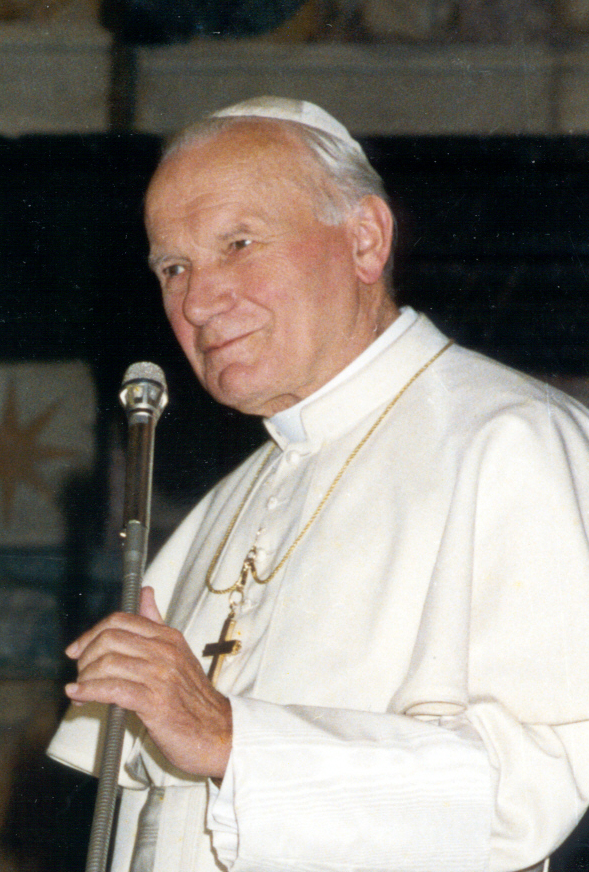
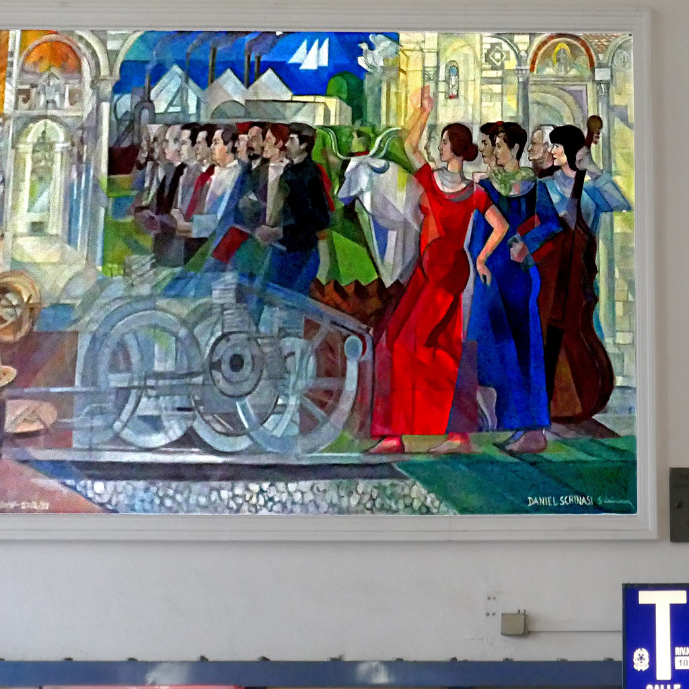
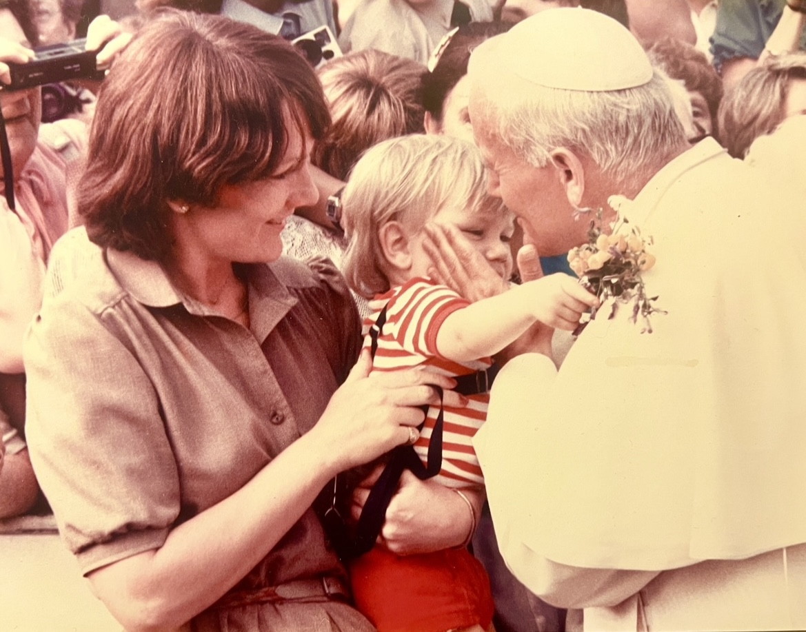

34年前の今日、1992年10月31日。バチカンにおいて、歴史を揺るがす重大な表明が行われました。ローマ教皇ヨハネ・パウロ2世が、天文学者ガリレオ・ガリレイに対するかつての宗教裁判の誤りを公式に認め、破門を解いたのです。「それでも地球は動いている」という言葉で知られる近代科学の父が、77歳でこの世を去ってから実に350年目のことでした。

## 望遠鏡が明かした宇宙の真理

1564年、イタリアのピサで生まれたガリレオ・ガリレイは、数学や物理学の分野で類まれな才能を発揮しました。1609年、オランダで発明された望遠鏡の噂を耳にしたガリレオは、自らの手で改良を重ね、倍率を大幅に高めた望遠鏡を作り上げました。そのレンズを夜空に向けたとき、人類が見たことのない宇宙の姿が次々と明らかになります。

月面には完全な球体ではなく無数の凹凸やクレーターが存在し、太陽には黒点があり、金星は満ち欠けを繰り返していました。さらに1610年には、木星の周りを回る衛星を発見します。これらの観測結果は、すべての天体が地球の周りを回っているとする従来の天動説を根底から覆し、地球こそが太陽の周りを回っているというコペルニクスの地動説の正しさを証明するものでした。

## 教会との対立と1633年の異端審問

しかし、ガリレオの主張は当時のローマ・カトリック教会の強い反発を招きました。聖書の記述を文字通りに信じる当時の教会にとって、地球が動いているという説は到底容認できない教義への挑戦とみなされたのです。1616年、教皇庁検邪聖省はガリレオに対し、地動説を唱えないよう警告を与え、コペルニクスの著作を禁書目録に指定しました。

それでも真理を捨てきれなかったガリレオは、1632年にイタリア語で『天文対話』を刊行します。この書物は教皇庁の激しい怒りを買い、ガリレオはローマの異端審問所への出頭を命じられました。そして1633年6月22日、異端審問所はガリレオに有罪の判決を下し、終身刑を宣告したのです。

*事件当時の写真ではありません · 1991年 — 写真: Photo by White House / Public domain*

## 軟禁と失明、それでも書き続けた晩年

ガリレオは自説の撤回を余儀なくされ、終身刑はのちに軟禁へと減刑されました。しかし、フィレンツェ郊外のアルチェトリにある別荘に身を置くことを余儀なくされ、外部との自由な接触や移動を厳しく制限されました。

過酷な運命はさらに続きます。看病を続けてくれていた最愛の長女マリア・チェレステが1634年に若くして病死し、ガリレオ自身も1637年に片目を、翌1638年には両目を失明しました。光を失い、孤独と病に苛まれながらも、ガリレオは屈しませんでした。弟子たちへの口述筆記によって力学の集大成である『新科学対話』を完成させ、1638年にオランダで出版しました。そして1642年1月、77歳で息を引き取りました。

*事件当時の写真ではありません — 写真: pom'. / CC BY-SA 2.0*

## 死後350年、ローマ教皇が下した決断

ガリレオの肉体が滅びても、彼が示した科学的手法と宇宙の真理は世界中に広まりました。時代が進むにつれ、地動説は疑いようのない事実となり、ガリレオの有罪判決は教会の権威にとって重い歴史的汚点として残り続けました。

この歴史の歪みに終止符を打ったのが、ローマ教皇ヨハネ・パウロ2世でした。ガリレオの死後350年目にあたる1992年10月31日、教皇は演説を行い、当時の神学者たちが聖書の解釈に固執するあまり科学的な真実を見落とし、ガリレオを不当に苦しめたという過ちを率直に認めました。教皇自らが誤審を認め、ガリレオの破門を解いた瞬間でした。

*Pope John Paul II blesses Dan Llywelyn Hall 1982 — 写真: Richiebloomberg / CC0*

## 科学と信仰が向き合った歴史の節目

ヨハネ・パウロ2世によるガリレオの復権は、単なる一人の科学者の名誉回復にとどまりません。科学的な探求と宗教的な信仰が、互いの領域を尊重し合いながら共存できるという道筋を世界に示した、歴史的和解の瞬間でもありました。

過ちを認めるまでに要した年月は、実に350年。あまりにも長い歳月ではありましたが、どれほど強大な権力であっても、積み重ねられた観察と実験によって証明された真実を永遠に覆い隠すことはできないという教訓を、人類に深く刻みつけました。

## 今も語り継がれるガリレオの遺産

現代において、ガリレオ・ガリレイは物理学や天文学の礎を築いた「近代科学の父」として揺るぎない敬意を集めています。彼が切り開いた実験と数学的手法による自然の探求は、今日の宇宙探査や先端技術のすべての出発点となりました。

1992年10月31日のバチカンの発表は、真理を追い求めた一人の人間の信念が、350年の時を超えて歴史に勝利した日として、今も人々の記憶に刻まれています。

### 参考資料

- <https://ja.wikipedia.org/wiki/10%E6%9C%8831%E6%97%A5>
- <https://archive.org/details/galileo-galilei_202308>
- <https://commons.wikimedia.org/wiki/File:George_H_W_Bush_and_Pope_John_Paul_II_(cropped).jpg>
- <https://www.flickr.com/photos/146832554@N06/41093898965>
- <https://commons.wikimedia.org/wiki/File:Pope_John_Paul_II_blesses_Dan_Llywelyn_Hall_1982.jpg>
