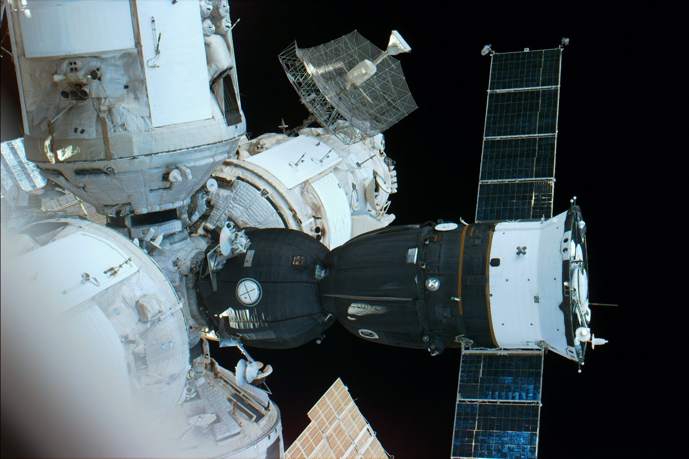
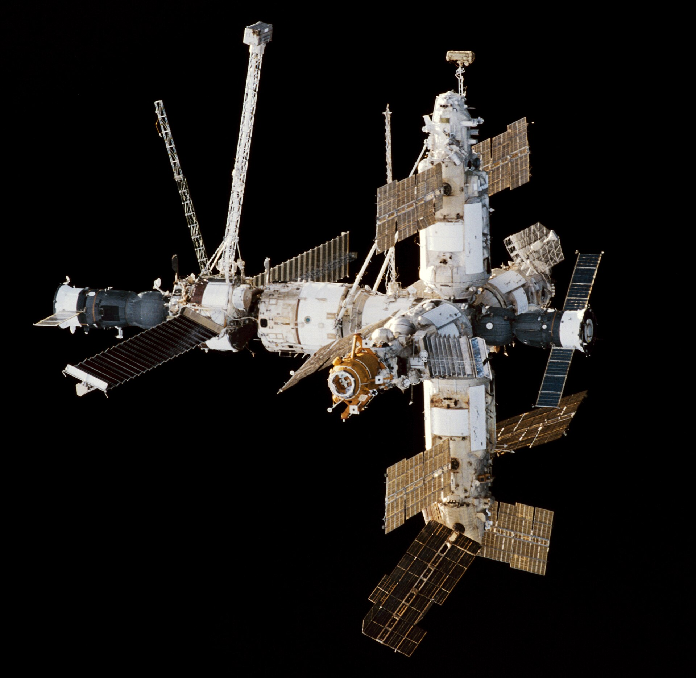
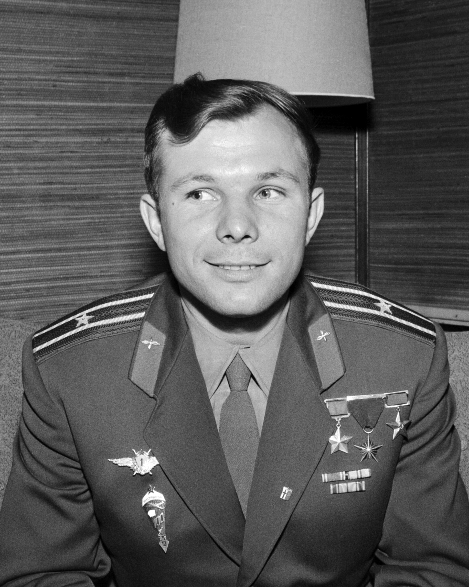

26年前の今日、2000年10月31日。国際宇宙ステーション（ISS）の最初の滞在者を乗せたロシアの宇宙船「ソユーズTM-31」が、カザフスタンのバイコヌール宇宙基地から打ち上げられました。地上約400キロメートルの軌道上で人類が途切れることなく暮らし続ける、壮大な宇宙滞在の幕開けとなった歴史的一日です。

## 冷戦の弾道ミサイルから国際協力の象徴へ

ソユーズのルーツは旧ソビエト連邦時代にさかのぼります。打ち上げに使用されるロケットは、もともと大陸間弾道ミサイルとして開発されたR-7型を改良したものでした。1957年に世界初の人工衛星スプートニク1号を軌道に乗せ、1961年にはユーリ・ガガーリンを乗せたボストークを宇宙へと送り出した歴史的な設計を受け継いでいます。

かつて激しい宇宙開発競争を繰り広げた東西の対立は、ソ連崩壊を経て国際協力の時代へと移り変わりました。アメリカをはじめとする参加国が建設を進める国際宇宙ステーションへの往復手段として、実績を積み重ねてきたロシアのソユーズが重要な役割を担うことになったのです。

## 3つの区画に分かれた合理的な機体設計

ソユーズ宇宙船は、前から順に「軌道船」「帰還船」「機械船」という3つの独立したモジュールで構成されています。軌道上で生活空間やドッキング装置となる球形の軌道船、宇宙飛行士が打ち上げ時と着陸時に乗り込む釣鐘型の帰還船、そして推進用エンジンや太陽電池パネルを備えた円筒形の機械船です。

地球に帰還するのは飛行士が搭乗する帰還船のみで、残りのモジュールは大気圏再突入の際に切り離されて燃え尽きます。これにより地球へ持ち帰るための耐熱材を最小限に抑え、軽量化と広い居住容積を両立させています。船内の空気環境も地上の大気と同じ窒素80パーセント、酸素20パーセントの1気圧に保たれており、乗員の負担を軽減する工夫が凝らされていました。

*1996年の資料 — 写真: NASA/Crew of STS-79 / Public domain*

## 発射から528秒、正確無比な軌道投入

2000年10月31日の打ち上げは、バイコヌール宇宙基地から極めて精密なタイムラインに沿って進められました。ロケットは点火とともに上昇し、打ち上げから114秒後に頂部の脱出用アボートタワーを分離、118秒後には第1段ロケットを切り離してさらに加速しました。

157秒後に大気圏上層部で機体を保護していたフェアリングを外し、287秒後には第2段を分離して第3段エンジンへ点火。発射からわずか528秒後、ソユーズTM-31は見事に地球周回軌道へと投入されました。ステーションへと向かう乗員たちを乗せ、滞在の旅が順調に始まった瞬間でした。

*1998年の資料 — 写真: NASA / Public domain*

## 悲劇の教訓が生んだ高い安全性と信頼性

ソユーズは最初から完璧だったわけではありません。1967年のソユーズ1号ではパラシュートが開かず墜落事故を起こし、1971年のソユーズ11号では帰還時の気圧低下により搭乗員全員が命を落とすという痛ましい過去がありました。しかし、これらの悲劇から徹底した原因究明と改良が行われました。

帰還時の与圧服着用が義務付けられ、発射台での火災や上昇中のロケット異常時にも乗員を瞬時に救出する非常脱出システムが確立されました。1983年の発射台火災事故や2018年の飛行中のロケット故障時にも、このシステムが正常に作動して飛行士の命を救っています。「枯れた技術」を磨き続けることで、半世紀以上にわたり搭乗員の死亡事故を起こさない極めて信頼性の高い船へと成長したのです。

*Yuri Gagarin (1961) - Restoration — 写真: Arto Jousi / /Suomen valokuvataiteen museo / Alma Media / Uu / Public domain*

## スペースシャトル退役から9年間、宇宙を支えた唯一の翼

ソユーズTM-31がISSに最初の滞在者を送り届けて以降、宇宙ステーションには絶え間なく人が滞在し続けることになりました。その価値が世界中で再認識されたのが、2011年のアメリカのスペースシャトル退役です。

2011年から2020年に民間の有人宇宙船が登場するまでの約9年もの間、国際宇宙ステーションに参加するすべての国にとって、ソユーズは宇宙へ人を輸送する世界で唯一の手段でした。東西冷戦の産物として生まれた宇宙船が、人類全体の宇宙開発の命綱となって宇宙ステーションの運用を支え続けたのです。

## 受け継がれるソユーズの伝統と宇宙への歩み

ソユーズ宇宙船はTM型からTMA型、そして現在のMS型へとデジタル化や改良を重ねながら、今もバイコヌール宇宙基地から宇宙へと飛び立ち続けています。船内は身長や体格に厳格な制限があるほどコンパクトですが、その無駄のない設計思想は世界中の宇宙工学に多大な影響を与えました。

2000年10月31日に打ち上げられたソユーズTM-31が切り拓いたステーション長期滞在の歴史は、今日に至るまで一日も途切れることなく続いています。テレビ画面に映し出されたロケットの力強い打ち上げは、人類が本格的に地球の外に家を持つ時代の始まりを告げる象徴でした。

### 参考資料

- <https://ja.wikipedia.org/wiki/%E5%9B%BD%E9%9A%9B%E5%AE%87%E5%AE%99%E3%82%B9%E3%83%86%E3%83%BC%E3%82%B7%E3%83%A7%E3%83%B3>
- <https://commons.wikimedia.org/wiki/File:Soyuz_tm-31_transported_to_launch_pad.jpg>
- <https://commons.wikimedia.org/wiki/File:Soyuz_acoplada_MIR.jpg>
- <https://commons.wikimedia.org/wiki/File:Mir_Space_Station_viewed_from_Endeavour_during_STS-89.jpg>
- <https://commons.wikimedia.org/wiki/File:Yuri_Gagarin_(1961)_-_Restoration.jpg>
