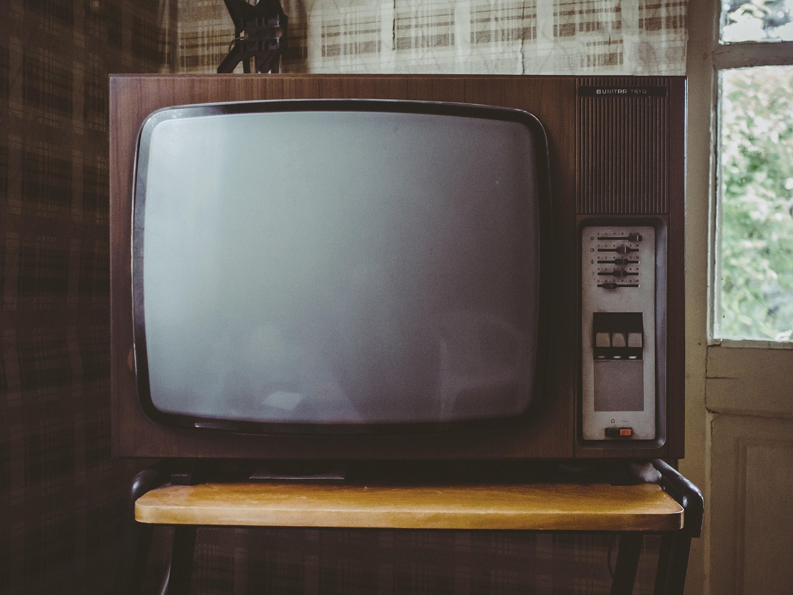
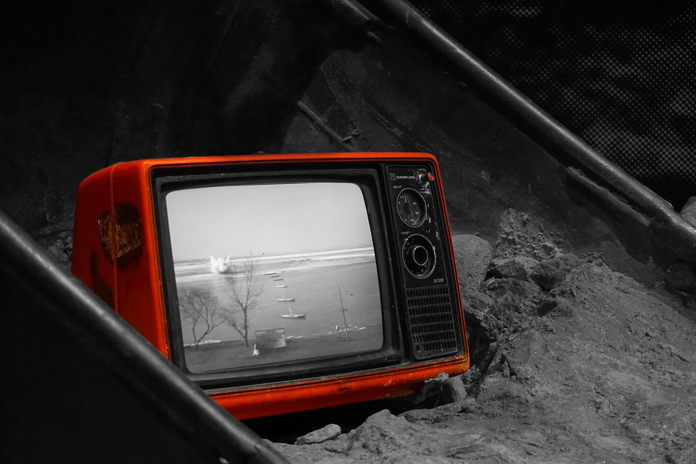
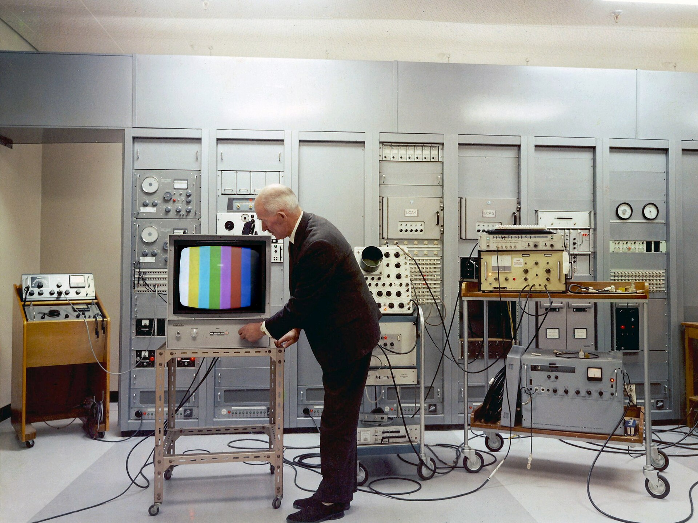

54年前の今日、1972年10月31日。東京・渋谷の代々木公園に隣接する敷地に、NHK放送センターのシンボルとなる地上23階建ての「本館（高層棟）」が完成しました。日比谷の内幸町にあった旧本部からの移転プロジェクトにおける最大の要であり、渋谷の街の風景を一変させた巨大拠点の誕生でした。

## 内幸町から代々木へ――オリンピックが引き金となった移転計画

もともとNHKの本部施設は、千代田区内幸町にある「東京放送会館（現在の日比谷シティ）」に置かれていました。しかしテレビ放送の本格化に伴い施設は手狭となり、1960年代前半、第9代NHK会長の阿部眞之助は新たな移転先を模索していました。

当初、移転先は港区麻布新龍土町（現在の六本木7丁目、都立青山公園南地区）に内定していました。しかし、1964年の東京オリンピック開催が決定したことで事態が動きます。NHKは五輪のホスト放送局を務めるため、阿部会長は当時の池田勇人首相に対し、「主会場である国立霞ヶ丘競技場の近くに放送施設を構えたい」と直談判しました。対象となったのは、在日アメリカ軍の家族居住区であった「ワシントンハイツ」の跡地でした。

池田首相の決断によって跡地の払い下げが認められ、麻布の用地は東京都に貸与される形となりました。こうして1964年の東京オリンピック放送センターとして建設が始まり、代々木の地に巨大な放送拠点が築かれることになったのです。

## 段階的な拡張と、1972年10月31日の本館完成

渋谷のNHK放送センターは、一気にすべてが完成したわけではありませんでした。まず1965年に最も古い「東館」が竣工し、続いて1968年には「西館」が完成しました。

そして1972年10月31日、全体の中枢となる地上23階建ての「本館（高層棟）」が完成を迎えました。周囲にまだ高層建築が少なかった当時、代々木の緑の向こうにそびえ立つ23階建ての白いタワーは、渋谷エリアの圧倒的なランドマークとなりました。翌11月には多目的ホールであるNHKホールも竣工し、10年近くをかけた内幸町からの移転計画は最終段階へと突入しました。

そして翌1973年7月31日をもって、旧東京放送会館でのすべての業務が終了。NHKの最高決定機関や管理部門、報道・番組制作機能が名実ともに渋谷へ完全集約されたのです。

*当日の写真ではありません · 事件当時の写真ではありません · イメージ写真 — 写真: StockSnap / Pixabay Content License*

## 東洋一のスタジオと、朝ドラ・大河が生まれた制作の現場

完成した放送センターには、テレビ局として国内最大規模を誇る25以上のスタジオが整備されました。中でも1階に位置する「CT-101スタジオ」は350坪という広さを誇り、完成当時は「東洋一の広さ」と称されました。日本で初めてカメラクレーンが導入され、『NHK紅白歌合戦』や『ステージ101』、『SONGS』など、時代を彩る大型音楽番組の舞台となってきました。

また、朝の連続テレビ小説を収録する「CT-105スタジオ」と、大河ドラマを収録する「CT-106スタジオ」（いずれも約200坪）が隣同士に配置されていることも、放送センターならではの特徴でした。スタジオの外の廊下や局内の食堂では、時代劇の衣装を着た俳優と現代劇の朝ドラ出演者が行き交い、ドラマやバラエティ、報道の垣根を越えたスタッフ同士の交流から数々の新しい番組企画が芽生えたと語り継がれています。

*当日の写真ではありません · 事件当時の写真ではありません · イメージ写真 — 写真: funnytools / Pixabay Content License*

## お茶の間を見つめ続けた半世紀の歩み

1972年の本館完成以降、この場所から日本中、そして世界へ向けて膨大な映像と声が届けられました。1980年代後半には北館が増設されて大型のニュースセンターが整備され、大規模災害や歴史的な大事件が発生した際には、24時間態勢で国民の命と暮らしを守る報道の拠点として機能してきました。

学校の社会科見学や観光スポットとして親しまれた「スタジオパーク」を訪れ、ガラス越しに番組制作の現場や『おかあさんといっしょ』の収録風景を見学した思い出を持つ方も多いのではないでしょうか。渋谷の放送センターは、単なる放送局のオフィスにとどまらず、昭和から平成にかけての日本のテレビ文化そのものを育んできた場所でした。

*A Colour Television Test — 写真: Archives New Zealand / CC BY-SA 2.0*

## 情報棟の稼働と、未来へ受け継がれる放送の使命

半世紀にわたって稼働を続けてきた放送センターは、耐震性の確保や設備の老朽化を受け、大規模な建て替えプロジェクトへと舵を切りました。2024年10月31日に第1期工事である免震構造の「情報棟」が完成し、放送開始100周年を経て、2026年8月にはニュースセンターやラジオセンターの機能が本格的に新しい情報棟へと移転しました。

かつて内幸町から代々木へと拠点を移し、カラーテレビの普及とともに日本の歩みを記録し続けてきた本館高層棟。建物の姿は時代とともに新しく生まれ変わっていきますが、1972年の秋、渋谷の空にそびえ立ったあの23階建ての白い巨塔が切り拓いた放送の歴史は、今も私たちの記憶とお茶の間に確かに刻まれています。

### 参考資料

- <https://ja.wikipedia.org/wiki/NHK%E6%94%BE%E9%80%81%E3%82%BB%E3%83%B3%E3%82%BF%E3%83%BC>
- <https://pixabay.com/photos/tv-television-retro-classic-old-1844964/>
- <https://pixabay.com/photos/tv-television-vintage-oldschool-2619649/>
- <https://pixabay.com/photos/television-developing-countries-899265/>
- <https://commons.wikimedia.org/wiki/File:A_Colour_Television_Test.jpg>
