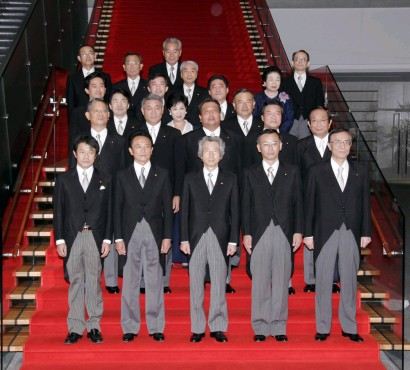
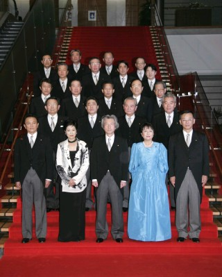
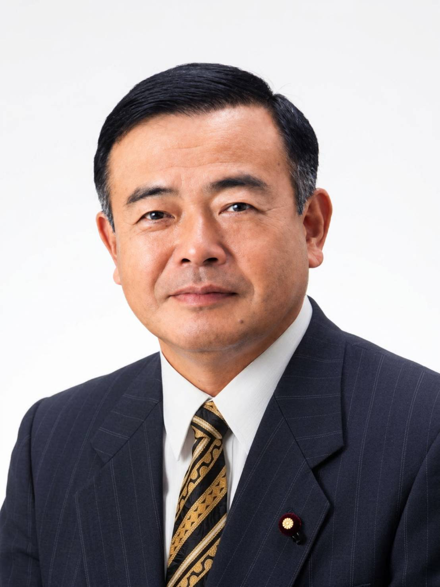

21年前の今日、2005年10月31日。第3次小泉改造内閣が発足しました。郵政解散の大勝から法案成立を経て、小泉純一郎首相が任期の最後の1年に臨むため、総仕上げとして整えた陣容でした。

## 郵政解散の大勝と「つなぎ内閣」の発足

2005年夏の政局は、郵政民営化をめぐって激しく揺れ動きました。法案が参議院で否決されたことを受け、小泉純一郎首相は衆議院を解散。「郵政解散」と呼ばれた第44回衆議院議員総選挙で、与党は圧倒的な勝利を収めました。

選挙後の9月21日、特別国会で第89代内閣総理大臣に再指名された小泉首相は、第3次小泉内閣を発足させます。この時は、公約である郵政民営化関連法案を速やかに再提出して成立させることを最優先とし、直前の第2次小泉改造内閣の閣僚を全員再任する異例の形を取りました。これは法案成立までの「つなぎ内閣」と位置づけられていました。

## 法案成立を受けて断行された最後の改造

10月に郵政民営化関連法案が無事成立すると、国会会期の最終盤となった10月31日、小泉首相は満を持して最後の内閣改造を実施しました。これが第3次小泉改造内閣です。

自由民主党では1980年以降、総裁の任期を連続2期までと定めていました。そのため、小泉総理の任期満了は翌2006年9月と決まっており、残された期間はちょうど1年でした。小泉首相自身、自衛隊の憲法上の位置づけなど任期中には成し遂げられない改革もあることを認めつつ、掲げてきた各種改革を完遂するための内閣を組織する必要がありました。

*2005年の資料 — 写真: 内閣官房内閣広報室 / CC BY 4.0*

## 官房長官に安倍晋三氏、外相に麻生太郎氏の布陣

この内閣改造で世間の注目を一身に集めたのは、いわゆる「ポスト小泉」と呼ばれる次代のリーダー候補たちの処遇でした。小泉首相は、彼らを内閣の中枢に惜しみなく配置しました。

自民党幹事長代理などを務めていた安倍晋三氏を内閣官房長官に抜擢。政権のスポークスパーソンであり総合調整を担う要職に据えました。また、総務大臣を務めていた麻生太郎氏を外務大臣へと横滑りさせ、外交の顔としました。さらに財務大臣には谷垣禎一氏を再任させ、主要な後継候補たちが内閣の中で競い合う形が整いました。

*2005年の資料 — 写真: 内閣官房内閣広報室 / CC BY 4.0*

## 竹中平蔵氏を総務大臣へ、改革の実行に注力

政策面での大きな人事としては、小泉政権の経済改革を一貫して牽引してきた竹中平蔵氏の総務大臣起用が挙げられます。郵政民営化担当も兼務させ、法案成立にとどまらず、実際の民営化プロセスの実施や行政改革の指揮を執らせる狙いがありました。

こうして発足した第3次小泉改造内閣のもと、最後の国会会期では提出された政府法案91本のうち82本が成立。行政改革や医療制度改革などが次々と法制化されていきました。

*2000年の資料 — 写真: 文部科学省 / CC BY 4.0*

## 任期延長論を排して迎えた2006年の幕引き

総選挙での圧勝劇とその後の高い求心力から、自民党内や公明党の一部からは党規約を改正して小泉総裁の任期を延長すべきだという声も上がりました。しかし小泉首相はそのような誘惑を退け、任期規定を厳格に順守する姿勢を貫きました。

小泉首相は予告通り、2006年9月26日に内閣総理大臣を退任しました。10月31日の組閣で官房長官に就いた安倍晋三氏がその後を継ぎ、第1次安倍内閣を発足させることになります。2005年秋のこの改造内閣は、小泉改革の集大成であると同時に、その後の日本政治を担うリーダーたちが勢揃いした歴史的な転換点でもありました。

### 参考資料

- <https://ja.wikipedia.org/wiki/10%E6%9C%8831%E6%97%A5>
- <https://commons.wikimedia.org/wiki/File:Soridaijinkantei1.jpg>
- <https://commons.wikimedia.org/wiki/File:Junichir%C5%8D_Koizumi_Cabinet_20050921.jpg>
- <https://commons.wikimedia.org/wiki/File:Junichir%C5%8D_Koizumi_Cabinet_20051031.jpg>
- <https://commons.wikimedia.org/wiki/File:Official_portrait_of_Nariaki_Nakayama_2000.jpg>
