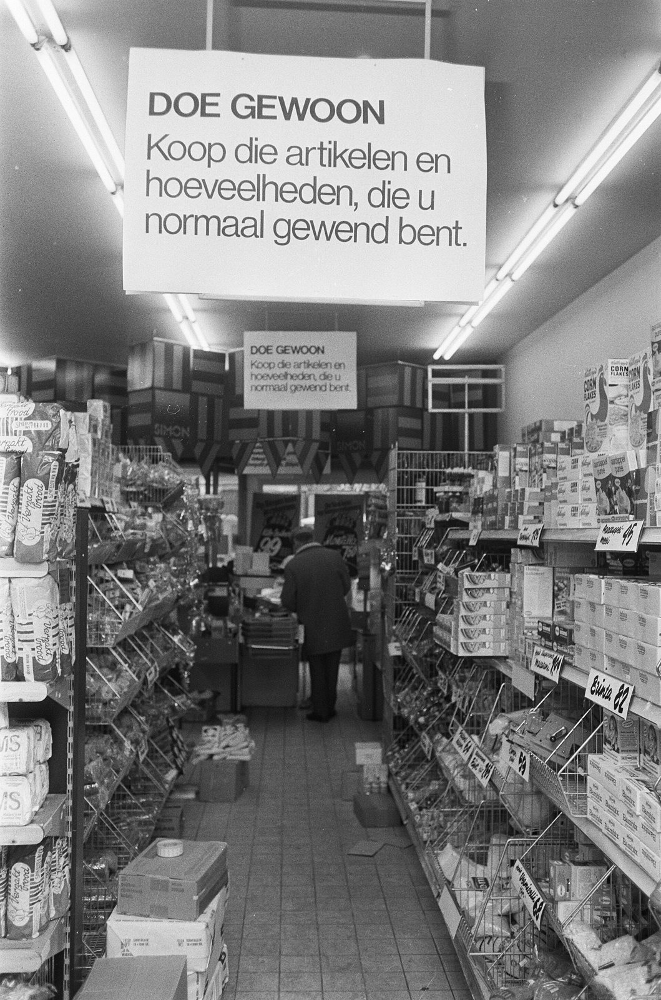
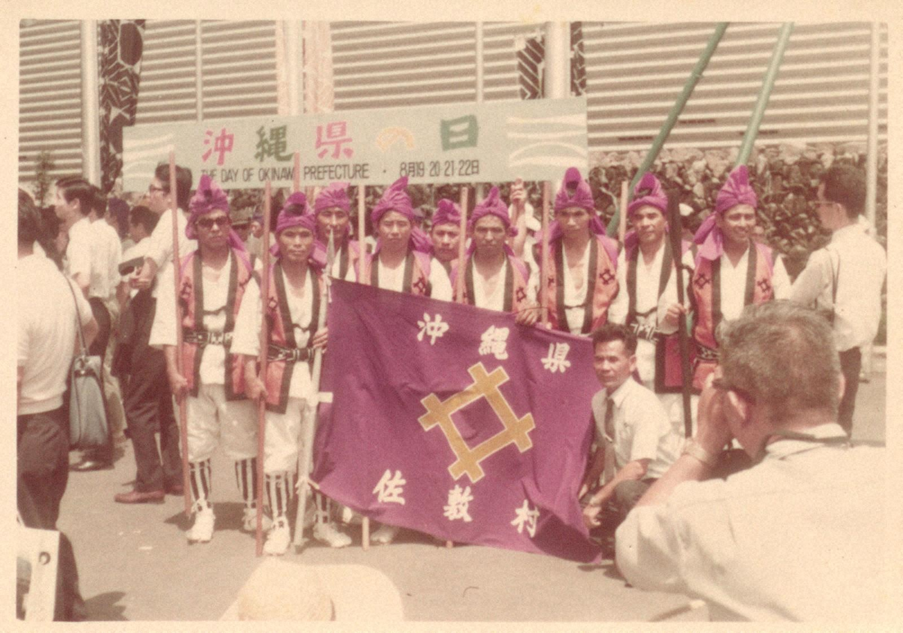
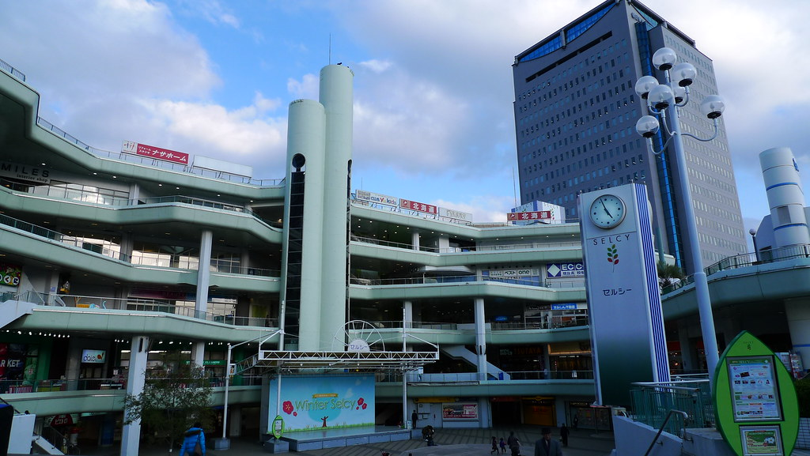

53年前の今日、1973年11月1日。オイルショックの不安が高まるなか、日本全国でトイレットペーパーの買い占めパニックが本格的に始まりました。大阪の新興住宅地で起きた主婦たちの行列を大手新聞が報じたことで、不安は瞬く間に列島中へ飛び火し、店頭から紙が消え去る異例の事態へと発展したのです。

## 第四次中東戦争と原油価格引き上げ――迫る石油危機の影

1973年（昭和48年）10月16日、第四次中東戦争を背景として、中東の産油国が原油価格を70パーセント引き上げることを決定しました。エネルギー資源の多くを海外からの輸入に頼っていた日本経済は、突如として深刻な石油危機、いわゆる第一次オイルショックに直面することになります。

事態を受けた第2次田中角栄内閣の中曽根康弘通商産業大臣は、10月19日に早くも「紙節約の呼びかけ」を発表しました。政府主導で紙の節約や古紙回収が推進される中、エネルギー不足が物資の供給停止に直結するのではないかという漠然とした不安が、社会全体に静かに広がり始めていました。

## 千里ニュータウンの噂――水洗トイレの普及が生んだ生活不安

全国的なパニックの震源地となったのは、大阪府北部に広がる千里ニュータウンでした。10月下旬、北千里に住むピアノ教師の主婦が生徒の親や近隣住民に語った「オイルショックの影響でトイレットペーパーが不足する」という話が、地域の口コミを通じてまたたく間に広がっていきました。

千里ニュータウンは1970年の大阪万博を契機に整備された先進的な新興住宅地で、上下水道が完備され水洗トイレが普及していました。当時の日本で一般的だった汲み取り式トイレで使われていた「ちり紙」と違い、水洗トイレには水に溶けるトイレットペーパーが不可欠でした。住民同士の交流が密で情報の伝達が早かった新興住宅地において、生活を直撃する紙不足の噂は切実な危機感として受け止められたのです。

*De borden boven de winkelpaden, Bestanddeelnr 926-8842 — 写真: Rob Croes for Anefo / CC0*

## 10月31日の大丸ピーコック――特売チラシに並んだ200人の主婦

決定打となったのは、1973年10月31日の朝でした。千里ニュータウンの中心にあったスーパー「大丸ピーコック千里中央店」は、折り込みチラシで1パック4ロール入り138円のトイレットペーパーの特売を予告していました。

当日、開店前にはすでに200人以上の主婦らが詰めかけて長蛇の列を作りました。用意されていた特売品は瞬く間に売り切れ、買えなかった客たちの間にさらなる動揺が広がりました。

当時の店員だった清水暉人さんは、特売は1カ月ほど前から水曜日の恒例チラシとして計画していたもので、まさかあのような事態になるとは想像もしていなかったと振り返っています。店側の意図とは無関係に、人々の不安と特売のタイミングが重なってしまった瞬間でした。

*万博での棒術披露 — 写真: 南城市教育委員会 / CC BY (Japan Search)*

## 11月1日の夕刊報道――「紙の狂騒曲」が煽った全国への飛び火

この開店前の大行列を捉え、全国規模の騒動へ決定づけたのが、1973年11月1日付の毎日新聞大阪版夕刊でした。紙面には「紙の狂騒曲」という大きな見出しが躍り、開店30分で売り切れた様子や、折り込み広告で138円だったものが品切れを理由に200円で売られていたと報じられました。

しかし店員の清水さんによれば、これは特売品がなくなったために通常価格の商品を店頭に出しただけであり、便乗値上げではありませんでした。記事のセンセーショナルな書き方に店側は憤りを感じたものの、報道のインパクトは絶大でした。「定価の2倍になった」「トイレットペーパーがなくなる」という情報はテレビや各紙を通じ、一気に日本中を駆け巡ることになったのです。

*senri-chuo new town. — 写真: watashiwani / CC BY 2.0*

## 洗剤や砂糖への拡大と政府の介入――緊急措置法と標準価格

メディアの報道を受けて不安に駆られた人々は全国の小売店へ殺到し、「嘘だとわかっていても買ってしまう」という集団心理が働きました。棚からトイレットペーパーが消えると、品薄の連鎖は洗剤や砂糖、塩といった他の生活必需品にまで急速に拡大していきました。

日本国政府の自粛要請だけではパニックは収まらず、政府は同年6月29日に制定されていた「生活関連物資等の買占め及び売惜しみに対する緊急措置に関する法律」に基づき、11月12日に紙類4品目を特定物資に指定しました。さらに翌1974年1月28日には「国民生活安定緊急措置法」によってトイレットペーパーの標準価格を定め、強制力を持って市場の安定を図りました。こうした対策が功を奏し、騒動は1974年3月になってようやく沈静化を迎えました。

## 減っていなかった生産量――半世紀を経ても変わらぬ教訓

騒動が収束したあと、翌年に出された国民生活白書には「生産実績は減少していない」と明記されました。工場では通常通りトイレットペーパーが製造され続けており、物理的な物資の不足ではなく、流言飛語とパニック買いが一時的な品切れを引き起こしたに過ぎなかったのです。

しかし、この教訓はその後も度々試されることになります。2011年の東日本大震災や、2020年の新型コロナウイルス流行時にも、SNSなどを通じて「紙がなくなる」という誤情報が広まり、同じような買い占め騒動が発生しました。伝達手段が近所の噂話から新聞、テレビ、そしてインターネットやSNSへと変わっても、不安による買い占めの本質は半世紀前のあの日と変わっていません。

### 参考資料

- <https://ja.wikipedia.org/wiki/%E3%82%AA%E3%82%A4%E3%83%AB%E3%82%B7%E3%83%A7%E3%83%83%E3%82%AF>
- <https://commons.wikimedia.org/wiki/File:Huurfietsen_worden_aangeboden,_Bestanddeelnr_926-7972.jpg>
- <https://commons.wikimedia.org/wiki/File:De_borden_boven_de_winkelpaden,_Bestanddeelnr_926-8842.jpg>
- <https://nanjo-archive.jp/document/?detail=53224&genre=6>
- <https://www.flickr.com/photos/11316976@N00/3397552162>
