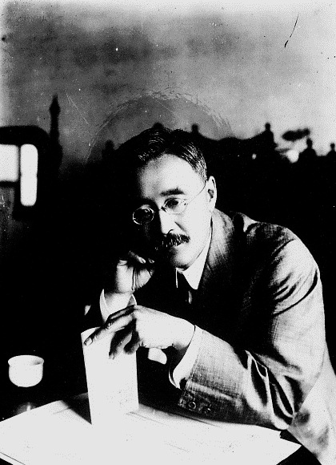
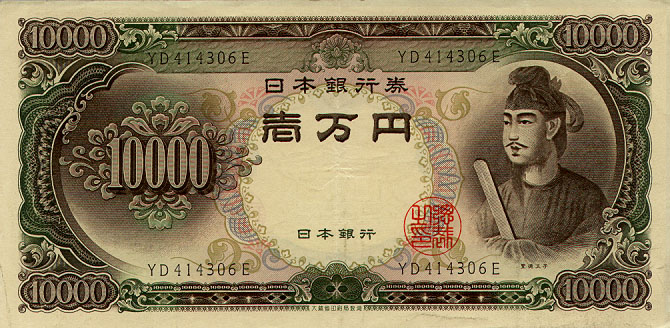

42年前の今日、1984年11月1日。日本で新しい紙幣、日本銀行券「D号券」の発行が始まりました。一万円札は福沢諭吉、五千円札は新渡戸稲造、千円札は夏目漱石の肖像となり、長年親しまれたお札の顔が一新されました。

## 戦後紙幣の系譜と肖像の刷新

第二次世界大戦後、日本では金融緊急措置令によって6種類の紙幣が発行されました。これは「A券」と呼ばれ、その後にB券、C券と改刷が重ねられてきました。1984年11月1日に登場したD号券は、それまでの紙幣から肖像を一新し、近代日本の教育や文化、思想に深く関わった人物たちが選ばれました。一万円札に福沢諭吉、五千円札に新渡戸稲造、千円札に夏目漱石という顔ぶれは、国民の間に広く新鮮な驚きをもって受け止められました。

## 偽造を防ぐ独自の素材とすき入れ技術

紙幣には極めて高い偽造防止性能が求められます。日本の紙幣用紙には、一般的な木材パルプではなく、三椏や楮、綿、マニラ麻といった非木材パルプが主原料として用いられています。これにより、通常の印刷用紙とは異なる独特の手触りや強度が生まれます。さらに、繊維の厚みを調整して濃淡を表現する「黒透かし」や「白透かし」の技法が取り入れられました。これらの透かし技術は「すき入紙製造取締法」によって厳格に管理されており、政府の許可なく製造することは固く禁じられています。

*当日の写真ではありません · 事件当時の写真ではありません · イメージ写真 — 写真: sasint / Pixabay Content License*

## 精緻を極めた印刷と偽造防止の工夫

D号券には、透かしに加えて精密な印刷技術が投入されました。触れた際にインクの盛り上がりを感じられる深刻凹版印刷や、通常のコピー機やスキャナーでは再現が難しい微細文字（マイクロ印刷）など、当時の高度な技術が券面の随所に散りばめられました。また、後にD券の一部では紫外線や近紫外線を当てると印章部分が蛍光を発する紫外線発光インクが採用されるなど、偽造対策は時代とともに進化を続けました。

*Inazo Nitobe 01 — 写真: Shinjun Nara(1871-1940) / Public domain*

## 山田羽書から日本銀行券への歴史

日本における紙幣の歴史は古く、記録上は1334年に後醍醐天皇が発行を試みた楮幣にまで遡ります。実物が現存する最古の紙幣としては、1623年に伊勢国山田の商人が発行した山田羽書が知られています。江戸時代には福井藩が1661年に発行したものをはじめ、多くの藩で藩札が流通しました。明治時代に入ると太政官札や明治通宝、国立銀行券などが乱立しましたが、1882年に日本銀行が設立され、紙幣の発行権が中央銀行へと一本化されていきました。

*P94b-10000Yen-(1958) front — 写真: Bank of Japan / Public domain*

## 日常生活を支える「法貨」の特質

強制通用力を持つ紙幣には、あらゆる取引で使える「汎用性」、誰にでも受け取られる「一般受容性」、第三者を介さずに決済を完了できる「支払完了性」、そして誰がいつ使ったかが秘匿される「匿名性」という重要な特質があります。1932年に金輸出が禁止され管理通貨制度へと移行したあとも、中央銀行の信用を背景として、紙幣は国民経済の基盤として欠かせない役割を果たし続けています。

## 二千円券、E券、そして新時代への継承

1984年に流通が始まったD号券は、その後も日本の通貨史における重要な基準となりました。2000年には新たな額面として二千円券がD券として発行され、2004年11月1日には20年ぶりとなるE券への改刷が行われました。さらに2024年7月3日にはF号券の発行が開始されるなど、日本の紙幣は最新の偽造防止技術を取り入れながら更新され続けています。42年前に福沢諭吉たちが紙幣の顔となったこの日は、現代につながる通貨文化の確かな転換点でした。

### 参考資料

- <https://ja.wikipedia.org/wiki/11%E6%9C%881%E6%97%A5>
- <https://pixabay.com/photos/rice-field-paddy-field-agriculture-7890204/>
- <https://pixabay.com/photos/agriculture-rice-plantation-thailand-1807581/>
- <https://commons.wikimedia.org/wiki/File:Inazo_Nitobe_01.jpg>
- <https://commons.wikimedia.org/wiki/File:P94b-10000Yen-(1958)_front.jpg>
