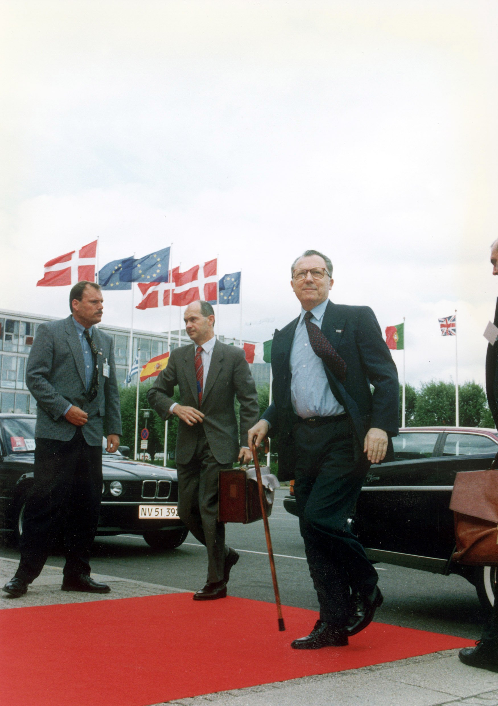
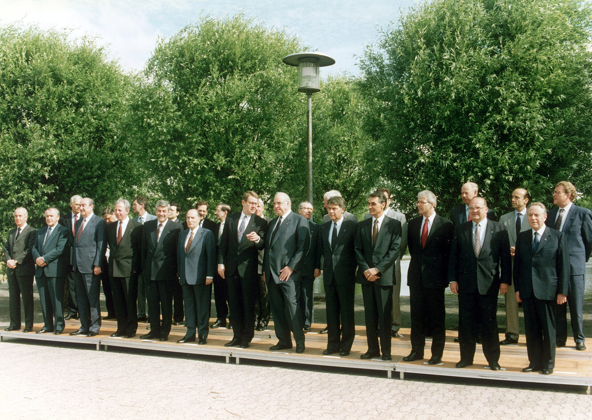
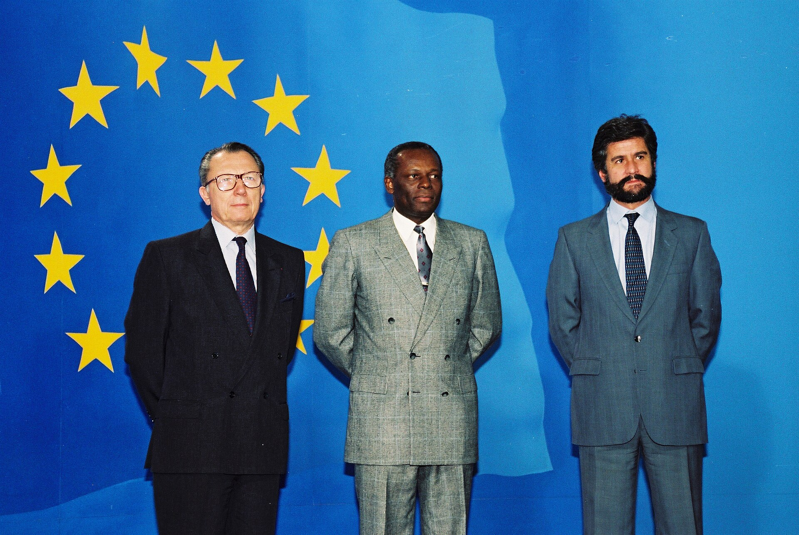

33年前の今日、1993年11月1日。オランダで調印されたマーストリヒト条約が発効し、それまでの「欧州共同体（EC）」を元にして「欧州連合（EU）」が正式に発足しました。国家が自らの主権を一部共有し、国境を越えた単一の市場と市民社会を築くという歴史的な実験が、ここに本格的なスタートを切ったのです。

## 戦争の惨禍から始まった共同管理の構想

ヨーロッパ統合の起源は、第一次世界大戦と第二次世界大戦という未曾有の惨禍にあります。荒廃したヨーロッパ大陸では、国家間の対立を生む過度なナショナリズムを克服し、二度と戦争を起こさないための仕組みが切実に求められていました。

1950年のシューマン宣言を経て、1951年のパリ条約によって設立された「欧州石炭鉄鋼共同体（ECSC）」がその第一歩でした。戦争の武器製造に欠かせない石炭と鉄鋼を国家間で共同管理することで、互いに武力衝突を起こせない仕組みを作ろうとしたのです。参加したのはフランス、西ドイツ、イタリア、ベルギー、オランダ、ルクセンブルクの6か国でした。

## 経済の枠組みから広がる共同体の歩み

1957年にはローマ条約が調印され、関税同盟を目指す「欧州経済共同体（EEC）」と原子力開発のための「欧州原子力共同体」が創設されました。1967年にはこれらが単一の制度に統合され、「欧州共同体（EC）」と呼ばれるようになります。

共同体は次第に拡大し、1973年にはイギリス、デンマーク、アイルランドが加盟。1981年にはギリシャ、1986年にはスペインとポルトガルが加わりました。1985年には加盟国間の国境審査を撤廃するシェンゲン協定が結ばれ、1990年の東西ドイツ再統一を経て、ヨーロッパ統合の勢いはさらに加速していきました。

*Copenhagen European Council, 21–22.06.1993 (P-002366 00-1) — 写真: Fernand Wauthy / CC BY 4.0*

## マーストリヒト条約がもたらした決定的な転換

冷戦終結という激動のなか、統一ドイツのコール首相とフランスのミッテラン大統領らが中心となり、共同体をより高次の連合へと発展させる議論が進められました。その結実が、1992年にオランダのマーストリヒトで署名された欧州連合条約（マーストリヒト条約）です。

1993年11月1日にこの条約が発効したことで、従来の経済中心だった枠組みは、外交・安全保障や司法・内政分野の協力をも包含する「欧州連合（EU）」へと改編されました。加盟国の国民には新たに「EU市民権」が与えられ、域内での自由な移動や居住の権利が法的に保障されることになったのです。

*Copenhagen European Council, 21–22.06.1993 (P-002366 00-4) — 写真: Fernand Wauthy / CC BY 4.0*

## 共通通貨ユーロへの道筋と単一市場の完成

マーストリヒト条約が掲げたもう一つの柱が、経済通貨同盟の創設でした。各国で異なっていた通貨を一つに束ねる構想が具体化し、1999年に共通通貨「ユーロ」が発足。2002年には12か国で紙幣と硬貨の流通が始まりました。

これにより、人、物、サービス、資本の4つが国境に遮られることなく行き交う巨大な単一市場が完成しました。国境を越えるたびに必要だった両替やパスポート審査が不要になり、ヨーロッパの人々の生活やビジネスの形態は劇的に変化していきました。

*事件当時の写真ではありません · 1991年 — 写真: EC / CC BY 4.0*

## 拡大と試練、そしてイギリスの離脱

EUはその後、旧共産圏の中・東欧諸国などを迎え入れ、2004年には過去最多となる10か国が一度に加盟するなど拡大を続けました。2009年にはリスボン条約が発効して制度改革が行われ、2012年にはヨーロッパの平和と和解に貢献したとしてノーベル平和賞を受賞しています。

一方で、加盟国の増加に伴う意見の調整難や経済格差、移民問題をめぐる対立など、新たな課題にも直面しました。2016年の国民投票を経て、2020年1月31日には主要メンバーであったイギリスがEUから離脱するという、歴史的な転機も経験しています。

## 今も受け継がれる平和と統合の理想

イギリス離脱後も、EUは27の加盟国を擁する国際社会の主要なアクターとして存在感を示しています。共通通貨ユーロは世界第2位の基軸通貨となり、ユーロ圏は21か国にまで広がりました。

かつて激しく戦火を交えた国々が、主権を分かち合いながら一つの食卓を囲むように議論を重ねる仕組みは、今もヨーロッパの日常として息づいています。1993年11月1日に灯された統合の火は、幾多の試練を乗り越えながら、平和への誓いとして受け継がれています。

### 参考資料

- <https://ja.wikipedia.org/wiki/%E6%AC%A7%E5%B7%9E%E5%85%B1%E5%90%8C%E4%BD%93>
- <https://commons.wikimedia.org/wiki/File:Copenhagen_European_Council,_21%E2%80%9322.06.1993_(P-002366_00-2).jpg>
- <https://commons.wikimedia.org/wiki/File:Copenhagen_European_Council,_21%E2%80%9322.06.1993_(P-002366_00-1).jpg>
- <https://commons.wikimedia.org/wiki/File:Copenhagen_European_Council,_21%E2%80%9322.06.1993_(P-002366_00-4).jpg>
- <https://commons.wikimedia.org/wiki/File:Visit_of_Jos%C3%A9_Eduardo_dos_Santos,_President_of_Angola,_to_the_CEC.jpg>
