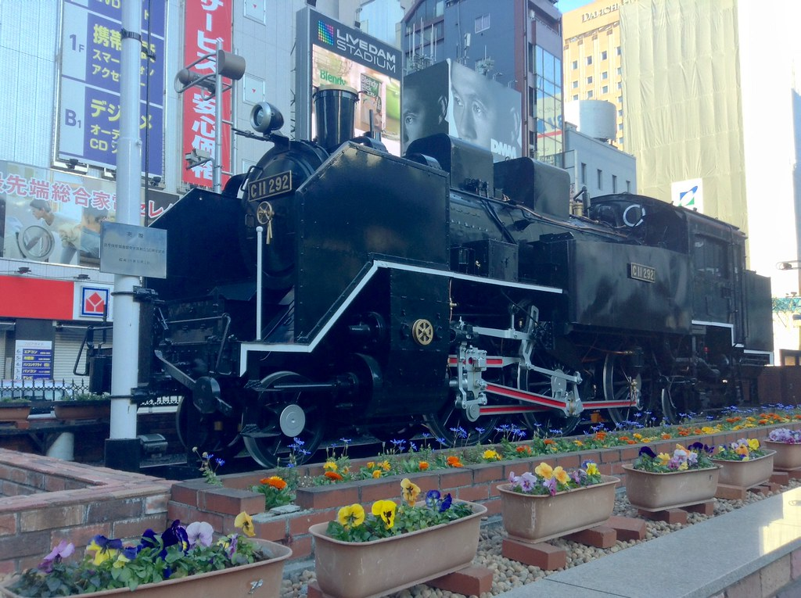
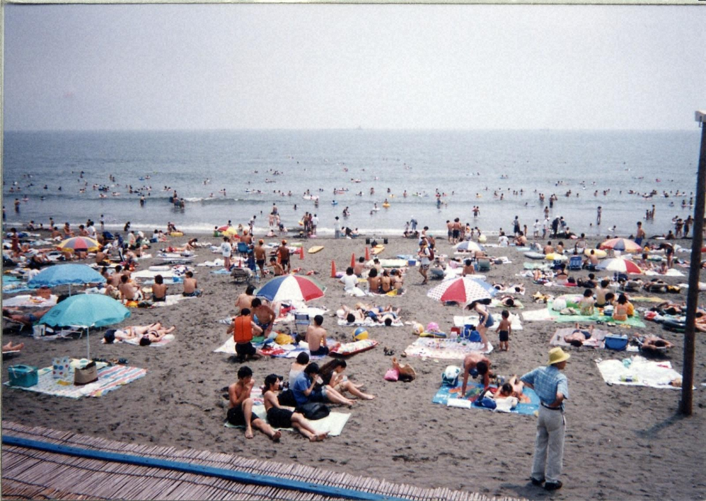
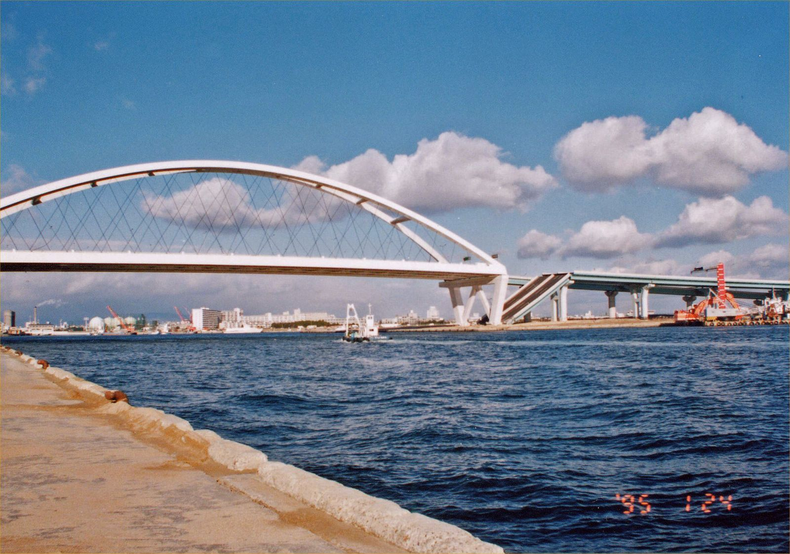

31年前の今日、1995年11月1日。東京臨海新交通臨海線、愛称「ゆりかもめ」の新橋駅（仮駅）から有明駅までの11.9キロが開業しました。運転士のいない最新鋭の無人自動運転システムを搭載した電車が、東京湾の上空を初めて駆け抜けた記念すべき一日です。

## なぜ臨海副都心に新交通システムが求められたのか

東京湾の埋立地を新たな都市拠点として再開発する計画は、1970年代から進められていました。1985年には鉄道工学者の八十島義之助を委員長とする計画委員会が設置され、都心と臨海副都心を結ぶ公共交通機関の検討が本格化します。

都心側の起点としては新橋駅のほか、浜松町駅、田町駅、品川駅の4案が浮上していました。その中から、先行して建設が進んでいたレインボーブリッジへの併設や、再開発が進む汐留・竹芝地区を経由できることから新橋ルートが選ばれました。導入方式にはモノレールやリニアなども候補に挙がりましたが、橋梁部での避難路確保の容易さや神戸ポートアイランド線などでの確かな実績から、ゴムタイヤで専用軌道を走る自動案内軌条式旅客輸送システム（AGT）が採用されました。

## 開業直前の大激震、都市博覧会の中止と「40億円の赤字予測」

ゆりかもめは、1996年に臨海副都心で開催される予定だった大型イベント「世界都市博覧会」への主要な輸送手段として大きな期待を集めていました。ところが、開業をわずか半年前の1995年4月に控えた時期、事態は一転します。

東京都知事選挙で博覧会中止を公約に掲げて当選した青島幸男知事が、開催中止を正式に決定したのです。最大の目玉イベントが突然消滅したことで、開業準備を進めていた新路線には激震が走りました。メディアや関係者からは「乗客が集まらず、年間40億円もの巨額の赤字を垂れ流すのではないか」と厳しい予測が飛び交い、ゆりかもめの船出には深い不安の影が差し込んでいました。

*SL open space in front of Shimbashi Station | 新橋駅前、SL広場 — 写真: over_frost / CC BY-SA 2.0*

## 1995年11月1日、期待と不安が交差した開業の朝

そうした懸念を抱えながら迎えた1995年11月1日、ゆりかもめは新橋駅（仮駅）から有明駅までの区間で営業運転を開始しました。車内に運転士や車掌の姿はなく、コンピューターによる自動列車運転装置（ATO）で制御される先端技術は、訪れた多くの利用者の目を引きました。

特に話題となったのが、芝浦ふ頭駅からレインボーブリッジへと進入する際のダイナミックなループ構造です。橋梁との大きな高低差を緩やかな勾配で乗り越えるために円を描く軌道は、まるでアトラクションのような爽快感を乗客に与えました。車両の最前列に陣取れば、運転席の窓越しに東京タワーや東京湾の大パノラマが一望でき、交通機関としてだけでなく、東京の新しい観光体験としても強い印象を刻みました。

*海水浴場#10 — 写真: chigamu / CC BY (Japan Search)*

## お台場ブームの到来と黒字化への大逆転劇

開業当初の数か月間、1日の乗客数は約2万7000人にとどまっていました。しかし、1996年に東京都が地区の用途指定を緩和し、オフィスや住宅だけでなく商業・娯楽施設の進出を後押ししたことで流れが大きく変わります。

お台場海浜公園の周辺に大型ショッピングモールやエンターテインメント施設が次々と誕生し、臨海副都心は一気に東京屈指の人気スポットへと変貌しました。開業からわずか1年で利用者は日野6万人に倍増し、やがて1日10万人以上を数える黒字路線へと急成長を遂げました。「年間40億円の赤字」という下馬評を鮮やかに覆し、ゆりかもめはお台場ブームを牽引する大立役者となったのです。

*1995年1月24日 西宮浜２丁目付近 — 写真: ndl / CC BY (Japan Search)*

## 豊洲への延伸と10億人突破、今も続く東京の景色

その後もゆりかもめは進化を続けました。2001年には新橋駅が現在のJR駅前へと移転延伸され、2006年3月27日には有明駅から豊洲駅までの2.7キロが延伸開業して、全線16駅、14.7キロのネットワークが完成しました。

沿線には東京ビッグサイトや豊洲市場などの重要施設が並び、ビジネスパーソンやイベント来場者、国内外の観光客を運ぶ欠かせない都市基盤となっています。2023年7月には、開業からの累計乗客数が10億人を突破しました。あの日、不安の中で東京湾の空へと走り出した無人電車は、いまや東京の海辺を象徴する風景として親しまれ続けています。

### 参考資料

- <https://ja.wikipedia.org/wiki/%E3%82%86%E3%82%8A%E3%81%8B%E3%82%82%E3%82%81%E6%9D%B1%E4%BA%AC%E8%87%A8%E6%B5%B7%E6%96%B0%E4%BA%A4%E9%80%9A%E8%87%A8%E6%B5%B7%E7%B7%9A>
- <https://www.flickr.com/photos/71481771@N00/2616997913>
- <https://www.flickr.com/photos/137724006@N08/24233034544>
- <https://jmapps.ne.jp/chigasaki_history/det.html?data_id=761>
- <https://adeac.jp/nishinomiya-city/catalog/0101000472>
