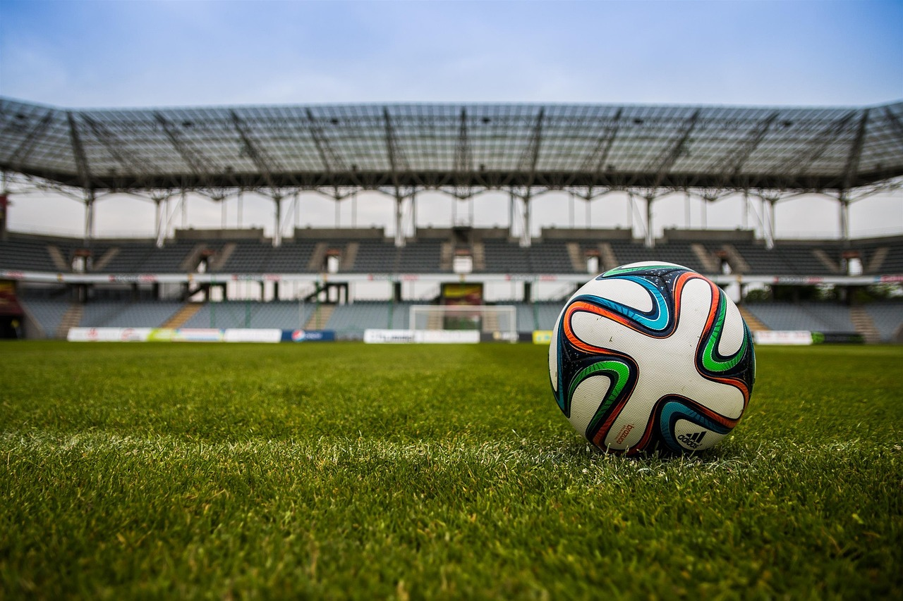

35年前の今日、1991年11月1日。社団法人日本プロサッカーリーグ、通称「Jリーグ」が文部省の認可を受け、正式に発足しました。実業団アマチュア中心だった日本のサッカー界が、世界の舞台を見据えた本格的なプロフェッショナル化へと大きく舵を切った瞬間でした。

## アマチュアリーグの低迷と代表の苦戦

Jリーグが誕生する前、日本のトップカテゴリーは日本サッカーリーグ（JSL）でした。1968年のメキシコ五輪で日本代表が銅メダルを獲得した当時は大きなブームを巻き起こしたものの、1980年代に入るとその人気は落ち込みを見せていました。

スタジアムの観客席には空席が目立ち、練習や試合を行うグラウンド環境も決して恵まれたものではありませんでした。国際舞台でも日本代表はアジアの強豪国を相手に苦しい戦いが続いており、競技全体の底上げが急務となっていました。

## ドイツを手本にしたプロ化構想

停滞する現状を打破し、ファンを呼び戻して代表チームを強化するため、日本サッカー協会（JFA）はプロリーグの創設という大改革を決意しました。

日本の関係者たちはヨーロッパ各地へと渡り、新しいリーグのあり方を模索しました。その中で手本として選ばれたのが、地域社会に根ざしたスポーツ文化を持つドイツのブンデスリーガでした。企業名ではなく地域名を冠したクラブチームが、地元と深く結びつきながら発展していく仕組みを目指したのです。

*当日の写真ではありません · 事件当時の写真ではありません · イメージ写真 — 写真: jarmoluk / Pixabay Content License*

## 1991年11月1日、10クラブでの正式発足

構想が具体化する中、1991年11月1日に文部省からの認可が下り、社団法人日本プロサッカーリーグが正式に発足しました。日本におけるプロサッカー組織の確固たる第一歩でした。

参加を決めたのは、日本サッカーリーグ1部から選ばれた8クラブ、2部からの1クラブ、そして市民クラブとして新たに誕生した清水エスパルスを加えた合計10クラブでした。翌1992年にはプレシーズン大会としてヤマザキナビスコカップが開催され、本開幕に向けた機運が全国で急速に高まっていきました。

## 1993年の開幕と空前のサッカー熱

1993年5月15日、東京の国立競技場で行われたヴェルディ川崎対横浜マリノスの開幕戦により、Jリーグの歴史的なファーストシーズンが幕を開けました。

色鮮やかなオープニングセレモニーとともに始まったリーグは、瞬く間に日本全国を巻き込む社会現象となりました。華やかなスタジアムの演出やトップレベルのプレーに多くの人々が魅了され、各地のスタジアムは満員の観客で埋め尽くされました。

## J2・J3の創設と全国への広がり

当初10クラブでスタートしたJリーグは、その後も着実に規模を拡大していきました。1999年には2部リーグであるJ2が創設され、クラブ間の昇降格システムが導入されます。

さらに2013年には3部リーグとなるJ3が設立され、プロサッカーの舞台は全国各地の都市へと広がっていきました。地方都市にも次々とプロクラブが根づき、地域活性化やスポーツ文化の拠点としての役割を果たすようになっていきました。

## 今も受け継がれる「Jリーグ百年構想」

Jリーグが掲げた「Jリーグ百年構想」は、日本全国に100のプロサッカークラブを作り、豊かなスポーツ文化を根づかせることを目指す長期ビジョンです。

1991年11月1日に文部省の認可を受けた小さな出発点から始まったプロリーグは、多くの人々の情熱と挑戦に支えられ、今も日本各地の街でその歩みを続けています。

### 参考資料

- <https://ja.wikipedia.org/wiki/%E6%97%A5%E6%9C%AC%E3%83%97%E3%83%AD%E3%82%B5%E3%83%83%E3%82%AB%E3%83%BC%E3%83%AA%E3%83%BC%E3%82%B0>
- <https://pixabay.com/photos/football-grass-ball-green-grass-2778583/>
- <https://pixabay.com/photos/football-ball-soccer-field-stadium-488714/>
