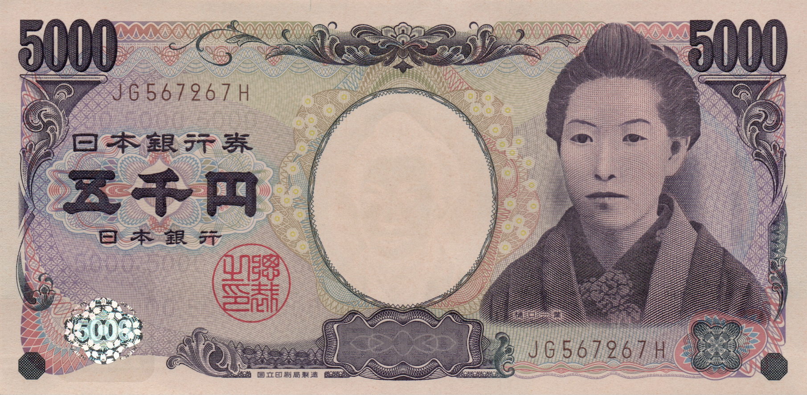
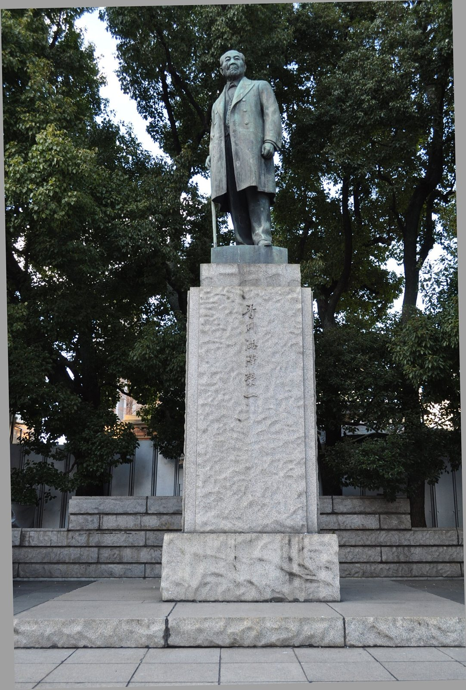
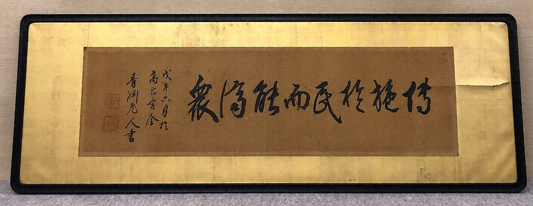

22年前の今日、2004年（平成16年）11月1日。日本で新しい日本銀行券、いわゆるE号券の発行が開始されました。1984年のD号券発行以来、ちょうど20年ぶりとなる本格的な紙幣の改刷でした。千円札には野口英世、五千円札には樋口一葉が選ばれ、一万円札は旧紙幣に続いて福澤諭吉が引き継がれました。全国の銀行窓口には、発行初日の新しいお札を手に入れようと朝から長い列ができました。

## 20年ぶりに刷新された3つの券種

日本銀行券は、日本の中央銀行である日本銀行が発行する法定通貨です。1984年11月1日に発行が始まったD号券（一万円券が福澤諭吉、五千円券が新渡戸稲造、千円券が夏目漱石）から20年の節目を迎え、偽造防止技術の向上などを目的に新たなE号券が導入されることになりました。対象となったのは一万円、五千円、千円の3券種で、2000年に発行されていた二千円券はそのまま維持されました。

## 異例の続投となった福澤諭吉の一万円札

この改刷において大きな特徴となったのが、最高額紙幣である一万円札の肖像でした。五千円札と千円札の肖像が新しく交代する中で、一万円札の肖像には旧紙幣と同じ慶應義塾創設者の福澤諭吉が引き続き採用されたのです。日本の紙幣刷新において、同じ人物の肖像が続けて最高額紙幣に採用されるのは極めて異例のことでした。福澤諭吉の一万円札は、昭和末期から平成、そして令和の初頭に至るまで、40年近くにわたり日本の最高額紙幣の顔として定着することになりました。

*5000 yen banknote (Series E), obverse — 写真: Nippon Ginko, Government of Japan / Public domain*

## 24歳で早世した樋口一葉が五千円札の肖像に

五千円札の新たな肖像に選ばれたのは、明治期の小説家である樋口一葉でした。本名を奈津といい、歌塾「萩の舎」で和歌や古典文学を学んだ後、生活苦の中で筆を執り、『たけくらべ』『にごりえ』『十三夜』といった後世に残る名作をわずか1年半ほどの間に次々と発表しました。しかし、24歳の若さで肺結核により亡くなっています。近代の女性文化人として紙幣の肖像に採用されたことは、当時社会的に大きな話題を呼びました。

*Eiichi Shibusawa-1 — 写真: Fumio Asakura / CC BY-SA 4.0*

## 初日の銀行窓口に並んだ人々の熱気

2004年11月1日の朝、全国の日本銀行の本支店から民間金融機関へと新紙幣が払い出され、営業開始とともに一般の利用者の手へと渡っていきました。多くの銀行の窓口前には記念に新札へ両替しようとする人々が列を作り、真新しい紙幣を受け取ると、光にかざして透かしを確かめたり、新しいデザインの肖像を見つめたりしていました。紙幣の原料である三椏やマニラ麻の独特の風合いと、最新の偽造防止技術が施された新しいお札は、こうして人々の日常の経済活動へと溶け込んでいきました。

*渋沢栄一書扁額「博施於民而能済衆」 — 写真: 渋沢栄一 / CC BY (Japan Search)*

## 新紙幣の歴史と今も残る法定通用力

日本銀行券はその後、2024年（令和6年）7月3日にさらなる改刷が行われ、F号券として一万円札に渋沢栄一、五千円札に津田梅子、千円札に北里柴三郎が採用されました。これによって福澤諭吉の一万円札と樋口一葉の五千円札の新規発行は役目を終えましたが、法律上無効になっていないため、今でも通常の買い物や決済において無制限に使用できる強制通用力を持っています。平成という時代を象徴するお札となったE号券は、今も私たちの暮らしの中にその記憶をとどめています。

### 参考資料

- <https://ja.wikipedia.org/wiki/%E7%A6%8F%E6%BE%A4%E8%AB%AD%E5%90%89>
- <https://commons.wikimedia.org/wiki/File:Japanse_meisjes_met_yen_travellers_cheques_van_American_Express,_Bestanddeelnr_926-9909.jpg>
- <https://commons.wikimedia.org/wiki/File:5000_yen_banknote_(Series_E),_obverse.png>
- <https://commons.wikimedia.org/wiki/File:Eiichi_Shibusawa-1.jpg>
- <https://online.bunka.go.jp/heritages/detail/540711>
