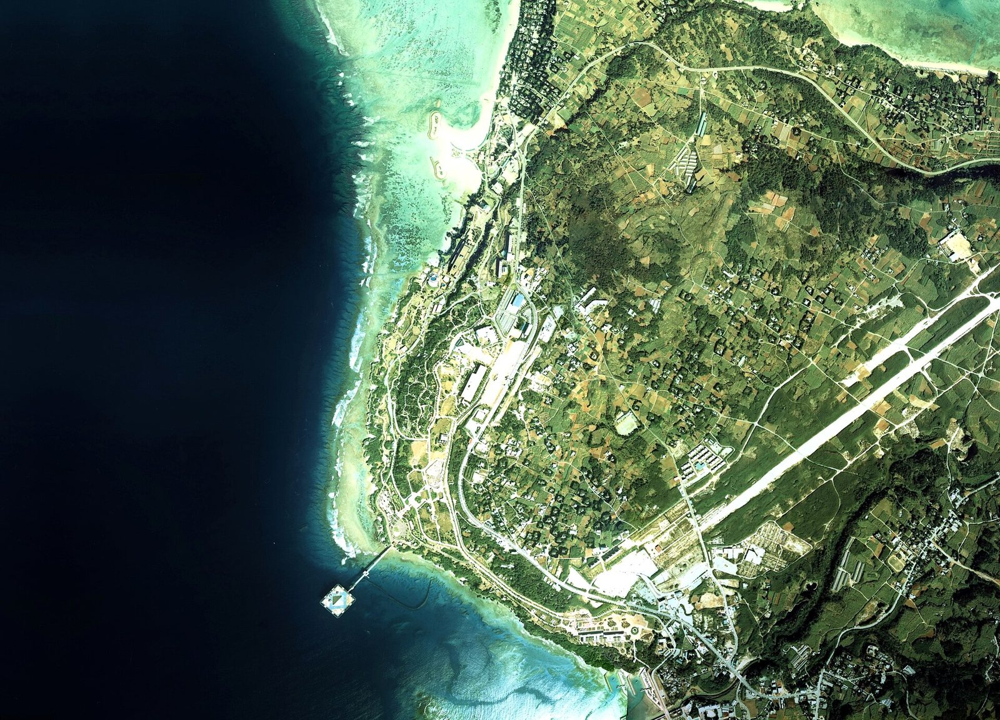
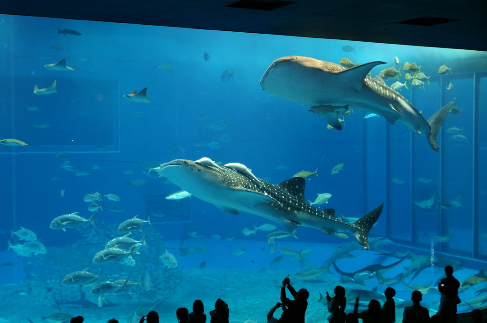
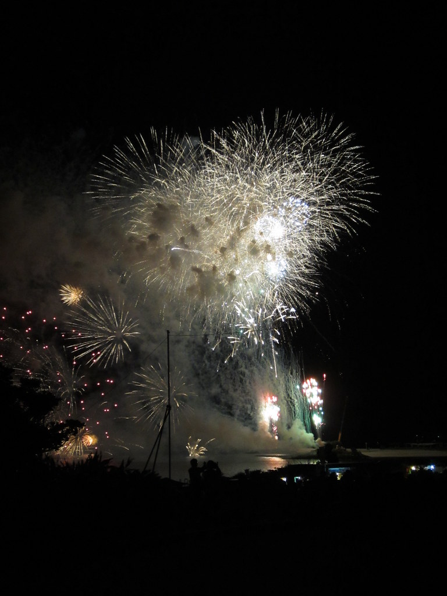

24年前の今日、2002年11月1日。沖縄県国頭郡本部町の海洋博公園内に「沖縄美ら海水族館」が開館しました。視界いっぱいに広がる青の世界と、悠然と泳ぐ巨大なジンベエザメ。当時世界一の規模を誇った大水槽は、訪れた人々に圧倒的な感動を与え、沖縄観光の勢力図を大きく塗り替えることになりました。

## 海洋博の遺産と老朽化の危機

美ら海水族館のルーツは、1975年に本部町で開催された沖縄国際海洋博覧会（海洋博）にあります。沖縄の本土復帰記念事業として開催されたこの博覧会で海洋生物園が出展され、跡地に整備された国営沖縄海洋博記念公園内に、1979年8月「国営沖縄海洋博記念公園水族館」が開館しました。当時としても水量1100トンの大水槽は世界最大を誇り、多くの来場者を集めました。

しかし、博覧会向けに短期間で建設された施設だったため建物の老朽化が急速に進行。さらに1990年代のバブル崩壊以降は観光客の減少も重なり、年間の入館者数は約43万人強にまで落ち込んでいました。沖縄の海の魅力を正しく伝え、地域を活性化させるための全面的な刷新が強く求められていたのです。

## 公募で名付けられた「美ら海」と復帰30周年の開館

内閣府沖縄総合事務局が主体となって進められた新館建設プロジェクトは、沖縄の本土復帰30周年に合わせて結実しました。旧水族館は2002年8月31日に役目を終えて閉館。地元沖縄出身の建築家・国場幸房氏の設計により、新たな命を吹き込まれた新館が2002年11月1日に開館を迎えました。

館名となった「美ら海」は、一般公募によって選定されたものです。沖縄の方言で「清らかで美しい海」を意味する言葉を冠し、「沖縄の海との出会い」をコンセプトに据えて、浅瀬のサンゴ礁から黒潮の海、そして神秘の深海までを巡る壮大な展示構成が整えられました。

*Okinawa Commemorative National Government Park Ocean Exposition Area Aerial photograph.1977 — 写真: 国土交通省 / Attribution*

## 深さ10メートルの秘密と世界一のアクリルパネル

美ら海水族館の代名詞となったのが、1階から2階を貫く大水槽「黒潮の海」です。長さ35メートル、幅27メートル、深さ10メートル、水量7500立方メートルに及ぶこの大水槽は、開館当時、単体の水槽として世界最大の規模を誇りました。

観客を驚かせたのは、視界を遮る柱のない巨大なガラス面でした。高さ8.2メートル、幅22.5メートル、厚さ60センチ、総重量135トンにもなるアクリルパネルは、ギネスブック公認の世界最大記録を樹立しました。水深が10メートルに設定されたのには明確な理由がありました。成熟すると9メートル前後に達するジンベエザメは、水面で餌を食べる際に体を垂直にする習性があります。立ち泳ぎになった巨大な魚の尾が水底を擦って傷つかないよう、精密な生態観察に基づいて導き出された深さでした。

*Okinawa Churaumi Aquarium — 写真: Hyougushi / CC BY-SA 2.0*

## 1年で来館者6倍、275万人への激増

開館と同時に、日本中から観光客が本部町へと押し寄せました。新館がオープンした直後の1年間の入館者数は、旧館時代の43万人から約6.4倍となる275万人へと跳ね上がりました。

当時は、前年のアメリカ同時多発テロ事件の影響で基地を抱える沖縄旅行が敬遠された時期を経ていましたが、NHK連続テレビ小説『ちゅらさん』による沖縄ブームや、海外渡航を控えた旅行客の国内回帰などが追い風となりました。巨大なジンベエザメやナンヨウマンタが頭上を旋回する光景はテレビや雑誌で繰り返し報じられ、美ら海水族館は沖縄観光の絶対的なランドマークとしての地位を一気に確立したのです。

*Ocean Expo Summer Festival — 写真: Nelo Hotsuma / CC BY 2.0*

## イルカのフジと世界初の繁殖研究

美ら海水族館は観光地としてだけでなく、海洋生物の研究・保護機関としても世界を牽引してきました。周辺施設である無料の「オキちゃん劇場」では、病気で尾びれの大部分を失ったバンドウイルカ「フジ」が世界初の人工尾びれを装着してジャンプを復活させ、のちに書籍や映画『ドルフィンブルー フジ、もういちど宙へ』となって全国に勇気を与えました。

また大水槽「黒潮の海」では、世界で初めてとなるナンヨウマンタの飼育下繁殖に成功したほか、ジンベエザメの長期飼育記録の更新、深海生物の新種発見など、世界水準の飼育・繁殖技術を証明し続けています。

## 5000万人を迎え、未来へ続く海の記憶

2002年の開館から歩みを止めることなく、2017年度には年間入館者数が378万人を突破。開館から約17年が経過した2019年6月29日には、累計入館者数5000万人という金字塔を打ち立てました。

かつて老朽化に直面していた博覧会跡地の水族館は、海の命をありのままに伝えたいという情熱と技術によって、世界に誇る海洋拠点へと生まれ変わりました。青い光に包まれた大水槽の前で息をのんだあの日から24年。美ら海水族館は今も、沖縄の豊かな海の息吹を伝え続けています。

### 参考資料

- <https://ja.wikipedia.org/wiki/11%E6%9C%881%E6%97%A5>
- <https://commons.wikimedia.org/wiki/File:Micro_cosmos_(2113152913).jpg>
- <https://commons.wikimedia.org/wiki/File:Okinawa_Commemorative_National_Government_Park_Ocean_Exposition_Area_Aerial_photograph.1977.jpg>
- <https://www.flickr.com/photos/71481771@N00/405468912>
- <https://www.flickr.com/photos/63122283@N06/15691768905>
