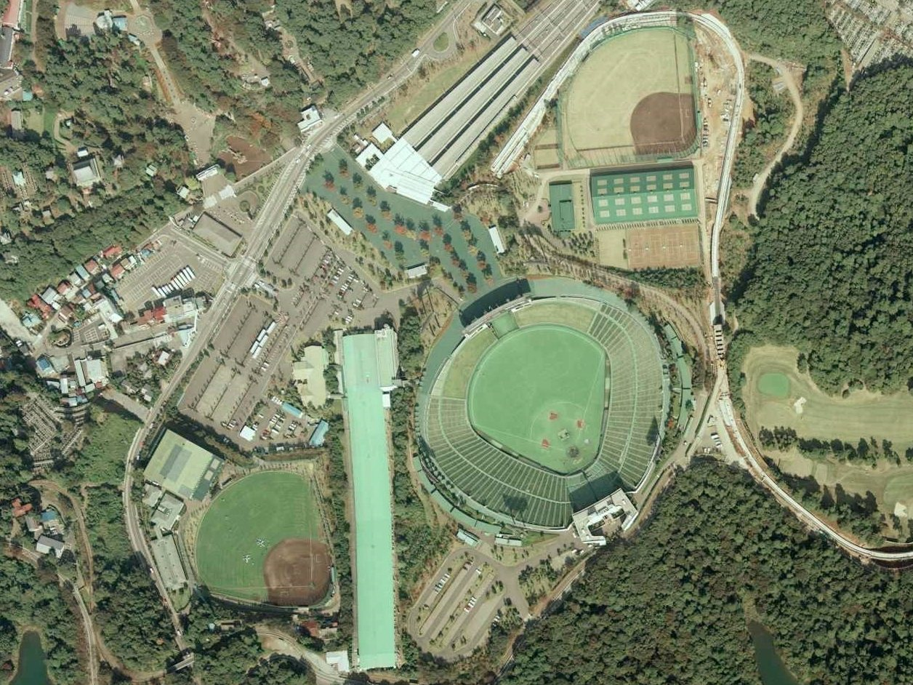
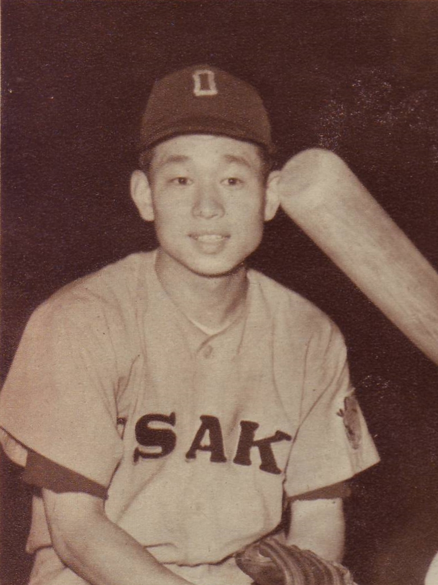
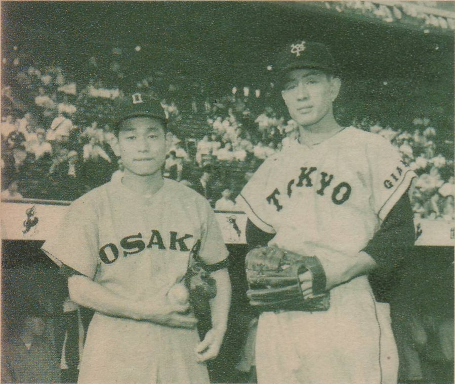

41年前の今日、1985年11月2日。プロ野球の日本シリーズ第6戦が行われ、阪神タイガースが西武ライオンズを破り、対戦成績4勝2敗で球団史上初となる2リーグ制での日本一を達成しました。1リーグ時代の1947年以来、実に38年ぶりとなる悲願の頂点に、関西をはじめ日本列島が歓喜に包まれました。

## 21年ぶりのセ・リーグ優勝と猛虎打線の爆発

1985年の阪神タイガースは、吉田義男監督のもとで圧倒的な攻撃力を誇るチームへと変貌を遂げていました。1番の真弓明信選手から始まり、ランディ・バース選手、掛布雅之選手、岡田彰布選手と続く中軸打線は他球団の投手陣を震え上がらせました。

特に助っ人のバース選手は打率、本塁打、打点の打撃三冠王を獲得する大活躍を見せました。チームは1964年以来21年ぶりとなるセントラル・リーグ優勝を飾り、勢いそのままに日本シリーズへと乗り込みました。

## 常勝・西武ライオンズとの激突と全試合指名打者制

日本シリーズで迎え撃った相手は、パシフィック・リーグを圧倒的な強さで制した広岡達朗監督率いる西武ライオンズでした。西武は防御率1位の工藤公康投手をはじめ、東尾修投手、松沼博久投手ら豪華な投手陣を擁し、「管理野球」で黄金期を築きつつありました。

また、この1985年の日本シリーズは、史上初めて全試合で指名打者（DH）制が採用された大会でもありました。阪神は全6試合で弘田澄男選手を2番指名打者に起用し、切れ目のない打線を組み上げて西武に挑みました。

*Seibu Stadium aerialphotograph 1984 — 写真: 国土地理院 / CC BY 4.0*

## バースの3試合連続弾と西武の反撃

第1戦は敵地・西武球場で阪神の2年目・池田親興投手が西武打線を完封し、バース選手の先制3点本塁打で快勝します。続く第2戦もバース選手の逆転2ラン本塁打などで連勝し、阪神が本拠地・甲子園球場へと凱旋しました。

甲子園で行われた第3戦では5万1千人を超える大観衆の前で、バース選手がシリーズ3試合連続となる本塁打を放ちます。しかし西武も意地を見せ、第3戦と第4戦を連勝して2勝2敗のタイに持ち込みました。迎えた第5戦、不振に苦しんでいた掛布選手に先制3点本塁打が生まれ、阪神が王手をかけました。

*Yoshio Yoshida 1956 Scan10012 — 写真: 博友社 (Hakuyu-sha Co., Ltd.) / Public domain*

## 運命の第6戦、満塁本塁打とゲイルの力投

舞台を再び西武球場に戻した11月2日の第6戦。試合は初回から大きく動きました。1回表、阪神は二死満塁のチャンスを作ると、6番の長崎啓二選手が右翼席へ飛び込む先制の満塁本塁打を放ち、主導権を握ります。

阪神は2回に真弓選手がソロ本塁打、9回には掛布選手が2ラン本塁打を放って着実に加点しました。投げては先発のリチャード・ゲイル投手が西武打線を7安打3失点に抑えて力投。最後は伊東勤選手を投ゴロに打ち取り、9回を投げ抜いて完投勝利を収めました。

*Yoshio Yoshida and Tatsuro Hirooka 1956 Scan10007 — 写真: 博友社 (Hakuyu-sha Co., Ltd.) / Public domain*

## 宙を舞った吉田監督と最高殊勲選手賞のバース

試合終了の瞬間、阪神の選手たちはマウンドへ駆け寄り、歓喜の輪が広がりました。小柄な名遊撃手としてチームを支え、監督としてチームを頂点に導いた吉田義男監督の体が夜空高く胴上げされました。

打率.368、3本塁打、9打点を記録したバース選手が文句なしの最高殊勲選手賞（MVP）を獲得しました。また、2試合連続本塁打を放った長崎選手、中押し弾を決めた真弓選手、完投勝利を挙げたゲイル投手が優秀選手賞に輝きました。

## 今も色あせない1985年の熱狂と記憶

1950年にプロ野球がセ・パ2リーグ制に分かれてから、阪神タイガースにとってこれが初めての日本一の栄冠でした。1947年の1リーグ時代以来、38年ものあいだ待ち望んだファンの熱気は凄まじく、関西の街は大騒動となりました。

強打で打ち勝つ豪快な野球と、個性豊かな選手たちが躍動した1985年の日本シリーズは、プロ野球の歴史に刻まれた屈指の名勝負として、今も多くの人々の記憶に鮮やかに残っています。

### 参考資料

- <https://ja.wikipedia.org/wiki/%E9%98%AA%E7%A5%9E%E3%82%BF%E3%82%A4%E3%82%AC%E3%83%BC%E3%82%B9>
- <https://www.flickr.com/photos/54217251@N05/15026981126>
- <https://commons.wikimedia.org/wiki/File:Seibu_Stadium_aerialphotograph_1984.jpg>
- <https://commons.wikimedia.org/wiki/File:Yoshio_Yoshida_1956_Scan10012.JPG>
- <https://commons.wikimedia.org/wiki/File:Yoshio_Yoshida_and_Tatsuro_Hirooka_1956_Scan10007.JPG>
