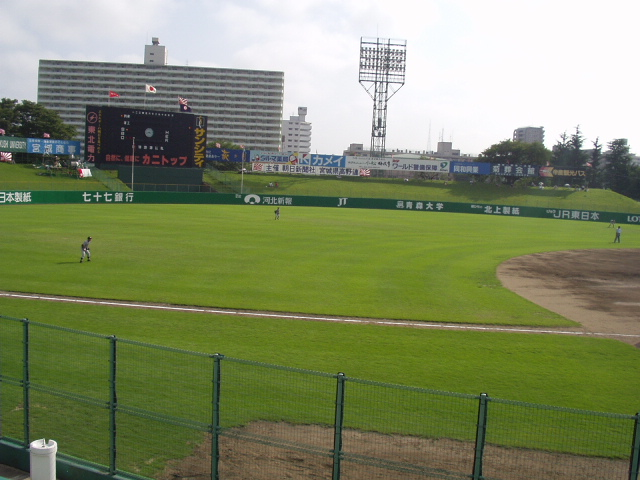
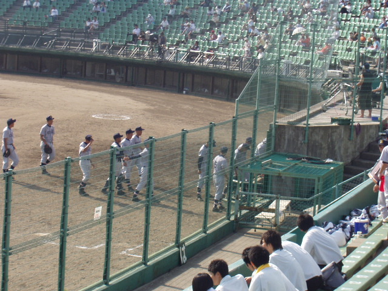
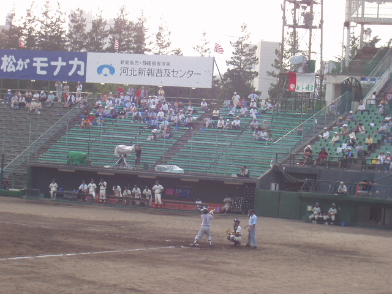

22年前の今日、2004年11月2日。東京都内で開かれたプロ野球のオーナー会議において、東北楽天ゴールデンイーグルスのパシフィック・リーグ新規参入が全会一致で承認されました。新規参入によるプロ野球球団の誕生は、1954年の高橋ユニオンズ以来、実に50年ぶりとなる歴史的な決定でした。東北の地に初めてプロ野球の本拠地球団が誕生することとなり、仙台市をはじめとする全国の野球ファンに大きな驚きと歓喜が広がりました。

## 50年ぶりの新球団誕生とオーナー会議の全会一致承認

2004年11月2日、東京都内のホテルでプロ野球のオーナー会議が開催されました。この会議の最大の議題は、パシフィック・リーグへの新規参入球団の選定でした。三木谷浩史氏をオーナーとする株式会社楽天野球団の「東北楽天ゴールデンイーグルス」が審査を受け、出席したオーナーたちによる全会一致の承認を得て正式にパ・リーグへの加盟が決定しました。

日本プロ野球において、既存球団の買収や親会社変更ではなく、新規参入という形で球団が新設されるのは1954年の高橋ユニオンズ以来、半世紀ぶりの快挙でした。50年もの間、球団数や参入の壁が動かなかった日本プロ野球界において、新たな企業の参入が全会一致で認められたことは、球界の構造が大きく動いた瞬間として記録されました。

## 本拠地に選ばれた宮城球場とその歴史

新球団の本拠地として承認されたのは、宮城県仙台市宮城野区の宮城野原公園総合運動場内にある宮城球場でした。条例上の正式名称は「宮城野原公園宮城球場」ですが、一般には宮城球場、報道などでは仙台宮城球場という通称でも親しまれてきた施設です。施設自体は宮城県が所有しており、楽天野球団が都市公園法に基づく管理許可制度によって運営管理を担う体制が整えられました。

この宮城球場は、第二次世界大戦後のGHQ占領期に大日本帝国陸軍練兵場の跡地に造成され、日本プロ野球がセ・パ2リーグ制に移行した1950年5月に開場した歴史を持ちます。開場直前の1950年5月5日には、毎日対南海などの変則ダブルヘッダー公式戦に早朝から数千人の群衆が詰めかけ、将棋倒しで3名が即死、フェンス倒壊で重軽傷者が出るという激しい熱気の歴史も刻まれていました。

*Miyagi Stadium outfield — 写真: sho_lab baseball / CC BY-SA 2.0*

## 地元が育てたスタジアムとロッテ本拠地時代

宮城球場は、長年にわたり東北のアマチュア野球やプロ野球の舞台となってきましたが、当初は夜間照明設備がありませんでした。1972年までは照明がなかったためナイトゲームを開催することができませんでしたが、河北新報社を中心に県内15の有力企業・団体が共同で東北野球企業を設立しました。

この東北野球企業の資金援助によって大規模改修が実施され、6基の照明塔が新設されて夜間公式戦に必要な照度が確保されたほか、得点を電光で掲示できるスコアボードも導入されました。いずれも東北地方の野球場では初めての設備でした。そして1973年から1977年までは、パ・リーグのロッテオリオンズが専用球場（本拠地）として使用しました。東北楽天ゴールデンイーグルスは、この由緒あるスタジアムを再びパ・リーグの本拠地として甦らせることになったのです。

*Miyagi Stadium backstop — 写真: sho_lab baseball / CC BY-SA 2.0*

## 日本初となった施設命名権の導入と激動の変遷

新球団の誕生に伴い、宮城県と楽天野球団は2005年1月7日に「宮城球場ネーミングライツ基本協定書」を締結し、球場に愛称をつける命名権（ネーミングライツ）を売り出しました。公募の結果、労働者派遣大手のフルキャストが年額2億円で契約を結び、2005年3月20日から「フルキャストスタジアム宮城」（通称フルスタ宮城）としてスタートしました。

しかし2007年8月、フルキャストが労働者派遣法で禁止されている業務への違法派遣により業務停止処分を受けました。宮城県の村井嘉浩知事が遺憾の意を示し、同社からの契約解除申し出を経て、同年10月のシーズン最終戦をもって命名権契約が解消されました。日本のプロ野球本拠地において命名権契約が途中で解消されるのは初めての出来事でした。その後、2008年からは日本製紙が命名権を取得し、グループのティッシュ商品名を冠した「クリネックススタジアム宮城」（Kスタ宮城）となりましたが、直後に同社の古紙配合率偽装問題が起き、社名を一時外す措置が取られるなど、黎明期の命名権ビジネスは波乱の連続でした。

*Miyagi Stadium infield seats — 写真: sho_lab baseball / CC BY-SA 2.0*

## ボールパークへの進化と今も続く歩み

その後、宮城球場は2014年に「楽天Koboスタジアム宮城」、2017年にはスタジアムから魅力向上を目指す「ボールパーク化」を反映して「Koboパーク宮城」へと改名されました。さらに「楽天生命パーク宮城」、「楽天モバイルパーク宮城」を経て、2026年からは「楽天モバイル 最強パーク宮城」として3年間の契約更新が行われています。

1954年の高橋ユニオンズ以来、50年ぶりの新規参入として誕生した東北楽天ゴールデンイーグルスは、東北のファンとともに歩み、歴史ある宮城球場を現代的なボールパークへと進化させました。2004年11月2日に下されたオーナー会議の全会一致の承認は、プロ野球の地図を大きく塗り替えた転換点として、今も鮮やかに語り継がれています。

### 参考資料

- <https://ja.wikipedia.org/wiki/%E6%9D%B1%E4%BA%AC%E9%83%BD>
- <https://commons.wikimedia.org/wiki/File:Miyagi_Stadium_seats.jpg>
- <https://commons.wikimedia.org/wiki/File:Miyagi_Stadium_outfield.jpg>
- <https://commons.wikimedia.org/wiki/File:Miyagi_Stadium_backstop.jpg>
- <https://commons.wikimedia.org/wiki/File:Miyagi_Stadium_infield_seats.jpg>
