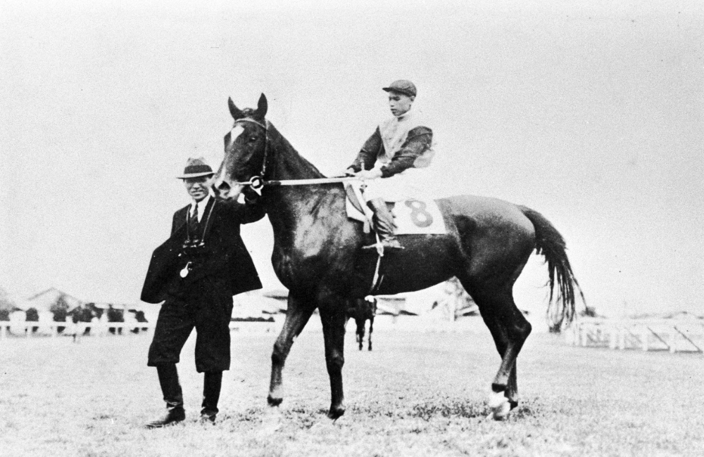
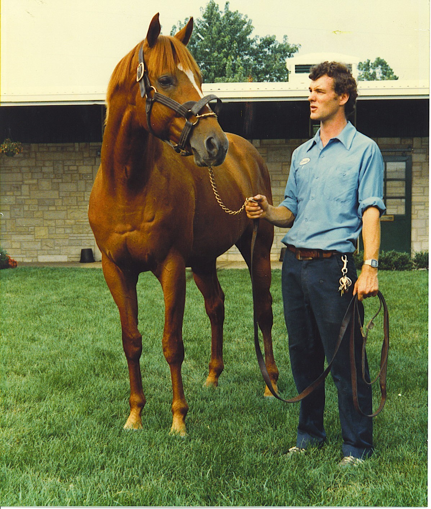
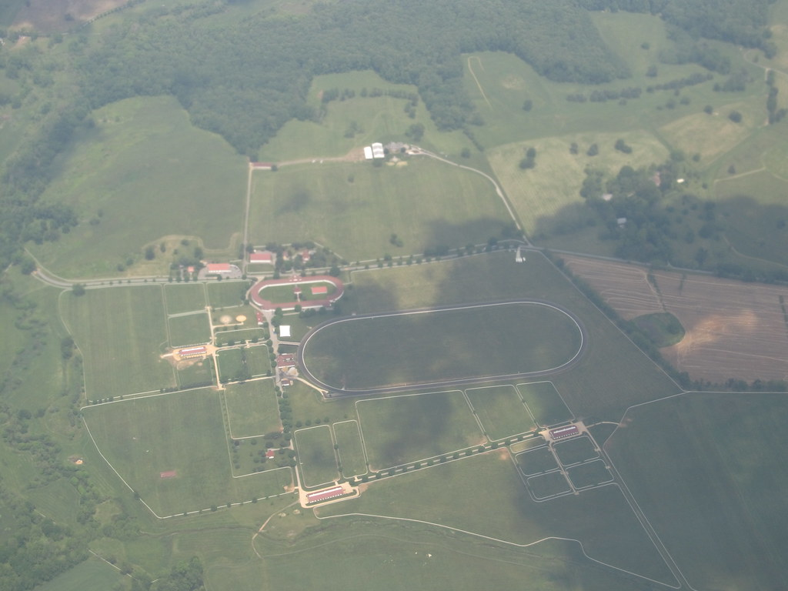

40年前の今日、1986年11月2日。京都競馬場で開催された第11回エリザベス女王杯で、1番人気のメジロラモーヌが優勝しました。春の桜花賞、優駿牝馬（オークス）に続く勝利で、日本の中央競馬史上初となる「牝馬三冠」の金字塔を打ち立てました。

## 期待されていなかった幼駒からの出発

1983年4月9日、北海道伊達市のメジロ牧場で一頭の牝馬が誕生しました。父は新種牡馬のモガミ、母はメジロヒリュウ。「俊飛」と名付けられたその仔馬は、幼い頃に両後脚の飛節に難を抱え、性格もおとなしく、当初は目立つ存在ではありませんでした。同期の牝馬のなかでも最後まで預け先が決まらず、1984年7月になってようやく奥平真治調教師が管理を引き受けることになりました。

ところが、育成が進むにつれて脚の難点が解消し、バランスの取れた馬体へと変貌を遂げていきます。担当厩務員の小島浩三さんは、その大きな腹袋から優れた心肺機能を見抜いていました。フランス・アルプスの鋭い岩峰にちなんで「メジロラモーヌ」と名付けられた彼女は、1985年10月の東京競馬場のデビュー戦で2着に20馬身以上の大差をつけて圧勝し、非凡な才能を世に知らしめました。

## 春のクラシック二冠を圧倒的な強さで制覇

明けて1986年、4歳を迎えたメジロラモーヌは、関西のトップジョッキーである河内洋騎手を鞍上に迎え、牝馬クラシック戦線へと駒を進めました。トライアルの報知杯4歳牝馬特別を直線一気の追い込みで制すると、4月6日の本番・桜花賞でも好位から力強く抜け出して優勝。メジロ牧場にとって悲願のクラシック初制覇をもたらしました。レース後の記念撮影では、河内騎手が馬上で、2年前に他界した牧場総帥・北野豊吉氏の遺影を高く掲げました。

続く優駿牝馬（オークス）に向けては、それまで敗戦を喫していた東京競馬場の克服が課題でした。しかし前哨戦のサンスポ賞4歳牝馬特別を快勝してジンクスを打ち破ると、5月18日のオークス本番ではスタートの躓きをものともせず、インコースを立ち回って2馬身半差の完勝。10年ぶり史上7頭目となる牝馬クラシック二冠を達成しました。その圧倒的なレースぶりは、関係者から「テスコガビーを超えた」と絶賛されました。

*事件当時の写真ではありません · 1943年 — 写真: Japan Racing Association (JRA) / Public domain*

## 体調不安を抱えて挑んだ運命のエリザベス女王杯

歴史的偉業となる「牝馬三冠」を懸けた秋、メジロラモーヌを試練が襲いました。夏の函館で夏負けを発症して美浦トレセンへ戻り、全身に笹針治療を施す事態となります。さらに調教中の歩行異常なども重なり、秋の始動は予定より遅れました。10月の前哨戦・ローズステークスは辛うじてクビ差で勝利したものの、陣営の不安は完全に拭えませんでした。

迎えた11月2日、京都競馬場でのエリザベス女王杯。奥平調教師が後に「調子は70パーセントくらいだった」と振り返る状態でしたが、単勝オッズ1.3倍という圧倒的な支持を集めました。前身のビクトリアカップ創設以来、誰も成し遂げたことのない牝馬三冠へ向け、ファンも固唾をのんで見守っていました。

*事件当時の写真ではありません · 1981年 — 写真: Visindar / CC BY-SA 3.0*

## 「早いのか、これでいいのか」緊迫のロングスパート

レースが始まると、メジロラモーヌは好位3番手を進みました。しかし、勝負どころの第3コーナー、残り800メートルの下り坂に差し掛かったところで、河内騎手は早くも馬を促して先頭へと並びかけます。京都の坂越えでの早すぎる仕掛けに場内は騒然となり、テレビ中継の実況を担当していた杉本清アナウンサーは思わず「河内、河内、早いのか、これでいいのか」と叫びました。

最後の直線に入り、メジロラモーヌは懸命に先頭を維持します。しかし、過酷なローテーションと体調の影響からか、ゴール前で脚色が鈍り始めました。外からスーパーショットが猛然と追い込み、馬体を並べてゴール板を通過。わずかクビ差、ラモーヌのハナ先が前に出ていました。前人未到の中央競馬史上初となる牝馬三冠が達成された瞬間でした。

*事件当時の写真ではありません — 写真: Ken Lund / CC BY-SA 2.0*

## 前哨戦もすべて勝った「完全三冠」の誇り

メジロラモーヌの快挙が今なお特別視される理由の一つに、本番だけでなく、桜花賞・オークス・エリザベス女王杯のトライアル競走3レースもすべて1着で通過した「完全三冠」であった点が挙げられます。この勝利で当時の重賞6連勝を記録し、獲得賞金は牝馬として日本競馬史上初めて3億円の大台を突破しました。

その後、牝馬三冠の最終戦は1996年から新設の秋華賞へと引き継がれ、エリザベス女王杯は古馬牝馬も交えた頂上決戦へと姿を変えました。数々の名牝が登場する現代にあっても、困難を乗り越えて最初の扉を開いたメジロラモーヌの気高き走りは、色褪せることのない伝説として語り継がれています。

### 参考資料

- <https://ja.wikipedia.org/wiki/%E3%82%A8%E3%83%AA%E3%82%B6%E3%83%99%E3%82%B9%E5%A5%B3%E7%8E%8B%E6%9D%AF>
- <https://commons.wikimedia.org/wiki/File:Kyoto_Daishogai53S.jpg>
- <https://commons.wikimedia.org/wiki/File:Kurifuji_at_Kyoto_Racecourse_3_October_1943.png>
- <https://commons.wikimedia.org/wiki/File:Affirmed_at_Spendthrift_Farm_1981.jpg>
- <https://www.flickr.com/photos/75683070@N00/7235283756>
