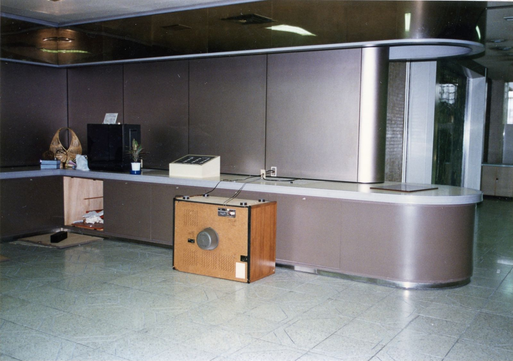

31年前の今日、1995年11月2日。日本テレビ系列で、男性アイドルグループ・TOKIOにとって初となる本格的な冠バラエティ番組『鉄腕!DASH!!』の放送が始まりました。今や日曜夜の定番として親しまれるこの番組ですが、その原点は木曜深夜のわずか30分枠にありました。

## 深夜枠で幕を開けた「人間の限界」への挑戦

1995年11月2日の木曜日、夜11時25分から11時55分までの30分枠で『鉄腕!DASH!!』はスタートしました。日本たばこ産業（JT）の一社提供で制作されたこの番組は、TOKIOが「人間の限界」に挑戦する新しいタイプのバラエティとして企画されたものです。

当時の放送スタイルは、後楽園ホールに一般の観客を集めた公開収録のスタジオトーク形式でした。進行役の司会には日本テレビの福澤朗アナウンサーとタレントの山口美江が起用され、TOKIOのメンバーたちが体を張って挑んだVTRをスタジオで見守るという構成が取られていました。

## 深夜から月曜へ、そして日曜ゴールデン進出へ

若手アイドルグループが全力で体当たりのロケに挑む姿は深夜帯で話題を呼びました。1996年には司会の山口美江の芸能界引退に伴い研ナオコへと交代し、本上まなみがアシスタントとして出演するなど、番組は着実に進化を続けます。

1997年9月29日からは、日本テレビの新たな深夜レーベル枠『ZZZ』の月曜第1部（夜11時45分から）へと枠を移動しました。そして1998年3月30日に深夜枠での放送を終え、いよいよ日曜夜7時という各局がしのぎを削るゴールデンタイムへの進出が決まりました。

*当日の写真ではありません · 事件当時の写真ではありません · イメージ写真 — 写真: StockSnap / Pixabay Content License*

## 『ザ!鉄腕!DASH!!』改題とスタジオから屋外ロケへの大転換

1998年4月12日、番組は『ザ!鉄腕!DASH!!』へとタイトルを改め、放送時間も拡大してゴールデンタイムでの放送を開始しました。当初は麹町・日本テレビのGスタジオでの公開収録を続け、福澤アナウンサーの「今夜もブイブイ行くぞー!!」という掛け声などで盛り上げていました。

大きな転機となったのが、2000年6月4日にスタートした長期企画「DASH村」でした。荒れ地を拓き、家を建て、田畑を耕す本格的な挑戦が軌道に乗ると、番組の軸足はスタジオから現場のロケへと移っていきます。やがてスタジオ収録そのものが廃止され、メンバーが日本各地の現場で本気で汗を流す全編ロケスタイルが確立されました。

*当日の写真ではありません · 事件当時の写真ではありません · イメージ写真 — 写真: funnytools / Pixabay Content License*

## 「農業アイドル」の確立と驚異の視聴率25.0%

専門家や地元の人々の指導を仰ぎながら、農業や漁業、ものづくりを基礎から手がけるTOKIOの姿は、単なるアイドルの枠を超えて「農業アイドル」として世間に広く認知されるようになりました。自然の恵みや人の手仕事の温かさを丁寧に伝える姿勢は、2006年度の調査で「親が子どもに見せたい番組」に選ばれ、民放連の「青少年に見てもらいたい番組」にも選出されました。

2004年10月3日に放送された2時間スペシャルでは、番組史上最高となる世帯視聴率25.0%（関東地区・ビデオリサーチ調べ）を記録しました。さらに2014年にはバラエティ番組の年間平均視聴率ランキングで18.4%をマークして首位を獲得するなど、国民的な人気番組としての地位を不動のものにしました。

*阪神・淡路大震災 広報コーナーテレビ : 市役所庁舎1階 — 写真: 西宮市 : ニシノミヤシ / CC BY (Japan Search)*

## 30年を超えて受け継がれる開拓の精神

放送開始から年月が流れ、TOKIOのメンバー構成の変化やグループの解散を経ても、番組の根底にある「自らの手で作り出す」という開拓の精神は変わることなく受け継がれています。長年リーダーを務める城島茂を中心に、次の世代の出演者たちも加わりながら、今なお様々な挑戦が毎週届けられています。

1995年11月2日、深夜の片隅で始まった小さな一歩は、30年以上の時をかけて日曜の夜に欠かせない大きな物語へと育ちました。テレビの前で彼らの体当たりの挑戦に驚かされたあの日の記憶は、今も多くの人々の胸に鮮明に残っています。

### 参考資料

- <https://ja.wikipedia.org/wiki/%E3%82%B6!%E9%89%84%E8%85%95!DASH!!>
- <https://pixabay.com/photos/tv-television-retro-classic-old-1844964/>
- <https://pixabay.com/photos/tv-television-vintage-oldschool-2619649/>
- <https://pixabay.com/photos/television-developing-countries-899265/>
- <https://adeac.jp/nishinomiya-city/catalog/0100002131>
