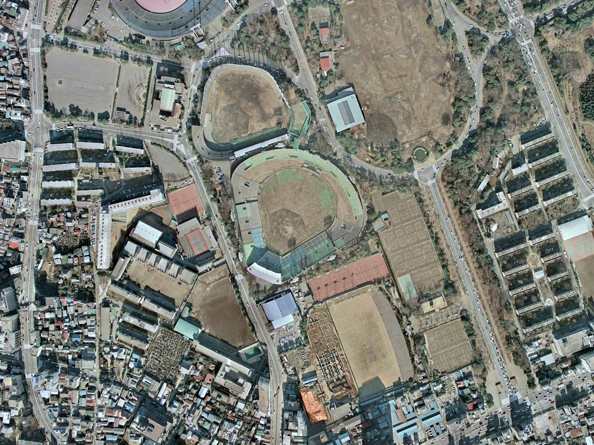

29年前の今日、1997年11月2日。フジテレビ系列で放送されていた人気バラエティ番組『ダウンタウンのごっつええ感じ』が、突然の最終回を迎え、約6年の歴史にピリオドを打ちました。改編期でもない11月最初の日曜日に、ダウンタウンの二人がスタジオに登場しないまま番組が終わるという、異例の結末でした。

## 日曜夜8時のお茶の間を席巻したコントの金字塔

『ダウンタウンのごっつええ感じ』は、1991年12月8日にレギュラー放送がスタートしました。キャッチコピーは「バカ、ふたり。」。東京進出を果たしたばかりのダウンタウンにとって、全国的な知名度を確固たるものにする冠番組となりました。

出演陣には今田耕司さん、東野幸治さん、130Rの板尾創路さんと蔵野孝洋（ほんこん）さん、YOUさん、篠原涼子さんらが名を連ねました。シュールで独創的なコントの数々は若者を中心に爆発的な支持を集め、出演者たちを一躍全国区のスターへと押し上げました。

## 猛烈なブームと過激さのジレンマ

番組の勢いは凄まじく、裏番組として君臨していた日本テレビの『天才・たけしの元気が出るテレビ!!』と激しい視聴率争いを演じ、1995年には年間平均視聴率18.9パーセントという高水準を記録しました。「Mr.BATER」「キャシィ塚本」「世紀末戦隊ゴレンジャイ」など、今なお語られる数多くのヒットキャラクターがこの絶頂期に誕生しています。

一方で、過激さを増していくコントには抗議や苦情も相次ぎました。子供に見せたくない番組の常連となる中、フジテレビや所属事務所が見直しを勧めたものの、コント構成を手がける松本人志さんは独自の笑いを追求し続けました。現場には常に緊張感と軋轢が漂っていました。

*当日の写真ではありません · 事件当時の写真ではありません · イメージ写真 — 写真: StockSnap / Pixabay Content License*

## 9月28日、突如起きた野球中継への差し替え事件

突然の終了劇の直接の引き金となったのは、1997年9月28日の出来事でした。この日、番組は2時間スペシャルの放送を予定していました。番組から生まれた人気企画「エキセントリック少年ボウイ」のCDが3日前に発売され、そのライブイベントと連動した、まさにその日に放送しなければ意味のない特別な内容でした。

ところが前日、プロ野球のヤクルトスワローズがリーグ優勝へのマジックナンバーを「1」としたことで、フジテレビは急遽セ・リーグ優勝決定試合の中継への差し替えを決定しました。この変更は松本さんや吉本興業へ事前に連絡されないまま進められ、松本さんが事実を知ったのは放送当日の昼過ぎでした。編成局へ予定通りの放送を強く求めたものの聞き入れられず、スペシャルは翌週へと追いやられました。

*当日の写真ではありません · 事件当時の写真ではありません · イメージ写真 — 写真: funnytools / Pixabay Content License*

## 松本人志のボイコットと打ち切りの決定

かねてから番組制作スタッフの安全確認不足やトラブルに不満を募らせていた松本さんは、この独断の差し替えに激怒しました。以降、フジテレビ系列の番組出演を次々とボイコットする事態に発展します。10月10日にはスポーツ新聞各紙が一斉にこの対立を報道し、騒動は世間の知るところとなりました。

この行動をめぐっては各界で賛否が巻き起こりました。「野球関係者への侮辱だ」「差し替えは当然」という厳しい批判の声が上がる一方で、自らの作品に妥協を許さないプロ意識として評価する声もありました。フジテレビとの修復は難航し、結果として番組の打ち切りという形で決着が図られました。

*Meiji-Jingu Stadium aerial photograph 1975 — 写真: 国土地理院 / CC BY 4.0*

## 本人不在の最終回と「恋のマジックポーション」

10月19日に延期されていたスペシャルを放送した後、番組はダウンタウン不在のまま急遽制作されたコント傑作選を2週にわたって放送しました。そして迎えた1997年11月2日、改編期でもない時期に約6年間の放送が静かに幕を下ろしました。

最終回の編集を担当したディレクターの小松純也さんは、いつか番組が復活することを信じ、エンディングに番組の初代オープニング曲「恋のマジックポーション」を採用しました。映像の合間には、今田さん、板尾さん、東野さん、YOUさん、篠原さんら歴代レギュラーの名場面が一人ずつ挟み込まれ、最後は再び初代オープニングのカットへと戻る構成で締めくくられました。

## 今なお色あせない、日曜夜8時の熱気

後に浜田雅功さんはインタビューで、「やめると決めたのは二人で決めたこと」「松本のワガママではない」と語り、スタッフに対する積年の不信感があったことを明かしています。誰か一人の衝動ではなく、ギリギリの熱量で笑いを作ってきた現場の限界が生んだ幕引きでした。

『ごっつええ感じ』が残したコントの数々は、その後のお笑い界に計り知れない影響を与え、今も多くの芸人や視聴者に語り継がれています。理不尽なまでのエネルギーと予測不能な笑いが画面からあふれていたあの時代を、懐かしく思い出す人も多いはずです。

### 参考資料

- <https://ja.wikipedia.org/wiki/11%E6%9C%882%E6%97%A5>
- <https://pixabay.com/photos/tv-television-retro-classic-old-1844964/>
- <https://pixabay.com/photos/tv-television-vintage-oldschool-2619649/>
- <https://pixabay.com/photos/television-developing-countries-899265/>
- <https://commons.wikimedia.org/wiki/File:Meiji-Jingu_Stadium_aerial_photograph_1975.jpg>
