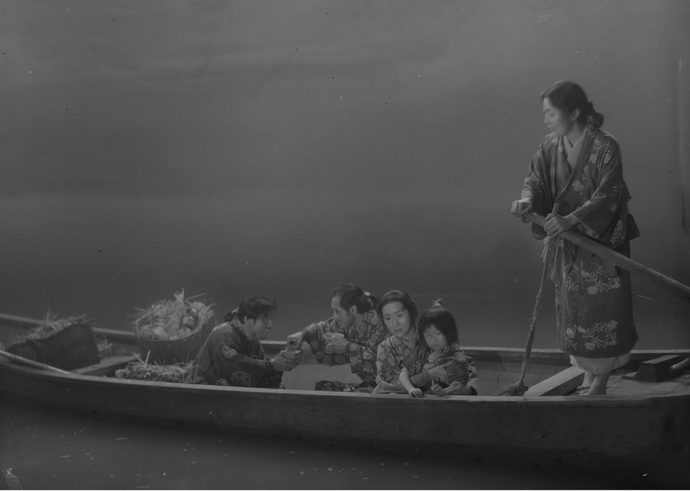
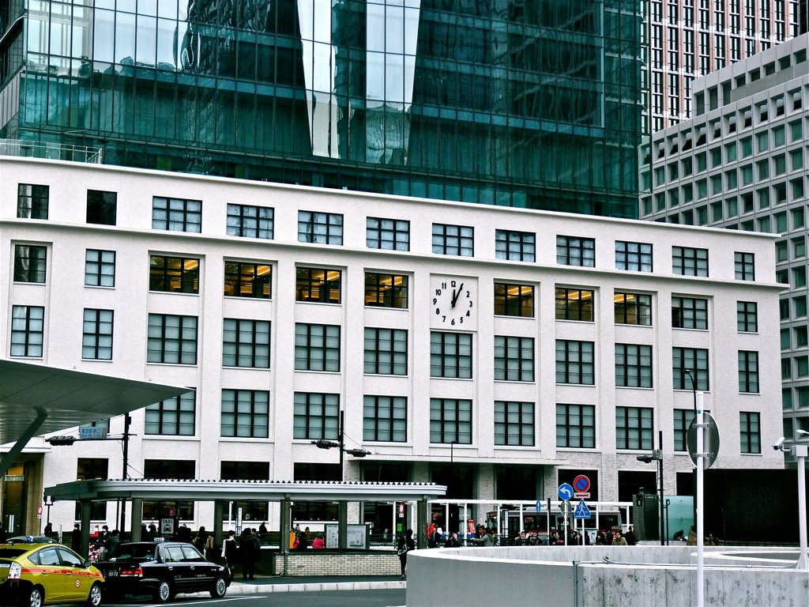

26年前の今日、2000年11月2日。東京・丸の内の帝国劇場で、堂本光一主演のミュージカル『MILLENNIUM SHOCK』の初日公演が開幕しました。少年隊が主演した舞台を原型としながらも、まったく新しいエンターテインメントとして世に送り出されたこの作品は、初演から瞬く間に熱狂的な支持を集め、日本演劇界の歴史を塗り替えるロングランシリーズの第一歩となりました。

## 製作費10億円、チケット倍率11.4倍の衝撃

初演となる『MILLENNIUM SHOCK』は、幕を開ける前から大きな話題を呼んでいました。舞台の製作費は10億円を超え、「お客さまに2分に一度のショックを与えたい」というコンセプトのもと、世界的に活躍するフランツ・ハーラレイが演出協力として参加しました。

さらに、帝国劇場の歴史の中で初となる入場券の抽選販売が実施されたことも世間の注目を集めました。全38公演、用意された7万枚のチケットに対して集まった応募は実に80万通。競争率は11.4倍に達し、劇場窓口や電話回線がパンクするほどの過熱ぶりを見せました。初演の全日程即日完売から始まったこのチケット争奪戦は、のちに「日本で最もチケット入手が困難な舞台」と称される伝説の始まりでした。

## 帝国劇場初のフライングと「Show must go on」

初演の劇中で貫かれていたテーマは、「Show must go on（何があってもショーを続けなければいけない）」でした。ニューヨークのオフ・ブロードウェイでショーに出演する若者たちが、ブロードウェイでの成功を夢見て挫折を乗り越え羽ばたく姿を描いたストーリーです。堂本光一が演じた主人公のコウイチは、常に頂点を目指し続ける若きエンターテイナーとして舞台を牽引しました。

舞台上では、華麗な歌やダンス、パーカッションの演奏に加え、帝国劇場で初めて導入された客席上空を飛ぶフライングや、驚きのイリュージョンなど、豪華絢爛な演出が次々と繰り広げられました。言葉が分からなくても誰もが圧倒されるものを作るという信念のもと生み出された数々の仕掛けは、初日の観客に強烈な衝撃を与えました。

*Ugetsu monogatori, 1953 — 写真: Daiei / Public domain*

## 堂本光一自身の脚本・演出による進化と挑戦

大成功を収めたシリーズは毎年上演を重ねましたが、大きな転機を迎えたのは2005年のことでした。タイトルを『Endless SHOCK』へと一新し、堂本光一自身が本格的に脚本、演出、音楽のすべてを手掛ける体制へと舵を切ったのです。

単なる派手な演出の連続から、登場人物たちの葛藤や生き様を描く緻密なストーリーへと劇的な進化を遂げました。高さ4.8メートル、22段の階段から転がり落ちる「階段落ち」など、危険と隣り合わせの過酷なパフォーマンスもストーリーの必然性として組み込まれました。堂本光一は「Show must go on」という劇中の言葉そのままに、満身創痍になりながらも妥協のないステージを創り上げていきました。

*Light decoration in Marunouchi, Tokyo — 写真: Takashi(aes256) / CC BY-SA 2.0*

## 幾多の困難を乗り越え打ち立てた大記録

妥協なき挑戦は、数々の演劇史の金字塔となって結実します。2008年1月には初演からわずか7年2か月で通算500回公演を達成し、帝国劇場の単独主演として史上最速の記録を樹立。同年4月には、高い舞台成果に対してスタッフ・出演者一同が第33回菊田一夫演劇大賞を受賞しました。

さらに2009年3月には通算626回を達成し、『屋根の上のバイオリン弾き』で森繁久彌が19年かけて築いた帝国劇場単独主演公演記録を塗り替えました。2014年には松本幸四郎の『ラ・マンチャの男』が持つ1207回を抜き、ミュージカル単独主演記録で歴代1位に浮上。そして2024年5月9日には通算2018回を数え、森光子が『放浪記』で積み上げた2017回の国内演劇単独主演記録をも更新し、単独1位に輝いたのです。

*Back in Full Glory. The renovated Tokyo Central Post Office in the Marunouchi 丸の内 district in Tokyo Japan — 写真: Arjan Richter / CC BY 2.0*

## 24年間で2128回、受け継がれるエンターテインメントの魂

舞台装置のトラブルや東日本大震災、感染症による公演中止など、24年間の中には数々の困難もありました。しかしそのたびに座長である堂本光一とカンパニーは前を向き、舞台を待ち望む観客のために立ち上がり続けました。

帝国劇場の建て替え休館などを控え、2024年11月29日、帝国劇場での大千穐楽をもってシリーズは幕を閉じました。24年間で積み上げた公演回数は全2128回、動員数は約370万人。チケットは初演からラストイヤーまで全日程即日完売を記録しました。ひとつの舞台に情熱を捧げた熱気と感動は、今も多くの人々の記憶に深く刻まれています。

### 参考資料

- <https://ja.wikipedia.org/wiki/%E5%A0%82%E6%9C%AC%E5%85%89%E4%B8%80>
- <https://commons.wikimedia.org/wiki/File:Hisaya_Morishige_540216_Scan10004.JPG>
- <https://commons.wikimedia.org/wiki/File:Ugetsu_monogatori,_1953.jpg>
- <https://www.flickr.com/photos/46151146@N04/11153842966>
- <https://www.flickr.com/photos/42102924@N02/8478917004>
