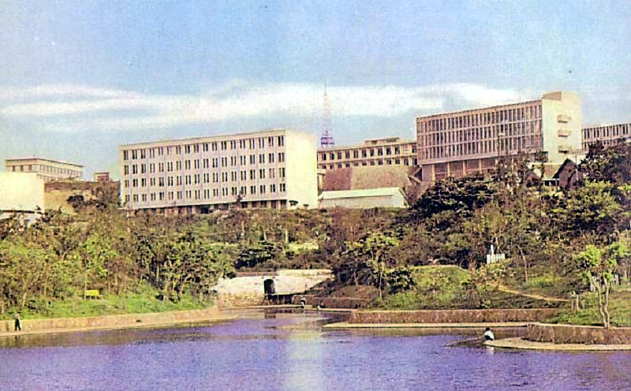
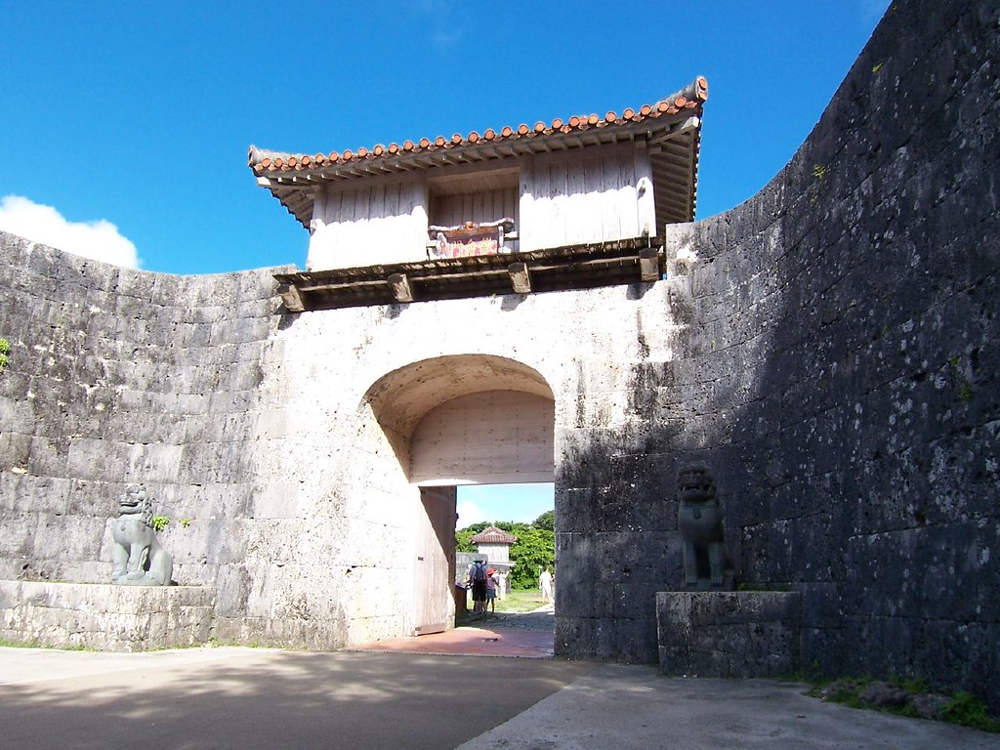
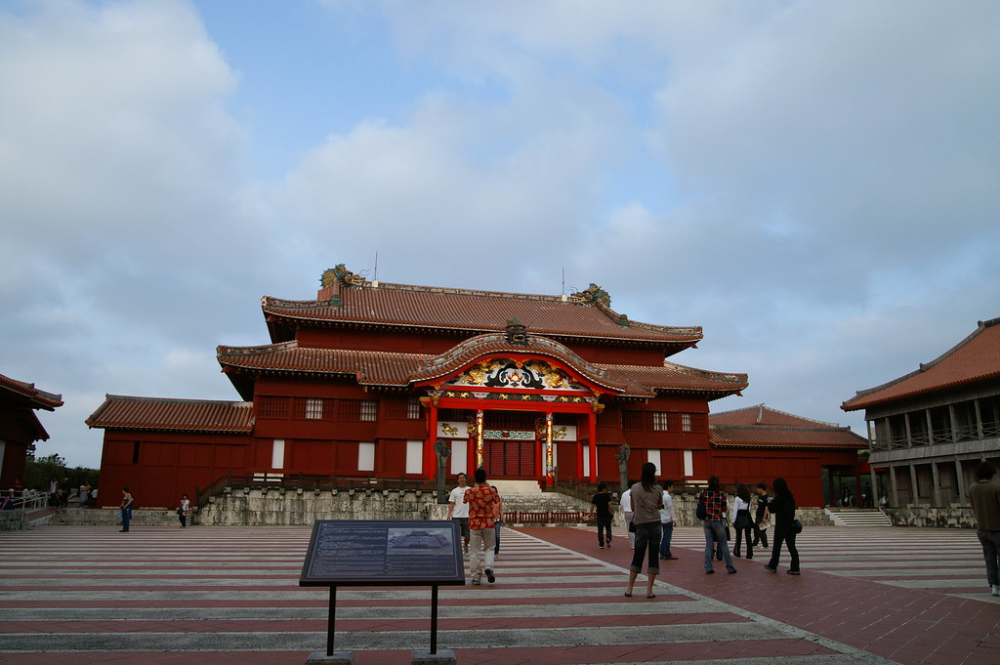

34年前の今日、1992年11月3日。太平洋戦争末期の沖縄戦で跡形もなく焼き尽くされた首里城が復元され、国営沖縄記念公園首里城地区として開園を迎えました。本土復帰20周年の節目によみがえった鮮やかな朱色の正殿は、沖縄の人々の長年の悲願が結実した瞬間でした。

## 「鉄の暴風」で灰燼に帰した王宮

琉球王国の中山首里に築かれた首里城は、かつて尚氏王統の居城として栄華を誇りました。日本の他地域の城とは異なり、中国の宮殿建築の強い影響を受けた独自の様式を持ち、1933年には沖縄神社拝殿として正殿などが旧国宝に指定されていました。

しかし1945年、首里城を悲劇が襲います。太平洋戦争末期の沖縄戦において、旧日本軍の第32軍総司令部が首里城の地下壕に置かれたため、米軍の激しい攻撃目標となったのです。5月25日から3日間にわたりアメリカ軍艦ミシシッピなどから激しい砲撃を受け、27日に城郭は完全に焼失しました。琉球王国時代の貴重な宝物や文書の多くも失われ、かつての壮麗な姿は地上から消え去りました。

## 琉球大学のキャンパスから始まった再建への道

戦後の首里城跡には1950年に琉球大学が開学し、多くの遺構が地中に埋もれたままキャンパスとして使用されていました。しかし、沖縄の人々にとって首里城の再建は戦後間もない時期からの切なる悲願でした。

1958年に守礼門が木造復元されたのを皮切りに、1972年の日本復帰時には国の史跡に指定され、歓会門などの再建が進められました。そして1980年代前半、琉球大学が西原町へ移転したことで、本格的な城郭復元に向けた敷地が確保されたのです。1986年11月には沖縄本土復帰20周年記念事業として、国営公園としての整備が閣議決定されました。

*University of the Ryukyus in 1960s — 写真: USCAR(United States Civil Administration of the Ryukyu Islan / Public domain*

## 瓦の色すら分からない難航した調査と職人の執念

1989年11月から始まった正殿の再建工事は、困難の連続でした。かつての詳細な設計図は戦争で失われており、頼りになったのは昭和初期の改修工事で作られた実測図や古写真、そして古老たちの記憶でした。

屋根瓦の色についてすら確たる記録がなく、当時を知るお年寄りに聞いても「赤だった」「黒だった」と意見が真っ二つに分かれました。当時、琉球瓦を製造できる窯元は奥原製陶の1軒だけとなっており、4代目当主の奥原崇典氏らの尽力によって瓦の復元が進められました。また、昭和の大修理時の柱に残っていたわずかな顔料の痕跡などから弁柄色が割り出され、壁や柱を彩る朱色の姿が導き出されたのです。

*Shurijo Castle Park / 首里城公園 — 写真: jetalone / CC BY 2.0*

## 1992年11月3日、朱の輝きがよみがえった日

工芸家や職人たちが当時の建築・装飾技術を結集し、1992年11月2日に竣工、翌11月3日の文化の日に首里城公園として一般への供用が始まりました。沖縄戦の焼失から実に47年の歳月が流れていました。

開園した園内には、朱色に輝く正殿をはじめ、北殿や南殿、それらを取り囲む御庭が往時の姿そのままに広がっていました。1993年にはNHK大河ドラマ「琉球の風」の舞台として全国にその姿が紹介され、沖縄の歴史と文化の誇り高きシンボルとして多くの観光客や地元の人々を魅了しました。

*Una & Seiden(State Hall) @ Shurijo Castle Park — 写真: Hyougushi / CC BY-SA 2.0*

## 世界遺産登録と、令和の再建へつながる歴史

復元された首里城はその後も整備が続けられ、2000年12月には首里城跡が「琉球王国のグスク及び関連遺産群」の一つとして世界遺産に登録されました。建物の地下に残る本物の遺構が、世界的な歴史的価値を認められたのです。

2019年10月31日、正殿をはじめとする主要7棟が火災で焼失するという深い悲しみに見舞われました。しかし、1992年の復元で培われた技術や詳細な記録が、令和の再建工事を力強く支えています。2026年秋の正殿完成を目指して進む再建の歩みは、幾度倒れても立ち上がってきた沖縄の不屈の歴史そのものを物語っています。

### 参考資料

- <https://ja.wikipedia.org/wiki/11%E6%9C%883%E6%97%A5>
- <https://commons.wikimedia.org/wiki/File:%E7%90%89%E7%90%83%E5%A4%A7%E5%AD%A6%E5%BF%97%E5%96%9C%E5%B1%8B%E5%9B%B3%E6%9B%B8%E9%A4%A8.jpg>
- <https://commons.wikimedia.org/wiki/File:University_of_the_Ryukyus_in_1960s.JPG>
- <https://www.flickr.com/photos/92203585@N00/223971088>
- <https://www.flickr.com/photos/71481771@N00/135841860>
