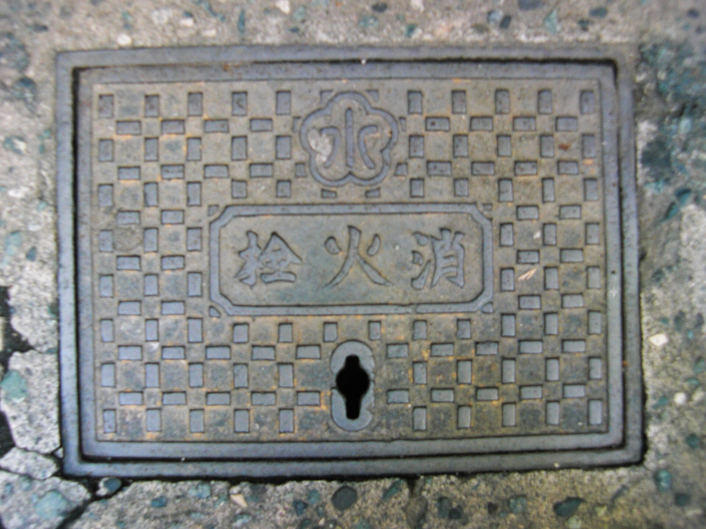
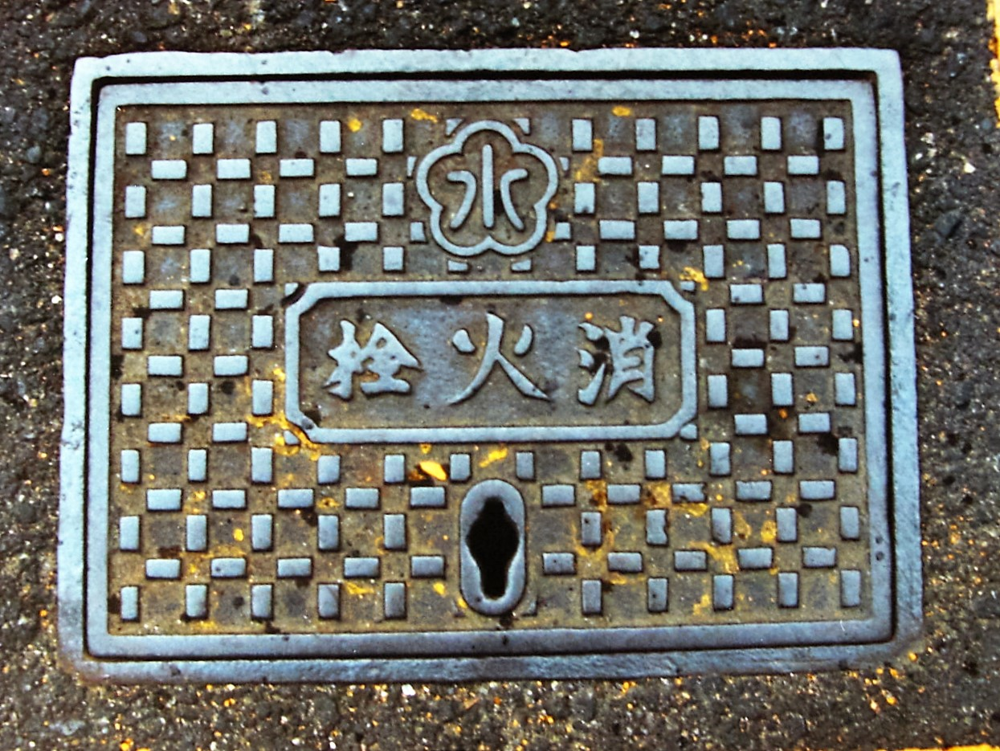
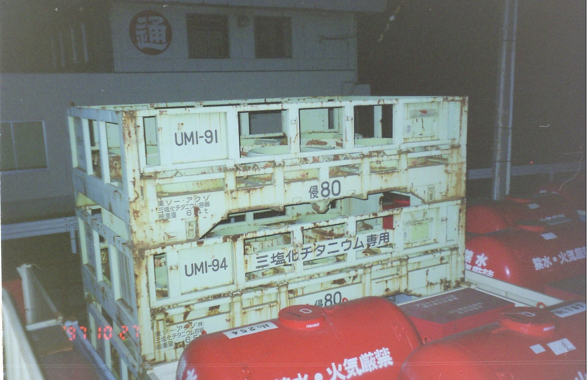

29年前の今日、1997年11月3日。準大手証券会社の三洋証券が東京地裁に会社更生法の適用を申請し、事実上倒産しました。日本の証券会社が経営破綻するのは戦後初めてのことでした。そしてこの破綻は、単なる一社の倒産にとどまらず、日本の金融市場全体を揺るがす未曾有のパニックの引き金となったのです。

## 「東洋一」と謳われた巨大ディーリングルーム

三洋証券は1910年に「土屋鋭太郎商店」として創業した歴史ある証券会社でした。戦後に日東証券、江口日東証券を経て1973年に三洋証券となり、大手証券である野村証券から出資を受けつつも、強いオーナーシップのもとで独自路線を突き進んでいました。

バブル経済の絶頂期、同社は不動産投資やコンピュータ関連設備への巨額投資を積極的に敢行しました。その象徴が、1988年4月に東京都江東区塩浜に竣工した本社別館です。広さ約6400平方メートル、最大800人のディーラーが同時に取引できる規模を誇り、当時「東洋一のトレーディングルーム」とメディアでも大きく謳われました。

## バブル崩壊と雪だるま式に膨らんだ不良債権

しかし、バブル崩壊とともに巨大な投資は重い足かせへと変わります。株式市場の低迷で本業の収益が悪化するなか、さらに致命傷となったのが「三洋ファイナンス」など系列ノンバンク4社の不動産融資の焦げ付きでした。

多額のコンピュータ投資の減価償却費も重なり、三洋証券の債務は雪だるま式に膨張していきました。1992年3月期から倒産に至る1997年3月期まで、同社は実に6期連続の赤字を記録することになります。経営危機を回避するため、1994年3月には旧大蔵省証券局の主導で「再建9ヵ年計画」が策定されました。野村證券などから200億円の増資を受け、生命保険会社各社からも200億円の劣後ローンを調達して9年間かけて不良債権を処理するはずでした。

*Fire.hydrant.cover.in.odawara.city — 写真: 栗原 岳 / CC BY-SA 4.0*

## 支援打ち切りと1997年11月3日の破綻申請

だが、自力回復の道は険しいものでした。証券会社の財務健全性を示す自己資本比率は急降下し、大蔵省の業務改善命令の発令基準である120％目前の169.4％にまで低下します。自転車操業の危険性が露呈するなか、主力銀行は株式の持ち合いを解消し始めました。

1997年7月、生命保険各社は焦げ付きリスクを理由に、劣後ローンの融資延長を「3カ月のみ」と通告。9月には国際証券との合併計画が報じられたものの、野村證券グループ本体の損失補填問題なども影を落とし、交渉は暗礁に乗り上げます。10月31日、劣後ローンの期限が切れた生命保険側は株主代表訴訟のリスクを恐れて再延長を拒否しました。資金繰りの道を完全に絶たれた三洋証券は、11月3日の祝日、ついに会社更生法の適用申請に踏み切ったのです。

*Fire.hydrant.cover.in.odawara.city.2 — 写真: 栗原 岳 / CC BY-SA 4.0*

## コール市場での10億円不決済──戦後初のデフォルト

世間を真に震撼させたのは、更生法申請の翌朝である11月4日でした。三洋証券は破綻前の10月31日（金曜日）に、金融機関同士が日々極めて短期間の資金を貸し借りする「無担保コール市場」で資金を調達していました。その返済期日は週明けの11月4日（火曜日）でした。

ところが、その前日の11月3日に会社更生法を申請してしまったため、群馬中央信用金庫（現・しののめ信用金庫）が貸し付けていた無担保コール資金約10億円が回収不能、すなわちデフォルト（債務不履行）に陥ったのです。インターバンク市場における金融機関の債務不履行は、日本の戦後金融史において前代未聞の事件でした。「1円たりとも決済事故は起きない」という暗黙の信用で成り立っていたコール市場は瞬時にパニックへ陥り、資金の出し手が急速に引き揚げる異常事態へと発展しました。

*UM1-91----① 【東ソー・アクゾ】Containers of Japan Rail — 写真: Gazouya-japan / CC BY-SA 4.0*

## 拓銀、山一へ…連鎖した金融危機の引き金

この三洋証券によるわずか10億円の返済不能が、日本の金融システム全体の信用を根底から失墜させました。海外市場では邦銀の資金調達金利に上乗せ金利がつく「ジャパンプレミアム」が跳ね上がり、体力の弱っていた金融機関は市場からの資金調達が極めて困難になります。

その結果、同じ1997年11月中に、都市銀行の一角であった北海道拓殖銀行や四大証券の山一證券、さらに德陽シティ銀行が次々と経営破綻へ追い込まれるという、未曾有の連鎖倒産劇が引き起こされました。三洋証券の破綻とデフォルトは、日本が底知れぬ金融危機の暗黒期へと突入する決定的な引き金となったのです。

## 再建断念から全従業員解雇、そして法人の消滅へ

その後、三洋証券の更生手続きでは三井海上火災保険が業務承継を検討したものの合意に至らず、1998年6月に再建を正式に断念。同年8月には全従業員が解雇され、1999年12月に会社更生法を取り下げて破産宣告を受けました。2009年3月25日に破産手続きが終結し、創業から約1世紀に及ぶ法人は完全に消滅しました。

かつて「東洋一」と誇られ、800人ものディーラーが熱狂的な取引を行っていた江東区塩浜の本社別館は、2000年に東洋情報システム（現・TIS）に買収され、現在はデータセンターとして稼働しています。金融大国日本の神話が音を立てて崩れ去ったあの1997年11月、日本の金融界はかつてない激動の季節を迎えていました。

### 参考資料

- <https://ja.wikipedia.org/wiki/11%E6%9C%883%E6%97%A5>
- <https://commons.wikimedia.org/wiki/File:Fujieda.st.brick.house.jpg>
- <https://commons.wikimedia.org/wiki/File:Fire.hydrant.cover.in.odawara.city.jpg>
- <https://commons.wikimedia.org/wiki/File:Fire.hydrant.cover.in.odawara.city.2.jpg>
- <https://commons.wikimedia.org/wiki/File:UM1-91----%E2%91%A0_%E3%80%90%E6%9D%B1%E3%82%BD%E3%83%BC%E3%83%BB%E3%82%A2%E3%82%AF%E3%82%BE%E3%80%91Containers_of_Japan_Rail.jpg>
