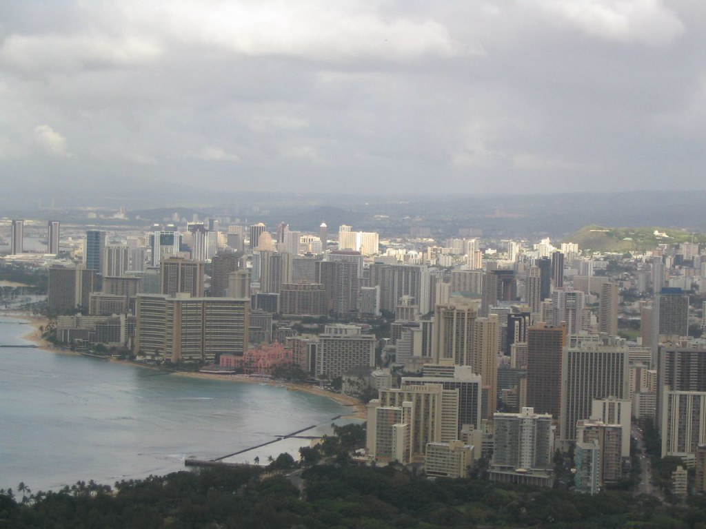
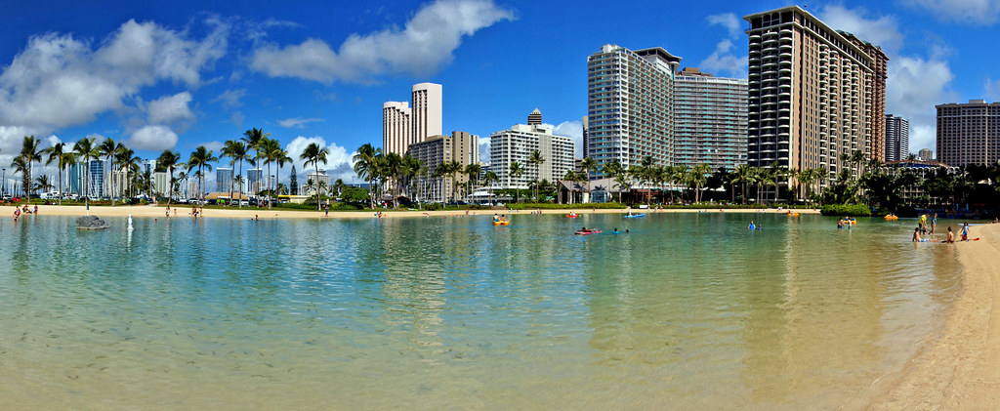
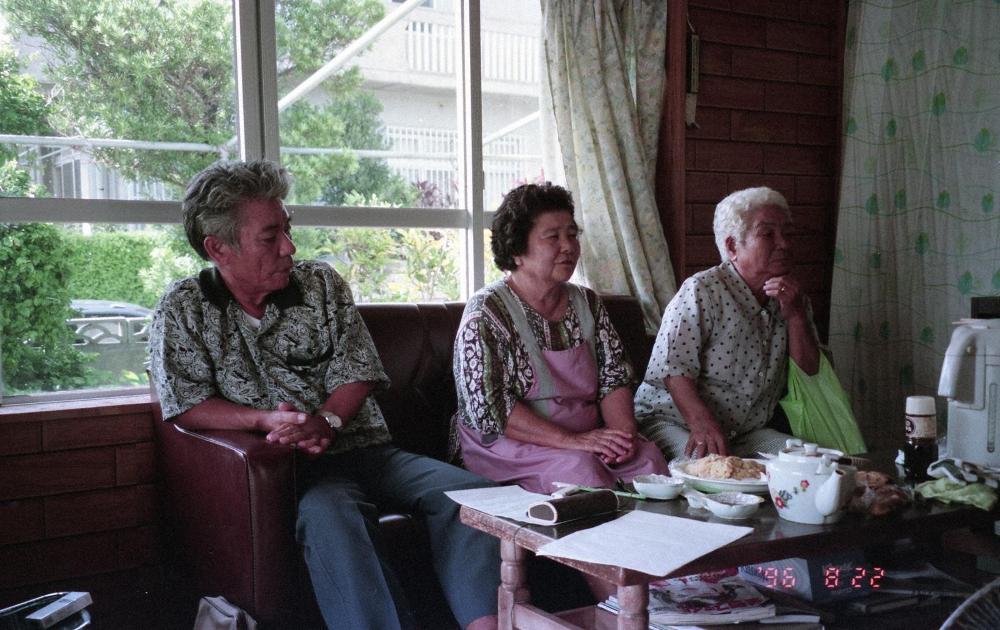

27年前の今日、1999年11月3日。5人組アイドルグループの嵐が、シングル『A・RA・SHI』をポニーキャニオンからリリースし、CDデビューを果たしました。フジテレビ系『バレーボールワールドカップ1999』のイメージソングとしてお茶の間に流れたこの曲は、初週55.7万枚を売り上げてオリコン週間シングルランキングの頂点に立ちました。

## ハワイ沖での結成会見とメンバーたちの知られざる葛藤

CDデビューに先駆けること約1か月半、1999年9月15日にアメリカ・ハワイ州ホノルル沖のクルーズ客船で嵐の結成とデビューを発表する記者会見が開かれました。司会を少年隊の東山紀之が務め、大野智、櫻井翔、相葉雅紀、二宮和也、松本潤の5人が新しいグループとして世にお披露目されたのです。

しかし、華やかな舞台の裏側で、メンバーたちの受け止め方は決して一枚岩ではありませんでした。実は大野、櫻井、二宮の3人は当時、事務所を退所することを考えていたのです。大野はそれまでに二度も退意を伝えており、レコーディングへの参加も手伝いと聞かされ、ハワイ行きはご褒美の旅行だと信じていました。

櫻井も海外留学を検討しており、バレーボールワールドカップのイメージキャラクターの仕事が終われば嵐は解散するものと考えて加入を引き受けていました。また二宮は演技の裏方に携わりたいと考えており、櫻井とともに社長の自宅へ退所の相談に赴いた際、机の上に置かれた「嵐」と書かれた資料を見て事の重大さを悟ったといいます。

## 「パスポート持ってる？」突然決まった5人目の合流

1999年の夏前から松本、二宮、櫻井はレコーディングや振り付けを行っていましたが、自身がCDデビューすること自体は知らされていませんでした。さらに相葉雅紀に至っては、ハワイ渡航のわずか3日前に当時の社長・ジャニー喜多川から「YOU、パスポート持ってる？」と尋ねられ、「あります」と答えたことで「一緒にハワイに行こう」と急きょ同行が決まりました。

何も知らずにハワイへ向かった相葉が加わり、ここに5人の嵐が揃うことになりました。大野は芸能活動への強いこだわりがなかったこともあり、デビュー直後は事務所からの連絡を避け、携帯電話の電源を約2週間にわたって切っていたというエピソードも残されています。

「世界中に嵐を巻き起こす」「頂点に立つ」という願いや、新聞の番組表に1文字で略されずに掲載されるという狙いから名付けられたグループ名は、こうして予期せぬドラマを抱えたまま船出することになりました。

*View of Honolulu from Diamond Head Crater, Oahu, Hawaii — 写真: Ken Lund / CC BY-SA 2.0*

## 1999年11月3日、初週55.7万枚の鮮烈なスタート

こうして迎えた1999年11月3日、デビューシングル『A・RA・SHI』が店頭に並びました。表題曲はもともとデビュー曲として準備されていた「REACH OUT FOR MY DREAM」と「夢はSOSO」という2曲を1曲にまとめたもので、作詞をJ&T（菊池常利）、作曲・編曲を馬飼野康二が手掛けました。

ジャケットに記された「嵐」の筆文字はジャニー喜多川によるもので、初回盤には特大ポスターやイベント参加券が封入され、通常盤にはフォトコレクションジャケットが用意されました。当時のデビュー記念イベントには推定8万人ものファンが駆けつけるなど、凄まじい反響を呼びました。

その熱気は数字にも直結しました。1999年11月第3週のオリコン週間シングルランキングで、初動売上55.7万枚を記録して見事1位を獲得。解散発表直後だったSPEEDのシングル『Long Way Home』を抑えての首位でした。この初動売上55.7万枚は、2010年に『果てない空』が更新するまで、嵐にとって最多記録として輝き続けました。

*Honolulu Waikiki. — 写真: Bernard Spragg / CC0 1.0*

## 歴代1位のシングル首位記録とギネス認定アルバムへ

デビューシングル『A・RA・SHI』の累計売上は97万3310枚に達し、2020年に『カイト』が塗り替えるまでグループ最大のヒットシングルであり続けました。カップリング曲「明日に向かって」も含め、バレーボール中継やドラマ『Vの嵐』などを通じて多くの人々の記憶に刻み込まれました。

デビュー以降、嵐は途中でメンバーの脱退や加入が一度もないまま歩み続けました。通算54作のシングルで週間チャート1位を獲得し、男性アーティストとして歴代1位の記録を樹立。アルバムでも4作でミリオンセラーを達成しました。

20周年を迎えた2018年から2019年のツアー『5×20』では日本史上最大規模の全50公演、総動員数237万5000人を記録し、ベストアルバム『5×20 All the BEST!! 1999-2019』は「世界で最も売れたアルバム」としてギネス世界記録に認定されるなど、名実ともに国民的グループへと成長を遂げました。

*町史関係資料 — 写真: 南城市教育委員会 / CC BY (Japan Search)*

## 2026年5月の活動終了と、今なお愛される原点の歌

大野の「自由な生活がしてみたい」という意向を受け、嵐は2020年12月31日をもって活動を休止しました。メンバーは「5人でなければ嵐じゃない」と解散を否定し、休止中も個人での活動を広げながら絆を守り続けました。

2024年4月にはメンバー5人が共同出資して「株式会社嵐」を設立。そして2026年3月からラストツアー「We are ARASHI」を行い、同年5月31日の東京ドーム公演をもって約26年半に及ぶグループ活動を終了しました。

デビューから20年以上を経ても、2019年にはリプロダクション楽曲「A-RA-SHI : Reborn」が配信され、NHK紅白歌合戦でも大トリを含め度々歌い継がれてきました。1999年11月3日に吹き荒れ始めた旋風は、四半世紀を超えて日本のポピュラー音楽史に消えない足跡を残しています。

### 参考資料

- <https://ja.wikipedia.org/wiki/11%E6%9C%883%E6%97%A5>
- <https://adeac.jp/koshigaya-city-digital-archives/catalog/mp146683-200020>
- <https://www.flickr.com/photos/75683070@N00/68949334>
- <https://www.flickr.com/photos/88123769@N02/10699517413>
- <https://nanjo-archive.jp/document/?detail=11199&genre=6>
