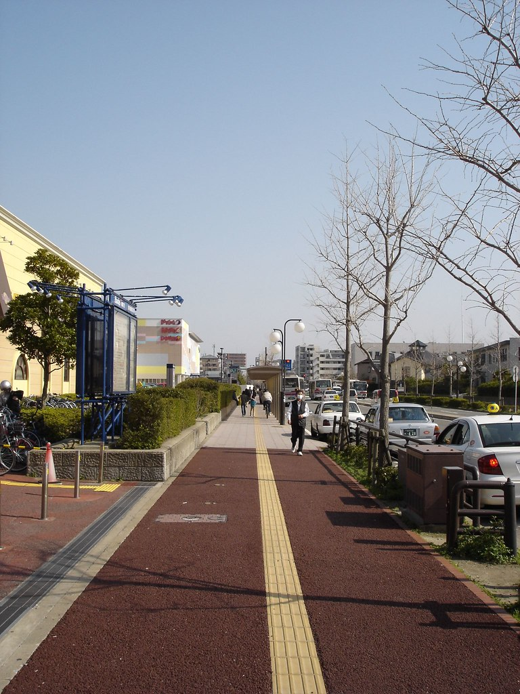
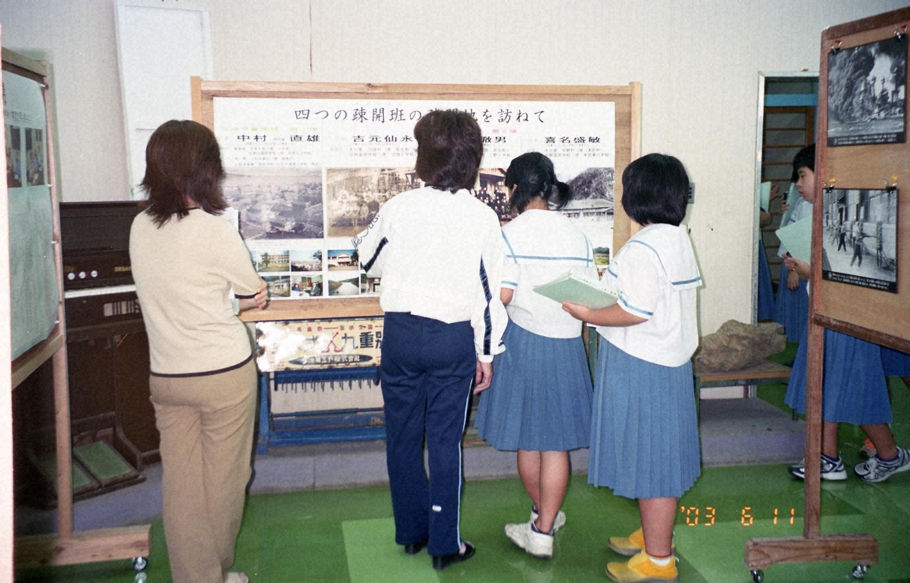
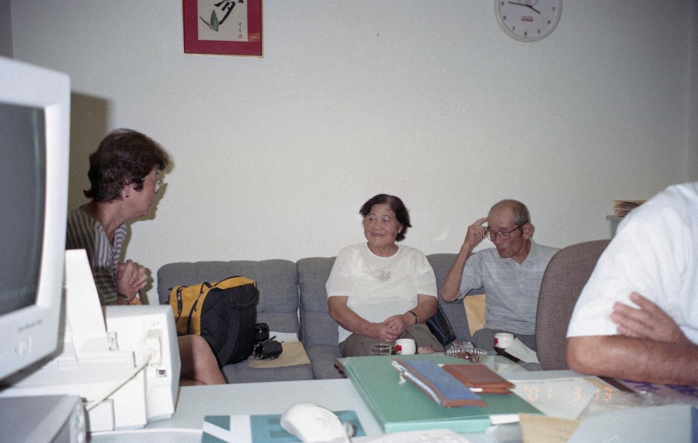

23年前の今日、2003年11月3日。福岡ダイエーホークスの主砲、小久保裕紀選手が読売ジャイアンツへ無償トレードで移籍することが突如発表されました。前日には福岡で4年ぶりの日本一を祝う盛大な優勝パレードが行われたばかり。その歓喜の冷めやらぬ中で飛び込んできた「無償」での巨人移籍という一報は、福岡のみならず日本全国のプロ野球ファンを驚愕させました。

## ホークスの象徴、主砲としての圧倒的な存在感

青山学院大学時代にバルセロナオリンピック野球日本代表として銅メダル獲得に貢献した小久保選手は、1993年ドラフト2位で福岡ダイエーホークスを逆指名して入団しました。背番号9を与えられた若き強打者は、王貞治監督就任初年度の1995年に28本塁打を放ちパシフィック・リーグ本塁打王を獲得。1997年には打率.302、36本塁打、114打点で打点王に輝きました。

1999年の球団福岡移転後初となるリーグ優勝と日本一、そして2000年の連覇でも4番打者や選手会長としてチームを力強く牽引しました。特に2001年には44本塁打を放ち、松中信彦選手、城島健司選手、井口資仁選手とともにプロ野球史上初となる日本人選手のみによる「30本カルテット」を形成。福岡ドームのファンにとって、小久保選手はまさにチームの誇りそのものでした。

## オープン戦での大けがと球団との生じた亀裂

しかし2003年シーズン、小久保選手を過酷な試練が襲います。3月6日に行われた西武ライオンズとのオープン戦（福岡ドーム）で、一塁走者だった小久保選手は二塁打でホームへ突入した際、相手捕手と激突。右膝の前十字靭帯断裂、内側靭帯損傷、外側半月板損傷など全治6か月以上の重傷を負ってしまいます。

この負傷により、小久保選手は一軍・二軍ともに公式戦出場がゼロとなり、アメリカのアリゾナ州にあるリハビリ施設で懸命な治療とトレーニングに励むことになりました。ところが、このアメリカでの治療費およそ2000万円が球団から一切支払われないという事態が発生します。さらに高塚猛球団社長との意見の食い違いなどもあり、球団への不信感を募らせた小久保選手は、一時帰国した2003年6月中旬の段階で契約解除を申し出るまでに至っていました。

*Fukuoka Dome Town — 写真: hibino / CC BY 2.0*

## 歓喜のパレード翌日、激震が走った無償トレード発表

主砲を欠きながらも、ダイエーは強力打線を武器に3年ぶりのリーグ優勝と4年ぶりの日本一を達成しました。小久保選手も優勝決定戦では歓喜の輪に加わり胴上げに参加、秋には打撃練習を再開し、翌2004年の完全復活に向けてファンも期待を寄せていました。

しかし、日本一の祝賀パレードが行われた翌日の2003年11月3日、電撃発表が行われます。小久保選手の巨人への移籍、しかも金銭も交換選手も発生しない「無償トレード」でした。小久保自身が「ホークス以外ならどこでもよかった」とトレードを強く志願していた中、瀬戸山隆三球団代表が巨人の渡邉恒雄オーナーに相談したところ、巨人側は引き受けを了承しつつも交換要員は出せないと回答。中内正オーナーが金銭トレードの対価分を小久保選手の年俸に上乗せする形を選んだことで、無償トレードという異例の決着となったのです。

*沖縄戦写真展 — 写真: 南城市教育委員会 / CC BY (Japan Search)*

## 読売ジャイアンツでの復活と背番号「6」の輝き

福岡のファンが悲痛の声を上げる中、小久保選手は読売ジャイアンツへ移籍し、背番号「6」を着用してグラウンドに立ちました。大怪我からの復活を期した小久保選手は、東京ドームを舞台に強打を発揮し、巨人でも主将を務めるなどチームの中核としてリーダーシップを発揮しました。

戦力外やキャリア晩年の選手が他球団へ移籍する際に用いられることが多かった「無償トレード」が、球界屈指のバリバリのスラッガーに対して適用された例は極めて異例でした。この出来事は球団経営のあり方や選手とフロントの信頼関係について、プロ野球界全体に大きな一石を投じる契機ともなりました。

*ペルー移民調査 — 写真: 南城市教育委員会 / CC BY (Japan Search)*

## ホークス復帰から監督就任へ、今へと続く物語

その後、小久保選手は2006年オフにフリーエージェント（FA）権を行使し、古巣である福岡ソフトバンクホークスへ復帰を果たしました。再び福岡のファンの大歓声に迎えられた小久保選手は、通算2041安打、413本塁打、1304打点という輝かしい金字塔を打ち立てて2012年に現役を引退しました。

引退後は野球日本代表「侍ジャパン」の監督などを歴任し、2024年シーズンからは福岡ソフトバンクホークスの一軍監督に就任。あの日、優勝パレードの翌日に走った激震から長い年月を経て、小久保監督は再びホークスの先頭に立ってチームを指揮しています。2003年11月3日の無償トレード発表は、日本プロ野球の歴史において今なお鮮烈な記憶として語り継がれています。

### 参考資料

- <https://ja.wikipedia.org/wiki/11%E6%9C%883%E6%97%A5>
- <https://commons.wikimedia.org/wiki/File:Fukuoka_Dome_aerialphotograph_1993.jpg>
- <https://www.flickr.com/photos/19126881@N00/8527692>
- <https://nanjo-archive.jp/document/?detail=10195&genre=6>
- <https://nanjo-archive.jp/document/?detail=8260&genre=6>
