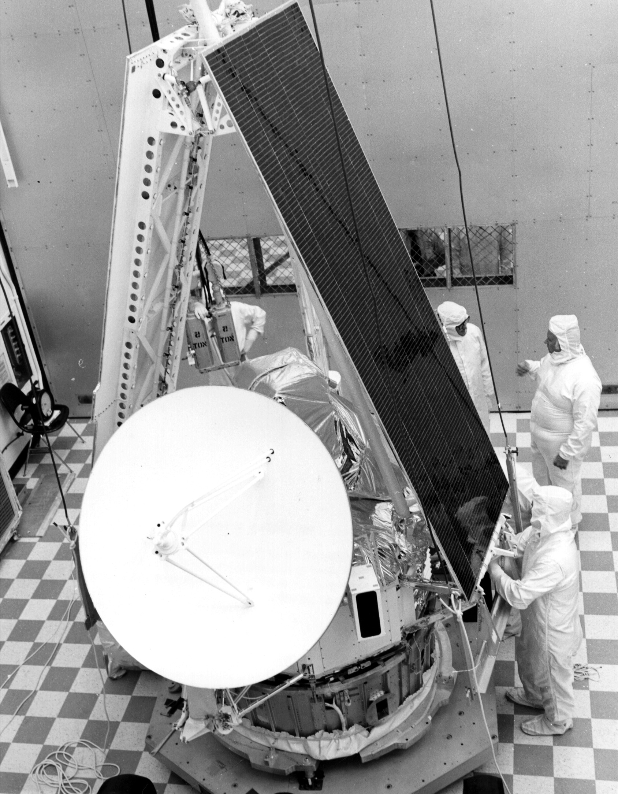
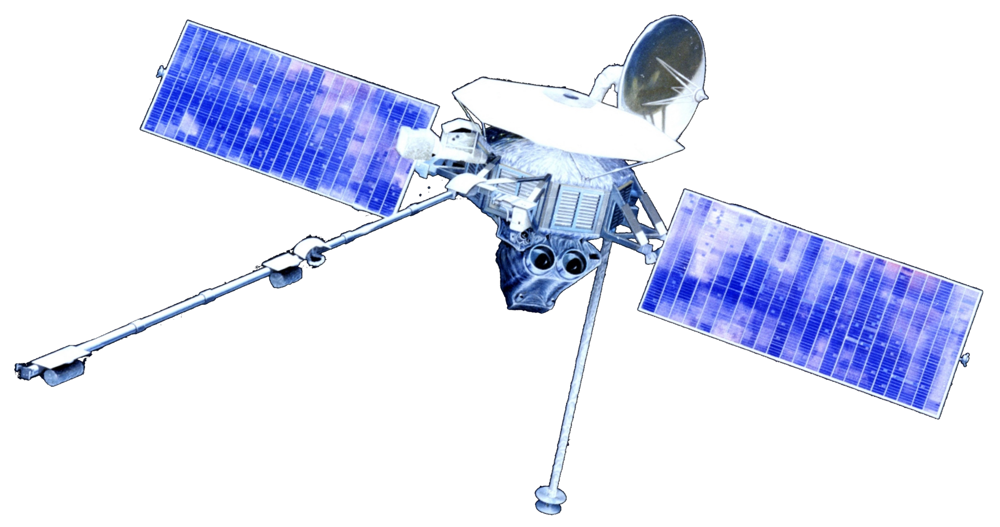
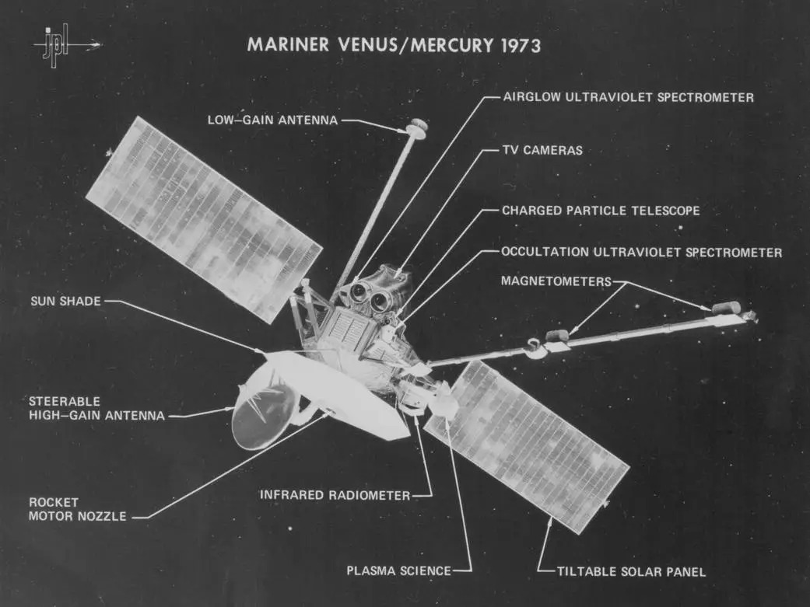

53年前の今日、1973年11月3日。アメリカ航空宇宙局NASAが、無人探査機マリナー10号を宇宙へと送り出しました。太陽系の中で最も太陽に近く、地球からの観測が極めて難しかった水星へと挑んだ、人類最初の直接探査の幕開けでした。

## 太陽に最も近い未踏の星を目指して

水星は太陽系の惑星の中で最小であり、太陽に最も近い軌道を回っています。地球から見ると常に太陽の近くに位置するため、日の出直前や日没直後のわずかな時間しか観測できず、地上からの望遠鏡観察には大きな限界がありました。天文学者たちにとって、水星の表面がどのような姿をしているのかは長年の謎でした。

NASAは金星と水星の環境や大気を直接調べるため、マリナー計画の最終機となるマリナー10号を計画しました。マリナー9号の打ち上げからおよそ2年後のことでした。総重量約500キロの機体には、高感度アンテナや紫外線分光器、磁力計、放射温度計などがぎっしりと積み込まれました。

## 史上初、金星スイングバイによる宇宙航行

フロリダ州のケープ・カナベラルからアトラス・セントール・ロケットによって打ち上げられたマリナー10号は、宇宙航行の歴史においても大きな革命を起こしました。それが、惑星の重力を利用して探査機の進行方向を変え、加速や減速を行う「スイングバイ」技術の実践です。

マリナー10号は打ち上げからおよそ4か月後の1974年2月5日、金星に5,768キロまで接近しました。紫外線フィルターを用いて金星の分厚い大気や特徴的な雲の撮影に成功したあと、金星の引力を利用して軌道を曲げ、太陽を約半年で公転する軌道へと入ることで、水星へと向かう針路を切り開いたのです。1機で複数の惑星を探査したのも、マリナー10号が史上初でした。

*Mariner 10 prepared for encapsulation — 写真: NASA Kennedy Space Center (NASA-KSC), image IDs: KSC-73P-054 / Public domain*

## クレーターだらけの地表と過酷な寒暖差

1974年3月16日、マリナー10号は水星の領域へ到達し、3月29日には地表からわずか703キロ（437マイル）まで最接近しました。地球へ送られてきた画像は、世界中の科学者や市民を驚かせました。そこに写っていたのは、地球の衛星である月とそっくりな、数え切れないほどのクレーターに覆われた荒涼とした地表だったのです。

放射温度計による観測結果も驚くべきものでした。マリナー10号の計測によると、太陽の光が当たらない夜間の気温はマイナス183度まで冷え込み、日中の最高気温は187度に達していました。大気がほとんど存在しない過酷な環境が、数字となって初めて立証された瞬間でした。

*Mariner 10 transparent — 写真: National Aeronautics and Space Administration (NASA) / Public domain*

## 三度の接近と最後の通信

マリナー10号の旅は1度では終わりませんでした。太陽の周りを回る軌道に乗った探査機は、1974年9月21日に約48,070キロまで2回目の接近を行い、水星の南極域の画像を撮影しました。さらに軌道修正を重ね、1975年3月16日には3回目の接近を果たし、地表からわずか327キロ（約200マイル）という超至近距離まで迫りました。

この3度のフライバイによって、水星表面の4割強に及ぶ地図が作成されました。しかし過酷な旅路の中で、姿勢制御用のガス燃料は次第に枯渇していきました。1975年3月24日12時21分（協定世界時）、マリナー10号からの最後の信号が途絶え、任務は正式に完了を告げました。

*Mariner 10 instruments — 写真: NASA / Public domain*

## 今も太陽を巡る先駆者と受け継がれる探査

通信が途絶えたマリナー10号は壊れて消滅したわけではありません。姿勢制御用の燃料を使い果たしたのちも、自らの役目を終えた人工惑星として、今なお太陽の周囲を静かに回り続けていると考えられています。

マリナー10号が残した貴重なデータは、その後の惑星探査の確固たる礎となりました。2008年に探査機メッセンジャーが到達するまでの30年以上にわたり、マリナー10号は人類にとって水星に接近した唯一の探査機であり続けました。未知の星へ果敢に飛び立ち、宇宙の扉を開けたあの日を、覚えていますか。

### 参考資料

- <https://ja.wikipedia.org/wiki/%E3%82%A2%E3%83%A1%E3%83%AA%E3%82%AB%E8%88%AA%E7%A9%BA%E5%AE%87%E5%AE%99%E5%B1%80>
- <https://commons.wikimedia.org/wiki/File:Mariner10.jpg>
- <https://commons.wikimedia.org/wiki/File:Mariner_10_prepared_for_encapsulation.jpg>
- <https://commons.wikimedia.org/wiki/File:Mariner_10_transparent.png>
- <https://commons.wikimedia.org/wiki/File:Mariner_10_instruments.jpg>
