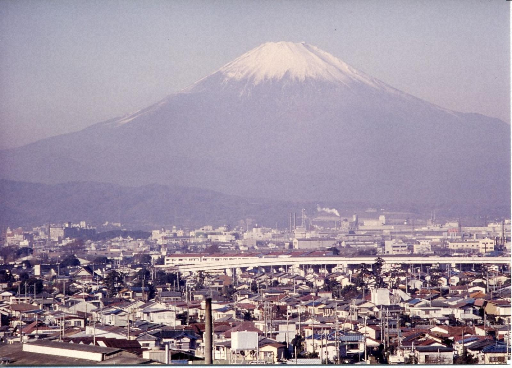
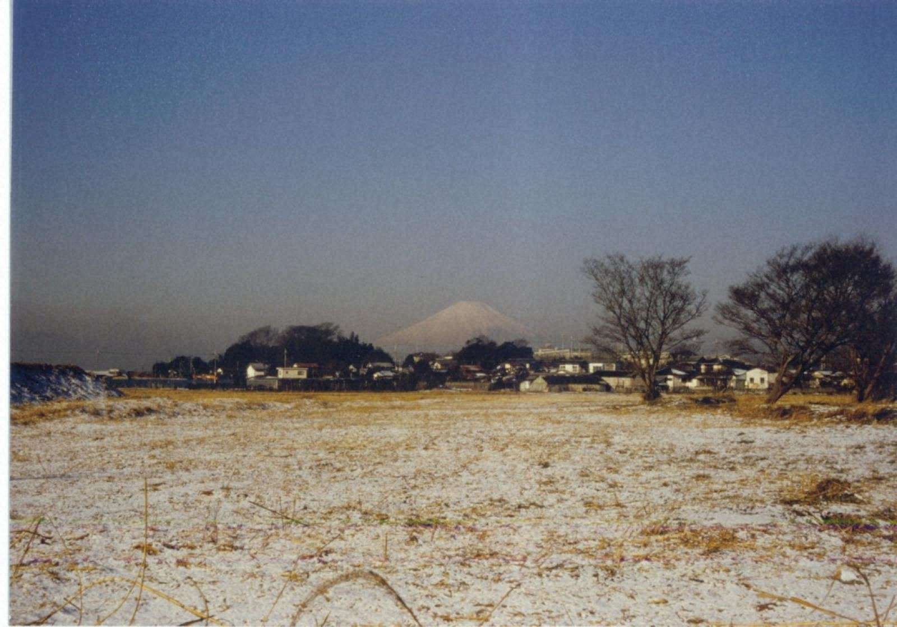
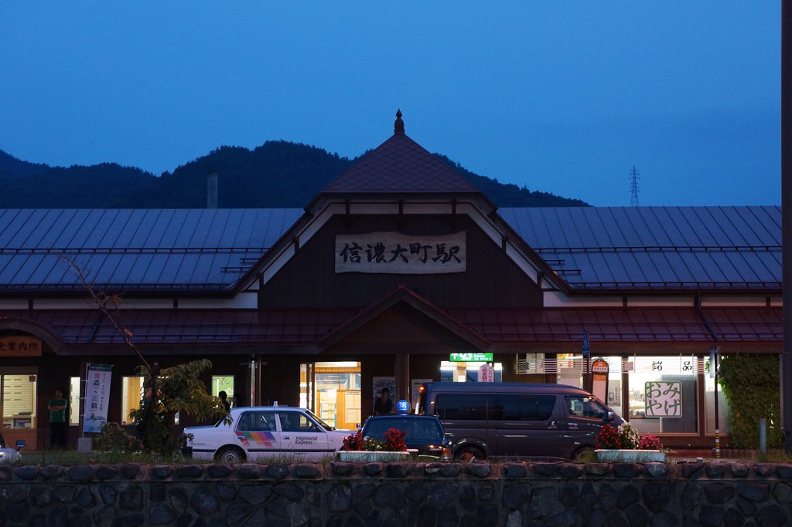

1989年11月4日未明、神奈川県横浜市磯子区の住宅街で、極めて痛ましい事件が起きました。オウム真理教の反社会性を追及していた弁護士の坂本堤さんとその妻、そしてわずか1歳の長男の一家3人が、教団の幹部らによって自宅で命を奪われたのです。正義を貫こうとした若き弁護士とその家族が突然姿を消したこの出来事は、のちに日本中を震撼させる巨大カルト事件の重大な発端となりました。

## 暴かれ始めた教団の実態と「被害者の会」の結成

神奈川県横浜市の横浜法律事務所に所属していた坂本堤弁護士は、当時33歳でした。1989年5月、江川紹子さんからの紹介で、出家信者の母親から息子の脱会について相談を受けたことが、オウム真理教問題に関わるきっかけとなりました。

当時、教団は出家信者に全財産の寄付を迫ったり、教祖の血液や風呂の残り湯を高額で売りつけたりするなど、社会的に重大な問題を抱えていました。坂本弁護士は信者の親たちとともに「オウム真理教被害者の会」を結成し、教団の反社会的な活動を厳しく批判・追及する活動を始めました。

## 「人を不幸にする自由はない」決裂した交渉と凶行の決断

教団に対する批判が高まる中、1989年10月31日、教団幹部の上祐史浩、青山吉伸、早川紀代秀の3人が横浜法律事務所を訪れ、坂本弁護士と訴訟回避に向けた交渉を行いました。坂本弁護士は教団が主張する超能力や高額な儀式の欺瞞性を指摘し、宗教法人認可の取り消しなどを求める民事訴訟の準備を進めていることを伝えます。

信教の自由を主張する幹部らに対し、坂本弁護士は「人を不幸にする自由などない」と言い放ち、交渉は決裂しました。教祖の麻原彰晃は、坂本弁護士の存在が翌年の総選挙出馬や教団の発展にとって重大な障害になると判断します。11月2日、麻原はサティアンビルに幹部らを集め、「話しても無駄だから、ポアするんだ」と告げ、坂本弁護士の殺害を命じました。

*市庁舎屋上からみた富士山 — 写真: chigamu / CC BY (Japan Search)*

## 11月4日未明、横浜の自宅で起きた凶行

11月3日、村井秀夫、早川紀代秀、岡﨑一明、新実智光、中川智正、端本悟の実行犯6人は、2台の車に分乗して横浜へと向かいました。当初は通勤で使われる洋光台駅付近での待ち伏せを狙っていましたが、この日が祝日であったため坂本弁護士は現れず、自宅への侵入へと計画が変更されます。

午後10時頃、自宅の鍵が開いていることが確認されると、早川からの連絡を受けた麻原は「一緒にやるしかないだろう」と家族全員の殺害を指示しました。翌11月4日の午前3時、幹部らは室内に侵入し、就寝中だった坂本弁護士、29歳の妻・都子さん、そして1歳の長男・龍彦ちゃんを襲いました。激しく抵抗する夫妻と泣き叫ぶ幼子に対し、実行犯らは暴行を加えた末に首を絞めるなどして、一家3人の息の根を止めました。

*香川北部耕地からみた富士山 — 写真: chigamu / CC BY (Japan Search)*

## 3つの県の山中へと分散された遺棄と隠蔽

犯行後、一家の遺体は車に乗せられ、山梨県の上九一色村にある富士山総本部へと運ばれました。午前7時に出迎えた麻原は「よくやった、ごくろう」と述べた後、遺体をドラム缶に詰めて遠くの山に埋めるよう命じました。

一行は同日のうちに長男の遺体を長野県大町市の山中に埋め、翌11月5日には坂本弁護士の遺体を新潟県名立町の山腹に遺棄しました。さらに翌6日、妻の遺体を富山県魚津市の僧ヶ岳中腹に埋め、一家3人を別々の県の山中へ埋め分けるという残酷な隠蔽工作を行いました。事件の痕跡を消し去った幹部らは、日本海に犯行道具などを捨てたあと、石川県の温泉地に宿泊して姿をくらましました。

*信濃大町駅 / Shinano Omachi Station — 写真: Kentaro Ohno / CC BY 2.0*

## 止まらなかった暴走と死刑執行

教団追及の急先鋒だった一家が突然消息を絶ったことで、教団への警戒は強まるはずでしたが、真相の解明には長い年月を要することになりました。教団はその間も暴走を続け、自動小銃や毒ガスの製造に手を染め、松本サリン事件や地下鉄サリン事件といった未曾有の無差別テロを引き起こしました。

教団は2000年に破産して消滅し、アレフなどの後継組織へと分裂しました。そして事件から長い歳月が流れた2018年、教祖の麻原彰晃をはじめとする元幹部ら13人の死刑が執行されました。

## 風化させてはならない記憶

理不尽な暴力によって奪われた一家3人の命は、二度と戻りません。カルトの危険性を社会に告発し、信者の家族を救おうと奮闘した坂本堤弁護士の行動は、法と正義を重んじる弁護士としての気概そのものでした。

平穏な家庭が深夜に襲撃され、一家全員が命を奪われたというこの凄惨な事件は、37年が経過した今もなお、日本の社会に深い教訓と消えない痛みを残しています。

### 参考資料

- <https://ja.wikipedia.org/wiki/%E3%82%AA%E3%82%A6%E3%83%A0%E7%9C%9F%E7%90%86%E6%95%99>
- <https://commons.wikimedia.org/wiki/File:Mt._Fuji_framed_by_cherry_blossoms_-_DPLA_-_3cf87944c325cc6f50ab7b02fa020484.jpeg>
- <https://jmapps.ne.jp/chigasaki_history/det.html?data_id=669>
- <https://jmapps.ne.jp/chigasaki_history/det.html?data_id=794>
- <https://www.flickr.com/photos/47335063@N08/22306150110>
