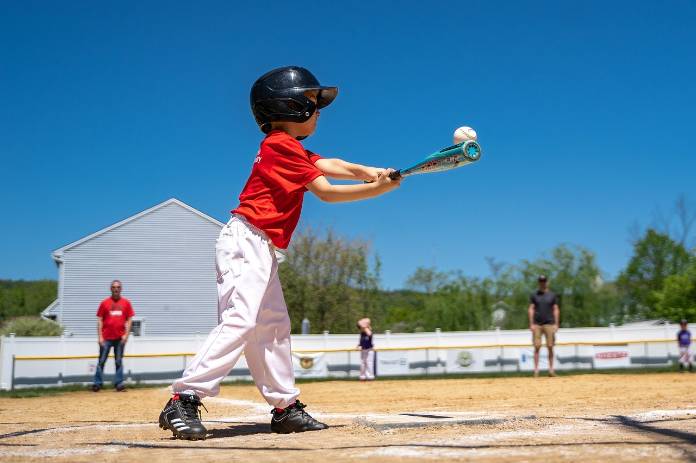
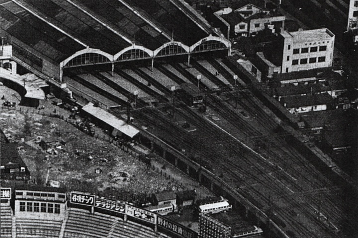
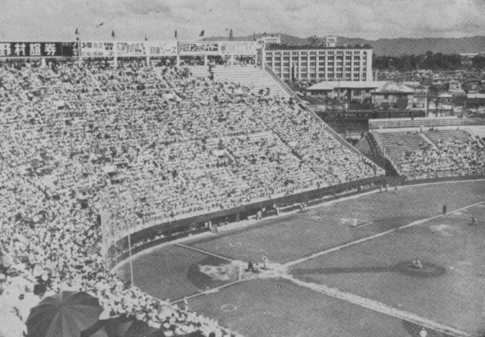

47年前の今日、1979年11月4日。プロ野球日本シリーズ第7戦で、広島東洋カープが球団創設30年目にして初の日本一を達成しました。雨の大阪球場で行われた運命の最終決戦、9回裏に繰り広げられたノーアウト満塁からの攻防は、今なお野球ファンの心に深く刻まれています。

## どちらが勝っても「初」の日本一をかけた決戦

1979年の日本シリーズは、セ・リーグを制した古葉竹識監督率いる広島東洋カープと、パ・リーグ覇者である西本幸雄監督率いる近鉄バファローズの対決でした。両チームともに球団創設以来、一度も日本一を経験しておらず、どちらが頂点に立っても史上初の栄冠となる特別な顔合わせでした。

第6戦までは両チームが本拠地で全勝する互角の展開が続き、3勝3敗のタイで運命の第7戦を迎えました。近鉄の主催試合として南海ホークスの本拠地である大阪球場を借りて行われた決戦は、冷たい雨が降りしきるなか、緊迫した投手戦が繰り広げられました。

## 4対3のリード、7回から登板したリリーフエース

試合は広島が小刻みに得点を重ね、6回表に水沼四郎捕手の2ラン本塁打などで4対2と勝ち越します。その裏に近鉄が1点を返し、スコアは4対3。1点リードを守り切るため、広島ベンチは7回裏2死から絶対的守護神である江夏豊投手を投入しました。

江夏投手は8回を無失点に抑え、いよいよ悲願達成まであとイニング1つ、9回裏の守備を迎えました。しかし、初優勝へのプレッシャーと近鉄打線の執念が、マウンド上の名投手を未曾有の窮地へと追い詰めていきます。

*当日の写真ではありません · 事件当時の写真ではありません · イメージ写真 — 写真: jatocreate / Pixabay Content License*

## 9回裏ノーアウト満塁、絶体絶命のピンチ

9回裏、近鉄の先頭打者である羽田耕一選手が初球をセンター前へ弾き返して出塁しました。続く打者の打席で代走の藤瀬史朗選手が盗塁を試み、捕手からの送球が逸れて無死三塁と一気に同点のピンチが広がります。さらに四球と代走・吹石徳一選手の二盗が決まり、ノーアウト二・三塁となりました。

ここで広島ベンチは平野光泰選手を敬遠し、満塁策を選択します。ノーアウト満塁、一打サヨナラ負けという極限状態でした。そのとき、江夏投手の目に飛び込んできたのは、広島のブルペンで投球練習を始める控え投手の姿でした。「ここまで投げさせておいて、まだ自分を信頼してくれないのか」。江夏投手の胸に強い憤りが湧き上がりました。

*南海難波駅と大阪球場（1953年） — 写真: Unknown authorUnknown author / Public domain*

## 衣笠祥雄のひと言と、運命の19球目スクイズ外し

動揺するマウンドへ歩み寄ったのが、一塁手を守っていた衣笠祥雄選手でした。「オレもお前も同じ気持ちだ。ベンチやブルペンのことなんて気にするな」。その温かく力強い言葉に、江夏投手は平静さと集中力を取り戻します。

江夏投手は続く代打の佐々木恭介選手を、膝元へ鋭く落ちるカーブで空振り三振に切って取りました。迎えた打者は石渡茂選手。初球を見送った打者の様子からスクイズを確信した江夏投手は、運命の19球目、カーブの握りのまま投球モーションに入ります。バントの構えを見せた石渡選手に対し、咄嗟の判断で外角高めのボールゾーンへ大きく外しました。三塁から本塁へ突入していた走者の藤瀬選手はタッチアウトとなり、最大の危機を切り抜けました。

*Osaka Stadium 1951 — 写真: 不明 / Public domain*

## 21球目の空振り三振、歴史に刻まれた26分間

ツーアウト二・三塁となり、迎えた21球目。江夏投手が投じた低めへのカーブに石渡選手のバットが空を切り、三振で試合終了となりました。広島東洋カープが球団創設30年目にして、ついに悲願の日本一を勝ち取った瞬間でした。

9回裏の開始からゲームセットまで、時間にしてわずか約26分間。自ら招いた満塁の危機を、卓越した投球術と心理戦で封じ込めた江夏投手の21球は、後に作家の山際淳司氏が手がけた名作ノンフィクション『江夏の21球』として世に出ました。結果だけでなく選手の細やかな心理描写に迫ったこの作品は、日本のスポーツジャーナリズムに大きな影響を与え、昭和のプロ野球史を代表する伝説の一幕として今も語り継がれています。

### 参考資料

- <https://ja.wikipedia.org/wiki/1979%E5%B9%B4%E3%81%AE%E6%97%A5%E6%9C%AC%E3%82%B7%E3%83%AA%E3%83%BC%E3%82%BA>
- <https://pixabay.com/photos/baseball-little-league-youth-kids-7985433/>
- <https://pixabay.com/photos/baseball-little-league-youth-kids-7985432/>
- <https://commons.wikimedia.org/wiki/File:%E5%8D%97%E6%B5%B7%E9%9B%A3%E6%B3%A2%E9%A7%85%E3%81%A8%E5%A4%A7%E9%98%AA%E7%90%83%E5%A0%B4%EF%BC%881953%E5%B9%B4%EF%BC%89.jpg>
- <https://commons.wikimedia.org/wiki/File:Osaka_Stadium_1951.jpg>
