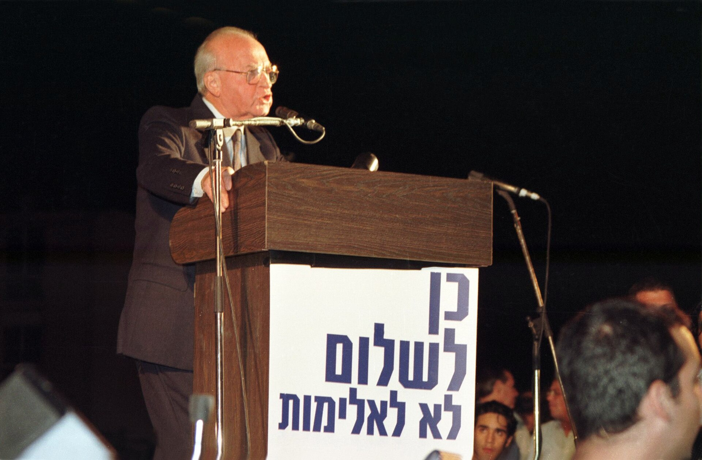
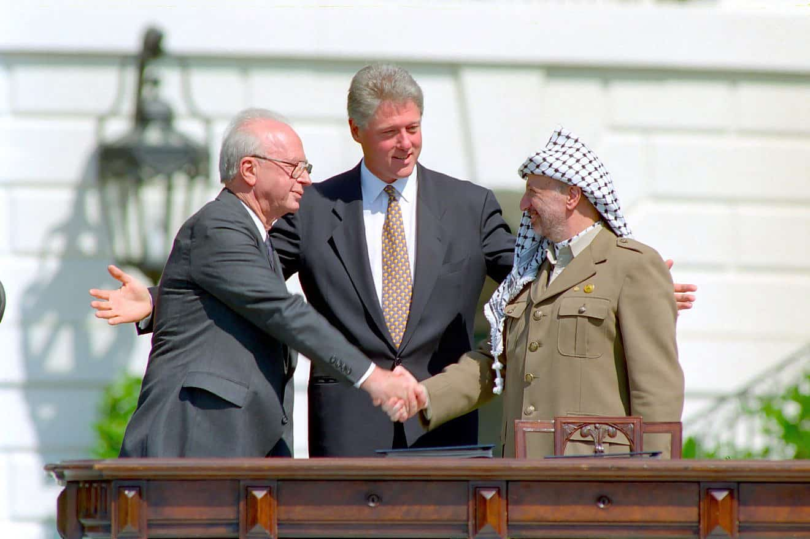
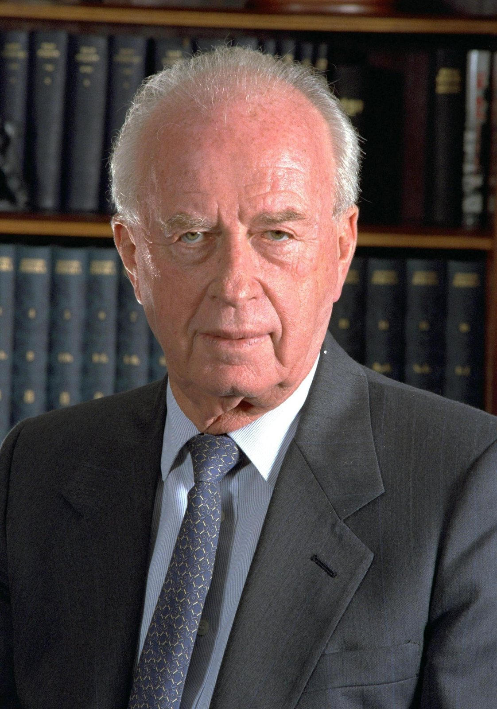

31年前の今日、1995年11月4日。イスラエルのテルアビブで、イツハク・ラビン首相が凶弾に倒れ、73歳で命を落としました。宿敵パレスチナとの歴史的な合意を成し遂げ、ノーベル平和賞を受賞した現職首相の暗殺という前代未聞の悲劇は、イスラエル国内のみならず、全世界に計り知れない衝撃をもたらしました。

## 軍司令官から政治の最高指導者へ

イツハク・ラビンは1922年、イギリス委任統治領パレスチナのエルサレムで生まれ、テルアビブで育ちました。若い頃からユダヤ人民兵組織ハガナーの突撃隊パルマッハに参加し、第一次中東戦争ではエルサレム防衛の指揮を執るなど、長年にわたり軍人としての道を歩みます。

1962年にはイスラエル国防軍の参謀総長に就任し、1967年の第三次中東戦争（6日戦争）において軍を率いて勝利を収めました。退役後は外交官として駐アメリカ特命全権大使を務めた後、政界へ進出。1974年にはゴルダ・メイアの後を継いで第6代首相に就任し、1976年のエンテベ空港奇襲作戦を承認するなど強い指導力を発揮しました。

## オスロ合意と国内に渦巻く激しい対立

1980年代に国防相を務めたラビンは、パレスチナ人による抵抗運動である第1次インティファーダを目の当たりにし、武力だけで問題を解決することの限界を強く認識します。1992年に再び首相の座に返り咲くと、それまでの強硬路線を改め、中東和平プロセスの推進を最優先課題に掲げました。

1993年、ラビン政権はパレスチナ解放機構（PLO）との間でパレスチナ自治の原則を定めた「オスロ合意」に調印しました。この功績により、ラビンはヤーセル・アラファト、シモン・ペレスとともに1994年のノーベル平和賞を受賞します。さらに同年には隣国ヨルダンとの平和条約締結にも漕ぎ着けました。

しかし、占領地の返還を含む和平路線は、イスラエル国内の右派や宗教勢力から強い反発を買いました。合意に反対する激しい抗議デモが各地で繰り返され、ラビンに対する脅迫や糾弾の声は日増しに高まっていきました。

*Assassination of Prime Minister Yitzhak Rabin, 1995 Dan Hadani Archive — 写真: Israel Press and Photo Agency (I.P.P.A.) photographer / CC BY 4.0*

## 1995年11月4日、テルアビブの平和集会と銃声

1995年11月4日の夜、テルアビブの市庁舎前にある「イスラエル王の広場」で、和平を支持する市民を集めた大規模な平和集会が開催されました。広場を埋め尽くした10万人を超える市民を前に、ラビン首相は壇上に立ち、平和への決意を力強く訴えかけました。

集会のクライマックスでは、ラビン首相自身も参加者たちとともに「平和の歌」を声を合わせて合唱しました。熱気に包まれた集会が無事に終わり、首相は広場の階段を降りて待機していた公用車へと歩みを進めます。

その直後でした。警備の隙を突き、群衆の中に潜んでいた和平反対派のユダヤ人青年イガール・アミルが至近距離から拳銃を連続して発砲したのです。背後から銃撃を受けたラビン首相は病院へ緊急搬送されましたが、手当ての甲斐なく73歳で息を引き取りました。

*1993年の資料 — 写真: Vince Musi / The White House / Public domain*

## ろうそくの祈りと世界80カ国の指導者による見送り

現職首相の暗殺という衝撃的なニュースは、瞬く間に世界中を駆け巡りました。事件の直後から、暗殺の現場となった広場には何十万人ものイスラエル国民が押し寄せました。とりわけ多くの若者たちが地面に無数のろうそくを灯し、涙を流しながら集会で歌われたばかりの平和の歌を歌い続け、ラビンの死を悼みました。

11月6日に執り行われた国葬には、アメリカのビル・クリントン大統領、エジプトのホスニー・ムバーラク大統領、ヨルダンのフセイン国王をはじめ、世界各国からおよそ80人もの国家元首や政府指導者が参列しました。かつて戦火を交えたアラブ諸国の首脳たちもエルサレムに集い、ラビンの遺体はヘルツルの丘に丁重に埋葬されました。

*1994年の資料 — 写真: Yaakov Saar / CC BY-SA 3.0*

## 「ラビン広場」に残る平和の願いと現代

ラビン首相の暗殺は、中東和平の行方に極めて深刻な影を落としました。和平プロセスを力強く牽引してきた指導者を失ったことで合意の履行は困難を極め、その後のイスラエル国内では言論の右傾化が急速に進むこととなりました。

事件の現場となった市庁舎前の「イスラエル王の広場」は、首相の功績と悲劇を後世に伝えるため「ラビン広場」と改称されました。広場の一角には暗殺の地を示す記念碑が建立され、現在も多くの人々が訪れて平和への祈りを捧げています。凶弾によって断たれた和平への道筋とあの夜の祈りは、今もなお世界に重い問いを投げかけています。

### 参考資料

- <https://ja.wikipedia.org/wiki/%E3%82%A4%E3%82%B9%E3%83%A9%E3%82%A8%E3%83%AB>
- <https://commons.wikimedia.org/wiki/File:114149_yitzhak_rabin_in_kfar_veradim_PikiWiki_Israel.jpg>
- <https://commons.wikimedia.org/wiki/File:Assassination_of_Prime_Minister_Yitzhak_Rabin,_1995_Dan_Hadani_Archive.jpg>
- <https://commons.wikimedia.org/wiki/File:Bill_Clinton,_Yitzhak_Rabin,_Yasser_Arafat_at_the_White_House_1993-09-13.jpg>
- <https://commons.wikimedia.org/wiki/File:Flickr_-_Israel_Defense_Forces_-_Life_of_Lt._Gen._Yitzhak_Rabin,_7th_IDF_Chief_of_Staff_in_photos_(11).jpg>
