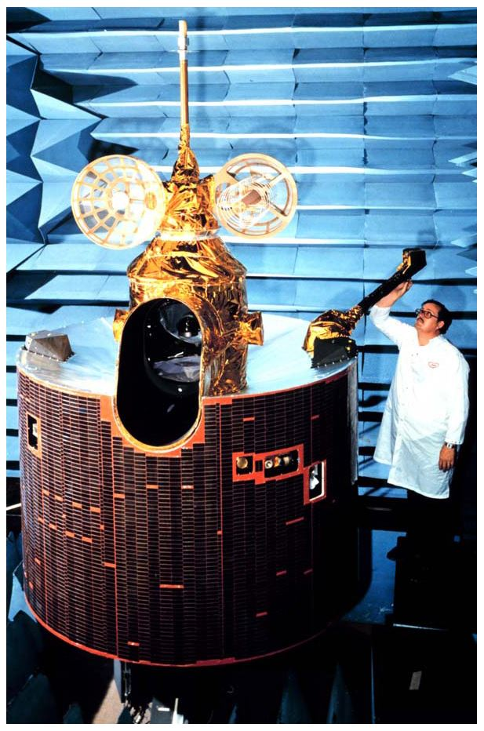
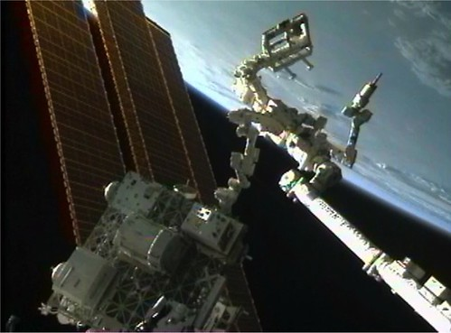
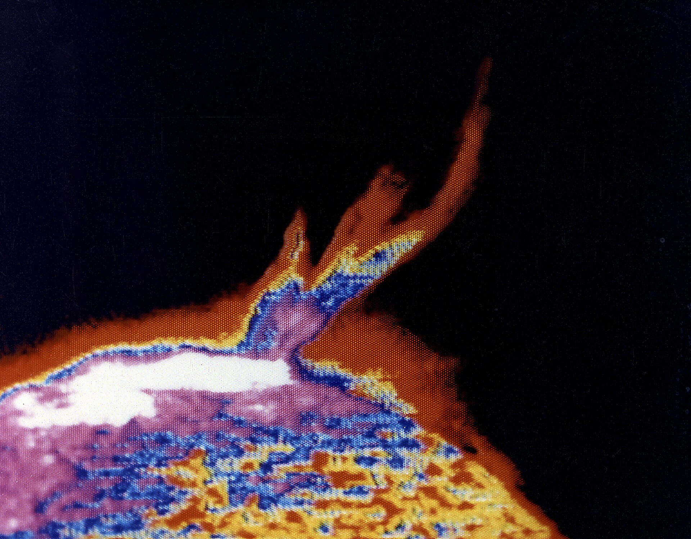

23年前の今日、2003年11月4日。私たちの頭上に輝く太陽で、人工衛星による観測開始以来、過去最大となる巨大な爆発現象「太陽フレア」が発生しました。放たれた強烈な電磁波や放射線は宇宙空間を駆け抜け、人工衛星や惑星探査機に直接の影響を与えました。地球上の電力網や通信網を麻痺させかねない宇宙からの脅威に、世界中の科学者と技術者が息をのんだ一日でした。

## 水素爆弾1億個分、太陽フレアの凄まじいメカニズム

太陽フレアとは、太陽表面付近に存在する磁場によって引き起こされる爆発的な増光現象です。太陽はプラズマで構成される天体であり、その内部や周囲には強大な磁場が渦巻いています。この磁力線が複雑に入り組む中で「磁気リコネクション」と呼ばれるつなぎ変わりが起きると、蓄えられていた磁気エネルギーが一気に解放され、熱や光、荷電粒子の運動エネルギーへと変換されます。

そのエネルギー解放量は極めて大きく、水素爆弾10万個から1億個分に相当するとされています。これは太陽系内で起こりうるエネルギー解放現象としては最大規模のものです。太陽表面の黒点が多い「極大期」にはこうした活動が頻発し、宇宙空間に向けて膨大な電磁波やプラズマの塊が噴き出されることになります。

## 測定限界を振り切った「X28」の衝撃

太陽フレアの規模は、大気圏外で観測されるX線の強度によってA、B、C、M、Xの5段階に分類されます。それぞれの等級は強度が10倍ごとに1つ上がり、最も強い区分が「Xクラス」です。Xクラスには上限がないため、数字が大きくなるほどその規模は桁違いに増大します。

2003年11月4日に発生したフレアは、アメリカのGOES衛星による観測で「X28」という数値を記録しました。これは衛星観測が始まって以来の観測史上最大の記録でした。しかもこの数値はセンサーが測定上限に達して振り切れてしまった結果であり、後に電離層への影響などを分析した研究では、実際には「X45」相当に達していたとする報告もなされています。

*On 6-16-77, NOAA's GOES-2 satellite went into space (27436780400) — 写真: NOAASatellites / Public domain*

## 日本の探査機「はやぶさ」と国際宇宙ステーションへの影響

この観測史上最大の爆発は、宇宙で活動する機体や人間に直接的な影響を及ぼしました。当時、小惑星イトカワを目指して航行を続けていた日本の小惑星探査機「はやぶさ」は、高エネルギー粒子の直撃を受け、搭載機器にダメージを負う事態に見舞われました。

さらに上空を周回する国際宇宙ステーション（ISS）でも緊張が走りました。地球の磁気圏外や宇宙空間では、フレアに伴うX線やガンマ線による被曝が人間の致死量を超える危険性があるためです。滞在していた宇宙飛行士たちは、念のためステーション内の放射線遮蔽機能が高い安全な区画へと避難を余儀なくされました。

*RRM Installed onto Permanent Home on the International Space Station — 写真: NASA Goddard Space Flight Center / CC BY 2.0*

## 3段階で押し寄せる太陽嵐と現代社会の脆弱性

太陽フレアに伴って発生する「太陽嵐」は、3つの段階を経て地球環境へ到達します。まず光と同じ速度で進む電磁波がわずか8分程度で到達し、電波障害やデリンジャー現象を引き起こします。次いで数時間で高エネルギー放射線が届き、宇宙空間の機器や飛行士を脅かします。そして2日から3日後、コロナ質量放出（CME）と呼ばれる巨大なプラズマの塊が地球に押し寄せます。

このプラズマが地球の磁気圏を揺さぶると、地上の送電線に異常な誘導電流が発生します。過去には1989年3月にカナダのケベック州で大規模な停電が発生した例があり、もし同等以上の巨大嵐が直撃すれば、変圧器の故障や広域ブラックアウト、通信やGPSの喪失など、全世界で数兆ドル規模の経済被害が出ると試算されています。

*False Color Isophote of a Solar Eruption — 写真: NASA / Public domain*

## 今も続く警戒と「宇宙天気予報」の進化

2003年11月4日の巨大フレアは、爆発の向きが幸いして地球上での壊滅的なインフラ破壊には至らず、被害は一時的・限定的なものにとどまりました。しかしこの出来事は、高度な電子機器と電力網に依存する現代社会が、宇宙の気まぐれな爆発に対していかに無防備であるかを痛感させる契機となりました。

現在では、地球と太陽の間に配置された観測衛星や、日本の名古屋大学をはじめとする研究機関の数値予測モデルなどにより、フレアの兆候を捉える「宇宙天気予報」の研究が精力的に進められています。目に見えない宇宙の嵐から私たちの日常を守る挑戦は、あの記録的な爆発の日を経て、今も絶え間なく続けられています。

### 参考資料

- <https://ja.wikipedia.org/wiki/11%E6%9C%884%E6%97%A5>
- <https://commons.wikimedia.org/wiki/File:Solar_eclipse_1999_4.jpg>
- <https://commons.wikimedia.org/wiki/File:On_6-16-77,_NOAA%27s_GOES-2_satellite_went_into_space_(27436780400).jpg>
- <https://www.flickr.com/photos/35278629@N08/8380692886>
- <https://commons.wikimedia.org/wiki/File:False_Color_Isophote_of_a_Solar_Eruption.jpg>
