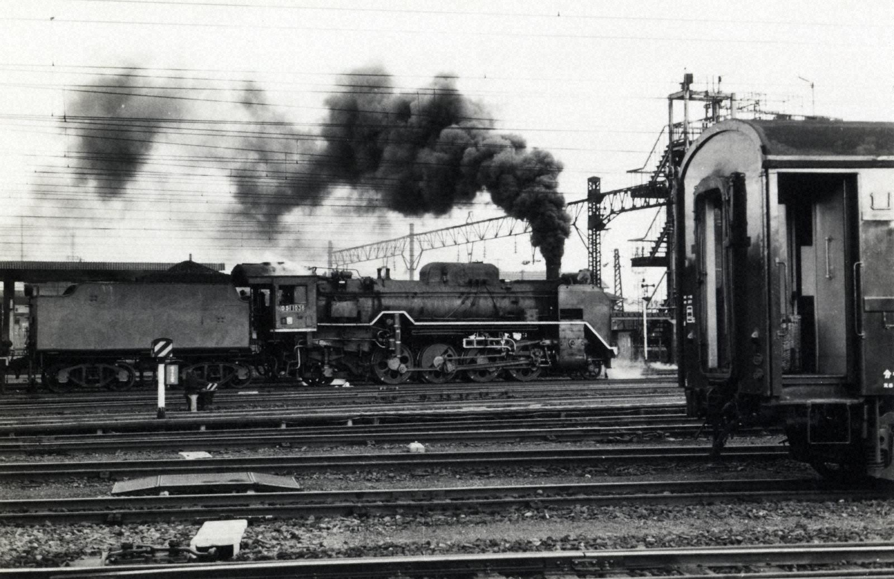

41年前の今日、1985年11月4日。北海道で最初の鉄道として産声を上げた国鉄手宮線が、最後の日を迎えました。南小樽駅から手宮駅までのわずか2.8キロを結ぶ鉄路を、臨時列車「さよなら手宮線手宮号」が走り抜け、多くの市民に見守られながら静かに運行を終えました。

## 1880年開通、北海道最初の鉄路として

手宮線の歴史は、明治初期の開拓期に遡ります。1880年（明治13年）10月24日に手宮桟橋から熊碓第4隧道間で試運転が行われ、同年11月28日に官営幌内鉄道として手宮駅と開運町駅（現在の南小樽駅）の間が開業しました。軌間1,067ミリの狭軌で敷設されたこの線路こそが、北海道で初めて汽車が走った記念すべき鉄路でした。その後、1889年に北海道炭礦鉄道へ譲渡され、1906年に国有化、1909年に手宮線と改称されました。

## 小樽を「北海道の心臓」にした石炭輸送

手宮線が果たした最大の役割は、内陸の幌内炭鉱から掘り出された石炭を小樽港へ運び出すことでした。小樽港から積み出された石炭は、本州や海外へと送られ、近代産業の発展を支えました。小樽で育った作家の小林多喜二は、活気あふれる小樽を「北海道の『心臓』みたいな都会である」と書き記しています。海岸線には石造倉庫が立ち並び、金融機関や卸商が集まり、仕事を求める人々が集まるゴールドラッシュのような賑わいをこの路線がもたらしました。

*当日の写真ではありません · 事件当時の写真ではありません · イメージ写真 — 写真: EME / Pixabay Content License*

## エネルギー転換と旅客営業の廃止

昭和に入ると、鉄路を取り巻く環境は大きく変わり始めました。1958年には旅客列車の気動車化が行われ、1959年には1日9往復が運行されていましたが、利用客の減少に伴い1961年には客車列車2往復にまで削減されました。そして1962年5月14日を最後に、手宮線の旅客営業は廃止され、貨物専用の路線となりました。さらに国のエネルギー政策が石炭から石油へと移行したことで炭鉱の閉山が相次ぎ、物資輸送の主役も自動車へと移っていきました。

*Minami-Otaru Station, Minami-Otaru-eki, Otaru, Hokkaido, Japan, 南小樽車站, 小樽, 北海道, 日本, 南小樽駅, みなみおたるえき, おたるし, ほっかいどう, にっぽん, にほん — 写真: bryan... / CC BY-SA 2.0*

## 国鉄で最も短い路線となった最後の年

1985年3月14日、当時国鉄で最も短かった徳島県の小松島線（1.9キロ）が廃止されたことで、2.8キロの手宮線が「国鉄の最短営業路線」となりました。しかしその座に就いてわずか数か月後の8月下旬、貨物列車の運行は完全に途絶えます。そして11月3日と4日の2日間、惜別の臨時列車「さよなら手宮線手宮号」が運行され、11月5日付での廃止を前に、4日限りで列車運行の歴史に幕を下ろしました。

*大分駅構内の蒸気機関車 — 写真: oitacity / CC BY (Japan Search)*

## 市民の声で守られたレールと遊歩道

路線廃止後、小樽の市民を中心として「旧国鉄手宮線打ち合わせ会議」や「小樽まちづくり協議会」が結成され、跡地の保存と活用が議論されました。2001年には道路拡張に伴う一部レール撤去の計画が持ち上がったものの、市民の反対運動を受けて全面保存が決定しました。小樽市は線路や遮断機を残しながら散策路の整備を進め、2001年度の寿司屋通りから中央通りまでの区間に続き、2016年には小樽市総合博物館までの区間が完成し、「旧手宮線散策路」として生まれ変わりました。

## 今も街に息づく北の大地の原点

現在、約1.6キロにわたって残された廃線跡は、散策路として市民や観光客に親しまれています。踏切の標識やレールがそのまま残る風景は、小樽雪あかりの路などの催しの舞台にもなり、2019年には第23回都市景観賞を受賞しました。終点の手宮駅跡は小樽市総合博物館本館となり、かつて活躍した蒸気機関車などが保存・展示されています。2025年2月には小樽市が「北海道の『心臓』と呼ばれたまち・小樽」として日本遺産に認定されるなど、手宮線が切り拓いた歴史は、今も大切に受け継がれています。

### 参考資料

- <https://ja.wikipedia.org/wiki/11%E6%9C%884%E6%97%A5>
- <https://pixabay.com/photos/old-train-train-nostalgia-china-8110662/>
- <https://pixabay.com/photos/railroad-toy-antique-train-512227/>
- <https://www.flickr.com/photos/91049143@N00/16578055880>
- <https://oitacity-archive.jp/detail/?id=46710>
