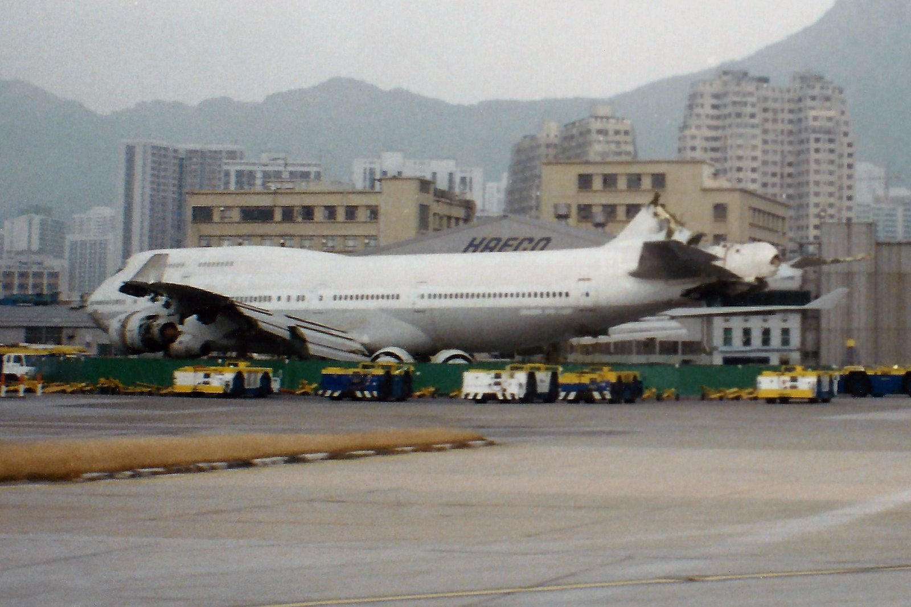
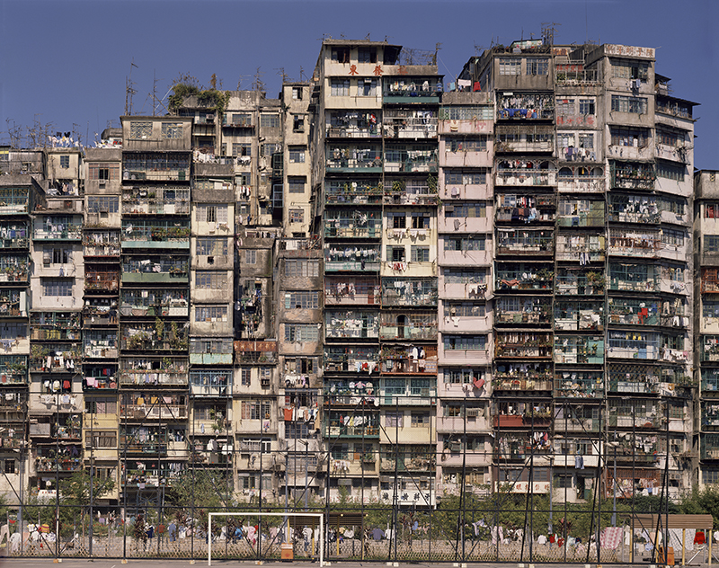

33年前の今日、1993年11月4日。台湾・台北の中正国際空港からイギリス領香港の啓徳（カイタック）空港へ向かった中華航空605便が、着陸時に滑走路で止まりきれずに海へ落ちる事故が発生しました。機体は製造からわずか数か月という最新鋭のボーイング747-400型機で、同型機としては世界初の全損事故となりました。激しい嵐のなかで起きたこの事故の全容と、奇跡の全員救出の経緯を振り返ります。

## 香港の難所・啓徳空港と台風23号の猛威

香港の啓徳空港は、市街地のすぐそばに位置し、九龍のビル群をすれすれにかすめるように旋回して着陸する「世界で最も着陸が難しい空港」の一つとして知られていました。周囲を険しい山と海に囲まれ、海に突き出た滑走路は1本しかありませんでした。

事故当日、香港には台風23号が接近しており、空港周辺には秒速十数メートルの激しい横風と突風が吹き荒れていました。中華航空605便が着陸進入を決めるわずか前には、英国航空の便が着陸を断念して進入を取りやめていたほど危険な気象状況でした。

## 完成から半年足らずの最新鋭機に迫る危機

事故に遭った中華航空605便（ボーイング747-409、機体記号B-165）は、1993年6月に製造されたばかりの新鋭機でした。総飛行時間は2,000時間にも満たず、まさに新品同然のハイテク機でした。機内には乗客274人と乗員22人が搭乗していました。

操縦桿を握っていた47歳の機長と37歳の副操縦士は、空港への着陸直前に激しい風の変化やウインドシアの警報に直面しました。機長は自動操縦と自動推力制御を解除し、自らの手動操縦で強風に立ち向かいながら滑走路13への着陸を試みました。

*Untitled (China Airlines) Boeing 747-409 B-165 (23222709894) — 写真: Kambui / CC BY 2.0*

## 減速できぬまま海へ──時速278キロの着地と混乱

午前11時36分、605便は時速約278キロ（150ノット）で滑走路に接地しました。しかし、着地位置は通常の接地点を大幅に越えて奥にずれ込んでいました。

接地後、強風にあおられた機体を滑走路中央に保とうとする操縦の過程で、意図せずエンジン推力が上がってしまいます。これにより自動ブレーキシステムが自動的に解除され、減速用のスピードブレーキも一度立ち上がった後に引っ込んでしまいました。副操縦士がブレーキの解除に気づいたときには、すでに滑走路の残りはわずかでした。機長は手動ブレーキと逆噴射を作動させたものの、停止は不可能でした。滑走路の先にある進入灯設備への激突を避けるため、機長は機体を左へ旋回させ、機体は滑走路脇からヴィクトリア湾の浅瀬へと滑り落ちました。

*Hong Kong street in daytime featuring a myriad of overhead signs, 1993 — 写真: GeorgeLouis / CC BY-SA 3.0*

## 水上の救出劇と日本にゆかりある乗客の無事

海に転落した機体は、ほぼ180度向きを変えて浅瀬に停止しました。機内アナウンス装置が破損したため、客室乗務員たちは大声で指示を出し、乗客全員に救命胴衣を着用させました。10カ所ある主デッキ非常口のうち8カ所から脱出用スライド兼ボートが展開発動されました。

乗客274人と乗員22人は全員が無事に救助され、死者は一人も出ませんでした。軽傷者は10人にとどまりました。この事故機には、日本でも広く親しまれた直木賞作家で経済評論家の邱永漢氏も搭乗しており、全身びしょ濡れになりながらも無事に救出された様子が当時のニュースで大きく報じられました。

*KWC - Playground — 写真: Ian Lambot / CC BY 4.0*

## 新品のハイテク機が「現場切断」で全損となった理由

海に落ちたボーイング747-400型機の損傷そのものは比較的軽微で、中華航空は引き上げて修理する方針でした。しかし、機体が停止した場所が滑走路の離着陸コースの直下に位置していました。

そびえ立つ巨大な垂直尾翼が他の航空機の運航の障害となり、機体全体の引き上げには日数がかかることから、空港当局の強い要請により、事故現場で垂直尾翼が切断撤去されました。垂直尾翼は機体骨格の重要な構造部材であり、切り離された機体はもはや元通りに修理することができず、就航からわずか数か月で同型機初となる全損扱いとなりました。

## 啓徳空港の閉港と今に受け継がれる教訓

都市のただ中に位置し、数々のドラマを生んだ啓徳空港は、1998年7月に新空港（赤鱲角・チェクラップコク国際空港）の開港に伴って惜しまれつつ閉港しました。

かつてジャンボ機が海へと滑り落ちた滑走路の跡地には、現在、世界中から大型客船を迎える広大な啓徳クルーズターミナルが整備され、大きく姿を変えています。しかし、悪天候下での判断や乗員連携の教訓を航空界に残したこの日の事故は、香港の歴史の劇的な1ページとして今も語り継がれています。

### 参考資料

- <https://ja.wikipedia.org/wiki/%E4%B8%AD%E8%8F%AF%E8%88%AA%E7%A9%BA605%E4%BE%BF%E3%82%AA%E3%83%BC%E3%83%90%E3%83%BC%E3%83%A9%E3%83%B3%E4%BA%8B%E6%95%85>
- <https://commons.wikimedia.org/wiki/File:Untitled_(China_Airlines)_Boeing_747-409_B-165_(23222710834).jpg>
- <https://commons.wikimedia.org/wiki/File:Untitled_(China_Airlines)_Boeing_747-409_B-165_(23222709894).jpg>
- <https://commons.wikimedia.org/wiki/File:Hong_Kong_street_in_daytime_featuring_a_myriad_of_overhead_signs,_1993.jpg>
- <https://commons.wikimedia.org/wiki/File:KWC_-_Playground.jpg>
