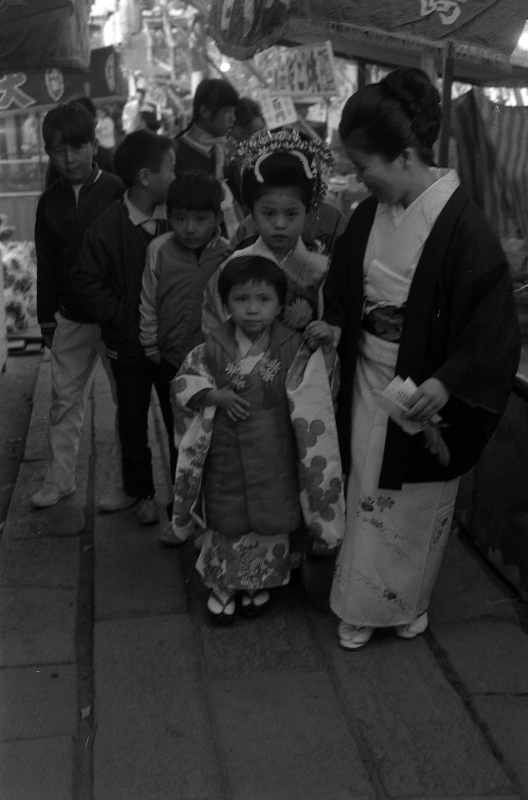
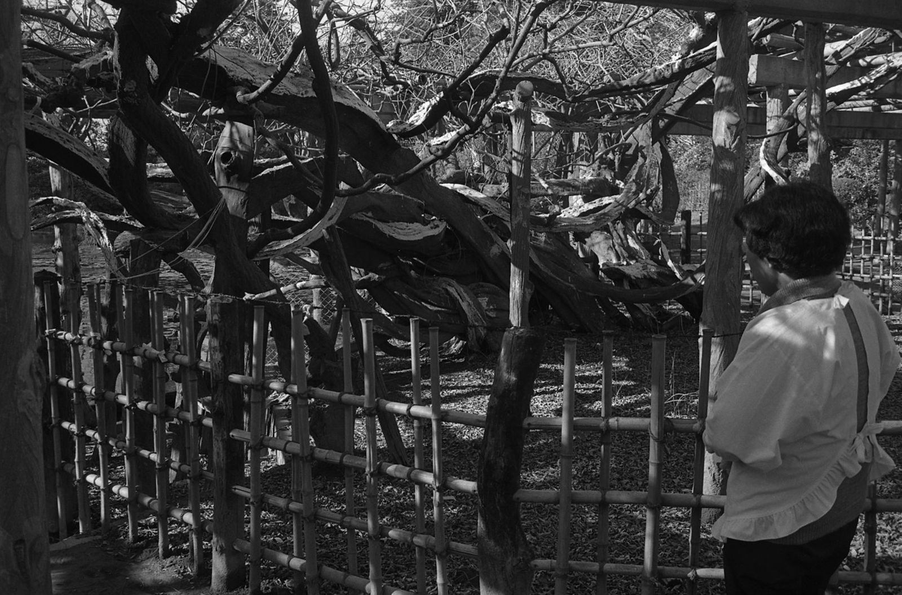
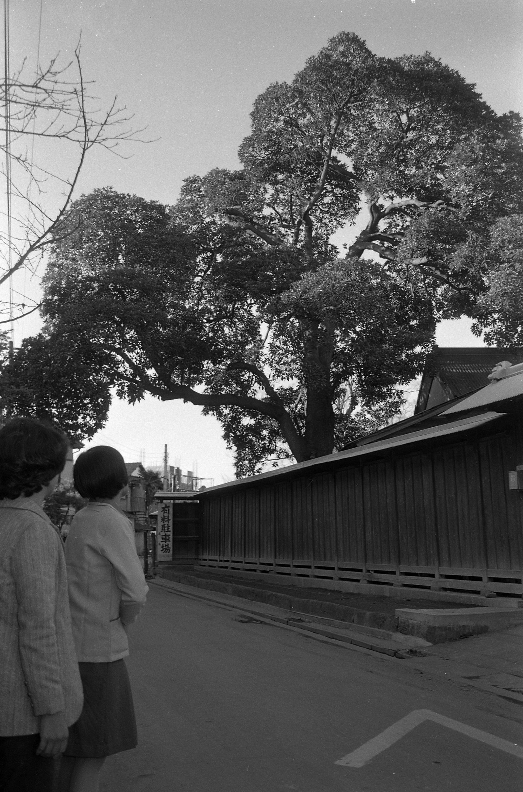

54年前の今日、1972年11月5日。東京の上野動物園で、中国から贈られた2頭のジャイアントパンダ「カンカン」と「ランラン」の一般公開が始まりました。
この年の9月に結ばれた日中国交正常化を記念して来日した2頭の姿を一目見ようと、動物園の前には夜通し並ぶ人々を含む空前の大行列ができました。日本中を巻き込んだパンダブームの原点となった、熱気あふれる初日の光景でした。

## 日中国交正常化の記念として来日した2頭

1972年9月、日本と中国の間で日中国交正常化が実現しました。この歴史的な外交の節目を記念し、友好の象徴として中国政府から日本へ贈られたのが、2頭のジャイアントパンダ、オスのカンカン（康康）とメスのランラン（蘭蘭）でした。

当時の日本において、生きたジャイアントパンダを目にしたことがある人はほとんどおらず、その来日は国中を巻き込む大ニュースとなりました。受け入れ先となった上野動物園には公開前から連日問い合わせが相次ぎ、日本中が一般公開の開始を心待ちにしていました。

## 徹夜組を含め約1万8000人が押し寄せた熱狂の初日

迎えた1972年11月5日、上野動物園の門の前には開園を待ちきれない熱心な見学客が前夜から詰めかけ、徹夜の列が作られました。早朝になると人の波はさらに膨れ上がり、初日だけで約1万8000人もの人々が上野に押し寄せました。

開門とともに展示エリアへ進んだ人々は、白と黒の毛並み、丸みを帯びた愛くるしい体型、そして笹を食べる仕草に歓声を上げました。短い観覧時間でありながらも大フィーバーが巻き起こり、この日の熱気はテレビや新聞を通じて全国へ伝えられ、空前のパンダブームが幕を開けました。

*大沢のおかめ市（香取神社） — 写真: ndl / CC BY (Japan Search)*

## 竹を大量に食べる特殊な生態と体の仕組み

ジャイアントパンダは、中国の四川省、陝西省、甘粛省などの標高1,200〜4,100メートルの高山地帯の竹林に生息する大型のクマ科動物です。成体の体重は通常100〜150キログラムに達し、頭胴長は120〜150センチメートルほどになります。尾の毛は黒ではなく白色で、長さは10〜15センチメートルほどしかありません。

食生活は極めて特殊で、食事の99％をタケ類やササ類が占めています。草食動物としての消化効率が低いため、毎日10〜18キログラム、水分の多い竹なら最大38キログラムもの量を食べる必要があり、1日のうち約14時間を採食に費やします。また、竹を掴むために前肢の骨が進化した「第六の指」や「第七の指」と呼ばれる突起を持ち、器用に竹を挟み込む二重ペンチ構造を備えているのも大きな特徴です。

*藤（久伊豆神社） — 写真: ndl / CC BY (Japan Search)*

## 世界的な保護の象徴となった歴史と背景

ジャイアントパンダの存在は、1869年にフランス人宣教師アルマン・ダヴィドが毛皮を発見したことで西洋に知られるようになりました。1936年にはルース・ハークネスが生体をアメリカへ連れ帰るなど関心が高まりましたが、毛皮目当ての狩猟や森林伐採による生息地の破壊によって個体数は急速に減少しました。

繁殖期は年に一度の春に限られ、生まれた直後の幼獣はわずか85〜140グラムと非常に小さく毛も生えていないなど、繁殖力の低さも重なって絶滅の危機が叫ばれました。中国では1938年に狩猟が禁止され、後に国家一級重点保護野生動物に指定されるとともに、世界自然保護基金（WWF）のシンボルマークにも採用されるなど、世界的な野生動物保護の象徴となりました。

*たぶの木 — 写真: ndl / CC BY (Japan Search)*

## 現代の動物園が担う役割と今に続く記憶

近代の動物園には、来園者を楽しませるレクリエーションだけでなく、環境教育、種の保存、そして調査研究という重要な機能が国際的に求められています。上野動物園におけるパンダの飼育と公開も、珍しい生態を多くの人々に直接伝え、自然保護への関心を呼び起こす貴重な窓口となってきました。

1972年のカンカンとランランの公開から半世紀以上が過ぎた今も、ジャイアントパンダは世代を超えて親しまれる特別な存在であり続けています。54年前のあの日、上野動物園を取り囲んだ1万8000人の大行列は、野生動物への親しみと関心を日本中に広げた大切な歴史の一幕として今に刻まれています。

### 参考資料

- <https://ja.wikipedia.org/wiki/%E9%BB%92%E6%9F%B3%E5%BE%B9%E5%AD%90>
- <https://commons.wikimedia.org/wiki/File:Pressekonferenz_Tokyo_1972.jpg>
- <https://adeac.jp/koshigaya-city-digital-archives/catalog/mp159959-200020>
- <https://adeac.jp/koshigaya-city-digital-archives/catalog/mp160022-200020>
- <https://adeac.jp/koshigaya-city-digital-archives/catalog/mp160037-200020>
