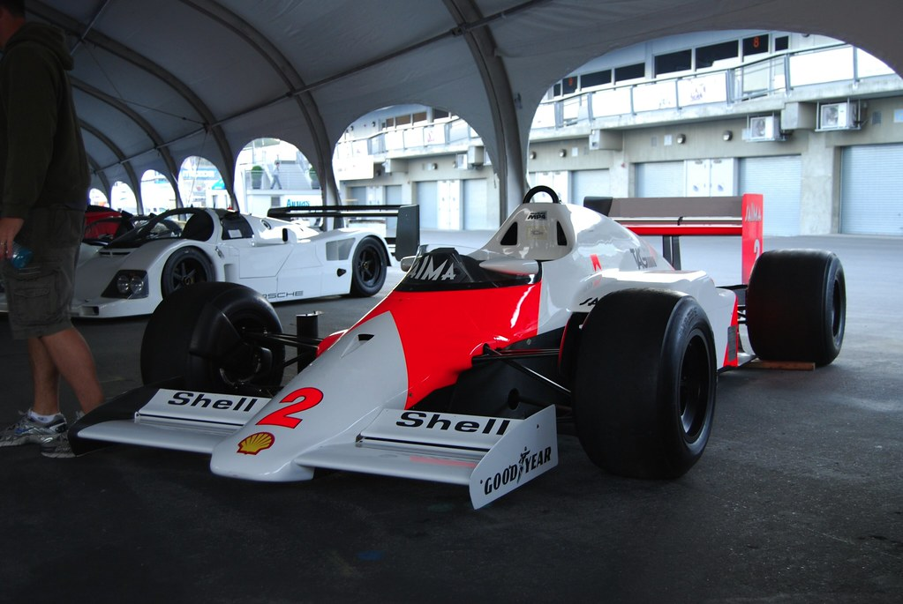
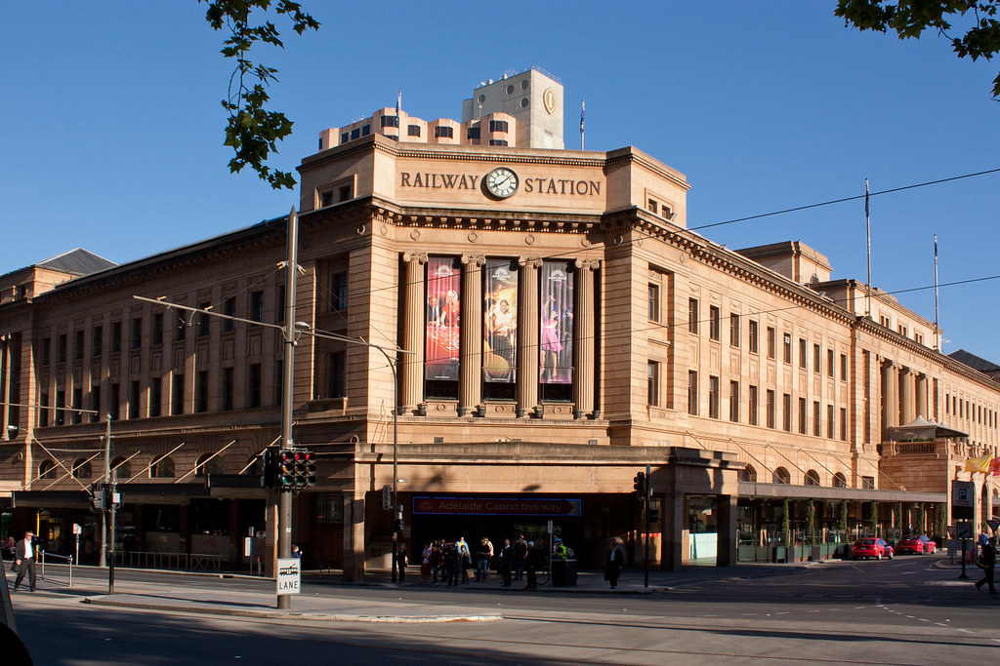
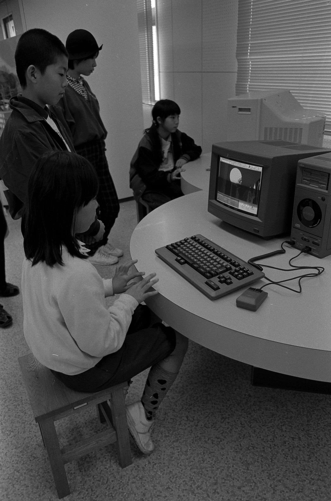

37年前の今日、1989年11月5日。自動車レースの最高峰F1オーストラリアグランプリで、中嶋悟選手が日本人初となる決勝レースのファステストラップ（最速周回記録）を達成しました。大雨にたたられた過酷な市街地コースで、世界の強豪たちが次々と脱落する中、予選23番手から4位まで駆け上がった驚異の追い上げ劇は、今もモータースポーツファンの胸に刻まれています。

## 緊迫した空気の中で迎えた最終戦アデレード

1989年のF1世界選手権は、鈴鹿サーキットで行われた前戦の日本グランプリで頂点に達した緊迫感をそのまま引きずりながら最終戦を迎えました。マクラーレン・ホンダのチームメイト同士だったアイルトン・セナ選手とアラン・プロスト選手がシケインで接触し、レース後にセナ選手が失格処分となった騒動は、法廷闘争へと発展していました。

迎えた11月5日のオーストラリアグランプリの舞台は、アデレード市街地コースでした。予選が行われた金曜日と土曜日はドライコンディションでしたが、日曜日の決勝当日は昼前から猛烈な豪雨に見舞われ、サーキットはあっという間に深い水浸しとなりました。

## 世界王者が棄権するほどの劣悪な路面コンディション

あまりの豪雨にドライバーたちからは危険を訴える声が相次ぎ、決勝のスタートは予定より30分遅れとなりました。コース上に溜まった雨水は深く、水煙によって視界は極度に悪化していました。スタートが切られた直後、1周を終える前に約3分の1のマシンがスピンを喫し、オニクスのJ.J.レート選手がクラッシュしたことでレースは赤旗中断となります。

この時、プロスト選手は「危険すぎる」として1周でピットに戻り、午後3時の再スタートにも加わらず自ら棄権を選びました。歴代最高峰のドライバーの1人であるプロスト選手が命の危険を感じて自発的にマシンを降りるほど、この日のコースは凄まじい状態でした。

*1985 McLaren MP4/2B-6 TAG Porsche turbo Alain Prost — 写真: wbaiv / CC BY-SA 2.0*

## 名手たちが次々と散ったサバイバルレース

再スタートが切られた後も、コース上では波乱が続出しました。視界が遮られた水煙の中でクラッシュやスピンが相次ぎ、ルネ・アルヌー選手、ゲルハルト・ベルガー選手、フィリップ・アリオー選手らが次々とリタイアへと追い込まれます。

年間王座のために優勝が絶対条件だったセナ選手も、前を走るマーティン・ブランドル選手に気づかず追突してフロントを大破させ、無念のリタイアを喫しました。さらにネルソン・ピケ選手やナイジェル・マンセル選手といった世界チャンピオン経験者たちも相次いでマシンのコントロールを失い、出走26台のうちチェッカーを受けたのはわずか8台という大荒れの展開となりました。

*Adelaide Railway Station — 写真: Rexness / CC BY-SA 2.0*

## 予選23番手から見せた驚異の「19台抜き」

この過酷なサバイバルレースで主役となったのが、ロータス・ジャッドを駆る中嶋悟選手でした。ドライ路面で行われた予選ではマシン性能の低さに苦しみ、23番手という後方グリッドに沈んでいましたが、ウェットコンディションとなったことで中嶋選手の天賦の才能が目を覚まします。

悪天候の中で抜群のマシンコントロールを見せた中嶋選手は、前方のマシンが次々と脱落・減速していくのを尻目に、鮮やかなオーバーテイクを繰り返しました。気がつけば4位まで浮上し、前を走るウィリアムズ・ルノーのリカルド・パトレーゼ選手を10周以上にわたって猛烈に追い詰めました。真後ろにつくと前車の水煙を吸い込んだエンジンがミスファイアを起こすため惜しくも逆転はならなかったものの、2時間の規定時間を迎えた70周終了時点で堂々の4位フィニッシュを果たしました。

*12/28 児童館コスモス コンピューターコーナー — 写真: ndl / CC BY (Japan Search)*

## 日本人初の快挙と「雨の中嶋」への称賛

この激走の中で記録されたのが、決勝レース中の全出走車で最速となるファステストラップでした。日本人ドライバーがF1の決勝レースで最速タイムを記録したのは、これが歴史上初めての快挙でした。

マシンの絶対的な馬力や空力性能ではるかに勝るトップチームを相手に、雨の中で驚異的なラップタイムを刻み続けた中嶋選手の技術は、世界中から絶賛を浴びました。イギリスBBCの辛口解説者として知られた元世界王者のジェームス・ハント氏もその走りを惜しみなく称え、「雨の中嶋」の異名は国際的な舞台で不動のものとなりました。

## 現在へと受け継がれる挑戦の記憶

F1における日本人ドライバーのファステストラップは、この1989年の中嶋悟選手に始まり、2012年中国グランプリの小林可夢偉選手、そして2023年アメリカグランプリの角田裕毅選手へと受け継がれています。長年語り継がれた1976年の記録が後に訂正された経緯もあり、中嶋選手がアデレードの豪雨の中で正式に刻んだ最速ラップは、日本モータースポーツ界にとってまさに不滅の金字塔です。

荒れ狂う雨の中、水しぶきを恐れずにアクセルを踏み込み、世界を驚かせたあのアデレードの午後。テレビの前で手に汗を握り、中嶋選手の白いヘルメットを追い続けたあの熱い記憶は、今も色あせることはありません。

### 参考資料

- <https://ja.wikipedia.org/wiki/%E3%83%95%E3%82%A9%E3%83%BC%E3%83%9F%E3%83%A5%E3%83%A91>
- <https://commons.wikimedia.org/wiki/File:Satoru_Nakajima_Lotus_Judd_1989_San_Marino_GP.jpg>
- <https://www.flickr.com/photos/9998127@N06/6293162131>
- <https://www.flickr.com/photos/25287507@N02/5104232674>
- <https://adeac.jp/koshigaya-city-digital-archives/catalog/mp232654-200020>
