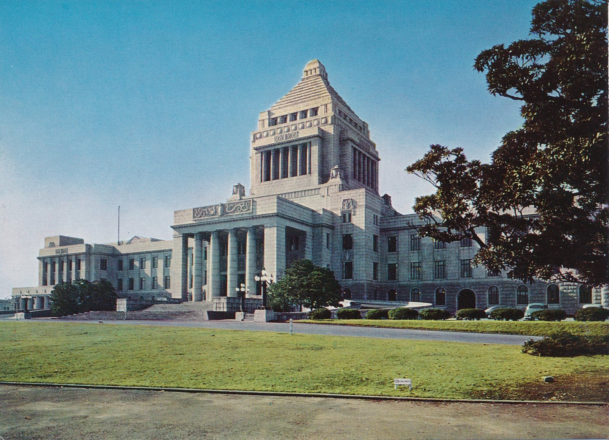
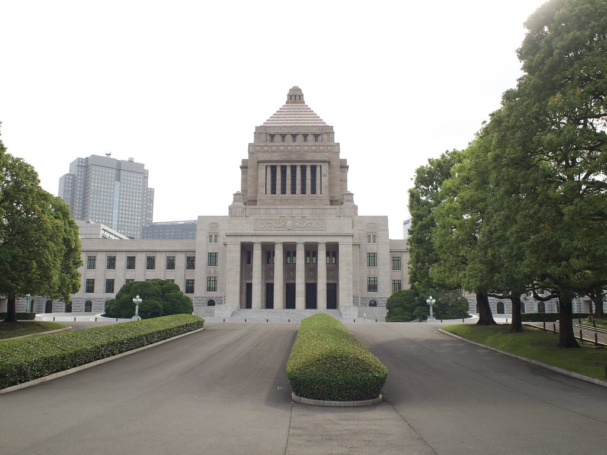
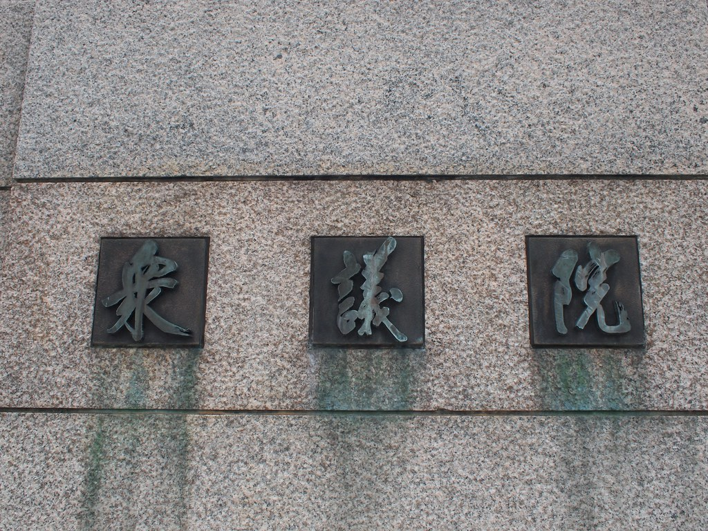

35年前の今日、1991年11月5日。宮澤喜一氏が第78代内閣総理大臣に任命され、宮澤内閣が正式に発足しました。参議院議員の経験者としては憲政史上初、そして大蔵官僚出身としては現時点で最後の総理大臣となった宮澤政権の誕生でした。

## 大蔵官僚から政界へ――池田勇人のブレーンとして

宮澤喜一は1919年、政治家の家系に生まれました。東京帝国大学法学部を卒業後、1942年に大蔵省へ入省します。終戦直後から頭角を現し、池田勇人蔵相の秘書官として講和条約の準備交渉に従事しました。1951年のサンフランシスコ講和会議では全権随員として立ち会うなど、卓越した英語力と政策立案能力で早くから注目を集めました。

1953年の参議院議員選挙で政界入りを果たすと、池田内閣のもとで経済企画庁長官として初入閣します。「所得倍増政策」の立案を支えるブレーンとして手腕を発揮し、テレビの討論番組などでも論理的な発言で新保守派の代表格として脚光を浴びました。のちに衆議院へ鞍替えし、外務大臣や通商産業大臣といった要職を歴任していきました。

## 「安竹宮」の競演とリクルート事件の挫折

自民党の名門派閥である宏池会を継承した宮澤は、安倍晋太郎、竹下登とともに「安竹宮」と並び称され、ポスト中曽根を担う「ニュー・リーダー」の筆頭候補として総裁の座を争いました。鈴木善幸内閣では内閣官房長官を務め、持ち前の実務処理能力で政権運営を支えました。

1987年の総裁選では中曽根裁定によって竹下内閣が発足し、宮澤は副総理兼大蔵大臣として消費税導入などの税制改革を推進しました。しかし、1988年に発覚したリクルート事件において未公開株譲渡を巡る道義的責任を問われ、無念の辞任を余儀なくされます。実力者でありながら頂点を目前にして足踏みを続ける試練の時期を過ごしました。

*1960's Japanese Postcard (52784040480) — 写真: Larry Syverson from Richmond, VA, USA / CC BY-SA 2.0*

## 72歳の船出――有力閣僚が揃った組閣

転機は1991年秋に訪れました。海部俊樹首相の退陣に伴う自民党総裁選挙で勝利を収め、72歳で悲願の首相指名を受けたのです。1991年11月5日に発足した宮澤内閣は、党内最大勢力であった竹下派の後押しを受けつつ、副総理兼外務大臣に渡辺美智雄、内閣官房長官に加藤紘一、大蔵大臣に羽田孜、通商産業大臣に渡部恒三を迎えるなど、重厚な布陣を整えました。

また、建設大臣に山崎拓が入り、党役員には小泉純一郎が名を連ねるなど、のちに「YKK」と呼ばれて政界の主軸となる政治家たちが表舞台に姿を現した内閣でもありました。発足当初の世論調査では高い内閣支持率を記録し、政策通の手腕に対する国民の期待の大きさを物語っていました。

*National Diet Building (JAPAN) - 04 — 写真: beve4 / CC BY 2.0*

## バブル崩壊と公的資金構想――先見性と立ちはだかる壁

宮澤首相が直面したのは、二、三百年に一度とも評した冷戦の終結と、バブル景気崩壊という未曾有の荒波でした。内需の基盤を整える「生活大国構想」を掲げるとともに、外交では懸案だったPKO協力法を成立させ、自衛隊のカンボジア派遣に道を開きました。

経済面では、地価や株価の急落による不良債権問題の本質を早期に見抜き、1992年8月の自民党軽井沢セミナーで金融機関への公的資金投入の必要性に言及しました。しかしこの構想は、大蔵省、財界、マスコミ、さらには当の金融機関からも激しい反発を受け、撤回に追い込まれます。のちに金融危機の深刻化によって公的資金の必要性が痛感されることになりますが、当時はタブー視され、先見の明を持ちながらも押し通すことができなかった苦渋の歴史となりました。

*National Diet Building (JAPAN) - 15 — 写真: beve4 / CC BY 2.0*

## 「55年体制」最後の総理、そして平成の高橋是清へ

政治改革関連法案を巡る党内対立は決定的な亀裂を生み、1993年6月に小沢一郎や羽田孜らの造反によって内閣不信任案が可決されました。続く総選挙で自民党は過半数を回復できず、日本新党の細川護煕を首班とする連立政権が誕生します。これにより、1955年の結党以来38年間続いた自民党単独政権「55年体制」は終焉を迎え、宮澤は第15代将軍になぞらえて「自民党の徳川慶喜」とも呼ばれました。

しかし、宮澤の政治人生はここで終わりませんでした。1998年、深刻な金融危機に対処するため小渕恵三首相の懇請を受け、元首相としては異例となる大蔵大臣への再登板を受諾します。戦前の高橋是清以来となるこの就任劇は「平成の高橋是清」と呼ばれ、宮澤は大量の国債発行による財政出動と金融再生法の整備に尽力し、初代財務大臣まで務め上げました。卓越した知性と経済への深い知見で激動の昭和から平成を駆け抜けた宮澤喜一の政治的足跡は、今も戦後政治史に鮮烈に刻まれています。

### 参考資料

- <https://ja.wikipedia.org/wiki/%E5%AE%AE%E6%BE%A4%E5%86%85%E9%96%A3>
- <https://commons.wikimedia.org/wiki/File:Miyazawa_Kiichi_1953.jpg>
- <https://commons.wikimedia.org/wiki/File:1960%27s_Japanese_Postcard_(52784040480).jpg>
- <https://www.flickr.com/photos/26958633@N02/4727600054>
- <https://www.flickr.com/photos/26958633@N02/4726958841>
