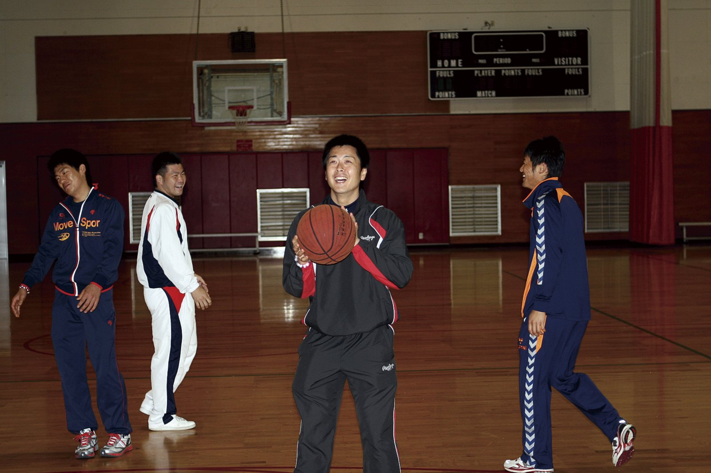
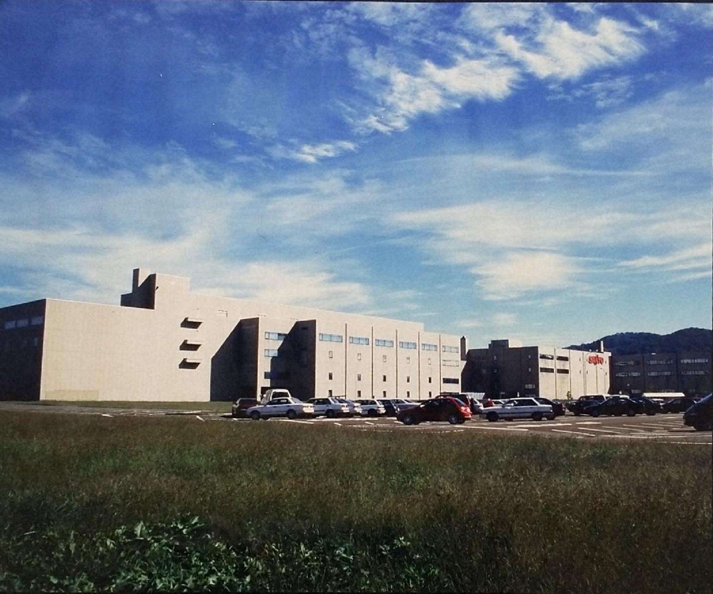
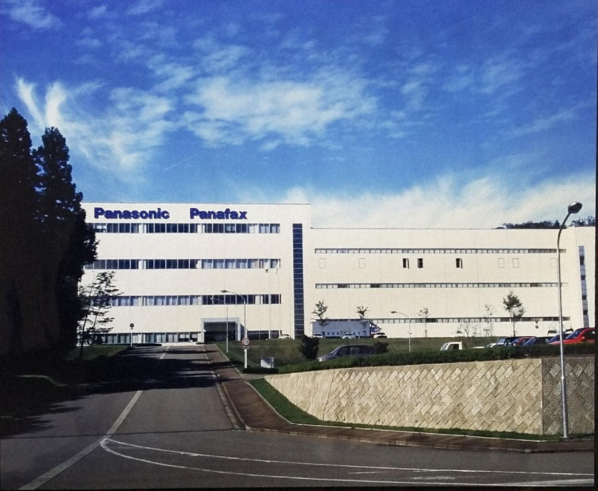

21年前の今日、2005年11月5日。日本初のプロバスケットボールリーグである「bjリーグ」が開幕しました。実業団主体の企業スポーツが当たり前だった時代に、地域に根ざしたエンターテインメント性の高いプロスポーツを目指して踏み出した歴史的な第一歩でした。

## 実業団からの脱却と新リーグ構想の誕生

かつての日本のバスケットボール界では、企業が運営する実業団チームによるリーグ戦が主流でした。選手たちの多くは企業に所属する会社員であり、プロとして観客を魅了する興行としての発展には限界がありました。そうした状況を打破し、プロフェッショナルでエンターテインメント性あふれるプレーを届けるとともに、地域社会におけるスポーツ文化の向上と国際化を目指そうという声が高まりました。

大きな転機となったのは2004年8月5日です。スーパーリーグに所属していた新潟アルビレックスと、日本リーグ所属のさいたまブロンコスが、バスケットボール日本リーグ機構および日本バスケットボール協会からの脱退を表明しました。既存の枠組みを飛び出し、完全なプロリーグを自らの手で創り上げるための決断でした。

## 準備室の立ち上げと初年度6チームの決定

脱退表明からわずか1週間後の2004年8月12日、有限責任中間法人日本プロバスケットボールリーグ設立準備室が設立されました。同年11月24日には新リーグの名称が「bjリーグ」と発表され、初年度に参加するチームが公表されました。

集まったのは、新潟アルビレックスBB、埼玉ブロンコスに加え、仙台89ERS、東京アパッチ、大阪ディノニクス（のちにヒューマングループへ会員資格が譲渡され大阪エヴェッサに改称）、大分ヒートデビルズの計6チームでした。東北から九州まで、各地域に根ざしたチームによる新しいリーグの骨格が固まりました。

*USMC-01424 — 写真: US Marine Corps in Japan / Public domain*

## ドラフト会議と迎えた11月5日の開幕戦

2005年3月24日、準備室は「株式会社日本プロバスケットボールリーグ」として法人化され、河内敏光コミッショナーが社長を兼任することになりました。4月には新潟と埼玉の日本リーグ機構脱退が正式に承認され、プロリーグとしての基盤が整えられていきました。

同年6月6日には記念すべき第1回bjリーグドラフト会議が開催され、26名の選手が指名を受けました。プロ選手としての道を切り拓いた選手たちは、新しい舞台への期待と覚悟を胸に練習を重ねました。そして2005年11月5日、待ちに待ったbjリーグの最初のシーズンが開幕し、各地の体育館で熱戦の火ぶたが切って落とされました。

*新潟三洋電子外観 — 写真: ojiya / CC BY (Japan Search)*

## 初代王者大阪エヴェッサの誕生とリーグの広がり

bjリーグは、試合を華やかに彩る音響や演出、ファンとの距離の近さを大切にし、それまでの堅い実業団の試合とは一線を画すアリーナ空間を作り出しました。各チームは自治体や地元企業と密着し、地域に愛されるクラブづくりを進めていきました。

初年度のシーズンは熱狂の中で進行し、2006年4月30日には大阪エヴェッサがbjリーグの初代王者に輝きました。その後、富山グラウジーズや高松ファイブアローズ、琉球ゴールデンキングス、ライジング福岡など、プロスポーツチームの少なかった地方都市へ次々と参入チームが広がり、日本全国にバスケットボール熱を波及させていきました。

*松下電送新潟工場 — 写真: ojiya / CC BY (Japan Search)*

## リーグ統合の波と現代Bリーグへの継承

全国でファンを獲得していったbjリーグでしたが、企業チームを中心とする従来のトップリーグとの併存状態が続き、国際大会への出場資格停止処分など日本バスケ界全体を揺るがす課題にも直面しました。そうした混迷を経て、2015年に新たな運営法人ジャパン・プロフェッショナル・バスケットボールリーグが発足し、両リーグの統合が決まりました。

2016年5月15日、琉球ゴールデンキングス対富山グラウジーズによるプレーオフ決勝をもって、bjリーグは11シーズンの歴史に幕を下ろしました。しかし、bjリーグが掲げた「地域密着」「エンターテインメント性」「アリーナ演出」の哲学は、同年9月に開幕した新リーグ「Bリーグ」へとそのまま受け継がれ、今や日本バスケットボール界の大きな原動力となっています。

### 参考資料

- <https://ja.wikipedia.org/wiki/%E3%83%90%E3%82%B9%E3%82%B1%E3%83%83%E3%83%88%E3%83%9C%E3%83%BC%E3%83%AB>
- <https://commons.wikimedia.org/wiki/File:Isolated_basketball.png>
- <https://commons.wikimedia.org/wiki/File:USMC-01424.jpg>
- <https://jmapps.ne.jp/ojiya_archive/det.html?data_id=5675>
- <https://jmapps.ne.jp/ojiya_archive/det.html?data_id=5689>
