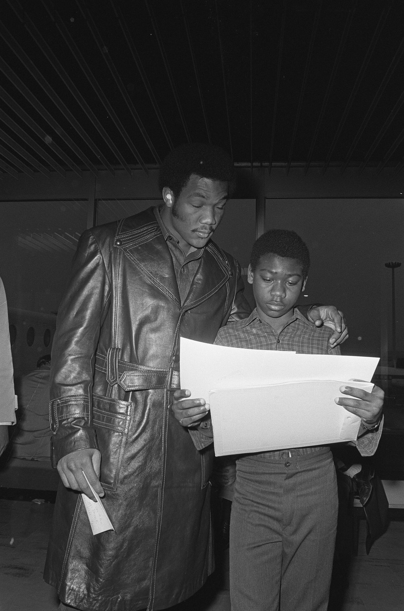
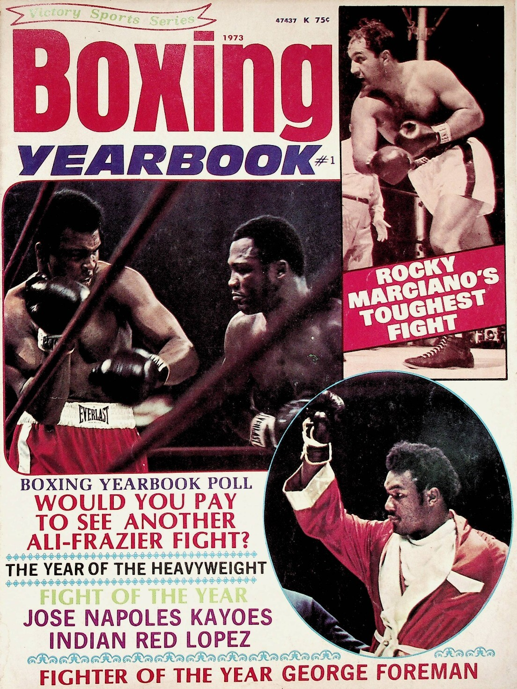
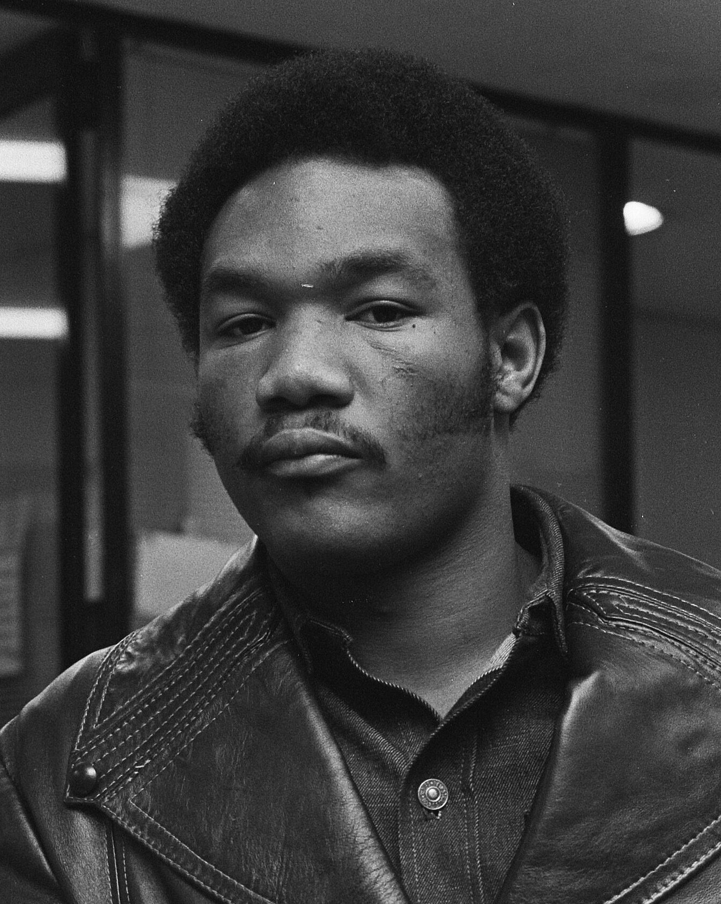

32年前の今日、1994年11月5日。ボクシングのWBA・IBF世界ヘビー級タイトルマッチで、挑戦者のジョージ・フォアマン選手が王者マイケル・モーラー選手を10回ノックアウトで破り、史上最年長となる45歳9か月で世界ヘビー級チャンピオンに返り咲きました。一度はリングを去り牧師となった元王者が、20年の歳月を経て再び頂点に立った瞬間でした。

## 若き日の栄光とキンシャサの敗北

ジョージ・フォアマン選手は1968年のメキシコシティーオリンピックでヘビー級金メダルを獲得し、プロ転向後も圧倒的な強打で連勝街道を突き進みました。1973年1月にはジョー・フレージャー選手を2回TKOで下して世界ヘビー級統一王者となり、その年の9月には東京の日本武道館で初防衛戦を行うなど、無敵の強さを誇っていました。

しかし1974年10月30日、ザイールの首都キンシャサで行われた「ランブル・イン・ザ・ジャングル」で運命が暗転します。挑戦者モハメド・アリ選手の巧妙な作戦にはまり、8回逆転KO負けを喫して王座から陥落。41戦目にしてプロ初黒星を味わうことになりました。

## 引退、牧師への転身、そして10年ぶりの復帰

アリ選手への再挑戦を目指したものの、1977年にジミー・ヤング選手に判定負けを喫したフォアマン選手は、試合後のロッカールームで昏倒する体験を経てキリスト教に目覚め、28歳で現役を引退しました。その後は故郷テキサス州で牧師となり、教会や青少年のためのセンターを設立して社会奉仕に専念します。

ところが、施設の維持費や多額の出費が重なり、資金難に直面します。そこでフォアマン選手は38歳だった1987年、リングへの復帰を決意しました。10年間のブランクに加え、体重も大幅に増えて太った体を前に、周囲は無謀な挑戦だと嘲笑しましたが、本人は真剣に勝利を重ねていきました。

*Bokskampioen Georg Foreman op Schiphol, Georg Foreman met Romeo Ommel, Bestanddeelnr 926-2855 — 写真: Bert Verhoeff / Anefo / CC0*

## 1994年11月5日、劣勢を覆した右ストレート

復帰後に連勝を重ねたフォアマン選手は、1994年11月5日、WBA・IBF統一王者マイケル・モーラー選手への挑戦権を得ました。モーラー選手はフォアマン選手より19歳年下で、サウスポーから鋭いパンチを放つ無敗の若き王者でした。

試合はスピードで勝るモーラー選手が主導権を握り、フォアマン選手は9回終了時点で採点において大差をつけられていました。判定まで持ち込まれれば勝ち目がない状況の中、迎えた第10ラウンド。フォアマン選手はじわじわと距離を詰め、王者の動きを止めにかかります。そして10回2分3秒、正確無比な右ストレートがモーラー選手の顎を直撃。王者はキャンバスに崩れ落ち、10カウントを聞くことになりました。

*Boxing Yearbook 1 1973 cover — 写真: Bill Apter Or Theo Ehret Or Tony Lanza Or Bob Sabre Or Bill  / Public domain*

## 45歳9か月の戴冠と日本とのゆかり

45歳9か月でのヘビー級王座獲得は、それまでの最年長記録を大きく更新する快挙でした。アリ選手に敗れてベルトを失った1974年から数えて、実に20年ぶりの世界王者復帰となりました。

フォアマン選手は若い全盛期の1973年9月1日に日本武道館でホセ・ローマン選手と戦い、わずか1回2分でKO防衛を果たしています。さらに王座返り咲き後の1996年11月3日にも、千葉の東京ベイNKホールで防衛戦を行い判定勝ちを収めるなど、日本のファンにとっても親しみ深い世界王者の一人でした。

*George Foreman (1973) (cropped) — 写真: Bert Verhoeff, Nationaal Archief, Den Haag, Rijksfotoarchief / CC0*

## 人々に希望を与え続けた「ビッグ・ジョージ」

王座奪還後のフォアマン選手は、名前を冠したバーベキューグリルが大ヒットするなど実業家としても大きな成功を収め、笑顔を絶やさない親しみやすい人柄で世界中から「ビッグ・ジョージ」と愛されました。

2025年3月に76歳で亡くなりましたが、年齢やブランクを言い訳にせず、45歳で再び夢を叶えたその姿は、今もスポーツ史に残る希望の物語として語り継がれています。

### 参考資料

- <https://ja.wikipedia.org/wiki/11%E6%9C%885%E6%97%A5>
- <https://commons.wikimedia.org/wiki/File:Bokskampioen_Georg_Foreman_op_Schiphol,_Georg_Foreman_met_klein_boksertje_Romeo_,_Bestanddeelnr_926-2853.jpg>
- <https://commons.wikimedia.org/wiki/File:Bokskampioen_Georg_Foreman_op_Schiphol,_Georg_Foreman_met_Romeo_Ommel,_Bestanddeelnr_926-2855.jpg>
- <https://commons.wikimedia.org/wiki/File:Boxing_Yearbook_1_1973_cover.jpg>
- <https://commons.wikimedia.org/wiki/File:George_Foreman_(1973)_(cropped).jpg>
