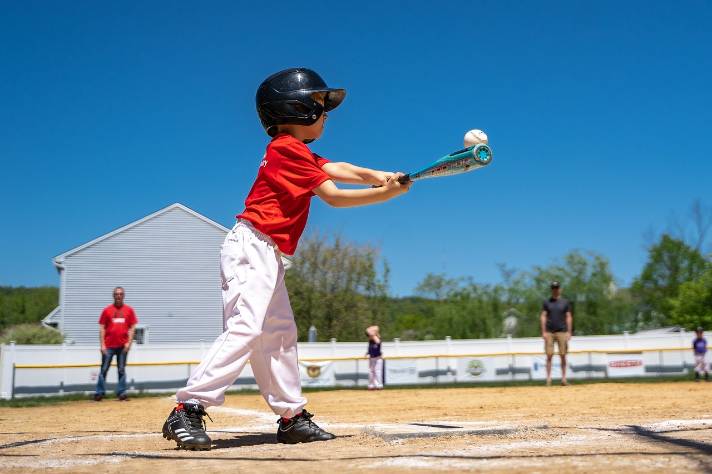
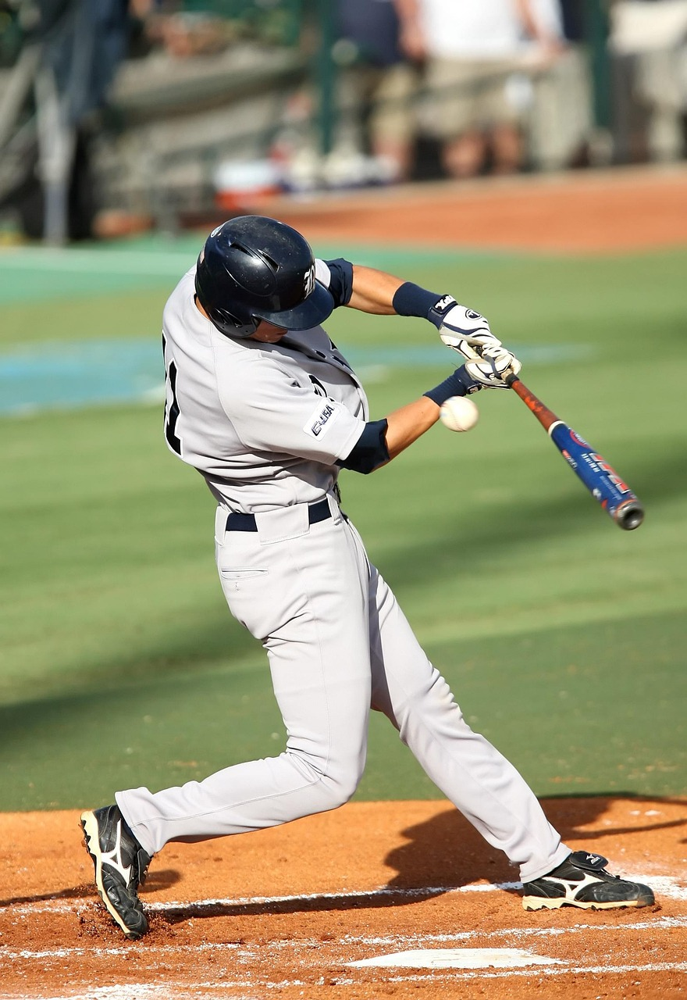
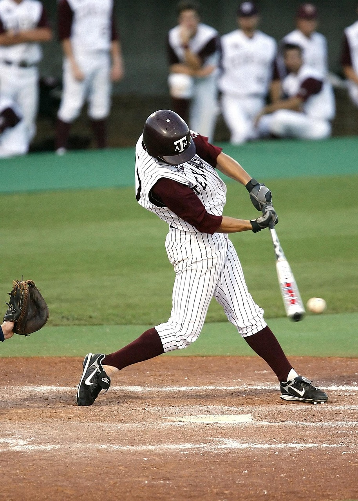

41年前の今日、1985年11月5日。東京都地方労働委員会（現・東京都労働委員会）が、日本プロ野球選手会を正式な「労働組合」として認定しました。華やかなスタジアムで喝采を浴びるプロ野球選手たちが、法律に基づく団結権と団体交渉権を獲得した歴史的な転換点でした。

## 個人事業主の壁と不安定な身分

当時、球団の親会社やオーナー側は、選手について「税法上は個人事業主であり、労働基準法や労働組合法が定める労働者ではない」と主張していました。そのため、選手会が労働組合を結成することは筋違いであるという論理で激しく反発していました。

しかし、プロ野球選手の平均引退年齢はおよそ29歳、平均現役年数は約9年という過酷な世界です。故障による戦力外通告や一方的な解雇に直面しても、選手個人が球団組織と対等に渡り合うことは極めて困難でした。選手たちの権利を法的に守るための組織が切実に求められていたのです。

## 高橋博士選手の解雇と中畑清らの決起

事態が大きく動いたきっかけは、1982年オフに起きたロッテオリオンズの高橋博士選手に対する不当解雇問題でした。球団から突然の解雇を言い渡された高橋選手を救済するため、各球団の選手たちが支援に立ち上がりました。

この動きの中心となったのが、読売ジャイアンツの主力打者で、のちに選手会長を務める中畑清さんでした。選手たちは事務局長に元日本ハムファイターズの西井敏次さんを迎え、1983年7月の選手会臨時総会で正式に労働組合を結成する方針を採択しました。

*当日の写真ではありません · 事件当時の写真ではありません · イメージ写真 — 写真: jatocreate / Pixabay Content License*

## 1985年11月5日、東京都労委の歴史的判断

選手たちは1984年7月に法外組合として「労働組合日本プロ野球選手会」を発足させ、東京都地方労働委員会に対して労働組合としての資格審査を申し立てました。

そして1985年11月5日、東京都地方労働委員会は選手会の主張を認め、正式な労働組合として認定書を交付しました。球団の指揮監督のもとでプレーを提供し、報酬を得ているプロ野球選手は労働組合法上の「労働者」にあたるという司法・行政判断が下された瞬間でした。

*当日の写真ではありません · 事件当時の写真ではありません · イメージ写真 — 写真: KeithJJ / Pixabay Content License*

## ストライキ権の獲得と球団ごとの葛藤

認定から2週間後の1985年11月19日、選手会は法人登記を完了し、法的なストライキ権を有する組織として正式に再出発しました。12球団の選手会も傘下の組合組織として組み込まれていきました。

ただし、すんなりと一枚岩になったわけではありませんでした。ヤクルトスワローズの選手会は親会社の意向により当初は脱会を余儀なくされ、1989年になってようやく復帰するなど、球団経営陣との間で激しい軋轢と葛藤を経験することになりました。

*当日の写真ではありません · 事件当時の写真ではありません · イメージ写真 — 写真: KeithJJ / Pixabay Content License*

## FA制度の実現と2004年のストライキ

労働組合としての基盤を手に入れた選手会は、その後、球界の構造改革を次々と推し進めました。1992年には長年要求してきたフリーエージェント（FA）制度の導入を勝ち取り、選手の移籍の自由と年俸水準の向上に道を開きました。

さらに2004年のプロ野球再編問題では、球団削減と合併に反対し、新球団の参入を求めて日本プロ野球史上初となる公式戦ストライキを決行しました。ファンを巻き込んだ大きな社会問題となり、結果として球界の12球団体制を守り抜く原動力となりました。

## 社会貢献と現在に続く選手会の歩み

現在、日本プロ野球選手会は待遇改善を担う労働組合法人と、野球振興や社会貢献を担う一般社団法人の2つの法人形態を併せ持って活動しています。セ・パ交流戦の実現やドラフト改革、育成枠の新設など、球界全体の発展に向けた協議を継続してきました。

また、熊本地震の復興支援や、コロナ禍で全国大会が中止となった高校球児への支援として日本高野連へ1億円を寄付するなど、グラウンド外での社会活動にも力を注いでいます。41年前に選手たちが勝ち取った団結権は、今も日本のプロ野球界を力強く支え続けています。

### 参考資料

- <https://ja.wikipedia.org/wiki/%E6%97%A5%E6%9C%AC%E3%83%97%E3%83%AD%E9%87%8E%E7%90%83%E9%81%B8%E6%89%8B%E4%BC%9A>
- <https://pixabay.com/photos/baseball-little-league-youth-kids-7985433/>
- <https://pixabay.com/photos/baseball-little-league-youth-kids-7985432/>
- <https://pixabay.com/photos/baseball-baseball-player-batter-1462413/>
- <https://pixabay.com/photos/baseball-batter-hitting-sport-1606943/>
