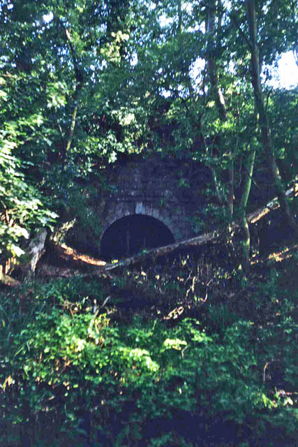
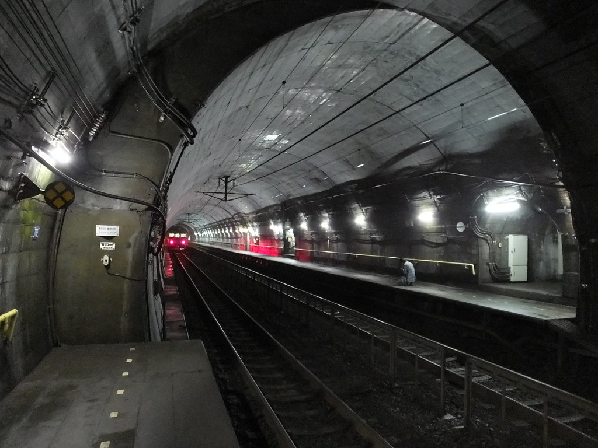
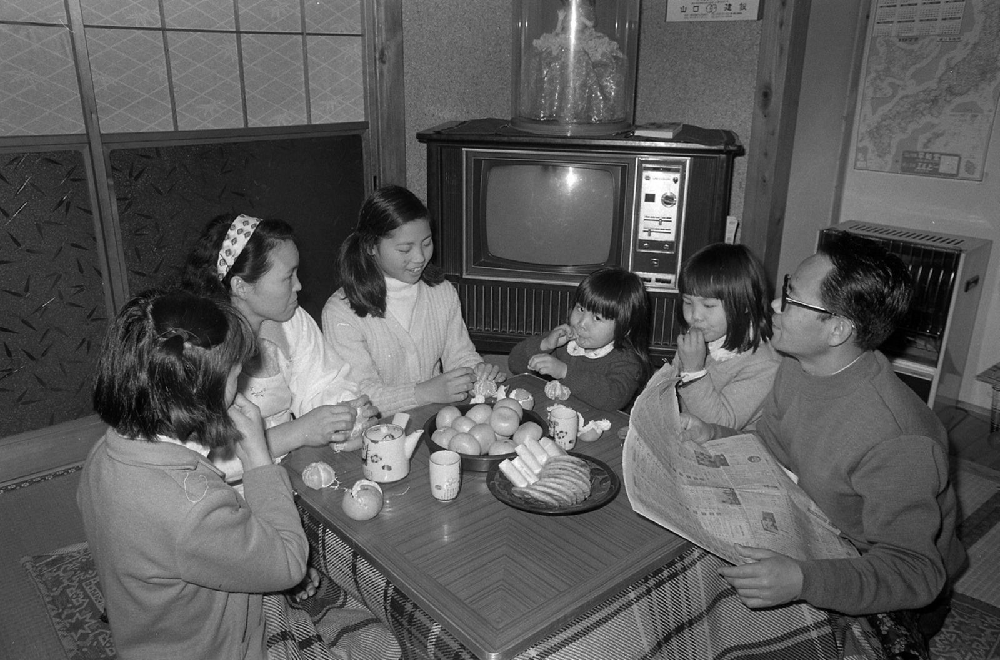

54年前の今日、1972年11月6日の未明。福井県敦賀市の北陸本線にある北陸トンネル内で、走行中の急行列車から出火する大惨事が発生しました。乗客乗員30人が命を落とし、714人が負傷したこの事故は、当時の鉄道防災の盲点を浮き彫りにし、日本の鉄道安全基準を根本から変える転換点となりました。

## 未明の長大トンネルで起きた列車火災

1972年11月6日午前1時8分頃、大阪発青森行きの急行「きたぐに」（15両編成）が、北陸本線の敦賀駅と南今庄駅の間にある北陸トンネルの下り線を走行していました。列車が敦賀側入口から約5.3キロ入ったところで、3号車の食堂車喫煙室にあるソファの下から火の手が上がりました。異臭と炎に気付いた乗客の通報を受け、列車は午前1時13分、当時の運転規程に基づいてトンネル内に緊急停止しました。

## 「火災は起きない」という過信と安全対策の盲点

事故の舞台となった北陸トンネルは、総延長13,870メートルを誇り、当時日本の在来線で最も長い陸上トンネルでした。1962年の開通当時は高度経済成長を象徴する大事業として称賛されましたが、防災対策には重大な欠陥が潜んでいました。国鉄は「電化されたトンネル内で火災は発生し得ない」との見解をとり、排煙設備や消火設備をトンネル内に設置していませんでした。さらに、運転の妨げになるという理由からトンネル内の照明も消灯されており、地元の消防本部からの再三にわたる改善要望も放置されたままでした。

*事件当時の写真ではありません · 1972年 — 写真: Robin Webster / CC BY-SA 2.0*

## 暗闇の立ち往生と送電停止の誤算

緊急停止後、乗務員は備え付けの消火器や調理室の水で消火を試みましたが、火元が鉄板に覆われていたため効果はありませんでした。火勢が強まったため、乗務員は規程に従い、燃えている食堂車を切り離す作業を開始しました。作業には約40分を要し、午前1時50分頃に切り離しを完了しました。しかし、前部車両を動かしてトンネル外へ緊急脱出しようとした矢先、火災の煙による放電短絡が発生し、送電が停止してしまいます。列車は動力を失い、真っ暗なトンネルの真ん中で完全に立ち往生しました。

*14j5804 — 写真: kimagurenote / CC BY-SA 2.0*

## 煙に阻まれた脱出と「立山3号」の救助

深夜の寝台車で就寝中だった乗客を含む約760人は、視界ゼロの暗闇と猛烈な有毒ガスが充満するトンネル内に取り残されました。外部からの救助隊も煙に阻まれて現場へ近づけず、多くの乗客が出口を目指して線路脇を歩いて避難せざるを得ませんでした。その最中、上り線を走っていた急行「立山3号」が停止信号で手前に止まり、逃げてきた乗客225人を車内に収容して後退し、逆走して脱出に成功するという救出劇もありました。しかし最終的に、一酸化炭素中毒や排水溝への転落により30人が死亡し、714人が重軽傷を負いました。

*毎月第3日曜日は「家庭の日」（清水さん宅で） — 写真: ndl / CC BY (Japan Search)*

## 責任をめぐる裁判と下された無罪判決

事故後、業務上過失致死傷の罪で起訴された専務車掌と機関士の刑事裁判は、福井地方裁判所で約6年にわたり審理されました。1980年11月25日、福井地裁は両被告に「無罪」を言い渡しました。判決は、この事故を個人の過失ではなく組織的な不備による「システム災害」と位置付け、予期せぬ停電などの悪条件が重なる中で当時の運転規程に沿って対応した乗務員に刑事責任は問えないと判断しました。

## 火災走行実験と現代へ続く安全の教訓

この事故を機に、日本の鉄道火災対策は根底から覆されました。実際に火をつけた車両をトンネル内で走らせる大規模な走行実験が行われ、科学的な検証の結果、「トンネル内で火災が発生した場合は停止せず、トンネルの外まで走り抜ける」という新たな運転原則が確立されました。さらに、車両の難燃化、消火器の増設、トンネル内の一斉点灯照明や歩行路の整備など、現在の私たちが利用する鉄道路線の安全対策は、北陸トンネルの悲劇から得られた重い教訓の上に築かれています。

### 参考資料

- <https://ja.wikipedia.org/wiki/%E5%8C%97%E9%99%B8%E3%83%88%E3%83%B3%E3%83%8D%E3%83%AB%E7%81%AB%E7%81%BD%E4%BA%8B%E6%95%85>
- <https://commons.wikimedia.org/wiki/File:TSURIFUNE_in_Naka,_Tokushima.jpg>
- <https://commons.wikimedia.org/wiki/File:Lillesdon_Tunnel_north_end,_Chard_Canal,_1972_-_geograph.org.uk_-_1621258.jpg>
- <https://www.flickr.com/photos/127797696@N04/15315501199>
- <https://adeac.jp/koshigaya-city-digital-archives/catalog/mp157681-200020>
