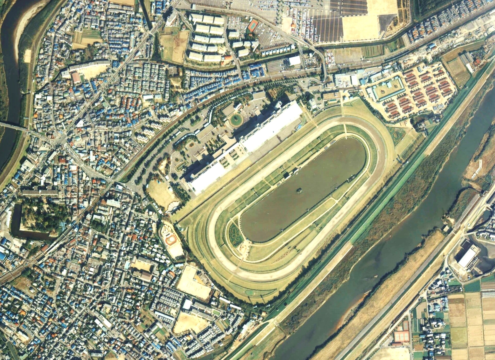
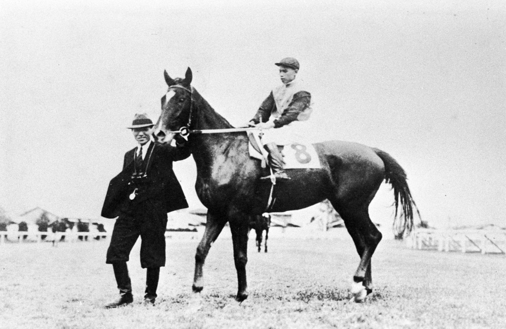
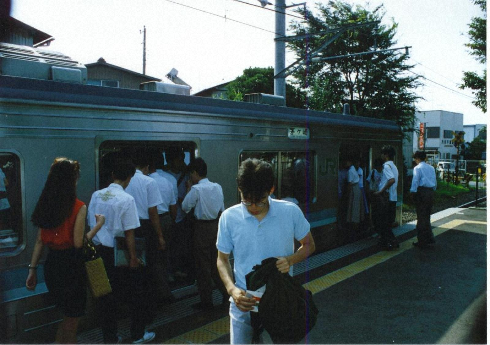

32年前の今日、1994年11月6日。京都競馬場で開催された第55回菊花賞において、ナリタブライアンが圧倒的なパフォーマンスを披露して優勝しました。1984年のシンボリルドルフ以来10年ぶり、日本競馬史上5頭目となるクラシック三冠馬の誕生でした。

## 兄ビワハヤヒデの背中を追って――誕生と初期調教

北海道新冠町の早田牧場新冠支場で1991年5月3日に誕生したナリタブライアンは、アメリカから輸入された種牡馬ブライアンズタイムの初年度産駒でした。母パシフィカスはイギリスのセールにおいて3万1千ギニー（約560万円）で落札された馬で、前年には半兄にあたるビワハヤヒデを出産していました。

牧場での初期調教では、調教スタッフからバネや背中の柔らかさ、敏捷性において兄を大きく上回ると絶賛されました。複数の馬で坂路を駆け上がらせても、ナリタブライアンだけは呼吸が全く乱れなかったといいます。一方で、水たまりに驚いて騎乗者を振り落とすなど、生来の臆病な気性も見せていました。家畜商の仲介を経て馬主の山路秀則氏に購入され、栗東の大久保正陽厩舎に入厩。主戦騎手には南井克巳騎手が迎えられました。

## 弱点の克服と「シャドーロールの怪物」の覚醒

1993年8月に函館競馬場でデビューしたナリタブライアンは、初戦こそ2着に敗れたものの、折り返しの新馬戦で初勝利を挙げました。しかし当時はレースが近づくと過度に興奮する気性の荒さと、走行中に自分の影を怖がって走りに集中できないという大きな課題を抱えていました。

大久保調教師は、下方の視界を遮る白い矯正具「シャドーロール」を鼻の上に装着する対策を講じました。この工夫が功を奏し、初めて装着した京都3歳ステークス以降は抜群の集中力を発揮するようになります。続く朝日杯3歳ステークスでGI初優勝を果たし、同年のJRA賞最優秀3歳牡馬に選出。トレードマークとなった白い覆布から、ファンに「シャドーロールの怪物」と呼ばれるようになりました。

*事件当時の写真ではありません · 1987年 — 写真: 国土交通省 / Attribution*

## 異次元の強さ――皐月賞レコードとダービー制圧

4歳となった1994年、ナリタブライアンはさらなる進化を遂げます。初戦の共同通信杯4歳ステークスを快勝すると、前日には兄ビワハヤヒデも京都記念を勝っており、兄弟による連日の重賞制覇を成し遂げました。さらにスプリングステークスを豪快なまくりで制し、クラシック第1戦の皐月賞へと向かいます。

単勝オッズ1.6倍の圧倒的1番人気に支持された皐月賞では、中山競馬場芝2000メートルのコースレコードを0.5秒更新する走破タイムで圧勝。続く東京優駿（日本ダービー）でも大外から出走馬最速の上がりタイムを繰り出して独走劇を演じ、クラシック二冠を手中に収めました。シンボリルドルフを手掛けた野平祐二氏が「現時点ではブライアンが上かな」と評するほど、同世代の中では突出した強さを誇っていました。

*事件当時の写真ではありません · 1943年 — 写真: Japan Racing Association (JRA) / Public domain*

## 11月6日・菊花賞――歴史を塗り替えた三冠達成

夏場に函館や札幌で調整されたナリタブライアンは、激しい夏負けにより一時は菊花賞回避も危ぶまれるほど体調を崩しました。秋初戦の京都新聞杯では内から伸びたスターマンに競り負けて2着となり、不安を残したまま本番を迎えることになります。

しかし、11月6日の京都競馬場で行われた菊花賞では、体調の上向きが伝えられ単勝オッズ1.7倍の支持を集めました。このレースの売り上げは当時の過去最高となる419億5000万円を記録。大観衆が見守る中、ナリタブライアンは最後の直線で早々と先頭へ踊り出ると、後続をぐんぐん突き放しました。

関西テレビの杉本清アナウンサーが「弟は大丈夫だ」と実況を響かせる中、稍重の馬場コンディションでありながら、兄ビワハヤヒデが前年に打ち立てたレースレコードを更新してゴール。武豊騎手が「ぶっちぎった」と表現する異次元の走りで、10年ぶり史上5頭目となるクラシック三冠を達成しました。

*朝の香川駅ホーム乗降風景 — 写真: chigamu / CC BY (Japan Search)*

## 幻の兄弟対決と有馬記念――4歳4冠の金字塔

菊花賞の制覇後、ファンが最も熱望したのは前年の年度代表馬である兄ビワハヤヒデとの直接対決でした。しかし、兄が天皇賞（秋）で故障を発生させて引退を余儀なくされたため、夢の「兄弟対決」は幻に終わります。

ナリタブライアンは古馬との初対決となった年末の有馬記念に出走し、ファン投票で17万8471票、単勝オッズ1.2倍という圧倒的な支持を集めました。ここでも4コーナーで先頭に立つとそのまま突き抜け圧勝。クラシック三冠馬による有馬記念制覇という4歳4冠を達成し、年間の総収得賞金は史上最高額となる7億1,280万2,000円を記録しました。JRA賞年度代表馬および最優秀4歳牡馬に選出され、名実ともに競馬界の頂点に立ちました。

## 度重なる試練と、今も色あせない怪物の輝き

翌1995年春、阪神大賞典を快勝した直後に右股関節炎を発症し、長期休養を強いられます。復帰後は往年の走りを取り戻せず苦闘が続きましたが、1996年の阪神大賞典におけるマヤノトップガンとの歴史的マッチレースや、短距離戦である第26回高松宮杯への果敢な挑戦は、多くのファンの心を打ちました。

屈腱炎により1996年10月に現役を引退し、1997年にはJRA顕彰馬に選出。1998年9月に7歳の若さで世を去りましたが、白いシャドーロールを着けて緑のターフを圧倒的なスピードで駆け抜けたその姿は、日本競馬史上屈指の怪物として今も語り継がれています。

### 参考資料

- <https://ja.wikipedia.org/wiki/%E3%83%8A%E3%83%AA%E3%82%BF%E3%83%96%E3%83%A9%E3%82%A4%E3%82%A2%E3%83%B3>
- <https://commons.wikimedia.org/wiki/File:Kyoto_Daishogai53S.jpg>
- <https://commons.wikimedia.org/wiki/File:Kyoto_Racecourse_Aerial_photograph.1987.jpg>
- <https://commons.wikimedia.org/wiki/File:Kurifuji_at_Kyoto_Racecourse_3_October_1943.png>
- <https://jmapps.ne.jp/chigasaki_history/det.html?data_id=254>
