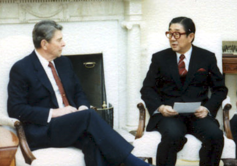
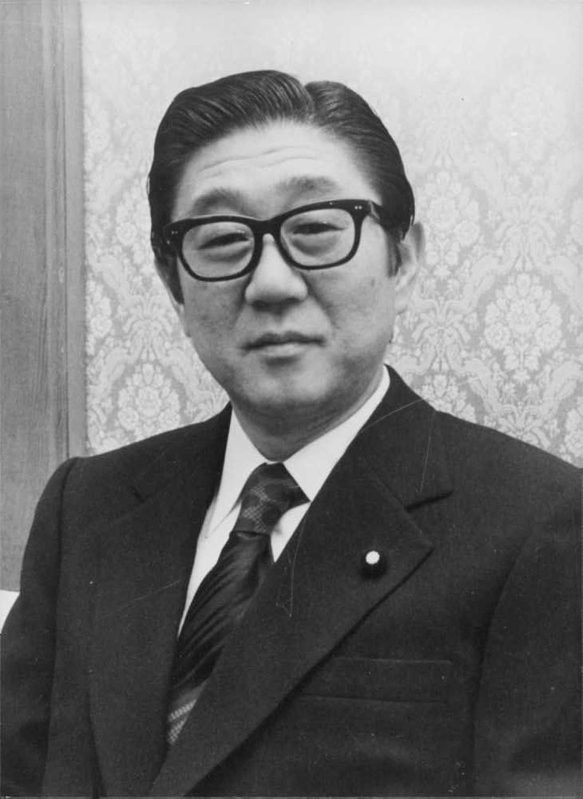
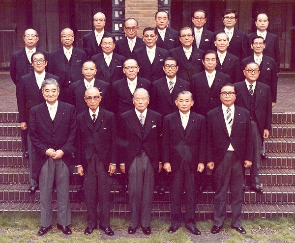

39年前の今日、1987年11月6日。第74代内閣総理大臣に竹下登が任命され、竹下内閣が正式に発足しました。自民党の主要派閥がすべて内閣を支える「総主流派」体制でのスタートであり、昭和の政治史において極めて大きな節目となりました。

## 生え抜き初の首相誕生と「中曽根裁定」

竹下登は島根県飯石郡掛合村（現・雲南市）の造り酒屋の家に生まれました。地元で中学校の代用教員や青年団活動を経て島根県議会議員となり、1958年の第28回衆議院議員総選挙で初当選を果たします。この初当選は1955年の保守合同を経た自由民主党の結党後であったため、竹下は自民党の「生え抜き」として初めて総理大臣に上り詰めた人物となりました。また、県議会議員出身の首相としても史上初でした。

中曽根康弘首相の任期満了に伴う後継選びでは、「ニューリーダー」と呼ばれた竹下登、安倍晋太郎、宮澤喜一の3人が激しく争いました。最終的に後継総裁の指名は中曽根に委ねられ、いわゆる「中曽根裁定」によって竹下が後継に選ばれることとなりました。

## 1987年11月6日、国会での首班指名と組閣

1987年11月6日、第110特別国会において首班指名投票が行われました。衆議院では竹下登が299票を獲得し、社会党の土井たか子の145票、民社党の塚本三郎の27票、共産党の宮本顕治の26票を大きく引き離しました。参議院でも竹下は143票を獲得し、土井の72票、宮本の15票、塚本の12票を上回って首班に指名されました。

組閣にあたり、竹下は「気配り調整」を掲げました。総裁選を争った安倍晋太郎を党幹事長に、宮澤喜一を副総理兼大蔵大臣に据えるなど、各派閥へ配慮した人事を実施しました。自民党の主要派閥がすべて主流派として取り込まれ、党内非主流派を閣僚に置かない「総主流派内閣」が誕生したのです。自派閥である経世会の強力な結束力もあり、政権は長期にわたる盤石なものになると見られていました。

*Ronald Reagan and Shintaro Abe — 写真: Pete Souza / Public domain*

## 大蔵大臣の経験と「プラザ合意」からの道

竹下は総理就任以前、大蔵大臣を4期務めており、経済政策における実績を武器としていました。特に中曽根内閣の蔵相時代であった1985年には、アメリカ、イギリス、西ドイツ、フランスの財務大臣らとともに、歴史的な「プラザ合意」に調印しています。この合意は日本の対米貿易黒字を縮小させるため円高の推進を認めたもので、日本経済がバブル景気へと向かい、のちの長期的な変化へとつながる決定的な引き金となりました。

国政の表舞台において培われた調整能力と財政に関する深い知見が、竹下政権の土台となっていたのです。

*Shintarō Abe 1982 — 写真: Camera Press / Public domain*

## ふるさと創生1億円と消費税の導入

竹下内閣が推進した代表的な政策が、地方活性化を目的とした「ふるさと創生事業」でした。全国の市区町村に対して、使途を限定せずに一律1億円の地方交付税を支給するという大胆な試みは、各地でユニークな事業を生み出し、大きな話題を呼びました。また、日米間の懸案事項となっていた牛肉・オレンジの輸入自由化についても合意に導きました。

そして最大の政治的課題となったのが、日本初の付加価値税である「消費税」の導入でした。野党や世論の強い反発に直面しながらも、竹下は税制改革関連法案の成立に踏み切ります。激しい議論の末、税率3パーセントの消費税導入が国会で可決され、日本の税制は根本的な転換点を迎えました。

*Second Ōhira Cabinet — 写真: 公益財団法人大平正芳記念財団、内閣官房内閣広報室 / CC BY 4.0*

## 昭和から平成へ、リクルート事件と退陣

竹下内閣は、昭和天皇の崩御に伴う元号改元を経験し、「昭和最後の内閣総理大臣」であると同時に「平成最初の内閣総理大臣」となりました。しかし、その足元は1988年に発覚したリクルート事件によって急速に揺らぎ始めます。

政界を揺るがす未公開株の譲渡疑惑は竹下自身にも及び、内閣支持率は10パーセントを割り込む水準まで急落しました。1989年4月22日には未公表の借入金が報じられ、竹下は4月25日に退陣を表明します。翌日には長年苦楽を共にしてきた秘書の青木伊平が自ら命を絶つという痛ましい出来事も起きました。竹下内閣は1989年6月3日、正式に総辞職しました。

## 今に続く政策と時代の記憶

退陣後も竹下は最大派閥の領袖として政界に強い影響力を及ぼし続けました。竹下内閣が強行した消費税は、その後の社会保障の財源として幾度かの増税を経て現在も暮らしの基盤となっており、ふるさと創生の1億円によって作られた記念碑や施設は、今も各地に残されています。

強大な党内基盤を誇りながらも、時代の激動と世論の逆風の中で幕を閉じた竹下内閣。昭和から平成へと日本が大きく舵を切ったあの秋の組閣は、多くの人々の記憶に刻まれています。

### 参考資料

- <https://ja.wikipedia.org/wiki/11%E6%9C%886%E6%97%A5>
- <https://commons.wikimedia.org/wiki/File:Shintaro_Abe_1987.jpg>
- <https://commons.wikimedia.org/wiki/File:Ronald_Reagan_and_Shintaro_Abe.jpg>
- <https://commons.wikimedia.org/wiki/File:Shintar%C5%8D_Abe_1982.jpg>
- <https://commons.wikimedia.org/wiki/File:Second_%C5%8Chira_Cabinet.jpg>
