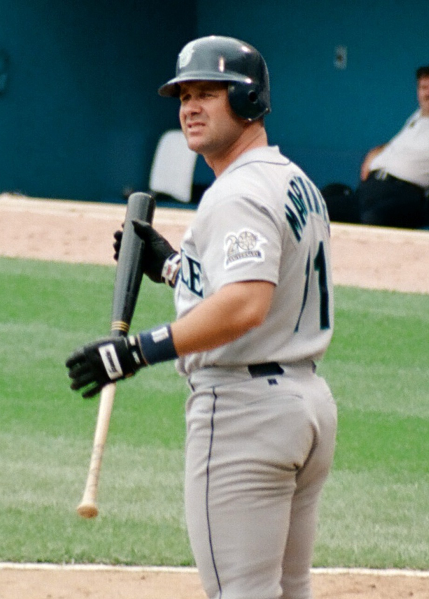
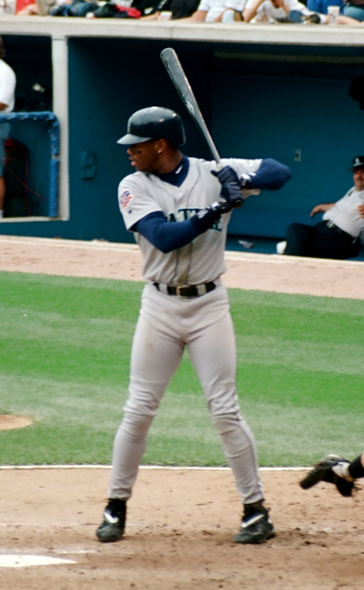

26年前の今日、2000年11月6日。アメリカの大リーグ、シアトル・マリナーズに所属する佐々木主浩投手が、アメリカン・リーグの新人王に選出されました。日本で「ハマの大魔神」として名を轟かせた絶対的守護神が、海を渡った最初の年に当時の大リーグ新人記録となる37セーブをマーク。シアトルのマウンドでも不動のクローザーとして君臨し、アメリカの舞台で最高の栄誉を勝ち取った一日でした。

## 横浜の守護神から海を渡る決断へ

佐々木主浩投手は、1990年に横浜大洋ホエールズに入団して以来、チームの絶対的な抑え投手として君臨しました。落差の鋭いフォークボールを武器にセーブを積み重ね、最優秀救援投手のタイトルを日本プロ野球で最多タイとなる5回獲得。1998年には横浜ベイスターズのセントラル・リーグ優勝と日本シリーズ優勝の立役者となり、リーグMVPと正力松太郎賞に輝きました。その圧倒的な投球から「ハマの大魔神」と呼ばれ、この愛称は1998年の新語・流行語大賞を受賞するなど、社会現象となりました。日本プロ野球で歴代屈指の抑えとして名声を確立した佐々木投手は、1999年まで横浜で通算252セーブを挙げた後、新たな挑戦の場として大リーグの舞台を選択しました。

## シアトル・マリナーズへの加入と2000年の戦い

2000年、佐々木投手が加入したのは、アメリカン・リーグ西地区に所属するシアトル・マリナーズでした。マリナーズは1977年に創設された球団で、1992年に任天堂の山内溥氏らが出資したグループによって買収され、日本との深い絆を持つチームでした。本拠地セーフコ・フィールドに集うファンの前で、佐々木投手はクローザーとしての重責を担うことになります。このシーズン、マリナーズは91勝71敗の好成績を収め、ワイルドカードを獲得して3年ぶりとなるプレーオフ進出を果たしました。チームが勝利を重ねる中で、最後に試合を締めくくる佐々木投手の右腕は欠かせない存在となっていったのです。

*1997年の資料 — 写真: clare_and_ben / CC BY-SA 2.0*

## 当時の大リーグ新人記録「37セーブ」を達成

佐々木投手の代名詞であるフォークボールは、大リーグの強打者たちをも翻弄しました。直球と見分けがつかない軌道から鋭く落ちる魔球に、アメリカの打者たちはバットを空転させました。佐々木投手は登板を重ねるごとに首脳陣やチームメイトの信頼を勝ち取り、最終的にシーズン37セーブを記録しました。この37セーブという数字は、当時の大リーグ新人記録を塗り替える歴史的な記録となりました。日本での長年の経験に裏打ちされた強靭な精神力と投球技術が、異国の地でも最高峰の舞台で通用することを証明したのです。

*1997年の資料 — 写真: clare_and_ben / CC BY-SA 2.0*

## 2000年11月6日、全米に轟いた新人王選出

そして2000年11月6日、全米野球記者協会の選考により、佐々木投手がアメリカン・リーグの新人王に選出されました。日本人選手による大リーグ新人王の獲得は、野茂英雄投手以来、アジア人および日本人として史上2人目となる快挙でした。日本球界で実績を積み上げたベテラン投手が、大リーグの舞台に挑んでタイトルを手にしたことは、日米双方の野球界で大きな話題となりました。シアトルのファンからも「ダイマジン」の愛称で愛され、その功績は全米で高く評価されました。

*1996年の資料 — 写真: marbla123 / CC BY 2.0*

## 日米通算381セーブと受け継がれる軌跡

佐々木投手はその後もマリナーズの守護神として活躍を続け、翌2001年にはチームのアメリカン・リーグ西地区優勝と、シーズン116勝というメジャータイ記録の樹立にも大きく貢献しました。2000年から2003年までの在籍期間で、日本人MLB選手として歴代最多となるMLB通算129セーブをマークしました。その後、2004年に古巣の横浜へ復帰し、日本プロ野球でも通算252セーブを記録。日米通算では381セーブを挙げ、日本人史上初となる通算300セーブの偉業を達成し、日本プロ野球名球会入りを果たしました。

## 日本人メジャーリーガーの道を切り拓いた守護神

佐々木主浩投手が2000年に成し遂げた新人王の栄冠は、日本の救援投手の実力を世界に知らしめた歴史的な瞬間でした。佐々木投手が築いた信頼は、翌2001年のイチロー選手の加入や、その後の日本人選手たちの活躍へとつながる確かな架け橋となりました。海を越えてシアトルの夜空に刻まれた「ダイマジン」の雄姿と、新人記録37セーブという金字塔。2000年11月6日に届けられた新人王の知らせは、日本の野球ファンにとっても誇らしく、忘れられない記憶として今も語り継がれています。

### 参考資料

- <https://ja.wikipedia.org/wiki/11%E6%9C%886%E6%97%A5>
- <https://commons.wikimedia.org/wiki/File:Seattle_Safeco_Field_01.jpg>
- <https://commons.wikimedia.org/wiki/File:Edgar_Martinez_1997.jpg>
- <https://commons.wikimedia.org/wiki/File:Ken_Griffey_Jr._1997_(cropped).jpg>
- <https://commons.wikimedia.org/wiki/File:10_inside_kindome.jpg>
