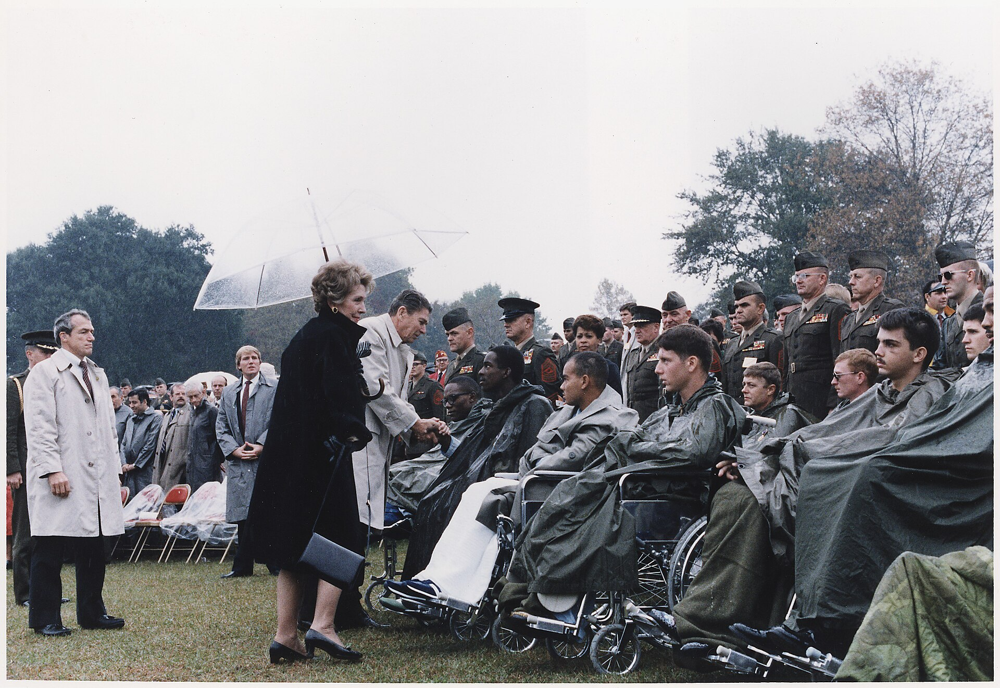
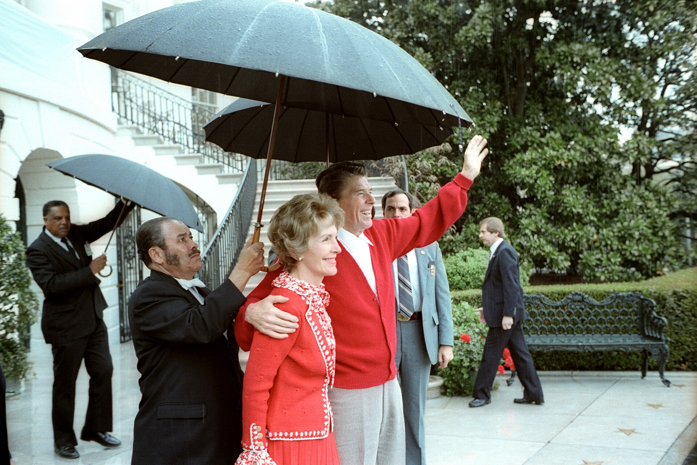
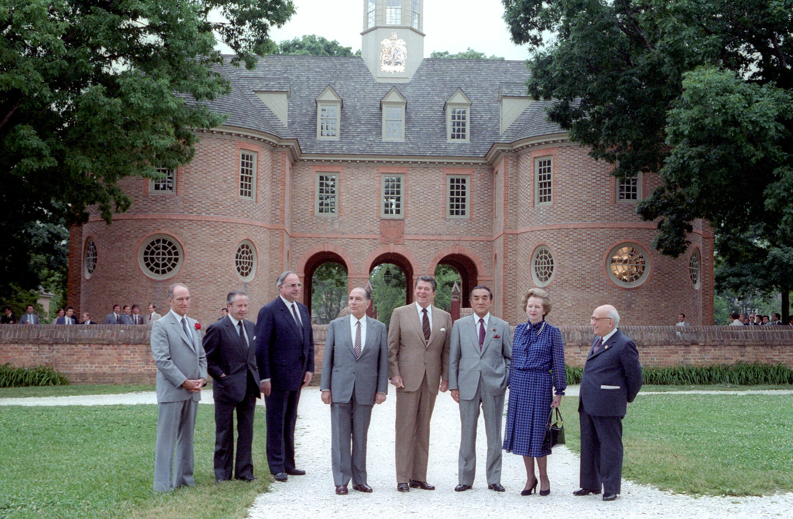

42年前の今日、1984年11月6日。アメリカ合衆国大統領選挙の一般投票が行われ、共和党現職のロナルド・レーガン大統領が歴史的な地滑り的勝利を収めて再選を果たしました。全米50州のうち49州を制するという圧倒的な記録は、今もアメリカの政治史に深く刻まれています。

## 俳優から政治家へ――異色の経歴を持つ大統領

ロナルド・レーガンは1911年、イリノイ州に生まれました。大学卒業後はラジオのアナウンサーとして活躍し、持ち前の話術と演技力を生かしてハリウッドの映画界へと進出します。1937年にワーナー・ブラザースと契約を結んだ後は数々の映画に出演し、チンパンジーと共演したコメディ作品『ベッドタイム・フォー・ボンゾ』などでも親しまれました。

映画俳優組合の要職を務める中で次第に政治に関わるようになり、テレビ番組の司会や解説者を経て、カリフォルニア州知事に当選します。エンターテインメント界の出身でありながら着実に政治経験を重ね、1981年1月20日、歴代でも指折りの高齢となる69歳で第40代アメリカ合衆国大統領に就任しました。

## 「強いアメリカ」を掲げた1期目の実績

レーガン大統領の1期目は、景気回復を目指した大幅減税と積極的な財政政策、いわゆる「レーガノミクス」が強く推進された時代でした。前政権時代に揺らいでいた対外的な影響力を立て直すため、軍事力を背景にした強硬策を貫き、「強いアメリカ」の復活を国民に強く印象づけました。

1984年の大統領選挙を迎えるにあたり、共和党内の予備選挙でレーガンは98.78パーセントという驚異的な得票率を記録しました。2,233人の代議員を獲得して文句なしの再指名を受け、国民の熱烈な支持を背に受けて2期目の選挙戦へと突入していったのです。

*1983年の資料 — 写真: Unknown authorUnknown author or not provided / Public domain*

## 女性候補を擁立して挑んだ民主党陣営

これに対抗した野党・民主党は、ジミー・カーター前政権で副大統領を務めたウォルター・モンデールを大統領候補に擁立しました。さらに副大統領候補には、二大政党を通じて史上初となる女性候補、ジェラルディン・フェラーロ下院議員を抜擢しました。

女性初の副大統領候補の登場は大きな注目と熱狂を呼びましたが、中絶政策などをめぐる論争も巻き起こり、選挙戦は次第に現職レーガンの優位へと傾いていきました。経済の好転を背景に自信を深めるレーガン陣営の勢いは、最後まで衰えることがありませんでした。

*1981年の資料 — 写真: Series: Reagan White House Photographs, 1/20/1981 - 1/20/198 / Public domain*

## 全米50州のうち49州を制覇した衝撃の開票速報

11月6日の投票日、全米各地から届いた開票結果はまさに「地滑り的勝利」と呼ぶにふさわしいものでした。民主党のモンデール陣営が選挙人を獲得できたのは、首都ワシントンD.C.と、モンデールの地元であるミネソタ州の2か所だけにとどまりました。

しかもミネソタ州における両者の得票率の差は、わずか0.18パーセントという極めて僅差の勝負でした。その他の49州すべてでレーガンが勝利を収め、選挙人の獲得数でも相手を圧倒しました。全米の地図がほぼ一面、共和党の勝利を示す色に塗り替えられたこの結果は、世界中に強い衝撃を与えました。

*1983年の資料 — 写真: President (1981-1989 : Reagan). White House Photographic Off / Public domain*

## 中曽根首相との「ロン・ヤス」関係と冷戦の行方

この圧倒的な再選は、同盟国である日本にも大きな影響を与えました。レーガン大統領は日本の首相・中曽根康弘と非常に親密な信頼関係を築き、互いを「ロン」「ヤス」とファーストネームの愛称で呼び合う関係として広く知られました。

イギリスのサッチャー首相や西ドイツのコール首相とも連携し、ソビエト連邦との対峙を続けたレーガンは、その後の冷戦終結へ向けた大きな道筋をつけていきます。高齢やスキャンダルへの批判に直面しながらも2期8年の任期を全うしたレーガンの姿は、当時の日本のテレビニュースでも連日のように大きく報じられました。

## 今も語り継がれる歴史的大勝の記録

2期目の就任時点で73歳11か月という高齢でありながら、圧倒的な国民的支持を集めて成し遂げた1984年の大統領選。一人の候補が49州を制するという前代未聞の記録は、アメリカ政治の転換点として今も語り継がれています。

開票速報の画面を見つめながら、アメリカという国の力強さと熱気に息をのんだあの日。当時の世界を包んでいた熱気を、今も鮮明に記憶している方は多いはずです。

### 参考資料

- <https://ja.wikipedia.org/wiki/%E3%83%AD%E3%83%8A%E3%83%AB%E3%83%89%E3%83%BB%E3%83%AC%E3%83%BC%E3%82%AC%E3%83%B3>
- <https://commons.wikimedia.org/wiki/File:Official_Portrait_of_President_Reagan_1981.jpg>
- <https://commons.wikimedia.org/wiki/File:Photograph_of_President_Reagan_and_Mrs._Reagan_attending_Memorial_Service_for_Lebanon_and_Grenada_casualty_victims..._-_NARA_-_198543.jpg>
- <https://commons.wikimedia.org/wiki/File:President_Ronald_Reagan_and_Nancy_Reagan_returning_home_to_the_White_House_from_George_Washington_Hospital.jpg>
- <https://commons.wikimedia.org/wiki/File:G-7_Economic_Summit_Leaders_in_Williamsburg_Virginia_(Left_to_Right_Pierre_Trudeau_Gaston_Thorn_Helmut_Kohl_Francois_Mitterrand_President_Ronald_Reagan_Yasuhiro_Nakasone_Margaret_Th_-_DPLA_-_568d5ce60050f6d0596f6e3154a289fd.jpg>
