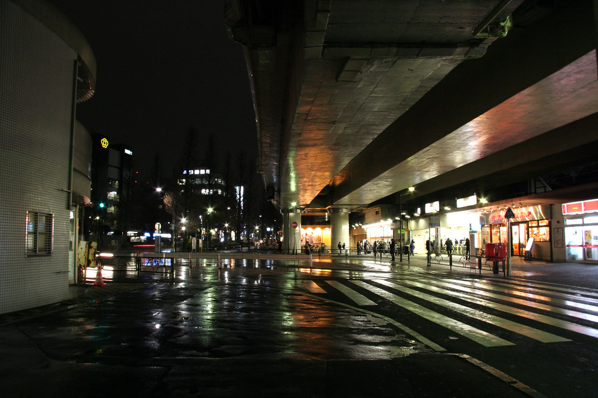
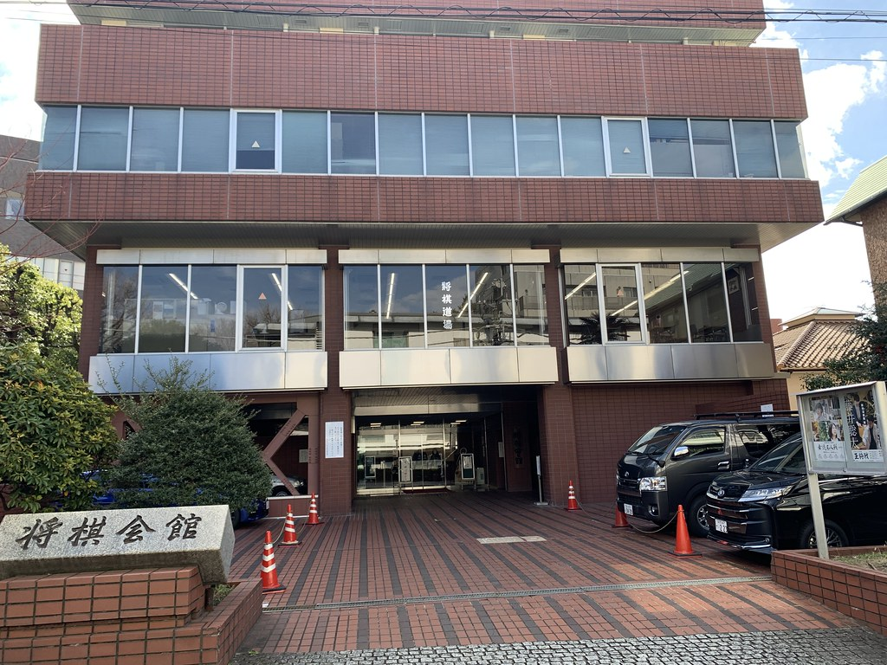
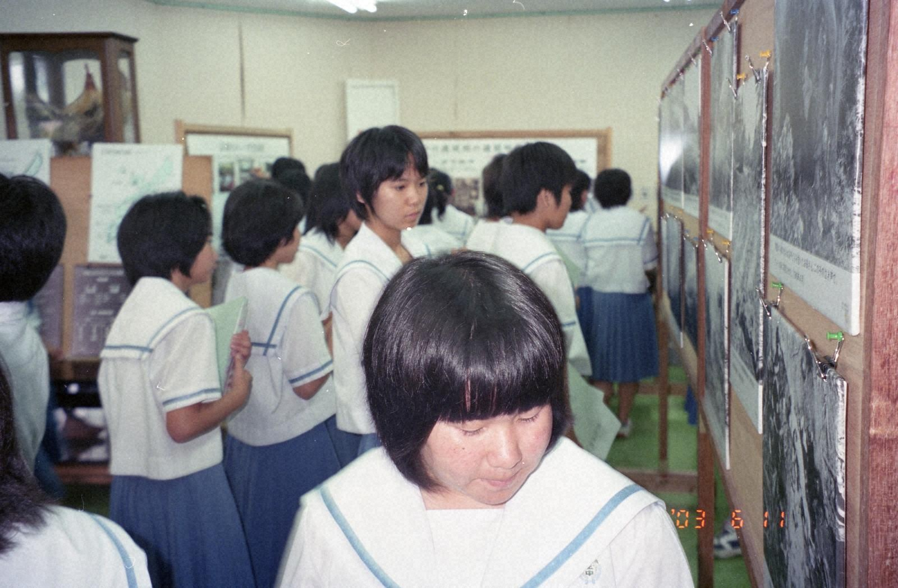

21年前の今日、2005年11月6日。サラリーマンだった瀬川晶司さんが、将棋のプロ編入試験第5局に勝利し、花村元司以来61年ぶりとなるプロ四段への編入を果たしました。一度は年齢制限の壁に阻まれながら、盤上への情熱を捨てずに道を切り拓いた瞬間でした。

## 26歳の年齢制限による挫折

瀬川晶司さんは小学校5年生のときに将棋を始め、中学時代には全国中学生選抜将棋選手権大会で優勝するなど頭角を現しました。1984年に安恵照剛八段門下で新進棋士奨励会に6級で入会し、21歳で三段リーグに進出します。

しかし、四段昇段への道は険しく、1992年から4年間在籍したものの、第18回三段リーグを最後に26歳の年齢制限を迎えて退会を余儀なくされました。三段リーグの通算成績は72勝72敗。瀬川さんは将棋の書籍や自身の棋譜を処分し、将棋の道を完全に諦めて司法試験を目指し、大学法学部の二部へと進学しました。

## アマチュア棋界での快進撃と「プロジェクトS」

その後、将棋を純粋に楽しむ気持ちを取り戻した瀬川さんはアマチュアとして競技に復帰します。1999年に全日本アマチュア名人戦で優勝すると、プロ公式戦への出場権を獲得。大学卒業後はシステムエンジニアとして会社勤務を続けながら、NEC将棋部などで腕を磨きました。

公式棋戦の銀河戦などでプロ棋士を相手に快進撃を続け、A級棋士だった久保利明八段を破るなど大活躍を見せます。2005年2月末時点でプロ相手に通算17勝6敗、勝率7割3分9厘という驚異的な実績を積み上げました。アマ強豪の遠藤正樹さんや読売新聞記者の西條耕一さんらが「プロジェクトS」を結成し、プロ編入の嘆願書提出を後押ししました。

*shelter from the rain — 写真: OiMax / CC BY 2.0*

## 棋士総会の激論と61年ぶりの試験実施

日本将棋連盟に提出された嘆願書は、プロ棋界を大きく揺るがしました。奨励会という厳しい登竜門を経てプロになる原則を崩すことへの懸念もあり、激しい議論が巻き起こります。

しかし2005年5月、棋士総会での投票により賛成129票、反対52票、白票8票で編入試験の実施が可決されました。東京将棋記者会などの要望も取り入れられ、1944年の花村元司さん以来61年ぶりとなるプロ編入試験の実施が正式に決定しました。

*shogi kaikan 将棋会館 — 写真: nakashi / CC BY-SA 2.0*

## 運命の第5局、悲願のプロ入り決定

試験は連盟推薦の棋士6名を相手に3勝すれば合格という過酷な条件でした。第1局は佐藤天彦三段に敗れたものの、第2局で神吉宏充六段に勝利。第3局で久保利明八段に敗れ、第4局で中井広恵女流六段に勝利して2勝2敗のタイに持ち込みました。

そして迎えた2005年11月6日の第5局。対戦相手の高野秀行五段を相手に、瀬川さんは5局連続となる後手番を引く中で見事に勝利を収めました。3勝2敗で合格条件を満たし、同日付で悲願のプロ棋士四段への編入が決まりました。

*沖縄戦写真展 — 写真: 南城市教育委員会 / CC BY (Japan Search)*

## 夢を追う人々の扉を開いた足跡

瀬川さんはプロ入り後、NECと日本将棋連盟初の企業所属契約を結び話題を呼びました。2009年には好成績を収めて順位戦C級2組への昇級を決め、その後六段まで昇段を果たしています。

瀬川さんの合格をきっかけに、日本将棋連盟は2006年に「プロ編入試験制度」を正式に法制化しました。これにより2014年には今泉健司さんが制度化後初の合格者となるなど、一度挫折を味わった才能あるアマチュア棋士たちに新たな希望の道が用意されることになったのです。

### 参考資料

- <https://ja.wikipedia.org/wiki/11%E6%9C%886%E6%97%A5>
- <https://commons.wikimedia.org/wiki/File:Sendagaya_Rail_Station_2.JPG>
- <https://www.flickr.com/photos/72396314@N00/369879589>
- <https://www.flickr.com/photos/81497476@N00/52641779894>
- <https://nanjo-archive.jp/document/?detail=10194&genre=6>
