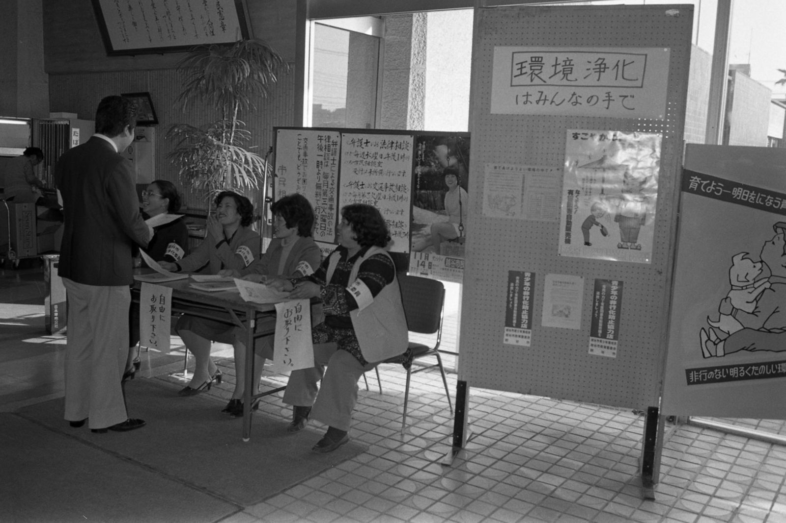
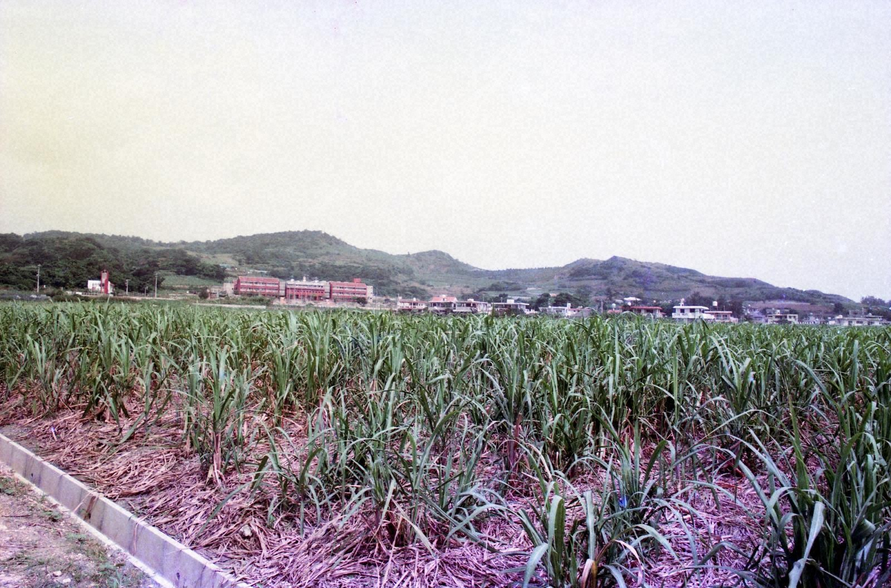
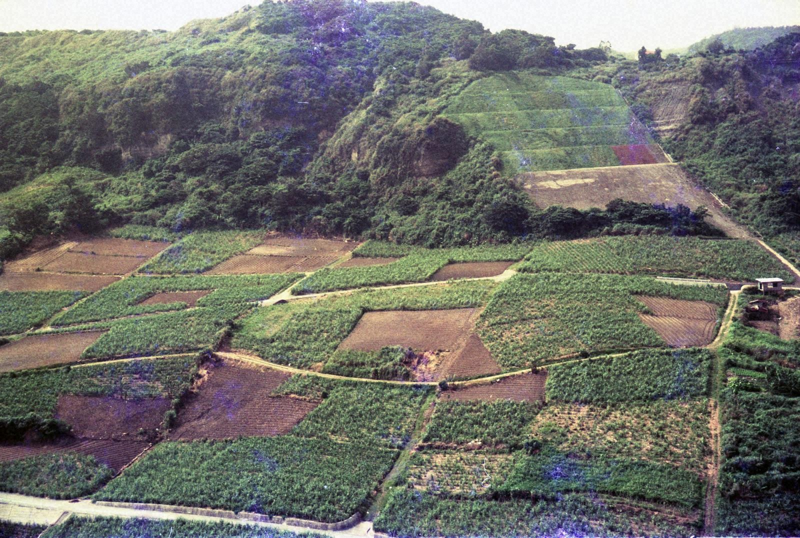

43年前の今日、1983年11月7日。奈良県明日香村阿部山にあるキトラ古墳の石室内から、四神の一つである「玄武」の彩色壁画が発見されました。1972年に壁画が見つかった高松塚古墳に次ぐ、国内で2例目となる大陸風彩色壁画の確認であり、古代史のベールを剥ぐ大発見として日本中の注目を集めました。

## 阿部山の南斜面に築かれた小さな円墳

キトラ古墳は、奈良盆地の南端に位置する明日香村南西部の阿部山に築かれた二段築成の円墳です。上段の直径は約9.4メートル、高さ約2.4メートル、下段の直径は約13.8メートル、高さ約90センチという規模を持っています。内部には凝灰岩の切石を組み合わせた横口式石槨があり、幅約1メートル、長さ約2.6メートル、高さ約1.3メートルと、人が1人埋葬されるほどの小さな空間でした。キトラという独特な名称は、石室の内部を覗くと亀と虎の絵が見えることから来ているという説や、地名の「北浦」が訛ったとする説などがあります。

## 小さな盗掘穴から差し込まれたレンズ

キトラ古墳は古代に盗掘を受けており、石室の南壁には高さ65センチ、幅25センチから40センチほどの盗掘穴が開けられていました。1983年11月7日、調査チームはこの小さな穴から工業用のファイバースコープを差し入れ、暗闇に閉ざされていた石室内部の撮影を試みました。ライトに照らされた奥壁（北壁）の漆喰の上に浮かび上がったのは、亀に蛇が巻き付いた姿の「玄武」でした。鮮やかな朱や緑で描かれたその姿が確認された瞬間、現場には大きな興奮が走りました。

*環境浄化キャンペーン — 写真: ndl / CC BY (Japan Search)*

## 青龍、白虎、朱雀と十二支像の全貌

1983年の玄武発見を皮切りに、その後の調査でさらなる驚きがもたらされました。1998年の探査では東壁の「青龍」と西壁の「白虎」が確認され、2001年には南壁の「朱雀」と、四神の下に描かれた十二支像が確認されたのです。この十二支像は獣の頭に人の体を持つ「獣頭人身像」で、北壁の子、東壁の寅、西壁の戌、南壁の午や巳などが確認されました。同時代の中国や朝鮮半島の墓にも類似の例がありますが、キトラ古墳では方角を司る四神と同じ色で衣装が塗り分けられているなど、独自の文化的特色を備えていました。

*馬天小学校遠景 — 写真: 南城市教育委員会 / CC BY (Japan Search)*

## 天井に広がる277個の星と東アジア最古の天文図

キトラ古墳のもう一つの大きな特徴は、石室天井に描かれた精緻な天文図です。三重の同心円と黄道、北斗七星をはじめとする星座が金箔と朱の線で克明に描かれ、東西には日月を表す像が配されていました。描かれた星の総数は277個にのぼります。この図は観測に基づいた星の実位置を科学的に配置し、緯度の補正も行われており、中国南宋時代の天文図よりも約500年古い東アジア最古の現存天文図と評価されています。

*佐敷町空撮写真 — 写真: 南城市教育委員会 / CC BY (Japan Search)*

## 葬られた人物は誰なのか

キトラ古墳に眠る被葬者は、現在も特定されていません。石室内からは金銀装帯執金具の残欠や琥珀玉、ガラス製品などが出土しており、身分の高い貴族であることは確実視されています。築造年代が遣唐使の帰国（704年）以前の7世紀末から8世紀初めとされることから、天武天皇の皇子である高市皇子や弓削皇子、あるいは地名との関連から右大臣の阿倍御主人といった有力者の名が挙げられています。

## カビ被害の危機から剥ぎ取りと国宝指定へ

発見後、石室内の湿気によって壁画にカビが発生し、劣化が進行するという深刻な問題が生じました。文化庁は壁画を守るため石室からの剥ぎ取りを決断し、2004年から慎重な作業が進められ、2010年までにすべての壁画が安全に取り外されました。調査を終えた石室の盗掘穴は2013年に二上山産の凝灰岩で封印され、壁画は2019年に国宝に指定されました。現在は2016年に開館した「キトラ古墳壁画体験館 四神の館」において、保存管理と公開が行われ、古代の息吹を今に伝えています。

### 参考資料

- <https://ja.wikipedia.org/wiki/%E5%A5%88%E8%89%AF%E7%9C%8C>
- <https://www.flickr.com/photos/101561334@N08/26569522036>
- <https://adeac.jp/koshigaya-city-digital-archives/catalog/mp047830-200020>
- <https://nanjo-archive.jp/document/?detail=28557&genre=6>
- <https://nanjo-archive.jp/document/?detail=28678&genre=6>
