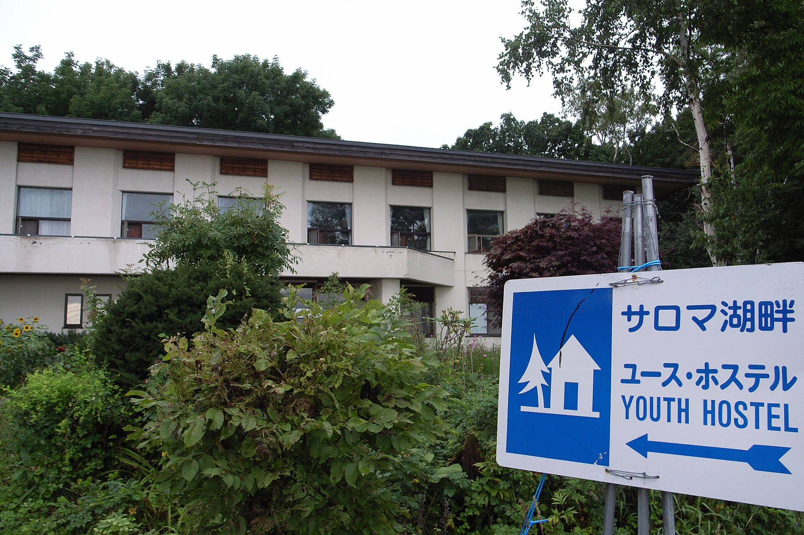
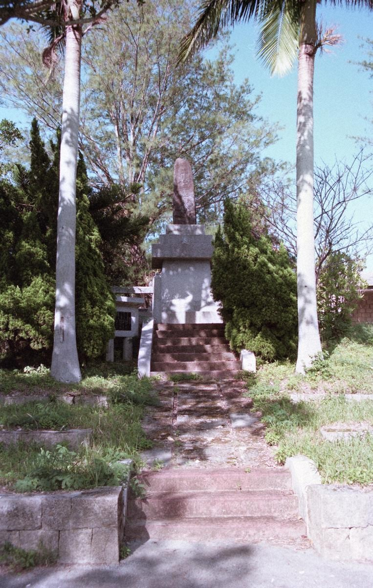

2006年11月7日午後1時20分ごろ、北海道オホーツク地方の佐呂間町若佐で猛烈な竜巻が発生しました。国道333号の新佐呂間トンネル掘削工事現場にあった作業員用プレハブ小屋が直撃を受け、2棟が屋根ごと吹き飛ばされて倒壊。9人もの尊い命が奪われ、31人が重軽傷を負う大惨事となりました。戦後日本の竜巻災害において最悪の犠牲者を出したこの災害は、日本の気象予測と防災のあり方に大きな課題を突きつけました。

## 北日本を覆った大荒れの天気と激しい寒暖差

この日、北日本から東日本にかけて寒冷前線が通過しており、特に北海道のオホーツク海沿岸から東北地方の日本海側にかけて大荒れの空模様となっていました。北海道付近にあった低気圧が急速に発達したことで、佐呂間町を抱える網走支庁の上空は大気の状態が非常に不安定になっていました。

寒冷前線の西側には非常に強い寒気が控えており、前線の西側に位置していた大阪では木枯らし1号が観測されていました。その一方で、前線の東側だった東京では9月中旬から下旬並みの暖かさとなるなど、日本列島は極端な気温差に覆われていました。佐呂間町周辺はこの激しい寒暖差の境界付近に位置しており、発達した巨大積乱雲「スーパーセル」が発生しやすい気象環境が整っていたのです。

## 工事現場のプレハブ小屋を襲った一瞬の惨劇

惨劇が起きたのは佐呂間町若佐地区、国道333号の新佐呂間トンネル工事現場でした。被害を受けた場所には、工事関係者が詰める作業員用の2階建てプレハブ小屋が3棟建てられていました。

午後1時20分ごろ、突如として発生した猛烈な竜巻がこの敷地を直撃しました。プレハブ小屋3棟のうち2棟が屋根もろとも吹き飛ばされ、原型をとどめないほど無残に倒壊しました。当時、現場では打ち合わせのため、多くの作業員がプレハブ小屋2階の会議室に集まっていました。突風による建物の激しい破壊に巻き込まれ、中にいた作業員ら9人が犠牲となり、その死因はいずれも竜巻による激突などで生じる脳挫傷でした。

*Saroma Kohan YH — 写真: yoppy from Kawasaki, Kanagawa, Japan / CC BY 2.0*

## 電柱がへし折れ、トラックが宙を舞う猛威

被災現場の惨状はすさまじいものでした。頑丈な大型トラックがいとも簡単に横転・吹き飛ばされ、頑丈なコンクリート製の電柱も根元からへし折られて転がっていました。新築されたばかりの頑丈な住宅も屋根が剥ぎ取られ、壁がえぐり取られる被害を受けました。

突風によって巻き上げられた建物の破片やトタン、木材などの飛散物は、被災地から風に乗って10キロ以上も離れた遠くの地域にまで落下しました。倒壊した電柱により、11月7日の午後10時頃まで佐呂間町と北見市の一部地域において631戸で大規模な停電が発生し、現場周辺の住民が避難生活を余儀なくされるなど、地域一帯が深い混乱と恐怖に包まれました。

*Vulpes vulpes laying in snow — 写真: Shiretoko-Shari Tourist Association / Attribution*

## 国内最強クラス「F3」と判定された突風の正体

気象庁は当初、この竜巻の規模について暫定的に藤田スケールで「F2以上」と発表していました。しかし、現場に残された凄まじい破壊痕跡の調査が進むにつれ、その威力が極めて異例であったことが明らかになっていきます。

北見工業大学土木開発工学科の大島俊之教授（構造工学）は、調査の結果として瞬間風速が毎秒83メートルに達していたことを突き止め、国内最高レベルの「F3」規模であると発表しました。その後、気象庁による正式な調査でも「F3」と認定されました。毎秒83メートルという風は、家屋の壁を破壊し重量物をやすやすと空中へ巻き上げるほどの威力であり、日本国内で観測された竜巻の中でも過去最強クラスの怪物だったのです。

*慰霊塔 — 写真: 南城市教育委員会 / CC BY (Japan Search)*

## 住宅地で犠牲者が出なかった偶然の事情

工事現場で9人もの命が失われる一方、同じく竜巻の直撃を受けて激しい被害を受けた若佐地区の住宅街では、奇跡的にも死者が出ず、住民の負傷者は9人にとどまりました。

これほどの大規模な倒壊被害がありながら住宅地で犠牲が最小限に抑えられた背景には、偶然の巡り合わせがありました。竜巻が発生した午後1時過ぎ、地区の住民の多くが近所で行われていたお葬式に参列するため、自宅を留守にしていたのです。もし普段通りに住民たちが家にいたならば、住宅街でもさらに多くの命が奪われていた可能性が高く、過酷な災害の中での不幸中の幸いとして語られました。

## 戦後最悪の被害が変えた日本の気象防災

9人の尊い命が失われ、31人が負傷した北海道佐呂間町竜巻災害は、戦後の日本における竜巻災害として最悪の人的被害となりました。それまで「日本では巨大な竜巻は滅多に起きない」と考えがちだった社会全体の認識を、根底から覆す出来事となったのです。

この悲劇を重く受け止めた気象庁は、急激に発達する突風や竜巻の兆候を捉えて迅速に住民へ注意を呼びかけるため、新たな防災気象情報の整備に乗り出しました。現在運用されている「竜巻注意情報」の導入には、佐呂間町での深い教訓が色濃く反映されています。突風の恐ろしさと日頃の備えの大切さを伝える記憶として、この日の出来事は今も風化させてはならない歴史の1ページです。

### 参考資料

- <https://ja.wikipedia.org/wiki/11%E6%9C%887%E6%97%A5>
- <https://commons.wikimedia.org/wiki/File:Sunset_of_Cape_Soya.jpg>
- <https://commons.wikimedia.org/wiki/File:Saroma_Kohan_YH.jpg>
- <https://commons.wikimedia.org/wiki/File:Vulpes_vulpes_laying_in_snow.jpg>
- <https://nanjo-archive.jp/document/?detail=10928&genre=6>
